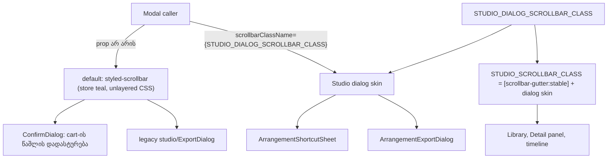

# SABA-B-12 stage 3b: Studio-ს dialog-ები Studio-ს scrollbar-ს იყენებს და არა store-ის teal scrollbar-ს

**თარიღი:** 2026-11-10
**სტატუსი:** In Progress (stage 3b of 4; C round 434 PASS)
**შეცვლილი პროექტი:** Store (საერთო `Modal.tsx`-ის ერთი optional prop, Studio-ს scrollbar constant-ის ფაილი, ორი Studio dialog — თითოში ერთი import და ერთი prop, ერთი ახალი test ფაილი, ეს doc; dialog-ების შინაარსი, geometry, focus და scroll-ის ქცევა უცვლელია)

## კონტექსტი

Saba-მ (SABA-B-12) მოითხოვა, რომ Studio-ში browser-ის default control-ები და ძველი სტილის ელემენტები აღარ ჩანდეს, და scrollbar-ები პირდაპირ დაასახელა. Stage 1-მა Clip details-ის spin button-ები დამალა (doc 278), stage 2a-მ Export dialog-ის radio-ები (doc 279), stage 2b-მ Export-ის progress bar (doc 280), stage 3-მა shortcut sheet-ის search Clear (doc 281). ეს stage Studio-ს dialog-ების scrollbar-ს ეხება.

**HEAD-ის ფაქტები** (`0c22ac9`, B-ის probe რეალურ Chromium 143-ში, ხილული scrollbar-ებით, `tmp/studio-real-loop/b-round-433/probe/head/`, `compare-head.txt`):

- `Modal.tsx` panel-ზე `styled-scrollbar` class hard-coded იყო.
- `app/styles/base/utilities.css` `.styled-scrollbar`-ს **ყოველგვარი `@layer`-ის გარეთ** განსაზღვრავს: teal `scrollbar-color`, `scrollbar-width: thin` და 4 px `::-webkit-scrollbar` წესები. Unlayered CSS Tailwind-ის layered utility-ებს სჯობნის.
- `<Modal>`-ს ოთხი ადგილი რენდერავს: Studio-ს ორი dialog (`ArrangementShortcutSheet.tsx`, `ArrangementExportDialog.tsx`), `ConfirmDialog` (`Modal.tsx`-ის შიგნით) და გაყინული legacy `app/components/studio/ExportDialog.tsx`. Store-ში Modal-ის ერთადერთი მომხმარებელი `/cart`-ის წაშლის დადასტურებაა (`ConfirmDialog` → `Modal`, default skin); მას cart item-ები სჭირდება, ამიტომ cloud-ში (backend-ის გარეშე) ვერ იხსნება — default-ს unit დონეზე DS1 ამოწმებს.
- `?` shortcut sheet ორივე viewport-ზე scroll-დება (1410 px შინაარსი 808 / 646 px-ში). მისი scrollbar **teal** იყო, ძველი ბრენდის ფერი: computed `scrollbar-color` `rgba(18, 217, 200, 0.4)`, `scrollbar-width` `thin`. მარჯვენა 13 px ზოლში probe-მა დაახლოებით 1,750 teal pixel დათვალა; surface-ზე contrast დაახლოებით 2.60:1.
- Export dialog-ს იგივე teal bar 1280×720-ზე ჰქონდა, სადაც scroll-დება (691 px შინაარსი 646-ში). 1440×900-ზე ეტევა და bar-ი არ აქვს.
- Studio-ს ყველა სხვა scroller (Library, Detail panel, timeline) `STUDIO_SCROLLBAR_CLASS`-ს იყენებს: `scrollbar-color` `auto`, 10 px bar-ი და თბილი `bg-dim` thumb.

**B-ის in-page ექსპერიმენტები HEAD-ზე** (`probe/exp-studio-only-classes/`, `probe/exp-studio/`):

1. მხოლოდ Studio-ს class-ების დამატება არაფერს ცვლის: სტანდარტული `scrollbar-color` `::-webkit-scrollbar`-ს სჯობნის.
2. `scrollbar-color: auto`-ს იძულებით დაყენება, როცა `styled-scrollbar` რჩება, **4 px bar-ს უხილავი thumb-ით** იძლევა: unlayered სიგანე იმარჯვებს, Studio thumb-ის `border-2` კი მას მთლიანად ჭამს.

ამიტომ Studio-ს dialog-ებიდან `styled-scrollbar` უნდა **მოიხსნას** და არა override-ით გადაიფაროს.

## მიდგომა

B-ის rulings (D-29z1534; tech-lead-ის verdict `b-round-433/sketch-review.md`-ში — approve-with-lows, Medium არ არის):

1. **Modal-ს optional prop ემატება.** `scrollbarClassName?: string`, default `'styled-scrollbar'`, hard-coded token-ს ცვლის. `ConfirmDialog` და legacy dialog store-ის სახეს byte-for-byte ინარჩუნებს. ყველა caller-ისთვის, რომელიც prop-ს არ გადასცემს, default უცვლელია.
2. **ახალი dialog skin.** `STUDIO_DIALOG_SCROLLBAR_CLASS` არის Studio-ს lane skin `[scrollbar-gutter:stable]`-ის გარეშე. `STUDIO_SCROLLBAR_CLASS` ხდება `'[scrollbar-gutter:stable] ' + STUDIO_DIALOG_SCROLLBAR_CLASS` და HEAD-ის მნიშვნელობის byte-identical რჩება (DS3 ამას ამაგრებს).
   - **რატომ არ არის gutter:** stable gutter scroll-ის გარეშე Export dialog-ს 1440-ზე 10 px-ით დაავიწროებდა. B-მ გაზომა, რომ gutter-ის გარეშე sheet და Export dialog HEAD-ის geometry-ს ინარჩუნებს: search ველი 660 px სიგანისაა, სვეტები x 385/731-ზე (1440) და 305/651-ზე (1280), Export dialog 560 px სიგანისაა, 1440-ზე 558 px client-ით.
3. **ორივე Studio dialog** გადასცემს `scrollbarClassName={STUDIO_DIALOG_SCROLLBAR_CLASS}`.
4. **სახე ემთხვევა Studio-ს სხვა scroller-ებს:** 10 px bar, თბილი `bg-dim` thumb (surface-ზე 5.38:1), hover-ზე `foreground` (14.78:1), teal არ არის. ახალი ფერი ან token არ ემატება.
5. **Firefox-ის შენიშვნა.** Firefox `::-webkit-scrollbar`-ს არ კითხულობს, ამიტომ იქ Studio-ს dialog-ები OS-ის default bar-ს აჩვენებს — ისევე, როგორც დღეს Studio-ს lane-ები (TL-R434-01). ეს შეგნებულია: ნურავინ „გაასწორებს“ მას `scrollbar-color`-ით, რადგან სტანდარტული `scrollbar-color` Chromium-შიც `::-webkit-scrollbar`-ს სჯობნის და Studio-ს skin-ს სტანდარტული bar-ით ჩაანაცვლებს (ექსპერიმენტი 1). Firefox-ის ნახევარი TLM-SABA-B-12-FIREFOX-SAFARI-ში გადადის.
6. **Prop-ის შენიშვნა.** `scrollbarClassName` default skin-ს **ცვლის** და არ ემატება მას (TL-R434-04): prop-ის გადაცემისას `styled-scrollbar` panel-ზე აღარ დგას. Prop ნებისმიერ class-ს იღებს; Studio მხოლოდ `STUDIO_DIALOG_SCROLLBAR_CLASS`-ს გადასცემს. კოდში comment არ ემატება (პროექტის წესი), ეს წესი აქ არის ჩაწერილი.
7. **DS4-ის არე** `app/components/arrangement`-ის top-level `.tsx` ფაილებია (TL-R434-02). ეს იგივე არეა, რაც წინა stage-ების source-scan ტესტებს ჰქონდათ (round 433 ruling 8); დღეს Studio-ს ყველა Modal იქ ცხოვრობს. DS4 ასევე ამოწმებს, რომ legacy dialog default-ს ინარჩუნებს. ეს შეგნებული ფარგლებია და არა finding.

### Reference: Ableton Live 12

| Point | Live 12 source (2026-11-10) | Live | CZABA | C checks |
|---|---|---|---|---|
| Scrollbar-ის სახე scroll-ად panel-ში | reference ვერ მოიძებნა. B-მ წაიკითხა [Working with the Browser](https://www.ableton.com/en/live-manual/12/working-with-the-browser/) და [Arrangement View](https://www.ableton.com/en/live-manual/12/arrangement-view/), სრულ HTML-ში "scroll bar" — 0, "scrollbar" მხოლოდ page script-ებში (`b-round-433/reference-scrollbar.txt`) | — | Studio-ს ყველა სხვა scroller-ის skin (`bg-dim` thumb, hover-ზე `foreground`) | C row 4 |
| ქცევა | ამ round-ში არ იცვლება | — | wheel და drag scroll უცვლელია, მხოლოდ ფერი და სიგანე იცვლება | C row 4 |

ეს CZABA-ს თემის შიგნით ვიზუალური თანმიმდევრულობის გასწორებაა. Deviations: არ არის; მოქმედებს Obsidian & Brass თემა.

### Stage-ების სია

| Stage | შინაარსი | სტატუსი |
|---|---|---|
| 1 | Clip details-ის number spin button-ები (doc 278) | done |
| 2a | Export dialog-ის radio-ები (doc 279) | done |
| 2b | Export dialog-ის progress bar (doc 280) | done |
| 3 | Shortcut sheet-ის search Clear (doc 281) | done |
| 3b | Studio dialog-ების scrollbar (ეს doc) | this round |
| 4 | native `<select>`-ები | REVIEW-RECOMMENDATIONS |

## არქიტექტურა



## შეცვლილი ფაილები

- `app/components/ui/Modal.tsx` — optional `scrollbarClassName` prop (default `'styled-scrollbar'`), რომელიც panel-ის hard-coded token-ს ცვლის.
- `app/components/arrangement/studio-scrollbar.ts` — ახალი `STUDIO_DIALOG_SCROLLBAR_CLASS` (lane skin gutter-ის გარეშე); `STUDIO_SCROLLBAR_CLASS` ახლა gutter + dialog skin და HEAD-ის მნიშვნელობის ტოლია.
- `app/components/arrangement/ArrangementShortcutSheet.tsx` — ერთი import და `scrollbarClassName` prop.
- `app/components/arrangement/ArrangementExportDialog.tsx` — ერთი import და `scrollbarClassName` prop.
- `app/lib/arrangement/__tests__/studio-dialog-scrollbar.test.tsx` (ახალი) — DS1–DS4.
- `docs/implementation/2026/quarter-IV/282-saba-b-12-dialog-scrollbar.md` — ეს doc.

## პრობლემები და გადაწყვეტები

- **პრობლემა:** Studio-ს class-ების დამატება teal-ს ვერ ცვლის, რადგან სტანდარტული `scrollbar-color` `::-webkit-scrollbar`-ს სჯობნის. **გადაწყვეტა:** `styled-scrollbar` Studio-ს dialog-ებიდან საერთოდ იხსნება (prop default-ს ცვლის); DS2 ამოწმებს, რომ token აღარ დგას.
- **პრობლემა:** `scrollbar-color: auto`-ის override-ი, როცა `styled-scrollbar` რჩება, 4 px bar-ს უხილავი thumb-ით იძლევა (unlayered სიგანე + `border-2`). **გადაწყვეტა:** override-ის ნაცვლად მოხსნა (იგივე DS2).
- **პრობლემა:** stable gutter scroll-ის გარეშე Export dialog-ს 1440-ზე 10 px-ით ავიწროებდა. **გადაწყვეტა:** dialog skin gutter-ის გარეშეა; lane skin gutter-ს ინარჩუნებს byte-for-byte (DS3).
- **პრობლემა:** store-ის Modal-ის მომხმარებლები (`ConfirmDialog`, legacy dialog) არ უნდა შეცვლილიყო. **გადაწყვეტა:** default `'styled-scrollbar'` რჩება; DS1 default-ს, DS4 legacy dialog-ს ამოწმებს.
- **პრობლემა:** headless Playwright `--hide-scrollbars`-ს გადასცემს, ამიტომ წინა screen review-ების screenshot-ებზე scrollbar არ ჩანდა. **გადაწყვეტა:** probe `ignoreDefaultArgs: ['--hide-scrollbars']`-ით ეშვება (L61 განახლდა).

## ტესტირება

**Unit (A, round 434):** covering set — 30 ფაილი, 442/442, rc 0; typecheck rc 0; lint rc 0 (205 warning, 1 info, HEAD-ის ტოლი); Biome 5 code/test ფაილზე rc 0 (`Modal.tsx`-ის 5 a11y warning HEAD-იდან მოდის). ახალი row-ები:

- **DS1** — Modal prop-ის გარეშე `styled-scrollbar`-ს ინარჩუნებს.
- **DS2** — Modal Studio dialog skin-ით `styled-scrollbar`-ს აღარ შეიცავს და skin-ის ყველა token-ს ატარებს.
- **DS3** — dialog skin არის lane skin gutter-ის გარეშე; lane skin HEAD-ის ტოლია; dialog skin-ში `scrollbar-gutter`/`scrollbar-color`/`scrollbar-width` არ არის.
- **DS4** — arrangement-ში Modal-ს ზუსტად ორი ფაილი შეიცავს (sheet და Export) და ორივე Studio dialog skin-ს გადასცემს; legacy dialog default-ს ინარჩუნებს; tag scanner-ის self-check.

**Mutants** (`tmp/studio-real-loop/b-round-433/mutants/summary.txt`, ზუსტი ასლი):

```
M1-modal-ignores-prop red: DS2 | Tests  1 failed | 3 passed
M2-sheet-no-prop red: DS4 | Tests  1 failed | 3 passed
M3-export-no-prop red: DS4 | Tests  1 failed | 3 passed
M4-styled-kept-plus-skin red: DS2 | Tests  1 failed | 3 passed
M5-dialog-skin-keeps-gutter red: DS3 | Tests  1 failed | 3 passed
M6-lane-skin-loses-gutter red: DS3 | Tests  1 failed | 3 passed
M7-store-default-changed red: DS1 | Tests  1 failed | 3 passed
M8-legacy-opts-in red: DS4 | Tests  1 failed | 3 passed
sketch-green red: none | Tests  4 passed
```

**Browser** (B-ის probe რეალურ Chromium-ში, `ignoreDefaultArgs: ['--hide-scrollbars']`-ით; `b-round-433/probe/compare.txt` sketch-ზე და `compare-head.txt` HEAD-ზე):

| Check | HEAD 1440×900 | HEAD 1280×720 | Sketch 1440×900 | Sketch 1280×720 |
|---|---|---|---|---|
| page errors | 0 | 0 | 0 | 0 |
| Library-ის reference bar | auto / auto, 10 px | auto / auto, 10 px | auto / auto, 10 px | auto / auto, 10 px |
| sheet scroll-დება (scroll / client) | 1410 / 808 | 1410 / 646 | 1410 / 808 | 1410 / 646 |
| sheet `scrollbar-color` / `scrollbar-width` | teal 0.4 / thin (FAIL) | teal 0.4 / thin (FAIL) | auto / auto | auto / auto |
| sheet-ზე `styled-scrollbar` class | კი (FAIL) | კი (FAIL) | არა | არა |
| sheet bar-ის სიგანე | 10 | 10 | 10 | 10 |
| sheet gutter | auto | auto | auto | auto |
| teal pixel-ები მარჯვენა 13 px ზოლში | 1766 (FAIL) | 1718 (FAIL) | 0 | 0 |
| თბილი thumb pixel-ები | 0 (FAIL) | 0 (FAIL) | 1798 | 1738 |
| thumb hover-ზე ნათდება (bright pixel-ები) | 0 → 0 (FAIL) | 0 → 0 (FAIL) | 0 → 1796 | 0 → 1732 |
| search ველის სიგანე | 660 | 660 | 660 | 660 |
| სვეტების x | 385 / 731 | 305 / 651 | 385 / 731 | 305 / 651 |
| Export `scrollbar-color` | teal 0.4 (FAIL) | teal 0.4 (FAIL) | auto | auto |
| Export სიგანე / gutter | 560 / auto | 560 / auto | 560 / auto | 560 / auto |
| Export focus dialog-ში | კი | კი | კი | კი |
| Export scroll / bar / client | არა / 0 / 558 | კი / 10 / 548 | არა / 0 / 558 | კი / 10 / 548 |
| Export teal / თბილი thumb (1280) | — | 1756 / 0 (FAIL) | — | 0 / 1798 |
| შედეგი | NOT ALL OK | | ALL OK (2 cells) | |

**Contrast** (`b-round-433/probe/contrast.txt`):

- thumb `dim` #928a7d surface #161412-ზე — 5.38:1 (WCAG 1.4.11 ≥ 3:1);
- hover-ზე thumb `foreground` #ece6da surface-ზე — 14.78:1;
- HEAD-ის teal 0.4 surface-ზე (დაახლოებით rgb(20,99,93)) — 2.60:1, ზღვარს ქვემოთ.

**C round 434:** mutant-ები HEAD + sketch-ზე, იგივე scrollbar probe A-ს tree-ზე ორ viewport-ზე ხილული scrollbar-ებით, round 433-ის search Clear-ის მეზობელი probe და auth row (C-ის ანგარიში round 434-ის loop folder-ში).

## TODO / შემდეგი ნაბიჯები

- **TLM-SABA-B-12-FIREFOX-SAFARI (Tech Lead row, არა C-ის):** Firefox-ში Studio-ს dialog-ები (shortcut sheet, Export 1280×720-ზე) OS-ის default scrollbar-ს აჩვენებს (`::-webkit-scrollbar` არ მოქმედებს), Studio-ს lane-ების მსგავსად; Safari-მ Studio-ს thumb უნდა აჩვენოს. Cloud runner-ზე მხოლოდ Chromium არის. Deadline: RETRO 435 (L46) — შეუმოწმებელი row-ები Saba-სთან ერთ კითხვად გადადის.
- **ARCH checkpoint (ROOT-REQ-ARCH-CHECKPOINT-STUDIO-CONTROLS, `tmp/studio-real-loop/b-round-433-checkpoint-request.md`):** `studio-*.ts` class-constant მოდულები, source-scan ტესტების საერთო tag scanner, search ველის საერთო component და კითხვა — საკმარისია თუ არა `Modal.tsx`-ის `scrollbarClassName`, თუ საჭიროა ცალკე `StudioDialog` wrapper. დამბლოკავი არ არის.
- **Stage 4:** native `<select>`-ები (REVIEW-RECOMMENDATIONS).
