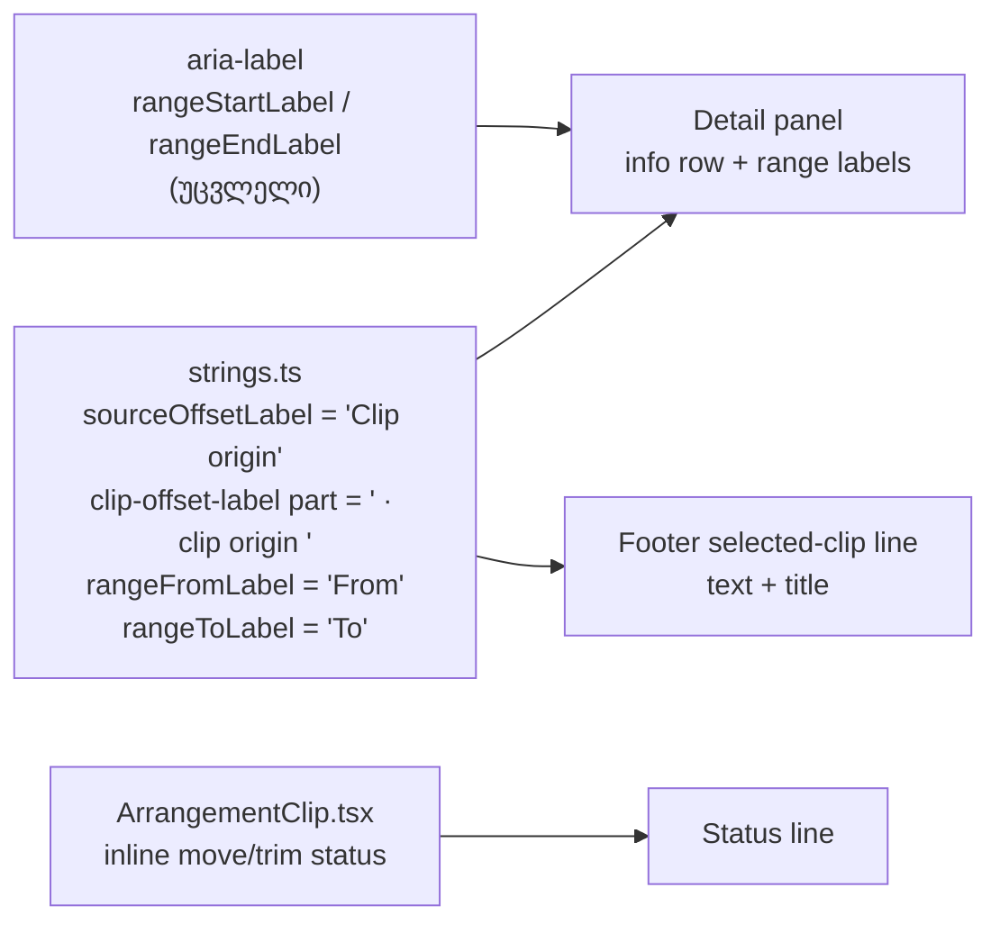

# COPY-PD-VIS stage 1: „Clip origin“ ნაცვლად „Source offset“-ისა და range ველებზე „From“ / „To“

**თარიღი:** 2026-11-10
**სტატუსი:** Completed (C round 436 PASS)
**შეცვლილი პროექტი:** Store (Studio-ს strings ფაილი, ერთი inline status literal `ArrangementClip.tsx`-ში, 8 test ფაილის assertion literal-ები, ეს doc; layout, ქცევა და accessible name-ები უცვლელია)

## კონტექსტი

product-designer-ის Studio-ს ვიზუალურმა აუდიტმა (`studio-visual-audit-2026-11-10.md`) ორი Medium იპოვა, რომლებიც Saba-მ დაამტკიცა:

- **STUDIO-VIS-4.** Clip details-ის info row-ზე ეწერა „Source offset“. Saba-ს პასუხი 1: ახალი სახელია „Clip origin“.
- **STUDIO-VIS-6.** Time selection-ის ველების ხილული label-ები „From, s“ / „To, s“ იყო. ახალი ტექსტია „From“ / „To“.

RETRO 435-ის screen review-მ (SR-435-2) იგივე სიტყვა footer-ის selected-clip ხაზზეც იპოვა. B-ის sweep-მა მესამე ადგილიც აჩვენა: clip-ის move/trim status. HEAD-ზე (`8233840`) „source offset“ ოთხ მდგომარეობაში (ცარიელი, მონიშნული, move-ის და trim-ის შემდეგ) თითო viewport-ზე 11-ჯერ ჩანდა DOM-ის ტექსტსა და `title`-ებში (`b-round-435/probe/head/copy-probe.json`).

## მიდგომა

B-ის rulings (D-29z1545, D-29z1547; tech-lead-ის verdict `b-round-435/sketch-review.md`-ში approve-with-lows იყო):

1. **ერთი სიტყვა ყველგან.** Detail-ის label, footer-ის ნაწილი (ტექსტი და `title`) და move/trim status ამბობს „clip origin“-ს; label-ად „Clip origin“ იწერება. „source offset“ ხილული და assistive DOM-იდან სრულად ქრება. შიდა იდენტიფიკატორები (`sourceOffset`, `sourceOffsetLabel`, `clip-offset-label`) არ იცვლება, რადგან rename diff-ს გაზრდიდა და მომხმარებლისთვის არაფერს ცვლის.
2. **Status inline რჩება** `ArrangementClip.tsx`-ში, რომ diff მინიმალური იყოს. მისი `strings.ts`-ში გადატანა TL-R436-02-INLINE-STATUS-ია (deferred Low).
3. **Range input-ების accessible name არ იცვლება.** `aria-label` („Time selection start (seconds)“ / „Time selection end (seconds)“) ინარჩუნებს ერთეულს assistive tech-ისთვის. Label-in-name (WCAG 2.5.3) HEAD-ზეც დარღვეული იყო; ეს TL-R436-03-LABEL-IN-NAME-ია (deferred Low).
4. **Layout უცვლელია.** Label-ების, input-ების და info row-ის box-ები HEAD-ს უდრის ორივე viewport-ზე; footer-ის ხაზს overflow არ აქვს.
5. **Test-ების სათაურები**, რომლებიც შიდა ცნებას ასახელებს (მაგ. LSU6-ის „source offset“), რჩება. იცვლება მხოლოდ assertion literal-ები, და არცერთი assertion არ იშლება.

### Reference: Ableton Live 12

- Live 12 manual §8.2.1 „Clip and Loop Region Settings“: Clip View-ს start/end position ველები და „Set Start“ / „Set End“ ღილაკები აქვს. **Deviation (Saba-მ დაამტკიცა):** CZABA ამბობს „Clip origin“-ს, რადგან „Start“ უკვე timeline-ის პოზიციას ნიშნავს.
- იგივე სექცია: unwarped audio-ს ველი წთ-წმ-მწმ-ს აჩვენებს. **Deviation:** ხილული label-ები ერთეულს აღარ წერს. ეს Saba-სთან Q4 / SR-435-1-ის სახით ჯერ კიდევ ღიაა.

## არქიტექტურა

## შეცვლილი ფაილები

- `app/lib/arrangement/strings.ts`: ოთხი literal („Clip origin“, „ · clip origin “, „From“, „To“).
- `app/components/arrangement/ArrangementClip.tsx`: move/trim status-ის literal „source offset“ ხდება „clip origin“.
- Test-ები (მხოლოდ assertion literal-ები, 24 ხაზი): `strings.test.ts`, `detail-panel-polish.test.tsx`, `detail-panel-strings-ui.test.tsx`, `lane-strings-ui.test.tsx`, `workspace-strings-ui.test.tsx`, `track-layout.test.tsx`, `grid-snap-clip-edges.test.tsx`, `clip-fades-ui.test.tsx`.
- `docs/implementation/2026/quarter-IV/283-studio-vis-4-6-detail-copy.md`: ეს doc.

## პრობლემები და გადაწყვეტები

- **Problem:** სიტყვა სამ ადგილას იყო, და ერთის გამოტოვება ძველ სიტყვას UI-ში დატოვებდა. **Solution:** B-ის UI sweep-მა (`app`, `perf`, `e2e`, `__tests__`-ის გარეშე) ცვლილების შემდეგ „source offset“ 0-ჯერ იპოვა, „clip origin“ კი 3-ჯერ.
- **Problem:** label-იდან ერთეულის მოხსნა screen reader-ს „seconds“-ს დაუკარგავდა. **Solution:** `aria-label`-ები უცვლელი რჩება და ერთეულს ინარჩუნებს (ruling 3).

## ტესტირება

- Covering ფაილები (`b-round-435/covering-files.txt`, 8 ფაილი): `npx vitest run` — 8 ფაილი, 208/208, rc 0. ცვლილებას ეს row-ები ამაგრებს:
  - `strings.test.ts`: ST31, ST41, ST-TP1, ST-TP2;
  - `detail-panel-strings-ui.test.tsx`: DPS2;
  - `detail-panel-polish.test.tsx`: „labels the single clip info and the range inputs in English and keeps the aria-labels“ და „labels the group info and the range inputs in English and keeps the aria-labels“;
  - `lane-strings-ui.test.tsx`: LSU6;
  - `workspace-strings-ui.test.tsx`: WSU2, WSU4;
  - `track-layout.test.tsx`: „reserves the selected-clip row with an aria-hidden placeholder…“;
  - `grid-snap-clip-edges.test.tsx`: CM1, CT1, CT6, CM12, CM14;
  - `clip-fades-ui.test.tsx`: FU5.
- `npm run typecheck`: rc 0. `npm run lint`: rc 0, 205 warnings (HEAD-ის ტოლი).
- B-ის mutant-ები M1–M5 sketch-ზე წითელია (`b-round-435/mutants/summary.txt`).
- Browser-ის მიღებას (Clip origin, From/To, ძველი სიტყვის არარსებობა, box-ები, screen budget) C ამოწმებს round 436-ში.

## TODO / შემდეგი ნაბიჯები

- COPY-PD-VIS stage 2 (round 437): STUDIO-VIS-7, STUDIO-VIS-10, SABA-LANE-RESIZE-HANDLE.
- Deferred Lows: TL-R436-02-INLINE-STATUS, TL-R436-03-LABEL-IN-NAME.
- Q4 / SR-435-1 (ერთეული label-ში) Saba-ს პასუხს ელოდება.
