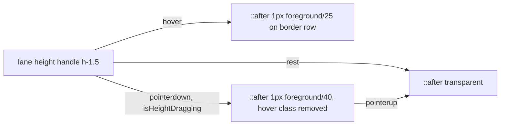

# COPY-PD-VIS stage 2: შევსებული brass Export ღილაკი, foreground CZABA exit link და 1 px ხაზი ხაზებს შორის

**თარიღი:** 2026-11-10
**სტატუსი:** Completed (C round 437 PASS)
**შეცვლილი პროექტი:** Store (Studio-ს ხუთი კომპონენტი `app/components/arrangement/`-ში, შვიდი test ფაილის assertion-ები და ეს doc. Layout, element box-ები და ქცევა უცვლელია. გამონაკლისია lane-ის border row, რომელიც ახლა resize handle-ს ეკუთვნის)

## კონტექსტი

ორი Low (STUDIO-VIS-7, STUDIO-VIS-10) product-designer-ის ვიზუალური აუდიტიდან (`studio-visual-audit-2026-11-10.md`) მოდის და Saba-მ დაამტკიცა. მესამე (SABA-LANE-RESIZE-HANDLE) Saba-ს საკუთარი 2026-11-10-ის შენიშვნაა. სამივე ახლა სწორდება და `deferred_low_polish`-ში არ გადადის:

- **STUDIO-VIS-7.** Export dialog-ის მთავარი ღილაკი outline იყო: brass border, 5 %-იანი foreground fill და brass ტექსტი. Saba-ს პასუხი 3 იყო „filled brass“.
- **STUDIO-VIS-10.** Header-ში exit link „← CZABA“ `text-muted` ფერით იყო და მეორეხარისხოვნად იკითხებოდა. Saba-ს პასუხი 4 იყო `text-foreground`.
- **SABA-LANE-RESIZE-HANDLE.** ხაზებს შორის height handle-ზე hover-ისას 6 px სიმაღლის ზოლი იღებებოდა `foreground/50`-ით. Saba-ს სიტყვებით: „the grey hover line between lanes is too thick“.

## მიდგომა

- **Export (STUDIO-VIS-7).**
  - Rest მდგომარეობაში ღილაკი `bg-brand text-brand-foreground`-ია. `border border-transparent` სიმაღლეს Done/Cancel-ის ტოლს ტოვებს. B-ის browser probe-მ (`b-round-436/probe`) box 113×38 გაზომა, HEAD-ის ტოლი.
  - Hover არის `enabled:hover:bg-brand-hover`. Pressed (`enabled:active:bg-brand`) base ფერზე ბრუნდება.
  - Disabled მდგომარეობა (ცარიელი პროექტი ან decoding) კვლავ `disabled:opacity-40`-ია.
  - Rendering-ის დროს ღილაკი იღებს `aria-busy` და `opacity-70`-ს, `disabled:opacity-40`-ის ნაცვლად. ასე „Rendering…“ იკითხებადი რჩება. Element ruling: „busy label readable“ სჯობს „disabled opacity-40“-ს.
- **Exit link (STUDIO-VIS-10).**
  - Link არის `group … text-foreground`. ArrowLeft ისარი `text-muted group-hover:text-foreground`-ია, underline არ არის.
  - Narrow screen-ის (`StudioNarrowScreen.tsx`) link ზუსტად იგივეს იღებს.
  - Element ruling: hover-ზე ისარი ნათდება, რადგან სიტყვა უკვე foreground-ია.
- **Lane hairline (SABA-LANE-RESIZE-HANDLE).**
  - Handle ინარჩუნებს `h-1.5` hit box-სა და inset focus ring-ს. იღებება მხოლოდ 1 px `::after` (`after:-bottom-px`), რომელიც lane-ის საკუთარ border row-ზე ჯდება.
  - Hover: `hover:after:bg-foreground/25`. Drag-ის დროს: `after:bg-foreground/40`. Folded branch უცვლელია.
  - Border row ახლა handle-ის ნაწილია: მასზე დაჭერა handle-ს იჭერს. HEAD-ზე იქ lane container-ს ხვდებოდა და არაფერი მოძრაობდა. Element ruling: „the line you see is the line you grab“.
- **Approach-ის ოთხი შენიშვნა:**
  - **(a) doc 144-ის override (TL-R437-02).** Doc 144 (`144-studio-dux-r5b1-affordance-colour.md`) ამ separator-ების hover paint-ისთვის ≥ 3:1 contrast-ს მოითხოვდა. Saba-ს მოთხოვნა („თხელი ხაზი“) lane-ისა და Detail separator-ის hover-ზე ამ წესს აუქმებს. Paint მხოლოდ hover-ზე ჩანს; keyboard focus ring უცვლელია და კვლავ ≥ 3:1-ია. Clip trim edge, loop brace edge და Library edge `hover:bg-foreground/50`-ზე რჩება: Saba-მ მხოლოდ ხაზებს შორის ხაზი დაასახელა.
  - **(b) Detail-ის ორრიგიანი წაკითხვა (TL-R437-01, მიღებული).** Detail separator იმავე წესს მიჰყვება `after:top-0`-ით. Panel-ს აქვს `overflow-hidden`, რომელიც `-top-px`-ს მოჭრიდა. ამიტომ hover-ზე ხაზი ჩანს როგორც ღია row, მუქი border row-ის პირდაპირ ქვეშ. Box და overflow უცვლელია; Saba-ს ამის შესახებ ეცნობა (`user-review/note-round-437-detail-separator.md`).
  - **(c) რატომ არ არის busy cursor (B-R437-BUTTON-CURSOR-UNLAYERED).** `app/styles/app.css` შეიცავს unlayered `button { cursor: pointer }` წესს. ის Tailwind-ის layered cursor utility-ებს ღილაკებზე ჯაბნის, ამიტომ `cursor-wait` ან `cursor-progress` არ იმოქმედებდა. HEAD-ის `disabled:cursor-not-allowed`-იც `pointer`-ად ითვლება. ეს წინარე Low-ია და deferred-ად რჩება.
  - **(d) Drag-ის hover swap.** B-ის browser probe-მ drag-ის დროს `/25` წაიკითხა და არა `/40` (B-R437-DRAG-HOVER-WINS). Drag-ის განმავლობაში handle `:hover`-ს ინარჩუნებს, ამიტომ `hover:after:bg-foreground/25` `after:bg-foreground/40`-ს ჯაბნიდა. Height handle `setPointerCapture`-ს არ იძახებს; drag window-level listener-ებითა და `claimPointerGesture`-ით მუშაობს. სავარაუდოდ handle pointer-ს მიჰყვება, რადგან lane-ის ქვედა კიდე drag-ს მიჰყვება. ეს მექანიზმი დასკვნაა და ცალკე არ გაზომილა. ამიტომ drag-ისას hover class-ი class list-იდან ამოდის და მხოლოდ drag-ის class რჩება. Release-ის შემდეგ hover class-ი ბრუნდება.

## არქიტექტურა

## შეცვლილი ფაილები

- `app/components/arrangement/ArrangementExportDialog.tsx`: filled brass Export, `aria-busy` და busy-ზე `opacity-70`.
- `app/components/arrangement/StudioWorkspace.tsx`: header exit link foreground, muted ისარი.
- `app/components/arrangement/StudioNarrowScreen.tsx`: narrow exit link, იგივე წესი.
- `app/components/arrangement/ArrangementLane.tsx`: 1 px `::after` hairline და drag-ის hover swap.
- `app/components/arrangement/ArrangementDetailPanel.tsx`: Detail separator-ის 1 px `::after` hairline.
- Tests: `affordance-colour-ui.test.tsx`, `export-dialog-hold-enter.test.tsx`, `label-status-colour-ui.test.tsx`, `mixer-onstate-colour-ui.test.tsx`, `panel-radius-ui.test.tsx`, `studio-narrow-gate-ui.test.tsx`, `track-layout.test.tsx`.
- ეს doc.

## პრობლემები და გადაწყვეტები

- **პრობლემა:** drag-ის დროს hover ფერი ჯაბნიდა drag-ის ფერს, რადგან handle drag-ის დროს `:hover`-ს ინარჩუნებს. **გადაწყვეტა:** `isHeightDragging`-ისას hover class-ი ამოდის (შენიშვნა (d)).
- **პრობლემა:** busy label „Rendering…“ იკითხებადი უნდა დარჩეს, `disabled:opacity-40` კი მას disabled ღილაკივით ამქრალებდა. **გადაწყვეტა:** busy-ზე `opacity-70` და `aria-busy`; disabled opacity მხოლოდ ცარიელ პროექტსა და decoding-ზე რჩება.
- **პრობლემა:** busy cursor ღილაკზე ვერ მუშაობს unlayered CSS წესის გამო. **გადაწყვეტა:** busy cursor არ ემატება; წესი ცალკე deferred Low-ად რჩება (შენიშვნა (c)).

## ტესტირება

- Assertion-ები გადაიწერა ახალ კონტრაქტზე და ძველ შემოწმებებს ინარჩუნებს ან აძლიერებს:
  - `affordance-colour-ui.test.tsx`: **DXA5**. Hover-ზე 1 px `foreground/25` hairline, drag-ის დროს `foreground/40` hover class-ის გარეშე; release-ის შემდეგ hover class-ი ბრუნდება.
  - `export-dialog-hold-enter.test.tsx`: **ESU1**. Filled brass, brand-hover; busy block-ში `aria-busy` true, `opacity-70` და `disabled:opacity-40`-ის არარსებობა.
  - `label-status-colour-ui.test.tsx`: **DXL3**. Foreground სიტყვა, muted ისარი, `group-hover:text-foreground`.
  - `mixer-onstate-colour-ui.test.tsx`: **DXM5**. Detail separator-ის 1 px hairline და inset focus ring.
  - `studio-narrow-gate-ui.test.tsx`: ახალი **NG1b**. Narrow exit link header-ის link-ს ემთხვევა.
  - `panel-radius-ui.test.tsx` და `track-layout.test.tsx`: განახლებული class literal-ები; folded handle-ზე hover class-ის არარსებობის ახალი assertion.
- A-ს გაშვებები (round 437):
  - covering set: 8 ფაილი, 106/106, rc 0;
  - `npm run typecheck`: rc 0;
  - `npm run lint`: rc 0, 205 warning (sketch-ის ტოლი);
  - Biome შეცვლილ 12 ფაილზე: rc 0.
- Browser შემოწმება (export states, exit link, hairline-ის pixel column, press probe და რეალური WAV export) C-ის round 437-ს ეკუთვნის. სრული suite და verify gate-ის row-ებია.

## TODO / შემდეგი ნაბიჯები

- B-R437-BUTTON-CURSOR-UNLAYERED: unlayered `button { cursor: pointer }` წესის `@layer base`-ში გადატანა (deferred Low).
- TL-R437-01: Detail separator-ის ორრიგიანი hover წაკითხვა მიღებულია. Saba-ს საწინააღმდეგო პასუხის შემთხვევაში Detail separator ძველ სახეს უბრუნდება.
- Detail separator-ს drag-ის ცალკე მდგომარეობა არ აქვს (არც HEAD-ზე ჰქონდა): drag-ის დროს მოსალოდნელია hover-ის `/25` (არ გაზომილა; C6 წაიკითხავს). Lane-ის `/40`-თან გათანაბრება B-ის გადასაწყვეტია (round 437-ის code review).
- Clip trim edge, loop brace edge და Library edge ჯერ კიდევ `hover:bg-foreground/50`-ზეა. ცვლილება მხოლოდ Saba-ს თხოვნით.
