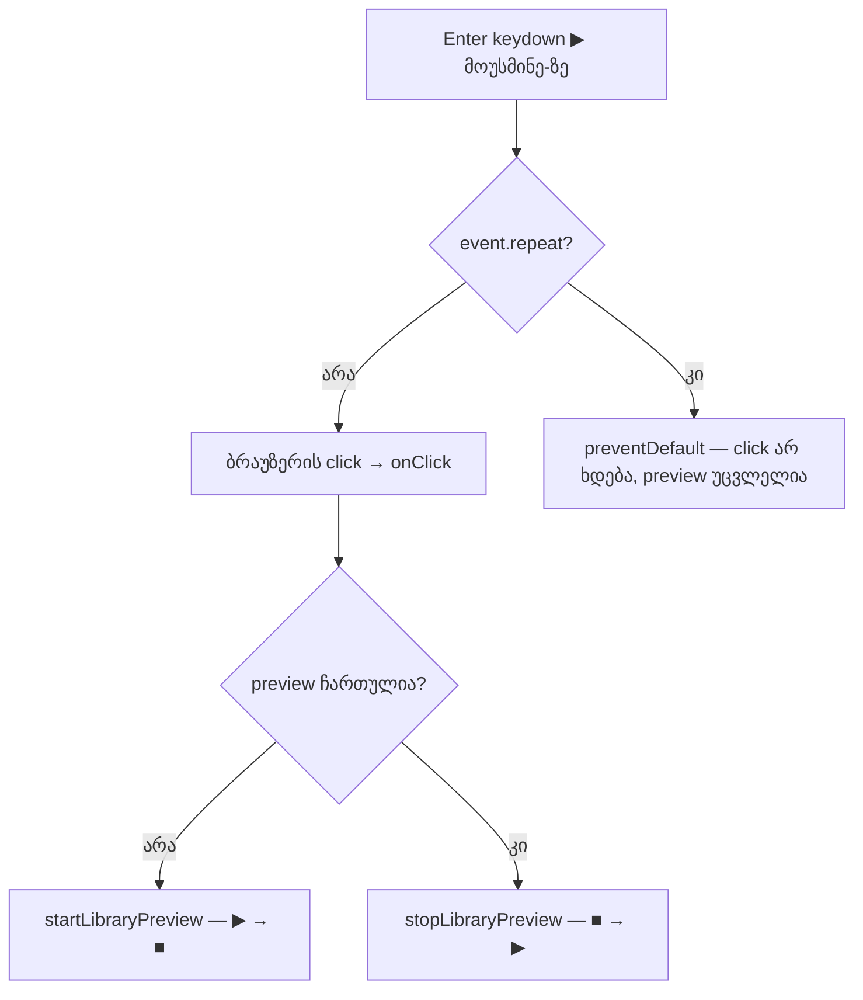

# Studio — დაჭერილი Enter ▶ მოუსმინე-ზე preview-ს მხოლოდ ერთხელ რთავს ან თიშავს

**თარიღი:** 2026-10-23
**სტატუსი:** Round 100 — C-ის შემოწმებას ელოდება (D-29z65)
**შეცვლილი პროექტი:** Store

## კონტექსტი

ბიბლიოთეკის preview panel-ზე ▶ მოუსმინე ღილაკი არჩეული ხმის preview-ს რთავს, ხოლო ■ შეჩერება თიშავს. Doc 087-მა ＋ დამატება-ს, ბიბლიოთეკის რიგსა და გლობალურ Enter-ს დაჭერილი Enter-ის guard დაუმატა. იქვე ▶ მოუსმინე-ზე ანალოგიური ქცევა შეუმოწმებელ ჰიპოთეზად დარჩა (`B-R98-H1-PREVIEW-TOGGLE-HOLD`).

B-მ ეს ბაგი რეალურ Chromium-ში გაიმეორა (`/studio-lab`, 1280×720, focus ▶ მოუსმინე-ზე, `keyboard.down('Enter')` სამჯერ 50 ms ინტერვალით). სამმა keydown-მა (`repeat` false/true/true) ღილაკზე **სამი click** გამოიწვია. ტექსტი ასე შეიცვალა: ▶ მოუსმინე → ■ შეჩერება → ▶ მოუსმინე → ■ შეჩერება. ანუ preview ჩაირთო, გამოირთო და ისევ ჩაირთო. ღილაკს `onKeyDown` არ ჰქონდა, ამიტომ Chromium ყოველ Enter keydown-ს, განმეორებითსაც, click-ად აქცევდა.

A-მ რედაქტირებამდე იგივე probe ოთხი keydown-ით გაუშვა. ოთხმა keydown-მა ოთხი click გამოიწვია და preview **გამორთული** დარჩა (▶ მოუსმინე). სამი keydown-ით საბოლოო ტექსტი ■ იქნებოდა fix-ითაც და მის გარეშეც, ამიტომ ოთხი keydown შედეგს არჩევს.

ეს დოკუმენტი ხურავს doc 087-ის ჰიპოთეზას `B-R98-H1-PREVIEW-TOGGLE-HOLD`.

## მიდგომა

- **ერთი დაჭერა = ერთი გადართვა.** ეს SRW-12 R12-L2-ისა და round 99-ის წესია. Waveform-ის საკუთარი handler განმეორებებს უკვე უგულებელყოფს.
- ▶ მოუსმინე ღილაკს დაემატა inline `onKeyDown`, ზუსტად ＋ დამატება-ს წესით: თუ კლავიში Enter-ია და `event.repeat` ჭეშმარიტია, იძახება `preventDefault()`. ბრაუზერი ასეთ keydown-ზე click-ს აღარ აგზავნის.
- პირველი Enter (`repeat=false`), სხვა კლავიშები და mouse click უცვლელია. `stopPropagation` არ იძახება. `onClick`, `disabled`, კლასები, `data-testid` და ორივე ტექსტი იგივეა.
- დაჭერილი Enter preview-ს მხოლოდ ერთხელ გადართავს: გამორთულ preview-ს რთავს და ჩართული რჩება, ჩართულს თიშავს და გამორთული რჩება. განმეორებები მას აღარ ცვლის.
- Space ამ რაუნდში არ იცვლება. Workspace-ში გლობალური Space transport-ის shortcut-ია (D-29z64 R2, C-R98-B1). Focus-ირებულ ▶ ღილაკზე Space-ის ქცევა არავის დაუკვირვებია და მასზე მტკიცება არ კეთდება.
- **უარყოფილი ალტერნატივები:**
  - guard `startLibraryPreview` / `stopLibraryPreview`-ში: შეცვლიდა გაყინულ `ArrangementContext.tsx`-ს, და context ვერ არჩევს კლავიშის განმეორებას mouse click-ისგან;
  - დროის ფანჯარა ან debounce: შეგნებულ სწრაფ მეორე დაჭერასაც დაბლოკავდა;
  - საერთო helper ექვსივე ადგილისთვის: გაყინულ ფაილებს შეეხებოდა და root-ის არქიტექტურულ checkpoint-ს საჭიროებს (`ARCH-R97-EXPORT-FOOTER-KEYBOARD`);
  - `stopPropagation`: სხვა listener-ებმა keydown უნდა მიიღონ.
- **held-Enter fix-ების სერიაში (doc 085–088) განმეორებითი Enter-ის guard ახლა ექვს ადგილას დგას** (ექსპორტის dialog, toolbar-ის Export, ბიბლიოთეკის რიგი, გლობალური Enter, ＋ დამატება და ▶ მოუსმინე). Waveform-სა და ზოგ მენიუს განმეორების საკუთარი, ადრინდელი ფილტრი აქვს. საერთო helper root-ის არქიტექტურულ checkpoint-ს ელოდება და ამ რაუნდში არ კეთდება.
- **ცნობილი საზღვარი (doc 085-ის იგივე).** ზოგი გარემო (მაგალითად remote desktop/VNC, ზოგი X11 კონფიგურაცია, soft keyboard) auto-repeat-ს `repeat=false`-ით აგზავნის. ასეთ keydown-ს guard ახალი დაჭერისგან ვერ არჩევს და იქ თითო განმეორება ისევ preview-ს გადართავს. ეს შეგნებული საზღვარია და არა რეგრესია.

## არქიტექტურა

## შეცვლილი ფაილები

- `app/components/arrangement/ArrangementLibraryPreview.tsx` — ▶ მოუსმინე ღილაკის `onKeyDown` guard.
- `app/lib/arrangement/__tests__/library-preview.test.tsx` — ბოლოში დამატებული ტესტები HT1–HT3 (არსებული ხაზები უცვლელია).
- `docs/implementation/2026/quarter-IV/087-studio-held-enter-single-add.md` — სტატუსის ხაზი (C PASS, round 99, გამოქვეყნდა e2412db).
- `docs/implementation/2026/quarter-IV/088-studio-preview-toggle-hold-enter.md` — ეს დოკუმენტი.

## პრობლემები და გადაწყვეტები

- **პრობლემა:** HT3-ის პირველ ვერსიაში propagation-ის შემოწმებას `defaultPrevented`-ისა და `fireEvent.keyDown`-ის დაბრუნებული მნიშვნელობის შემოწმებაც ჰქონდა. ამიტომ baseline-ზე წითელი იყო, B-ის მოლოდინის საწინააღმდეგოდ. **გადაწყვეტა:** HT3 მხოლოდ იმას ამოწმებს, რომ განმეორებითი `q` არ ჩერდება და `document`-ის bubble-phase listener-ი განმეორებით Enter-ს იღებს. `preventDefault`-ს HT1 ფარავს (doc 086-ის TH4-ისა და doc 087-ის HA6-ის იგივე გადაწყვეტა).
- **პრობლემა:** jsdom keydown-ს click-ად არ აქცევს, ამიტომ jsdom-ში preview keydown-ით ვერც ბაგამდე გადაირთვება. **გადაწყვეტა:** HT1-ის მთავარი შემოწმება `fireEvent.keyDown`-ის დაბრუნებული მნიშვნელობაა. Click-ის რეალური შეჩერება ბრაუზერში მოწმდება (C row HOLD-TOGGLE).

## ტესტირება

- **Fail-before** (გაფართოებული ტესტი baseline-ის snapshot-ზე, scratch-ში): წითელია მხოლოდ HT1. HT2, HT3 და ოთხი არსებული ტესტი მწვანეა. ეს B-ის მოლოდინს ემთხვევა.
- **Mutations** (scratch-ში): guard-ის მოხსნა → HT1; guard `key`-ის შემოწმების გარეშე → HT3; `stopPropagation` guard-ში → HT3; guard განმეორებით Space-საც აჩერებს → HT3 (code review-ის Low #1-ის შემდეგ HT3-ს Space-ის lock დაემატა); guard ყველა Enter-ზე → HT1, HT2. Mutation-ის გარეშე 7/7 მწვანეა.
- `npm run typecheck`, `npm run lint`, Biome კომპონენტსა და ტესტზე, და დაკავშირებული ტესტები (`a-round-100/targeted-list.txt`) — შედეგები A-ს ანგარიშშია.
- **ბრაუზერი (A, მხოლოდ Chromium, B-ის probe-ის ასლი ოთხი keydown-ით):** რედაქტირებამდე ოთხი click იყო და preview გამორთული დარჩა. რედაქტირების შემდეგ იყო ერთი click, ტექსტი ერთხელ შეიცვალა (▶ → ■) და 1.2 წამის შემდეგაც ■ შეჩერება ჩანდა. ერთმა `press('Enter')`-მა ორივე ვერსიაზე ერთი click გამოიწვია. აუდიოს RMS-ის გაზომვა და სრული მიღება C-ის საქმეა.

## TODO / შემდეგი ნაბიჯები

- C round 100: HOLD-TOGGLE, FRESH-TOGGLE, WAVE-REG, HOLD-PLUS-REG, HOLD-ROW-REG, EXPORT-REG და დანარჩენი რიგები.
- განმეორებითი Enter-ის საერთო helper — root-ის არქიტექტურული checkpoint-ის შემდეგ.
- ექსპორტის dialog-ის footer-ის Low-ები (GATE89-S4, A-R88 #4, GATE97-S4, GATE89-S6).
- არა-Chromium ბრაუზერში შემოწმება, როცა ასეთი გარემო ხელმისაწვდომი იქნება.
