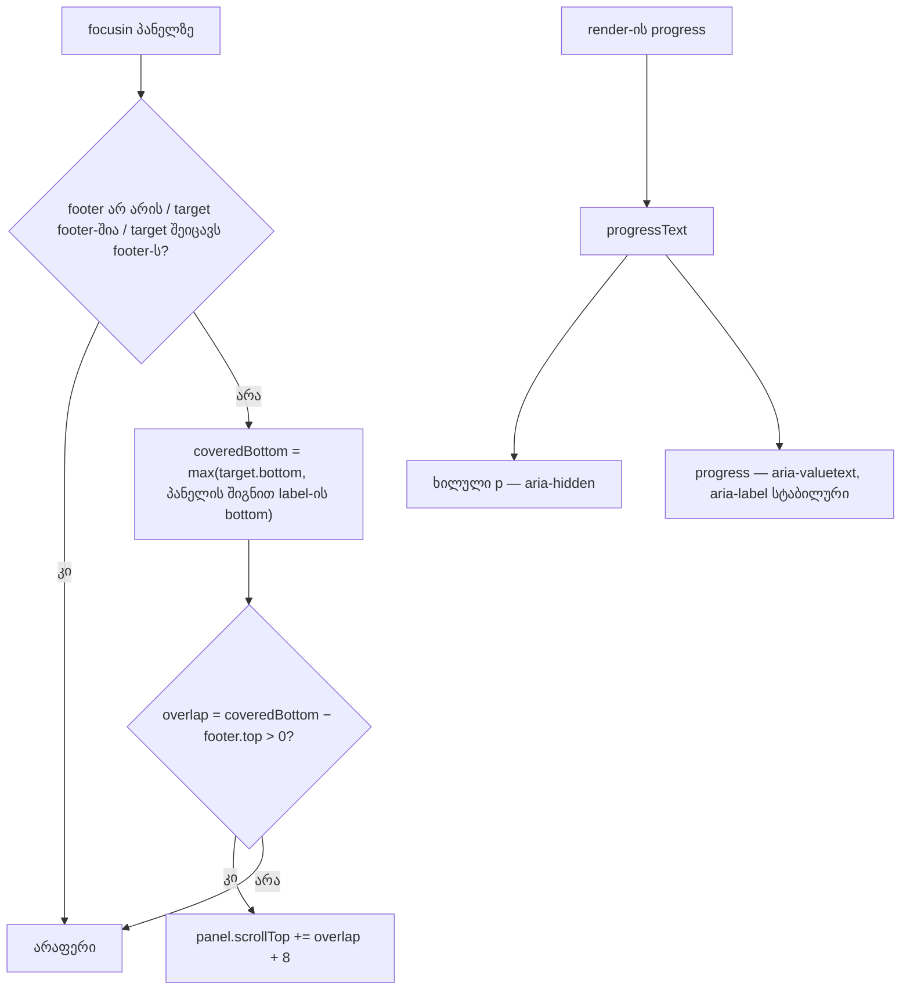

# Studio — ექსპორტის dialog-ის focus guard მთელ ბარათს ზომავს, პროგრესის ტექსტი კი ერთხელ იკითხება

**თარიღი:** 2026-10-23
**სტატუსი:** Round 102 — C-ის შემოწმებას ელოდება (D-29z67)
**შეცვლილი პროექტი:** Store

## კონტექსტი

ექსპორტის dialog-ის sticky footer-ს (doc 083, D-29z53) აქვს focusin guard: თუ ფოკუსირებული კონტროლი footer-ის ქვეშ ექცევა, პანელი გადადის `overlap + 8` px-ით. Guard მხოლოდ ფოკუსირებულ ელემენტს ზომავდა. Radio-სთვის ეს 13 px-იანი წრეა, ხილული ვარიანტი კი მისი `<label>` ბარათია (`p-3`, border) — `A-R88-REVIEW-EDGES` #1.

B-მ Chromium-ში გაზომა (`b-round-101-probe/probe-focus-result.json`, ერთი კლიპი, რეალური Tab). A-მ რედაქტირებამდე იგივე probe-ის ასლი გაუშვა და იგივე რიცხვები მიიღო (`a-round-102/repro-before-focus.json`):

- **1280×720, done მდგომარეობა** (რეალური WAV ექსპორტის შემდეგ footer 163 px-ია, მისი ზედა კიდე 520-ზე): Tab `scope-project`-ზე პანელს 0 → 43-ზე გადაიტანს. Radio-ს ქვედა კიდე footer-ზე 8.5 px-ით მაღლაა, მაგრამ **ბარათის ქვედა კიდე footer-ის ქვეშ 8 px-ითაა**. ბარათის ქვედა border და padding footer-ის უკან იმალება. მოსალოდნელი scroll ≈ 59.
- უმოქმედო მდგომარეობაში (footer 71 px) ბარათი 1280-ზე footer-ზე 41 px-ით მაღლაა, 1440-ზე კი ორივე მდგომარეობაში 86 px-ით. Scroll არ ხდება.

იმავე footer-ზე მეორე Low (`GATE101-S1`): render-ის დროს ხილული `
` და ზოლის `aria-valuetext` (doc 089) ერთსა და იმავე ტექსტს ატარებს. ხაზ-ხაზ მკითხველი screen reader მას ორჯერ ამბობს. B-ის AX probe-ში (`b-round-101-probe/probe-ax-result.json`, CDP `Accessibility.getFullAXTree`) dialog-ის ტექსტი იყო `… რენდერი · 4% რენდერი · 4% …`. `GATE101-S2` (nit): `formatArrangementExportProgress(progress)` ორჯერ გამოიძახებოდა.

## მიდგომა

- **Guard ზომავს „უფრო დაბალს“ ორიდან:** ფოკუსირებული ელემენტის ქვედა კიდეს და მისი უახლოესი `<label>`-ის ქვედა კიდეს, თუ ეს label არსებობს და dialog-ის პანელის შიგნითაა. `overlap = coveredBottom − footer top`, დანარჩენი (early return-ები, `+8` margin) უცვლელია.
  - **რატომ „უფრო დაბალი“ და არა „label-ი target-ის ნაცვლად“ (B-ის გადაწყვეტილება):** ეს scroll-ს მხოლოდ ამატებს და არასოდეს აკლებს. დღეს გამართული ყველა შემთხვევა გამართული რჩება, მაგალითად label-ზე მაღალი კონტროლი. არსებული FT4 ტესტები მხოლოდ radio-ს rect-ს mock-ავს, jsdom კი label-ისთვის 0×0-ს აბრუნებს; max FT4-ს უცვლელად მწვანედ ტოვებს.
  - Label-ის გარეშე კონტროლები (X, დახურვა, Export, გაუქმება) ისე იქცევიან, როგორც ადრე.
  - ახალი state, ref, effect, listener ან export არ დამატებულა.
- **ტექსტი ერთხელ:** `handleClose`-ის წინ ერთი მნიშვნელობა `progressText` (`null`, როცა render არ მიდის). ხილულ `
`-ს მიეცა `aria-hidden="true"` და ის `progressText`-ს აჩვენებს; ზოლი იღებს `aria-valuetext={progressText ?? undefined}`. `aria-label="ექსპორტის პროგრესი"`, className და testid უცვლელია, `aria-live` და `role` არ დამატებულა.
  - **რატომ `aria-hidden` და არა `aria-labelledby`:** B-ის AX probe-ში `aria-hidden` ერთადერთი ვარიანტი იყო, სადაც ტექსტი accessibility tree-ში ზუსტად ერთხელ რჩება (ზოლის value-ად), ზოლს კი სტაბილური სახელი აქვს. `aria-labelledby`-მ ზოლის სახელი პროცენტზე გადაიყვანა, StaticText დატოვა და ტექსტი სამჯერ გამოჩნდა.
  - Sighted მომხმარებელი label-ს ისევ ხედავს: `aria-hidden` მხოლოდ accessibility tree-დან აშორებს.
- **დახურული გადაწყვეტილებით, კოდის გარეშე (D-29z67):**
  - `A-R88` #2 (guard mouse focus-ზეც scroll-ავს) იგივეა, რაც `GATE89-S5`; gate 89-ის reviewer-მა ის „JS justified; cosmetic“-ად შეაფასა. ნაწილობრივ დაფარულ კონტროლზე click მას მთლიანად აჩენს.
  - `A-R88` #3 (footer focus-ის შემდეგ იზრდება ახალი focusin-ის გარეშე) დღეს მიუღწეველია: footer სიმაღლეს მხოლოდ render-ის დაწყებისას (107 → 171) და done-ზე (163) იცვლის. Render-ის დროს scope radio-ები გამორთულია, Tab-ით მისაწვდომი body კონტროლები (X და format radio-ები) footer-ზე ≥ 289 px-ით მაღლაა. ხელახლა გაიხსნება, თუ ცვლილება footer-თან ახლოს ფოკუსირებად კონტროლს მოიტანს, სანამ footer იზრდება.

## არქიტექტურა

## შეცვლილი ფაილები

- `app/components/arrangement/ArrangementExportDialog.tsx` — focusin guard-ის გაზომვა (label ბარათი), `progressText`, label-ის `aria-hidden` და ზოლის `aria-valuetext`.
- `app/lib/arrangement/__tests__/export-dialog-footer.test.tsx` — ბოლოში დამატებული ტესტები FC1, FC2, FC3, FC4, FA1 (არსებული ხაზები უცვლელია). FC4 code-reviewer-ის შენიშვნით დაემატა: label-ის გარეშე body კონტროლი (Modal X) საკუთარი rect-ით იზომება.
- `docs/implementation/2026/quarter-IV/089-studio-export-footer-strip-valuetext.md` — სტატუსის ხაზი (C PASS, round 101, გამოქვეყნდა 56231c0).
- `docs/implementation/2026/quarter-IV/090-studio-export-focus-card-progress-once.md` — ეს დოკუმენტი.

## პრობლემები და გადაწყვეტები

- **პრობლემა:** jsdom-ს layout არ აქვს. **გადაწყვეტა:** FC ტესტები guard-ის არითმეტიკას mock-ირებულ rect-ებზე ამოწმებს; ეს FC1-ის სათაურშიც წერია. პიქსელების მიღება C-ის ბრაუზერის რიგია CARD-1280.
- **პრობლემა:** A-მ კომპონენტი შეცვალა, სანამ რედაქტირებამდე probe ჯერ კიდევ მიდიოდა live HMR server-ზე. **გადაწყვეტა:** probe გაჩერდა, საკუთარი ფაილი დროებით baseline snapshot-ით (`c2c32e1c`) აღდგა, „before“ თავიდან გაეშვა და შემდეგ ცვლილება დაბრუნდა.
- **პრობლემა:** რედაქტირების შემდეგი focus probe-ის პირველი გაშვება გვერდის reload-მა შეწყვიტა (ტესტის ფაილის რედაქტირება გაშვების დროს). **გადაწყვეტა:** მეორე გაშვება store-ის ცვლილებების გარეშე წარმატებით დასრულდა.
- **პრობლემა:** `content.contains(label)` შემოწმებას ტესტი ვერ ამოწმებს: მიუღწეველია DOM, სადაც radio-ს label dialog-ის გარეთაა. **გადაწყვეტა:** ტესტი არ მოგონილა. `content.contains`-ის მოხსნის mutation (A-ს ანგარიშში „c“) ღიად ჩაწერილია როგორც დაუფარავი.

## ტესტირება

- **Fail-before** (გაფართოებული ტესტი baseline snapshot-ზე `c2c32e1c`, scratch-ში): წითელია FC1 და FA1; FC2, FC3, FC4 და 10 არსებული ტესტი მწვანეა. ემთხვევა B-ის მოლოდინს (FC4 B-ის სიაში არ იყო და baseline-ზეც მწვანეა, რადგან baseline label-ის გარეშე კონტროლს უკვე სწორად ზომავდა).
- **Mutations** (scratch-ში): მხოლოდ target-ის გაზომვა → FC1; მხოლოდ label-ის გაზომვა → FT4 „scrolls the panel by overlap + margin“, FC2 და FC4; `content.contains`-ის მოხსნა → არცერთი (დაუფარავი, იხ. ზემოთ); `aria-hidden`-ის მოხსნა → FA1; მეორე დამოუკიდებელი `formatArrangementExportProgress` გამოძახება → არცერთი (ეკვივალენტობა, refactor). Mutation-ის გარეშე 15/15 მწვანეა.
- `npm run typecheck`, `npm run lint`, Biome ორ კოდის ფაილზე და დაკავშირებული ტესტები (`a-round-102/targeted-list.txt`, 13 ფაილი) — შედეგები A-ს ანგარიშშია.
- **ბრაუზერი (A, მხოლოდ Chromium, B-ის probe-ის ასლი):** 1280 done-ზე scroll 43 → 59, ბარათის ქვედა კიდე footer-ის ქვეშ +8 → −8 px; უმოქმედო და 1440 შემთხვევებში scroll 0 რჩება, Tab-ის რიგი უცვლელია. AX: StaticText კვანძი აღარ არის, dialog-ის ტექსტში პროგრესი ერთხელ ჩანს, ზოლის სახელია `ექსპორტის პროგრესი`. სრული მიღება C-ის საქმეა.

## TODO / შემდეგი ნაბიჯები

- C round 102: CARD-1280, CARD-IDLE-REG, AX-ONCE, VALUETEXT-REG, FOCUS-REG, STRIP-REG, EXPORT-REG და დანარჩენი რიგები.
- **INFO-B101-VALUETEXT-CDP (დაკვირვება, არა დეფექტი):** CDP dump-ში ზოლის `valuetext` property mojibake-ად ჩანს (`á ááááá á · 9%`), სახელები და dialog-ის ტექსტი კი სწორ ქართულს აჩვენებს. ეს CDP-ის serialization-ის არტეფაქტს ჰგავს (UTF-8 წაკითხული Latin-1-ად). A-ს probe-შიც იგივე ჩანს. რეალური screen reader-ით შემოწმება Tech Lead-ის საკითხია.
- `A-R88` #3 ხელახლა გაიხსნება, თუ footer-თან ახლოს ფოკუსირებადი body კონტროლი გაჩნდება, სანამ footer იზრდება.
