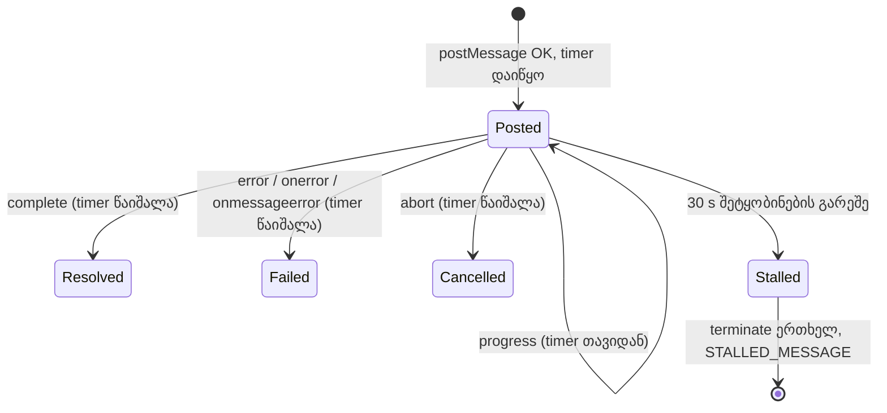

# Studio — WAV worker-ის stall watchdog, worker-ის შეცდომის ტექსტი და ექსპორტის ტესტების იზოლაცია

**თარიღი:** 2026-10-23
**სტატუსი:** C PASS (Round 103), გამოქვეყნდა 3b6178b (D-29z68)
**შეცვლილი პროექტი:** Store

## კონტექსტი

ექსპორტის pipeline-ში სამი Low რჩებოდა:

- **GATE89-S3.** `encodeArrangementWavOffMainThread` WAV-ს Web Worker-ში წერს. თუ worker საერთოდ არ პასუხობს, ექსპორტი "rendering" მდგომარეობაში რჩება, სანამ მომხმარებელი Cancel-ს არ დააჭერს. გარდა ამისა, worker-ის `{type:'error', message}` პასუხის ტექსტი იკარგებოდა და UI მხოლოდ ზოგად შეტყობინებას აჩვენებდა.
- **C-R90-MUT-B-CU4-GAP.** `exportMp3`-ში download-ების წინ `if (signal.aborted) return;` შემოწმება წაშლილიც რომ ყოფილიყო, არც ერთი ტესტი არ წითლდებოდა. CU4 Cancel-ს encode-ის დასრულებამდე აჭერს, ამიტომ cancel-ს abort race იჭერს.
- **A-R87-LOW-PU-ORDER.** `export-progress-ui.test.tsx`-ში encoder-ის import gate-ს მხოლოდ პირველი PU4 ხსნიდა. ამიტომ MP3-ის ნებისმიერი PU ტესტი ცალკე (`-t "PU2"`) ვერ გადიოდა.

## მიდგომა

### Stall timer და არა საერთო დროის ლიმიტი

- Timer იწყება მას შემდეგ, რაც `worker.postMessage(...)` შეცდომის გარეშე დაბრუნდება.
- `progress` timer-ს თავიდან იწყებს.
- promise-ის დასრულების ხუთივე გზა (`complete`, `error` შეტყობინება/`onerror`/`onmessageerror`, abort, stall და `postMessage`-ის შეცდომა) ერთ ლოკალურ `detachWorker`-ზე გადის. ის timer-ს წმენდს, abort listener-ს ხსნის, `onmessage`/`onerror`/`onmessageerror`-ს ნულავს და `terminate()`-ს ერთხელ იძახებს.
- თუ 30 წამის განმავლობაში worker-იდან არაფერი მოვიდა, promise აბრუნებს `ARRANGEMENT_WAV_WORKER_STALLED_MESSAGE`-ს: `WAV-ის ჩაწერა შეჩერდა — worker 30 წამი არ პასუხობს.`
- დასრულების შემდეგ მოსული შეტყობინება შედეგს აღარ ცვლის. დაგვიანებული `progress` აღარც timer-ს ჩართავს და აღარც `onProgress`-ს გამოიძახებს. მანამდე ის `fail`/`complete`-ის შემდეგაც `onProgress`-მდე აღწევდა.
- **რატომ არა საერთო ლიმიტი:** worker პროგრესს ყოველ მთელ პროცენტზე აგზავნის. ამიტომ შეტყობინებებს შორის შუალედი ნებისმიერ რეალურ მანქანაზე 30 წამზე გაცილებით ნაკლებია, გრძელი პროექტისთვისაც. საერთო ლიმიტი ნელ მანქანაზე გრძელ პროექტს შეცდომით ჩააგდებდა. Stall timer მხოლოდ მაშინ ამოქმედდება, როცა worker მართლა ჩუმადაა. ფონური tab-ის timer throttling-ს შეუძლია მხოლოდ დააგვიანოს ის, ადრე ვერ აამოქმედებს.
- **30 წამი:** B-ს გადაწყვეტილებაა. ჯანმრთელი worker შეტყობინებებს შორის ამდენ ხანს არ ჩუმდება, ამიტომ ის მასზე ვერ ამოქმედდება. C-ის WD-SLOW (CPU throttling ×6) ზომავს შეტყობინებებს შორის ყველაზე დიდ შუალედს.
- **ყველაზე გრძელი ჩუმი მონაკვეთი პირველ `progress`-მდეა.** ამ დროს worker module-ს ტვირთავს, `measureExportOverload`-ს ყველა sample-ზე უშვებს და sample-ებს clamp-ს უკეთებს. `onProgress(0)`-ს მხოლოდ ამის შემდეგ აგზავნის (code-reviewer-ის შენიშვნა). C-მ WD-SLOW-ში ეს დრო ცალკე უნდა გაზომოს.
- **მთავარი thread-ის ბლოკი:** თუ მთავარი thread 30 წამზე მეტხანს დაბლოკილია, timer-ის task და რიგში მდგომი worker-ის შეტყობინებები სხვადასხვა task source-იდან მოდის. ბრაუზერი მათ თანმიმდევრობას არ იძლევა. ჩაწერისას მთავარი thread თითქმის თავისუფალია, ამიტომ ეს ნაკლებ სავარაუდოა.

### worker-ის შეცდომის ტექსტი

- `{type:'error', message}` პასუხში, თუ trim-ის შემდეგ `message` ცარიელი არ არის, ტექსტი ასე იქმნება: `${ARRANGEMENT_WAV_WORKER_FAILED_MESSAGE} ${trimmed}`. მაგალითად: `WAV-ის ჩაწერა ვერ მოხერხდა (worker). boom`.
- ცარიელი ან მხოლოდ whitespace-იანი `message`, `onerror`, `onmessageerror`, `postMessage`-ის და constructor-ის შეცდომა ზუსტად იმ constant-ს აბრუნებს, რასაც დღემდე.
- UI-ის ტექსტი ისევ `ArrangementContext.tsx`-ში იწყობა (`ექსპორტი ვერ მოხერხდა — ფაილი არ შეიქმნა. ${error.message}`) და React text node-ად ჩანს არსებულ `role="alert"`-ში. Injection-ის გზა არ არსებობს.

### CU10 — cancel encode-ის დასრულებასა და download-ებს შორის

ახალი `describe` `export-cancel-ui.test.tsx`-ის ბოლოს. ერთ `act`-ში ტესტი იძახებს `encode.finish(mp3Blob)`-ს, შემდეგ `await Promise.resolve()`-ს, შემდეგ `cancelExport()`-ს.

ECMAScript-ის job-ების თანმიმდევრობა:

1. `finish` encode-ის promise-ს ხსნის. მისი reaction-ები (`work.catch` passthrough და race-ის `then`) რიგში დგება ტესტის continuation-ზე ადრე.
2. Race-ის `then` გარე promise-ს ხსნის. `exportMp3`-ის `await` continuation რიგში დგება ტესტის continuation-ის **შემდეგ**.
3. ტესტის continuation-ში `cancelExport()` signal-ს abort-ს უკეთებს. Race listener უკვე მოხსნილია, `resetEncoderOnAbort` კი ჯერ მიბმულია, ამიტომ reset ერთხელ ხდება.
4. `exportMp3`-ის continuation listener-ს ხსნის და download-ებს მხოლოდ `if (signal.aborted) return;` აჩერებს.

ტესტი ამ თანმიმდევრობას თავადაც ამოწმებს. render-ის signal-ზე `removeEventListener` spy-ა, და `cancelExport()`-მდე ზუსტად ერთი მოხსნა უნდა იყოს: race-ის listener-ის. თუ frozen ფაილებში microtask-ების რაოდენობა შეიცვლება, CU10 გაწითლდება და CU4-ის გზას ჩუმად აღარ გაიმეორებს (diagnostic m7: `await Promise.resolve()`-ის გარეშე CU10 წითელია).

Mutation m6-მა (scratch-ში ეს სამი ხაზი წაშლილი) CU10 3/3 გაწითლა. დანარჩენი 11 ტესტი მწვანე დარჩა. მუტაციის გარეშე CU10 3/3 მწვანეა, ამიტომ ტესტი დარჩა.

### PU ტესტების ცალკე გაშვება

`export-cancel-ui.test.tsx`-ის ნიმუში გადმოვიტანეთ:

- `downloads`/`renderedBlob`/`mp3Blob` module-ის დონეზე გადავიდა.
- setup და teardown გახდა `setUpProgressEnvironment` და `tearDownProgressEnvironment`.
- პირველი PU4 (import gate ჯერ დახურულია) ცალკე, ფაილში პირველ `describe`-შია.
- ძირითადი `describe`-ის `beforeEach` ჯერ `encoderImportGate.release()`-ს იძახებს, შემდეგ setup-ს.

`it`-ების სათაურები და სხეულები byte-ით იდენტურია. ტესტების რაოდენობა ისევ 8-ია. ახალ პირველ `describe`-ს `{ timeout: 15_000 }` არ აქვს, როგორც cancel-ui-ის CU3-ის `describe`-ს: ამ ოფციის დამატებისას Biome `describe`-ს ახალ ხაზებზე გადაიტანს და `it`-ის სხეულებს ჩაწევს. პირველი PU4 fake timer-ებით ~0.3 წამში სრულდება.

## არქიტექტურა

## შეცვლილი ფაილები

- `app/lib/arrangement/export-wav.client.ts`: stall timer, ორი ახალი export (`ARRANGEMENT_WAV_WORKER_STALL_TIMEOUT_MS`, `ARRANGEMENT_WAV_WORKER_STALLED_MESSAGE`) და worker-ის შეცდომის ტექსტი.
- `app/lib/arrangement/__tests__/export-wav.test.ts`: ახალი `describe`-ი EW8a–EW8f (მხოლოდ ფაილის ბოლოს დამატებული).
- `app/lib/arrangement/__tests__/export-cancel-ui.test.tsx`: CU10 (მხოლოდ ბოლოს დამატებული).
- `app/lib/arrangement/__tests__/export-progress-ui.test.tsx`: setup-ის გატანა და პირველი PU4-ის ცალკე `describe`-ში გადატანა.
- `docs/implementation/2026/quarter-IV/090-studio-export-focus-card-progress-once.md`: მხოლოდ სტატუსის ხაზი.

## პრობლემები და გადაწყვეტები

- **Problem:** code-reviewer-მა იპოვა, რომ `fail`/`complete`-ის შემდეგ დაგვიანებული `progress` timer-ს ხელახლა ჩართავდა. 30 წამში ეს მეორე `terminate()`-ს გამოიწვევდა. → **Solution:** დასრულების ყველა გზა ერთ `detachWorker`-ზე გადის. EW8c/EW8e ამოწმებს, რომ დაგვიანებული `progress` იგნორირდება (m8).
- **Problem:** `worker.onerror = fail` ახალ `fail(message?)`-ს `ErrorEvent`-ს გადასცემდა. → **Solution:** `onerror`/`onmessageerror` ახლა `() => fail()`-ს იძახებს. ტექსტი მხოლოდ `{type:'error'}` პასუხიდან მოდის.
- **Problem:** `export-wav.test.ts`-ში ცვლილება მხოლოდ ბოლოს დამატება უნდა ყოფილიყო, ახალი constant-ები კი import-ში არ იყო. → **Solution:** დამატებულ ნაწილში ისინი `await import('../export-wav.client')`-ით მოდის, ფაილის header უცვლელია.
- **Problem:** baseline-ზე EW8d მწვანეა, B კი წითელს ელოდა. → **Solution:** baseline-ს timer არ აქვს, abort კი უკვე სწორად აბრუნებს cancelled-ს. ამიტომ EW8d-ს მხოლოდ m4 იჭერს (abort timer-ს არ წმენდს).
- **Problem:** baseline-ზე `-t "PU2"` timeout-ით კი არა, assertion-ით ვარდება. `-t "PU1"`/`-t "PU3"` კი baseline-ზეც მწვანეა, რადგან WAV/PU3 encoder-ის import-ს არ ელოდება. → **Solution:** დაფიქსირდა ანგარიშში. მთავარი მტკიცებულება PU2-ია: baseline-ზე წითელი, ახალ ფაილზე მწვანე.

## ტესტირება

- `npm run typecheck` და `npm run lint` გადის. Biome-ს ოთხ კოდის ფაილზე შენიშვნა არ აქვს.
- Targeted vitest: 9 ფაილი, 100/100.
- Fail-before (baseline `b56ca58e` და ახალი ტესტი): EW8a, EW8b, EW8c, EW8e, EW8f წითელია. EW8c წითელია, რადგან baseline დაგვიანებულ `progress`-ს `onProgress`-მდე ატარებს. EW8d და EW1–EW7 მწვანეა.
- მუტაციები: m1 → EW8a, EW8b; m2 → EW8b; m3 → EW8c; m4 → EW8d; m5 → EW8e; m6 → CU10 (3/3); m7 (ტესტის მხარე) → CU10; m8 (`fail` handler-ებს არ ნულავს) → EW8e. მუტაციის გარეშე 3/3 მწვანეა.
- C ბრაუზერში worker-ის stub-ით ამოწმებს WD-STALL, WD-CANCEL, WD-ERRTEXT, WD-MP3 და WD-SLOW-ს.

## TODO / შემდეგი ნაბიჯები

- C-ის ბრაუზერის შემოწმება (round 103).
- worker-ის შეცდომის ტექსტს სიგრძის ლიმიტი არ აქვს. engine-ის ინგლისური ტექსტი (მაგ. "Array buffer allocation failed") ქართულ alert-ს ემატება. საჭიროების შემთხვევაში ეს ცალკე დავალებაა.
- EW5-ის სათაური ("exact message") `'boom'`-ის შემთხვევისთვის აღარ არის ზუსტი. ფაილში მხოლოდ დამატება იყო ნებადართული, ამიტომ გადარქმევა შემდეგი დავალებაა.
