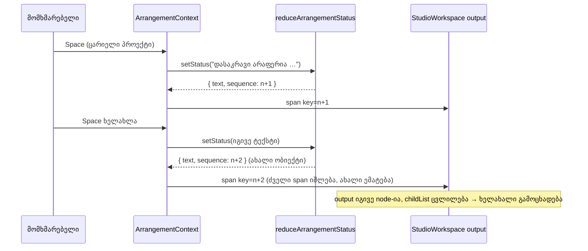

# Studio — განმეორებული სტატუსის წინადადება screen reader-ს ხელახლა ესმის

**თარიღი:** 2026-10-23
**სტატუსი:** Round 104 — C-ის შემოწმებას ელოდება (D-29z69)
**შეცვლილი პროექტი:** Store

## კონტექსტი

**GATE96-S2 (Low, a11y).** Studio-ს სტატუსის ხაზი არის `aria-live="polite"` `<output>` (`data-testid="arrangement-status"`), რომლის ტექსტიც `ArrangementContext`-ის `status`-იდან მოდის. `status` ჩვეულებრივი `useState` string იყო.

როცა იგივე წინადადება ზედიზედ ორჯერ დაყენდებოდა, React-ი განახლებას ტოვებდა, რადგან ახალი string ძველის ტოლი იყო. DOM არ იცვლებოდა და live region-ს მეორედ არაფერი უნდა გამოეცხადებინა. ამის მაგალითებია Space ორჯერ ცარიელ პროექტზე, Enter ორჯერ ჩაუტვირთავ ბიბლიოთეკის რიგზე ან Fit ორჯერ. screen reader-ის მომხმარებელი მეორე მოქმედებაზე პასუხს ვერ იღებდა.

## მიდგომა

- **Reducer და მიმდევრობის ნომერი.** `status` ახლა `useReducer`-ის მდგომარეობაა: `{ text, sequence }`. ახალი pure ფუნქცია `reduceArrangementStatus` (`app/lib/arrangement/status-announcement.ts`) ასე მუშაობს:
  - **string-ზე** ყოველთვის ქმნის ახალ ობიექტს და `sequence`-ს ერთით ზრდის, იმ შემთხვევაშიც, როცა ტექსტი იგივეა. სწორედ ეს არის გამოსწორება.
  - **ფუნქციაზე** (updater) გამოთვლის ახალ ტექსტს. თუ ის არ შეცვლილა, აბრუნებს იმავე ობიექტს: provider-ის სხეული ერთხელ გაეშვება (React 18-ში `useReducer`-ს dispatch-ის დროს ადრეული bail-out არ აქვს), მაგრამ commit არ ხდება და შვილობილი კომპონენტები და DOM უცვლელი რჩება. თუ შეიცვალა, `sequence`-ს ზრდის.
- **dispatch-ს ისევ `setStatus` ჰქვია.** ამიტომ არც ერთი გამოძახების ადგილი არ შეცვლილა. საჯარო ტიპი `setStatus: (message: string) => void` იგივე რჩება. `useReducer`-ის dispatch სტაბილურია, ამიტომ Biome-ის `useExhaustiveDependencies` ახალ გაფრთხილებას არ იძლევა.
- **ფუნქციის შტოს მიზეზი.** ერთადერთი ფუნქციური გამოძახება drag-ის დასრულების შემდეგ ძველი ტექსტის აღდგენაა. ეს შიდა ჩანაწერია და არა მომხმარებლის მოქმედება. თუ აღსადგენი არაფერია, გამოცხადება არ უნდა მოხდეს.
- **Context-ში დაემატა `statusSequence: number`.** ის ჩაიწერა value ობიექტშიც და მის dependency list-შიც.
- **ჩაშენებული keyed ``.** `StudioWorkspace` სტატუსის ტექსტს `<output>`-ის შიგნით, ``-ში რენდერავს. ახალი `sequence` span-ს ცვლის: ძველი იშლება, ახალი ემატება. ეს live region-ის შიგნით `childList` ცვლილებაა, ამიტომ იგივე ტექსტიც ხელახლა ცხადდება.
- **`<output>`-ს key არ აქვს.** ის არასოდეს იცვლება და თავიდან არ mount-დება. screen reader-ები ხშირად არ აცხადებენ live region-ს, რომელიც ახლით ჩანაცვლდა, მაგრამ აცხადებენ ისეთს, რომლის შიგთავსიც შეიცვალა. `<output>`-ის კლასები და ატრიბუტები უცვლელია. `textContent` ყველა მდგომარეობაში იგივეა, ამიტომ არსებული ტესტები უცვლელად მუშაობს.

### უარყოფილი ვარიანტები

- **ჯერ გასუფთავება, მერე დაყენება** (`setStatus('')` → ტექსტი). ცარიელი შუალედური მნიშვნელობა `lastNonRefusalStatusRef`-ში ჩაიწერებოდა და drag-ის შემდეგ აღდგენას გააფუჭებდა. ამას ერთ ცვლილებაზე ორი render სჭირდება.
- **`useCallback` wrapper `setStatus`-ის გარშემო.** B-ს probe-ში ამან `useExhaustiveDependencies`-ის 29 ახალი გაფრთხილება გამოიწვია.
- **დროის ზღვარი** (მაგ. "იგივე ტექსტი X ms-ის შემდეგ ხელახლა"). ეს გამოგონილი timing-ის კონტრაქტი იქნებოდა. მომხმარებლის ყოველი მოქმედება უნდა გამოცხადდეს.

## არქიტექტურა

## შეცვლილი ფაილები

- `app/lib/arrangement/status-announcement.ts` (ახალი): `ArrangementStatusEntry`, `ArrangementStatusUpdate`, `createArrangementStatusEntry`, `reduceArrangementStatus`.
- `app/contexts/ArrangementContext.tsx`: `useState` → `useReducer`, `status`/`statusSequence` გამოყვანილი მნიშვნელობები და `statusSequence` context-ის ტიპსა და value-ში. სხვა ხაზები, მათ შორის `setStatus`-ის ყველა გამოძახება, უცვლელია.
- `app/components/arrangement/StudioWorkspace.tsx`: `statusSequence` destructure-ში და keyed `` `<output>`-ის შიგნით.
- `app/lib/arrangement/__tests__/status-announcement.test.ts` (ახალი): reducer-ის SA1–SA5.
- `app/lib/arrangement/__tests__/status-announcement-ui.test.tsx` (ახალი): provider-ისა და workspace-ის SU1–SU4.

## პრობლემები და გადაწყვეტები

- **პრობლემა:** ყოველი `setStatus(string)` ახლა provider-ს რენდერავს, მაშინაც კი, როცა ტექსტი იგივეა. **გადაწყვეტა:** ეს გამოსწორების აუცილებელი ნაწილია. render-ის არსებული ტესტები (`render-budget`, `context-hygiene`) უცვლელად მწვანეა.
- **პრობლემა:** drag, რომელიც ერთსა და იმავე ტექსტს იმეორებს (შეზღუდული readout, ან `ArrangementClip.tsx`-ის დაბლოკილი გადატანის/trim-ის/lane-refusal-ის შეტყობინება), ახლა ყოველ pointermove-ზე ცვლის DOM-ს. **შედეგი:** span-ის ცვლილება pointermove-ზე მაქსიმუმ ერთხელ ხდება, ამიტომ მოძრაობებზე მეტი არ იქნება. მაგრამ ორი გზა აქამდე უფასო იყო: დაბლოკილი ერთი კლიპის გადატანა და lane-refusal, სადაც `previewArrangement` არ იძახება. ახლა ორივე ყოველ მოძრაობაზე provider-სა და `useArrangement`-ის მომხმარებლებს რენდერავს. იგივე წინადადება polite region-ში ხელახლაც ცხადდება. **სტატუსი:** ღიაა, B-ს გადაეცა (A-R104-REPEAT-DRAG). გამოსწორება მოითხოვს ამ call site-ების `setStatus(() => message)`-ზე გადაყვანას `ArrangementClip.tsx`-ში. ეს ფაილი ამ რაუნდში frozen-ია. C-ის SR-DRAG-STREAM-მა დაბლოკილი გადატანაც უნდა შეამოწმოს.
- **პრობლემა:** კოლექციის შეცვლისას სტატუსის reset (round 94) ახლა `sequence`-საც ზრდის. **გადაწყვეტა:** ეს სწორია, რადგან ახალი კოლექციის ჩატვირთვის ტექსტი ახალი შეტყობინებაა.
- **პრობლემა:** mount-ზე იგივე effect ხელახლა აყენებს ჩატვირთვის ტექსტს (`copy.loading`), რომელიც საწყის მდგომარეობაშიც იყო. ამიტომ `sequence` 1 ხდება (dev StrictMode-ში 2), ემატება provider-ის ერთი render და span-ის ერთი ჩანაცვლება. **შედეგი:** hydration უსაფრთხოა, რადგან საწყისი key ორივე მხარეს 0-ია. ჩატვირთვის ტექსტი შეიძლება ერთხელ გამოცხადდეს, რაც აქამდე არ ხდებოდა. ეს მისაღებია.
- **პრობლემა:** m3 მუტაციაზე (key `<output>`-ზე) ტესტები თავდაპირველად ძველ node-ზე ტექსტის შემოწმებისას ვარდებოდა და არა identity-ის assertion-ზე. **გადაწყვეტა:** SU1–SU3-ში პირველი მოქმედების შემდეგ დაემატა region-ის identity-ის პირდაპირი შემოწმება.

## ტესტირება

- **Fail-before** (scratch, baseline-ის snapshot-ებზე): SA ფაილი import-ზე ვარდება (მოდული არ არსებობს); SU1, SU2 და SU3 წითელია; SU4 მწვანეა. SU4 fail-before ტესტი არ არის: ის რეგრესიის guard-ია უხმო აღდგენისთვის და m4 მუტაციაზე წითლდება.
- **მუტაციები:**
  - m1 (იგივე string → `previous`): SA3, SU1, SU2 წითელია.
  - m2 (span-ს key არ აქვს): SU1, SU2 წითელია.
  - m3 (key `<output>`-ზე, span არ არის): SU1–SU4 წითელია.
  - m4 (ფუნქციის შტო ყოველთვის ზრდის): SA4, SU4 წითელია.
  - m5 (`statusSequence` dependency list-ში არ არის): SU1, SU2 წითელია.
- **Targeted vitest:** 69 ფაილი, 1122 ტესტი, ყველა მწვანე. `npm run typecheck` და `npm run lint` წარმატებულია; ახალ და შეცვლილ ფაილებში 0 diagnostic-ია.

## TODO / შემდეგი ნაბიჯები

- C-ის ბრაუზერის შემოწმება: SR-REPEAT-SPACE, SR-REPEAT-FAILED-ROW, SR-REGION-STABLE, SR-DRAG-STREAM, SR-TEXT-REG.
- რეალური screen reader-ით შემოწმება (NVDA/VoiceOver) — Tech Lead-ის ხელით შესამოწმებელი პუნქტი R104-T.
