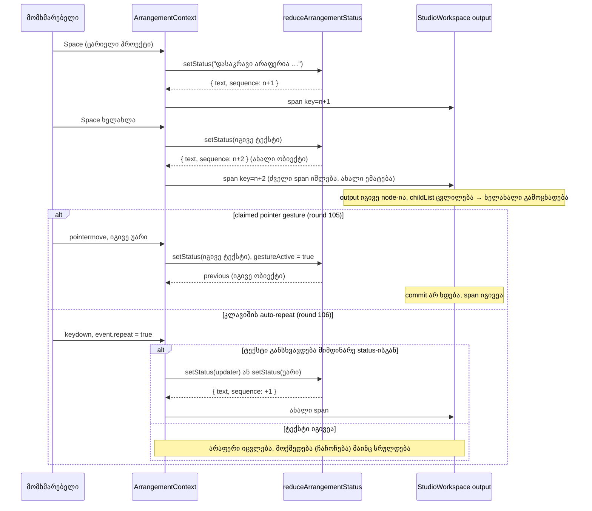

# Studio — განმეორებული სტატუსის წინადადება screen reader-ს ხელახლა ესმის

**თარიღი:** 2026-10-23
**სტატუსი:** Round 106 — C-ის შემოწმებას ელოდება (D-29z71, GATE105-S1). Round 105: C PASS, gate 105 დაბლოკა (GATE105-S1). Round 104: C PASS, gate 104 დაბლოკა (A-R104-REPEAT-DRAG).
**შეცვლილი პროექტი:** Store

## კონტექსტი

**GATE96-S2 (Low, a11y).** Studio-ს სტატუსის ხაზი არის `aria-live="polite"` `<output>` (`data-testid="arrangement-status"`), რომლის ტექსტიც `ArrangementContext`-ის `status`-იდან მოდის. `status` ჩვეულებრივი `useState` string იყო.

როცა იგივე წინადადება ზედიზედ ორჯერ დაყენდებოდა, React-ი განახლებას ტოვებდა, რადგან ახალი string ძველის ტოლი იყო. DOM არ იცვლებოდა და live region-ს მეორედ არაფერი უნდა გამოეცხადებინა. ამის მაგალითებია Space ორჯერ ცარიელ პროექტზე, Enter ორჯერ ჩაუტვირთავ ბიბლიოთეკის რიგზე ან Fit ორჯერ. screen reader-ის მომხმარებელი მეორე მოქმედებაზე პასუხს ვერ იღებდა.

## მიდგომა

- **Reducer და მიმდევრობის ნომერი.** `status` ახლა `useReducer`-ის მდგომარეობაა: `{ text, sequence }`. ახალი pure ფუნქცია `reduceArrangementStatus` (`app/lib/arrangement/status-announcement.ts`) ასე მუშაობს:
  - **string-ზე** gesture-ის გარეთ ქმნის ახალ ობიექტს და `sequence`-ს ერთით ზრდის, იმ შემთხვევაშიც, როცა ტექსტი იგივეა. სწორედ ეს არის გამოსწორება. claimed pointer gesture-ის დროს იგივე ტექსტი `previous`-ს ინარჩუნებს (round 105). დაჭერილი კლავიში key handler-ში მუშავდება (round 106): `event.repeat`-ზე უარი მხოლოდ მაშინ იგზავნება, როცა მისი ტექსტი მიმდინარე სტატუსისგან განსხვავდება — provider updater-ის ფორმას იყენებს, კომპონენტი `status`-ს ადარებს. დეტალების პანელის input-ებში Enter-ის repeat საერთოდ გამოტოვებულია, არსებული კონვენციით.
  - **ფუნქციაზე** (updater) გამოთვლის ახალ ტექსტს. თუ ის არ შეცვლილა, აბრუნებს იმავე ობიექტს: provider-ის სხეული ერთხელ გაეშვება (React 18-ში `useReducer`-ს dispatch-ის დროს ადრეული bail-out არ აქვს), მაგრამ commit არ ხდება და შვილობილი კომპონენტები და DOM უცვლელი რჩება. თუ შეიცვალა, `sequence`-ს ზრდის.
- **dispatch-ს ისევ `setStatus` ჰქვია.** ამიტომ round 104-ში არც ერთი გამოძახების ადგილი არ შეცვლილა (round 106-ის key-repeat call site-ები ქვემოთაა). საჯარო ტიპი `setStatus: (message: string) => void` იგივე რჩება. `useReducer`-ის dispatch სტაბილურია, ამიტომ Biome-ის `useExhaustiveDependencies` ახალ გაფრთხილებას არ იძლევა.
- **ფუნქციის შტოს მიზეზი.** ერთადერთი ფუნქციური გამოძახება drag-ის დასრულების შემდეგ ძველი ტექსტის აღდგენაა. ეს შიდა ჩანაწერია და არა მომხმარებლის მოქმედება. თუ აღსადგენი არაფერია, გამოცხადება არ უნდა მოხდეს.
- **Context-ში დაემატა `statusSequence: number`.** ის ჩაიწერა value ობიექტშიც და მის dependency list-შიც.
- **ჩაშენებული keyed ``.** `StudioWorkspace` სტატუსის ტექსტს `<output>`-ის შიგნით, ``-ში რენდერავს. ახალი `sequence` span-ს ცვლის: ძველი იშლება, ახალი ემატება. ეს live region-ის შიგნით `childList` ცვლილებაა, ამიტომ იგივე ტექსტიც ხელახლა ცხადდება.
- **`<output>`-ს key არ აქვს.** ის არასოდეს იცვლება და თავიდან არ mount-დება. screen reader-ები ხშირად არ აცხადებენ live region-ს, რომელიც ახლით ჩანაცვლდა, მაგრამ აცხადებენ ისეთს, რომლის შიგთავსიც შეიცვალა. `<output>`-ის კლასები და ატრიბუტები უცვლელია. `textContent` ყველა მდგომარეობაში იგივეა, ამიტომ არსებული ტესტები უცვლელად მუშაობს.

### უარყოფილი ვარიანტები

- **ჯერ გასუფთავება, მერე დაყენება** (`setStatus('')` → ტექსტი). ცარიელი შუალედური მნიშვნელობა `lastNonRefusalStatusRef`-ში ჩაიწერებოდა და drag-ის შემდეგ აღდგენას გააფუჭებდა. ამას ერთ ცვლილებაზე ორი render სჭირდება.
- **`useCallback` wrapper `setStatus`-ის გარშემო.** B-ს probe-ში ამან `useExhaustiveDependencies`-ის 29 ახალი გაფრთხილება გამოიწვია.
- **დროის ზღვარი** (მაგ. "იგივე ტექსტი X ms-ის შემდეგ ხელახლა"). ეს გამოგონილი timing-ის კონტრაქტი იქნებოდა. მომხმარებლის ყოველი მოქმედება უნდა გამოცხადდეს.

## არქიტექტურა

## შეცვლილი ფაილები

Rounds 104–106 (ერთი change set):

- `app/lib/arrangement/status-announcement.ts` (ახალი, rounds 104–105): `ArrangementStatusEntry`, `ArrangementStatusUpdate`, `createArrangementStatusEntry`, `reduceArrangementStatus` (round 105-ში — `gestureActive` პარამეტრი).
- `app/contexts/ArrangementContext.tsx`:
  - round 104: `useState` → `useReducer`, `status`/`statusSequence` გამოყვანილი მნიშვნელობები და `statusSequence` context-ის ტიპსა და value-ში;
  - round 105: inline reducer `gestureCountRef`-ით, `gestureCountRef` `useReducer`-ის ზემოთ;
  - round 106: `nudgeSelectedClip`-ისა და `stepLoopRange`-ის არასავალდებულო `options: { keyRepeat }` და ინტერფეისის ორი ხაზი.
- `app/components/arrangement/StudioWorkspace.tsx`: round 104 — `statusSequence` destructure-ში და keyed `` `<output>`-ის შიგნით; round 106 — ისრით ჩაჩოჩების შტო (`keyRepeat` და `NUDGE_AT_TIME_START_MESSAGE`-ის შედარება) და Ctrl/Option+Arrow `stepMarker`-ის გამოძახება.
- `app/components/arrangement/ArrangementLoopBrace.tsx` (round 106): `handleLoopKeyDown` `{ keyRepeat: event.repeat }`-ს გადასცემს.
- `app/components/arrangement/ArrangementMarkerRow.tsx` (round 106): `status` destructure-ში; `stepMarker`-ის `options.keyRepeat` და handle-ის ტიპი; `commitMarkerMove`-ის `keyRepeat = false`; `nudgeMarker`-ის სავალდებულო `keyRepeat`; flag-ის ისრის შტო `event.repeat`-ს გადასცემს.
- `app/components/arrangement/ArrangementDetailPanel.tsx` (round 106): `handleRangeInputKeyDown`-ისა და `handleClipGainKeyDown`-ის Enter შტოები repeat-ს ტოვებს.
- `app/lib/arrangement/__tests__/status-announcement.test.ts` (ახალი): reducer-ის SA1–SA7.
- `app/lib/arrangement/__tests__/status-announcement-ui.test.tsx` (ახალი): provider-ისა და workspace-ის SU1–SU6 და დაჭერილი კლავიშის SK1–SK8 (+ reviewer-ის მოთხოვნით SK9–SK12).
- `docs/implementation/2026/quarter-IV/091-studio-export-worker-watchdog.md` (round 104-ის ცვლილება) და ეს დოკუმენტი.

## პრობლემები და გადაწყვეტები

- **პრობლემა:** ყოველი `setStatus(string)` provider-ს რენდერავს, მაშინაც კი, როცა ტექსტი იგივეა. **გადაწყვეტა:** gesture-ის გარეთ ეს გამოსწორების აუცილებელი ნაწილია (იგივე ტექსტი ხელახლა ცხადდება, commit ხდება). Round 105-იდან pointer gesture-ის დროს იგივე ტექსტზე reducer იმავე ობიექტს აბრუნებს: provider-ის სხეული ერთხელ გაეშვება, მაგრამ React bail-out-ს აკეთებს — DOM-ის ცვლილება, მომხმარებლების re-render და span-ის ჩანაცვლება არ ხდება. render-ის არსებული ტესტები (`render-budget`, `context-hygiene`) უცვლელად მწვანეა.
- **პრობლემა (A-R104-REPEAT-DRAG, Medium):** drag, რომელიც ერთსა და იმავე ტექსტს იმეორებს (შეზღუდული fade readout, ან `ArrangementClip.tsx`-ის დაბლოკილი გადატანის/trim-ის/lane-refusal-ის შეტყობინება), round 104-ის შემდეგ ყოველ pointermove-ზე span-ს ცვლიდა და polite region იმავე წინადადებას ხელახლა აცხადებდა. C round 104-მა დაბლოკილ გადატანაზე 81 მოძრაობაზე 81 ახალი span დათვალა (80 იდენტური წინადადებით), შეზღუდულ fade-ზე — 21 იდენტური `Fade In: 101.352 წმ`. Gate 104-მა გამოქვეყნება ამის გამო დაბლოკა.
  **გადაწყვეტა (round 105, D-29z70):** reducer gesture-ს ითვალისწინებს. `reduceArrangementStatus(previous, next, gestureActive)`: string-ზე, როცა `gestureActive === true` და ტექსტი იგივეა, აბრუნებს `previous`-ს; ყველა სხვა string შემთხვევაში — ახალ ობიექტს `sequence + 1`-ით; ფუნქციის შტო უცვლელია. Provider reducer-ად inline ფუნქციას გადასცემს, რომელიც `gestureCountRef.current > 0`-ს კითხულობს. `reduceArrangementStatus` pure რჩება (დრო, ref ან global მოდულში არ არის). React-ის მიერ გაშვებული inline closure კი React-ის გაგებით სრულად pure არ არის, რადგან mutable ref-ს კითხულობს — ამის შედეგია სემანტიკის პირველი პუნქტი.
  - **რატომ provider-ში და არა call site-ებზე:** ყველა drag (clip-ის გადატანა, trim, range, fade, marker-ის რიგი, clip envelope, lane fader და volume/pan gesture-ები) `claimPointerGesture`/`beginPointerGesture`-ით იწყება და `gestureCountRef`-ს ზრდის. ერთი წესი ყველა გზას ფარავს და frozen ფაილის შეცვლა არ სჭირდება.
  - **`useRef` ხაზის გადატანა:** `const gestureCountRef = useRef(0);` `useReducer`-ის პირდაპირ ზემოთ გადავიდა. React reducer-ს provider-ის render-ის დროს, `useReducer`-ის გამოძახებაზე უშვებს. ძველ ადგილას (74 ხაზით ქვემოთ) inline reducer პირველივე განახლებაზე `ReferenceError: Cannot access 'gestureCountRef' before initialization`-ს აგდებდა (m9 ამას ადასტურებს). hook უპირობოა, ამიტომ hook-ების რიგი ყველა render-ში ერთნაირია.
  - **ჩაწერილი სემანტიკა:**
    1. flag იკითხება reducer-ის გაშვებისას, ანუ provider-ის მომდევნო render-ში და არა dispatch-ის დროს. დასკვნა, არ არის გაზომილი: ბოლო pointermove-ზე გაგზავნილი string, რომელიც release-ის შემდეგ დარენდერდა, gesture-ის გარეთ ითვლება და შეიძლება ერთხელ გაზარდოს `sequence`. იგივე შეიძლება მოხდეს concurrent rebasing-ით: pointermove-ის (continuous lane) განახლება შეიძლება ჯერ კიდევ მოლოდინში იყოს, როცა pointerup (discrete) `release()`-ს და აღდგენის updater-ს უშვებს; გადადებული განახლება მოგვიანებით, უკვე `gestureCountRef = 0`-ით, ხელახლა გაეშვება. შედეგი მაქსიმუმ ერთი დამატებითი გამოცხადებაა gesture-ის ბოლოს; gesture-ის განმავლობაში გამოტოვება ან გაორმაგება ასე არ ხდება. C-ის ბრაუზერის ზღვარი (≤ 2 დამატებული span) ამას ითვალისწინებს.
    2. დარჩენილი ხარჯი: `useReducer`-ის გამო გაერთიანებული განახლება provider-ის სხეულს ერთხელ მაინც უშვებს (შემდეგ bail-out: DOM-ის ცვლილება, მომხმარებლების re-render და effect-ები არ ხდება). ეს `3b6178b`-ს (render საერთოდ არა) და round 104-ს (სრული commit) შორისაა — baseline-ის იდენტური არ არის.
    3. მიღებული trade-off (reviewer-ის): ერთი gesture-ის განმავლობაში ორჯერ გამოწვეული იგივე უარი ერთხელ ცხადდება. ერთი gesture — ერთი შეტყობინება.
    4. gesture-ის დროს კვლავ ცხადდება განსხვავებული ტექსტი (პირველი დაბლოკვის წინადადება, ცვალებადი readout). gesture-ის გარეთ კვლავ ცხადდება იდენტური ტექსტი (Space ორჯერ, Enter ორჯერ ჩავარდნილ რიგზე).
  - **უარყოფილი ვარიანტები:** call site-ებზე `setStatus(() => message)` `ArrangementClip.tsx`-ში — გაფანტული, ადვილად დასავიწყებელი და frozen ფაილს მოითხოვს; `{ text, coalesce }` action — reducer pure რჩება, მაგრამ `setStatus`-ის საჯარო ტიპს wrapper დასჭირდებოდა, ხოლო `useCallback` wrapper-მა round 104-ის probe-ში 29 lint გაფრთხილება მისცა.
  **სტატუსი:** გამოსწორებულია round 105-ში, C-ის ბრაუზერის შემოწმებას ელოდება (HD-BLOCKED-HOLD, HD-FADE-CLAMP, HD-READOUT-CHANGING).
- **პრობლემა (GATE105-S1, Medium, a11y და render-ის ხარჯი; round 104-ის რეგრესია):** საზღვარზე დაჭერილი კლავიში OS-ის ყოველ auto-repeat-ზე (დაახლ. 30/წმ) იმავე უარს ხელახლა აცხადებდა და provider-ს ყოველ ჯერზე commit-ს აკეთებდა. `3b6178b`-ზე `useState` იდენტურ ტექსტს ტოვებდა, ამიტომ უარი ერთხელ ცხადდებოდა. Round 105-ის gesture-ის წესი მხოლოდ pointer gesture-ს ფარავს. B-მ ყველა `onKeyDown` გადაამოწმა და ხუთი გზა იპოვა, პლუს მეექვსე:
  - P1: ←/→ მონიშნულ კლიპზე, Snap off (`nudgeSelectedClip` — ერთი კლიპი და ჯგუფი);
  - P2: იგივე Snap on-ით, მარცხნივ grid-ის ხაზი აღარ არის (`NUDGE_AT_TIME_START_MESSAGE`);
  - P3: ←/→ (Shift = ბოლო) loop brace-ზე (`stepLoopRange`);
  - P4: ←/→ მარკერის flag-ზე (`nudgeMarker`/`commitMarkerMove`);
  - P5: Ctrl+←/→ (Apple-ზე Option) ბოლო/პირველი გაჩერების მიღმა (`stepMarker`);
  - P6: დაჭერილი Enter დეტალების პანელის დიაპაზონისა და Clip Gain-ის input-ებში.

  **გადაწყვეტა (round 106, D-29z71):** ერთი სახელი ყველგან — `keyRepeat` (ნაგულისხმევად `false`), grep-ით მოსაძებნად. Provider-ში (`nudgeSelectedClip`, `stepLoopRange`) `keyRepeat`-ზე უარი updater-ის ფორმით იგზავნება (`setStatus(() => MESSAGE)`), რომელზეც reducer იდენტურ ტექსტზე `previous`-ს აბრუნებს. კომპონენტებში (`StudioWorkspace`-ის Snap on შტო, `ArrangementMarkerRow`) — `if (!event.repeat || status !== MESSAGE) setStatus(MESSAGE)`, სადაც `status` ბოლო render-ის ტექსტია; ყოველი keydown დისკრეტული მოვლენაა და React მას შემდეგამდე ასრულებს, ამიტომ ეს render მიმდინარეა. P6-ში repeat-ზე Enter საერთოდ არ სრულდება: გამეორებული apply idempotent-ია და მხოლოდ „უცვლელია“ ტექსტს იძლევა; workspace-ის Enter იგივე კონვენციას მიჰყვება. მოქმედება ყოველ repeat-ზე სრულდება, ჩუმდება მხოლოდ განმეორებული იდენტური უარი. საჯარო `setStatus`-ის ტიპი უცვლელია (`(message: string) => void`): მისი გაფართოება frozen ტესტის fake-ებს `strictFunctionTypes`-ით დაარღვევდა.
  - **რატომ key handler-ში და არა reducer-ში:** მხოლოდ handler-მა იცის `event.repeat`. reducer-ში იდენტური ტექსტის გაერთიანება gesture-ის გარეთ Space-ისა და Enter-ის განმეორებით დაჭერას დაადუმებდა (GATE96-S2) — იხ. k8.
  - **ჩაწერილი სემანტიკა (კლავიატურა):**
    1. კლავიშის auto-repeat (`event.repeat === true`) არასოდეს აცხადებს ხელახლა უარს, რომელიც უკვე მიმდინარე სტატუსის ტექსტია. repeat-ზე უარი იგზავნება მხოლოდ მაშინ, როცა ტექსტი განსხვავდება; ამიტომ საზღვარი, რომელსაც hold-ის დროს მივაღწიეთ, ერთხელ ცხადდება (პირველ უარყოფილ repeat-ზე).
    2. ცალკე, შეგნებული დაჭერა (`repeat === false`) ყოველთვის აცხადებს, იგივე ტექსტსაც.
    3. ცვალებადი წარმატების ტექსტი (`მარკერი «…» გადავიდა: …`) ყოველ ნაბიჯზე ცხადდება, რადგან დრო იცვლება.
  - **აკრძალული გადაწყვეტა:** იდენტური ტექსტის გაერთიანება reducer-ში/provider-ში gesture-ის გარეთ. მტკიცებულება — k8: SU1, SU2, SU5, SK1–SK6, SK8 (მე-3 ნაბიჯი), SK11 და SK12 წითელია.
  - **უარყოფილი წესი:** ყოველ repeat-ზე უარის გამოტოვება. hold-ის დროს მიღწეული საზღვარი საერთოდ არ გამოცხადდებოდა, `3b6178b` კი ერთხელ აცხადებდა. მტკიცებულება — k9: SK7 წითელია.
  - **ცალკე ჩაწერილი, შეუსწორებელი დაკვირვება:** ერთი კლიპი დროის 0-ზე, Snap off, ← — ჩუმი no-op-ია (`moveClip` იდენტურ arrangement-ს აბრუნებს, `applyEdit` არაფერს აკეთებს): სტატუსი და history-ის ჩანაწერი არ ჩნდება, round 105-შიც და round 106-შიც. ერთი კლიპის უარი მხოლოდ მეზობლის დაბლოკვაზე ჩნდება. ამიტომ SK1 და SK7 მარცხენა მეზობელს იყენებს. ქცევა უცვლელია და B-ს გადაეცა.

  **სტატუსი:** გამოსწორებულია round 106-ში, C-ის ბრაუზერის შემოწმებას ელოდება.
- **პრობლემა:** კოლექციის შეცვლისას სტატუსის reset (round 94) ახლა `sequence`-საც ზრდის. **გადაწყვეტა:** ეს სწორია, რადგან ახალი კოლექციის ჩატვირთვის ტექსტი ახალი შეტყობინებაა.
- **პრობლემა:** mount-ზე იგივე effect ხელახლა აყენებს ჩატვირთვის ტექსტს (`copy.loading`), რომელიც საწყის მდგომარეობაშიც იყო. ამიტომ `sequence` 1 ხდება (dev StrictMode-ში 2), ემატება provider-ის ერთი render და span-ის ერთი ჩანაცვლება. **შედეგი:** hydration უსაფრთხოა, რადგან საწყისი key ორივე მხარეს 0-ია. ჩატვირთვის ტექსტი შეიძლება ერთხელ გამოცხადდეს, რაც აქამდე არ ხდებოდა. ეს მისაღებია.
- **პრობლემა:** m3 მუტაციაზე (key `<output>`-ზე) ტესტები თავდაპირველად ძველ node-ზე ტექსტის შემოწმებისას ვარდებოდა და არა identity-ის assertion-ზე. **გადაწყვეტა:** SU1–SU3-ში პირველი მოქმედების შემდეგ დაემატა region-ის identity-ის პირდაპირი შემოწმება.

## ტესტირება

- **Fail-before** (scratch, baseline-ის snapshot-ებზე): SA ფაილი import-ზე ვარდება (მოდული არ არსებობს); SU1, SU2 და SU3 წითელია; SU4 მწვანეა. SU4 fail-before ტესტი არ არის: ის რეგრესიის guard-ია უხმო აღდგენისთვის და m4 მუტაციაზე წითლდება.
- **მუტაციები:**
  - m1 (იგივე string → `previous`): SA3, SU1, SU2 წითელია.
  - m2 (span-ს key არ აქვს): SU1, SU2 წითელია.
  - m3 (key `<output>`-ზე, span არ არის): SU1–SU4 წითელია.
  - m4 (ფუნქციის შტო ყოველთვის ზრდის): SA4, SU4 წითელია.
  - m5 (`statusSequence` dependency list-ში არ არის): SU1, SU2 წითელია.
- **Targeted vitest (round 104):** 69 ფაილი, 1122 ტესტი, ყველა მწვანე. `npm run typecheck` და `npm run lint` წარმატებულია; ახალ და შეცვლილ ფაილებში 0 diagnostic-ია.

### Round 105 (A-R104-REPEAT-DRAG)

- **ახალი ტესტები:**
  - SA6: იგივე string `gestureActive = true`-ით აბრუნებს იმავე ობიექტს, `sequence` უცვლელია.
  - SA7: იგივე string `gestureActive = false`-ით აბრუნებს ახალ ობიექტს `sequence + 1`-ით; განსხვავებული string gesture-ის დროსაც `sequence + 1`-ს იძლევა.
  - SU5: claimed gesture-ის დროს იგივე ტექსტი span-ს ინარჩუნებს; `GESTURE_EDIT_BLOCKED_MESSAGE` ორჯერ — პირველი ახალი span, მეორე იგივე; release აღადგენს ძველ ტექსტს ახალ span-ში; gesture-ის გარეთ იგივე ტექსტი ისევ ახალი span-ია (`sequence` ჯამში +3).
  - SU6: gesture-ის დროს `A`, `B`, `A` — სამივე ახალი span ზუსტი ტექსტით.
- **Fail-before** (scratch, round 104-ის snapshot-ები `status-announcement.ts`-ისა და `ArrangementContext.tsx`-ისთვის): SA6 და SU5 წითელია (SU5 — მე-3 ნაბიჯზე, span-ის identity); SA1–SA5, SA7, SU1–SU4, SU6 მწვანეა. ემთხვევა B-ს მოლოდინს.
- **მუტაციები (scratch):**
  - m6 (provider `false`-ს გადასცემს): SU5 წითელია.
  - m7 (reducer `gestureActive`-ს უგულებელყოფს): SA6, SU5 წითელია.
  - m8 (flag შებრუნებულია, `=== 0`): SU1, SU2, SU5 წითელია; SA ტესტები მწვანეა.
  - m9 (`gestureCountRef` ძველ ადგილას): SU1–SU6 წითელია `ReferenceError: Cannot access 'gestureCountRef' before initialization`-ით.
  - მუტაციის გარეშე control (წინ და შემდეგ): 13/13 მწვანე.
- **Targeted vitest (round 105):** 69 ფაილი, 1126 ტესტი (1122 + SA6, SA7, SU5, SU6), ყველა მწვანე. `npm run typecheck` წარმატებულია; `npx biome check` შეცვლილ კოდისა და ტესტის ფაილებზე და `biome lint` — 0 diagnostic ამ ფაილებში.

### Round 106 (GATE105-S1)

- **ახალი ტესტები (SK = „status, key repeat“):** ყოველ SK-ში (SK7-ის გარდა) პირველი დაჭერა ზუსტ უარს ახალ span-ში ამატებს; სამი repeat იმავე span-ს ტოვებს და `statusSequence` უცვლელია; ცალკე დაჭერა ახალ span-ს ამატებს იგივე ტექსტით, `sequence + 1`.
  - SK1: ერთი კლიპი, მარცხენა მეზობლით დაბლოკილი, Snap off, ←.
  - SK2: Snap on (`arrangement-snap-toggle`-ზე click), კლიპი 0-ზე, ←.
  - SK3: ორი კლიპი, მარცხენა 0-ზე, ←.
  - SK4: loop 0-დან, ← ფოკუსირებულ `arrangement-loop-brace`-ზე.
  - SK5: მარკერი 0-ზე, ← მის flag-ზე.
  - SK6: Ctrl+→ ბოლო გაჩერების შემდეგ.
  - SK7: კლიპი 5.3-ზე, მეზობელი 0–5; ← + ოთხი repeat: start 5.2 → 5.1 → 5 → 5 → 5, უარი ზუსტად ერთხელ (პირველ უარყოფილ repeat-ზე), ერთი დამატებული span.
  - SK8: Clip Gain-ის უცვლელ input-ში Enter: `Clip Gain უცვლელია: 0.0 dB.` ერთხელ; repeat არაფერს ამატებს; ცალკე Enter — ახალი span.
  - code-reviewer-ის F1/F2-ის შემდეგ დამატებული:
    - SK9: მარკერი 0.1-ზე; ← მას 0-ზე გადაიყვანს, შემდეგ სამი repeat — პირველი უარი repeat-ზე ჩნდება და ზუსტად ერთხელ ცხადდება (კომპონენტის `status`-ის შედარებას უბრალო `!event.repeat`-ისგან არჩევს).
    - SK10: Ctrl+→ ჯერ მარკერზე (1), repeat — clip-ის ბოლოზე (5), შემდეგი repeat-ები — „წინ მარკერი აღარ არის“ ერთხელ.
    - SK11: ← მარკერზე, რომელსაც მეზობელი მარკერი ბლოკავს — `commitMarkerMove`-ის კონფლიქტის ტექსტი ერთხელ თითო დაჭერაზე.
    - SK12: დეტალების დიაპაზონის start input-ში Enter — `მონიშვნა: … · მუსიკა.` ერთხელ თითო დაჭერაზე.
- **Fail-before** (scratch, round 105-ის snapshot-ები ხუთი კოდის ფაილისთვის): SK1–SK12 წითელია, SU1–SU6 მწვანეა. ემთხვევა B-ს მოლოდინს (SK1–SK8).
- **მუტაციები (scratch):**
  - k1 (workspace `keyRepeat: false`-ს გადასცემს `nudgeSelectedClip`-ს): SK1, SK3, SK7 წითელია.
  - k2 (`NUDGE_AT_TIME_START_MESSAGE`-ის შედარება მოხსნილია): SK2.
  - k3 (guard მოქმედების გარშემო): SK7.
  - k4 (loop brace `keyRepeat: false`): SK4.
  - k5 (flag `false`): SK5, SK9, SK11.
  - k6 (Ctrl+Arrow `keyRepeat: false`): SK6, SK10.
  - k7 (Clip Gain-ის Enter repeat-guard-ის გარეშე): SK8.
  - k8 (call site-ები round 105-ის მდგომარეობაში + reducer იდენტურ string-ს gesture-ის გარეშეც აერთიანებს): SU1, SU2, SU5, SK1–SK6, SK8, SK11, SK12.
  - k9 (provider repeat-ზე უარს საერთოდ ტოვებს): SK7.
  - k10 (კომპონენტებში `status`-ის შედარების ნაცვლად უბრალო `!event.repeat`): SK9, SK10.
  - k11 (დიაპაზონის Enter repeat-guard-ის გარეშე): SK12.
  - k12 (`commitMarkerMove`-ის კონფლიქტი guard-ის გარეშე): SK11.
  - მუტაციის გარეშე control (წინ და შემდეგ): 18/18 მწვანე.
- **Targeted vitest (round 106):** 69 ფაილი, 1138 ტესტი (1126 + SK1–SK12), ყველა მწვანე. `npm run typecheck` წარმატებულია; `npm run lint` და `npx biome check` შეცვლილ ფაილებზე — 0 diagnostic.

## TODO / შემდეგი ნაბიჯები

- Round 104-ის C: PASS (`browserVerified=true`); SR-DRAG-STREAM-მა და დაბლოკილი გადატანის შემოწმებამ აღმოაჩინა A-R104-REPEAT-DRAG. SR-REGION-STABLE ვარაუდობდა, რომ Space play/pause სტატუსს აყენებს, რაც ასე არ არის; round 105-ში region-ის სტაბილურობას SR-TEXT-REG ამოწმებს.
- Round 105-ის C-ის ბრაუზერის შემოწმება: HD-BLOCKED-HOLD (1280 და 1440), HD-FADE-CLAMP, HD-READOUT-CHANGING, SR-REPEAT-SPACE, SR-REPEAT-FAILED-ROW, SR-TEXT-REG, PX-NET, REG-HYD, G105-3, AN-REVIEW, T105-TARGETED, SOURCE-UNCHANGED.
- Round 106-ის C-ის ბრაუზერის შემოწმება: KR-NUDGE-SNAPOFF (1280 და 1440; მარცხენა მეზობლით), KR-NUDGE-SNAPON, KR-NUDGE-MOVES (მეზობლამდე), KR-GROUP, KR-LOOP, KR-MARKER-FLAG, KR-MARKER-STEP, KR-DETAIL-ENTER, HD-BLOCKED-HOLD, SR-REPEAT-SPACE, SR-TEXT-REG, PX-NET, REG-HYD, G106-3, AN-REVIEW, T106-TARGETED, DOC-092, SOURCE-UNCHANGED.
- B-სთვის: ერთი კლიპი დროის 0-ზე, Snap off, ← — უკუკავშირის გარეშე no-op (იხ. GATE105-S1-ის დაკვირვება).
- B-სთვის (code-reviewer, round 106, იგივე კლასი, ამ რაუნდის ფარგლებს გარეთ): დაჭერილი Ctrl/Cmd+E, Ctrl+L (ყოველ repeat-ზე loop-ს რთავს/თიშავს), Ctrl+Shift+L და Ctrl/Cmd+C repeat-guard-ის გარეშეა; ღილაკებზე დაჭერილი Enter (◀/▶ მარკერი, Clip Gain-ის განულება) ყოველ repeat-ზე click-ს იწვევს და იმავე ტექსტს იმეორებს.
- რეალური screen reader-ით შემოწმება (NVDA/VoiceOver) — Tech Lead-ის ხელით შესამოწმებელი პუნქტი R104-T, გაფართოებული: Space ორჯერ და Enter ორჯერ ორჯერ უნდა გამოცხადდეს, დაჭერილი დაბლოკილი drag — ერთხელ, ხოლო საზღვარზე დაჭერილი ისარი — ერთხელ.
