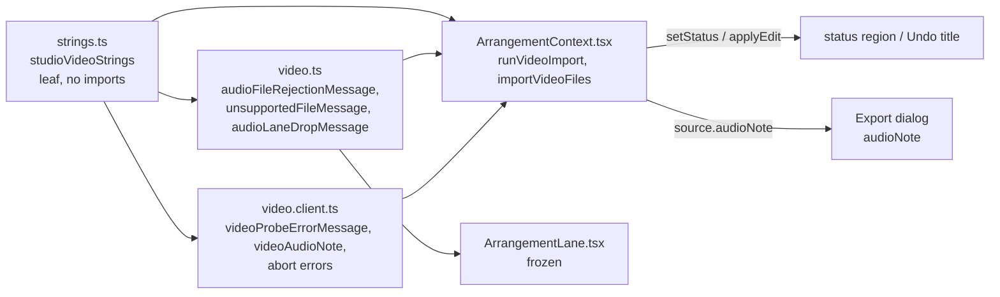

# Studio V-0.2c1 — ვიდეოს იმპორტის ტექსტები ინგლისურად

**თარიღი:** 2026-10-24
**სტატუსი:** Completed (A-ის შემოწმებები მწვანეა რაუნდ 131-ში; ბრაუზერის შემოწმება C-ის რაუნდია)
**შეცვლილი პროექტი:** Store

## კონტექსტი

VISUAL-A-ს M2 მოთხოვნით Studio-ს მთელი UI ინგლისურია, ტექსტები კი ერთი strings მოდულიდან მოდის. V-0.1 (doc 104) Export-ს მოიცავდა, V-0.2a (doc 105) რედაქტირების ბრძანებებს, V-0.2b (doc 106) კი playback-ს, ბიბლიოთეკას, loop-სა და nudge-ს. V-0.2c-ის ერთ რაუნდში ჩატევა შეუძლებელი აღმოჩნდა: B-ის გაზომვით ის რაუნდ 130-ზე 3–4-ჯერ დიდი იქნებოდა. ამიტომ ის ეტაპებად დაიყო, სრული მოცულობის შენარჩუნებით:

- **c1** (ეს რაუნდი): ვიდეოს იმპორტის შეტყობინებები (`video.ts`, `video.client.ts`, Context-ის `runVideoImport` / `importVideoFiles`);
- **c2:** `tempo.ts`, `metronome.ts`, `view.ts`;
- **c3:** `selection.ts` და `groups.ts`.

`collection.ts` (Context-ის l.3462-ის load fallback-ით) მთლიანად გადავიდა V-0.5-ში, ბიბლიოთეკის UI-სთან ერთად, რომელიც მის შეცდომებს აჩვენებს. `library.ts` (ხაზის ტიპების label-ები) გადავიდა V-0.4-ში, ნაგულისხმევ ხაზის სახელებთან ერთად.

## მიდგომა

- `app/lib/arrangement/strings.ts`-ს დაემატა ერთი ობიექტი, `studioVideoStrings`. დანარჩენი ექვსი ობიექტი უცვლელია. მოდული ისევ leaf-ია და არაფერს აიმპორტებს. `soundUnreadable` იმავე ფაილში `studioExportStrings.videoSoundUnreadable`-ზე მიუთითებს, ამიტომ Export-ის ხაზი და `videoAudioNote('decode-failed')` ერთი წყაროდან მოდის.
- **Export-ირებული სახელები რჩება, მნიშვნელობა მოდულიდან მოდის.** `audioFileRejectionMessage`, `unsupportedFileMessage`, `audioLaneDropMessage` (`video.ts`), `videoProbeErrorMessage` და `videoAudioNote` (`video.client.ts`) იგივე სახელით, პარამეტრებითა და return type-ით რჩება. მათი importer-ების (`ArrangementLane.tsx`, Context, `export-mp3.test`, `waveform-zoom.test`, `video.test`, `strings.test`) გამოძახებები და import-ები არ შეცვლილა.
- **პირობითი ტექსტი იქვე რჩება.** `videoAudioNote`-ის `reason` branch-ები, `extension ? … : file.type || unknownType` არჩევანი, `audioLaneDropMessage`-ის `kind` branch-ები და `error instanceof Error ? error.message : String(error)` detail ადრინდელ ადგილას დარჩა. ისინი მხოლოდ მოდულის მნიშვნელობას ირჩევენ.
- **დრო Context-ში ფორმატდება.** `added({name, start, end})` უკვე დაფორმატებულ დროს იღებს (`formatArrangementTime`), როგორც V-0.2b-ში.
- ქცევა არ იცვლება. უცვლელია პირობები, შემოწმებების რიგი, abort / early-return გზები, state-ის განახლება, history push, seek, decode chain, timeout და `classifyVideoFile`. შეიცვალა მხოლოდ string expression-ები. `added(...)`-ის გამოძახება რამდენიმე ხაზზეა, ზუსტად იგივე არგუმენტებით.
- ალტერნატივა იყო formatter-ებში პირობითი ტექსტის გადატანა (მაგ. `videoAudioNote(reason)` პირდაპირ მოდულში). ის უარყოფილია, რადგან module contract მოითხოვს „plain strings + small pure formatters“-ს. ეს კითხვა frontend-architect checkpoint-ს გადაეცა.

### V რუკა

| # | key | ინგლისური |
|---|---|---|
| V1 | `opening(name)` | `Opening “{name}”…` |
| V2 | `addToTrackFailed(name)` | `“{name}”: could not be added to the video track.` |
| V3 | `historyAddVideo(name)` | `Add video — {name}` |
| V4 | `added({name, start, end})` | `“{name}” added to the video track: {start} — {end}` |
| V5 | `importFailed(detail)` | `Could not add the video: {detail}` |
| V6 | `audioFileRejected(name)` | `“{name}”: audio files cannot be added here — only your own video can; sounds are added from the library.` |
| V7 | `notVideo(name, detail)` | `“{name}”: the format is not video ({detail}).` |
| V7a | `unknownType` | `unknown type` |
| V8 | `dropOnVideoTrack` | `Drop the video on the video track.` |
| V9 | `probeFailed(name)` | `“{name}”: the browser could not open this video — try MP4 (H.264) or WebM.` |
| V10 | `noSound` | `The video has no sound` |
| V11 | `tooLongToRead` | `Sound not read: the video is longer than 20 minutes` |
| V12 | `tooLargeToRead` | `Sound not read: the file is larger than 1 GB` |
| V13 | `soundUnreadable` | = `studioExportStrings.videoSoundUnreadable` |
| V14 | `probeCancelled` | `Adding the video was cancelled.` |
| V15 | `decodeCancelled` | `Reading the video's sound was cancelled.` |

ქართული „…“ ბრჭყალები ინგლისური “…”-ით (U+201C / U+201D) შეიცვალა. ფაილის სახელი მომხმარებლის კონტენტია და არ ითარგმნება.

### B-ის გადაწყვეტილებები

- **(c) ბიბლიოთეკის load fallback** `'ჩატვირთვა ვერ მოხერხდა'` (Context l.3462) ქართულად რჩება. ის მხოლოდ ბიბლიოთეკის item-ის შეცდომად ჩანს `შეცდომა:`-ის შემდეგ (`ArrangementLibrary.tsx`), `collection.ts`-ის შეცდომებთან ერთად. ყველა ერთად გადავა V-0.5-ში, რომ ერთი შეცდომის ხაზი ორ ენაზე არ იყოს.
- **(d) ვიდეოხაზის საკუთარი ტექსტები** `ArrangementLane.tsx`-ში (ცარიელი ხაზის hint, drag hint `აქ ვიდეო არ ემატება — ჩააგდე ვიდეოხაზზე`, კლიპის ხმის badge) V-0.4-ში გადავა, მთელ ხაზთან ერთად. V-0.4 მათ status-ის ტექსტების იგივე ინგლისურით შეცვლის (`No room here`, `has not loaded yet`, `Drop the video on the video track`). შერეული ენა დროებითია და აღრიცხულია (GATE128-S1).
- უცვლელია აგრეთვე ნაგულისხმევი ხაზის სახელები (Context l.546–547, V-0.4) და ჯგუფის nudge-ის label `გადატანა (…)` (V-0.4).

### წინსწრებითი წესი (GATE130-S3)

ყოველ ახალ formatter-ს UI ტესტში ერთი ხელით დაწერილი ინგლისური literal უნდა ჰქონდეს, `strings.test`-ის გარდა. მოდულით აგებული მოსალოდნელი მნიშვნელობა template-ის ცვლილებას ვერ დაიჭერს, რადგან ორივე მხარე ერთნაირად იცვლება (doc 106-ის m7 შემთხვევა). ამიტომ `video-import-status-ui.test.tsx` მხოლოდ ხელით დაწერილ literal-ებს ამოწმებს. m9 მუტაციამ აჩვენა, რომ ახლა UI ტესტიც წითლდება.

### Glossary-ის დამატებები

video track (`ვიდეოხაზი`), Add video — {name} (`ვიდეოს დამატება`), Opening … (`იხსნება…`), the format is not video, unknown type, Sound not read (`ხმა არ წაიკითხა`), The video has no sound.

## არქიტექტურა

## შეცვლილი ფაილები

- `app/lib/arrangement/strings.ts`: ახალი ობიექტი `studioVideoStrings` (V1–V15).
- `app/lib/arrangement/video.ts`: import და ოთხი string literal (l.66, 71, 72, 85).
- `app/lib/arrangement/video.client.ts`: import და რვა string literal (l.35, 40, 43, 46, 48, 70, 141, 148).
- `app/contexts/ArrangementContext.tsx`: import და ხუთი string expression `runVideoImport`-სა და `importVideoFiles`-ში.
- `app/lib/arrangement/__tests__/strings.test.ts`: ახალი describe ST14–ST16; ST13-ის სიიდან ამოღებულია ვიდეოს იმპორტის 5 ხაზი, დარჩა 4.
- `app/lib/arrangement/__tests__/video.test.ts`: ორი მოსალოდნელი ტექსტი მოდულიდან, იგივე matcher-ით (`toBe`, `toContain`).
- `app/lib/arrangement/__tests__/video-import-status-ui.test.tsx` (ახალი): VI1–VI4, Context-ის `importVideoFiles`-ით.
- `docs/implementation/2026/quarter-IV/106-studio-v0-playback-loop-strings.md`: მხოლოდ სტატუსის ხაზი (GATE130-S5).

## პრობლემები და გადაწყვეტები

- **პრობლემა:** VI1-ში გარდამავალი `Opening “film.mp4”…` status-ის დანახვა, რადგან resolved probe-ის შემთხვევაში ის მაშინვე იცვლება. **გადაწყვეტა:** probe mock-ი deferred promise-ს აბრუნებს. ტესტი status-ს resolve-მდე კითხულობს, შემდეგ resolve-ს აკეთებს და საბოლოო status-ს ამოწმებს.
- **პრობლემა:** `decodeVideoAudio(file, getDecodeContext(), …)` mock-ის გამოძახებამდე `new OfflineAudioContext(...)`-ს ქმნის. **გადაწყვეტა:** `export-mp3.test`-ის mock preamble და `AudioContext` / `OfflineAudioContext` stub-ები გადმოვიდა. Production hook საჭირო არ გახდა.
- **პრობლემა:** m10 მუტაციამ (ქართული `noSound`) ST14/ST16/VI4-ის გარდა ST4-იც გააწითლა. **მიზეზი:** ST4 `strings.ts`-ს მთლიანად ამოწმებს ქართულ სიმბოლოებზე. ეს მოსალოდნელი დამატებითი დაცვაა.

## ტესტირება

- `npm run typecheck`: სუფთაა. `npm run lint`: exit 0, შეცვლილ ფაილებზე diagnostic არ არის. read-only `npx biome check` 7 კოდისა და ტესტის ფაილზე სუფთაა.
- `npx vitest run`: 13 ფაილი, 233 ტესტი, ყველა მწვანე. ესენია: `strings` (16), `video` (27), `video-import-status-ui` (4), name-only importer-ები `export-mp3` (11) და `waveform-zoom` (9), მეზობლები `ArrangementContext.test` (21), `gesture-reentry` (14), `status-announcement-ui` (33), `video-sync` (58), `video-fades` (12), `video-fades-ui` (10), `collection-load-status` (10), `failed-source-refusal` (8).
- მუტაციები: m9 (ST15 და VI1 წითელი), m10 (ST14, ST15, ST16, VI4 და ST4 წითელი), m11 (VI1 წითელი), m12 (ST13 წითელი), m13 (ST15 და ST16 წითელი). ყოველი მუტაცია აღდგა და sha256-ით შემოწმდა.
- ბრაუზერის შემოწმება (VID-ADD, VID-REJECT, VID-NOAUDIO, VID-LANE-DROP, GEO-COUNT, LAYOUT) C-ის რაუნდია.

## TODO / შემდეგი ნაბიჯები

- V-0.2c2: `tempo.ts`, `metronome.ts`, `view.ts`.
- V-0.2c3: `selection.ts`, `groups.ts`.
- V-0.4: ვიდეოხაზის hint-ები და ხმის badge, ხაზის სახელები, move/trim label-ები, `library.ts`.
- V-0.5: `collection.ts` და ბიბლიოთეკის load fallback.
- frontend-architect checkpoint (`b-round-130-checkpoint-request.md`): strings მოდულის ფორმა და ზრდა, პირობითი ტექსტი formatter-ში თუ გამოძახების ადგილას, Context-ის re-export surface და ზომა.
