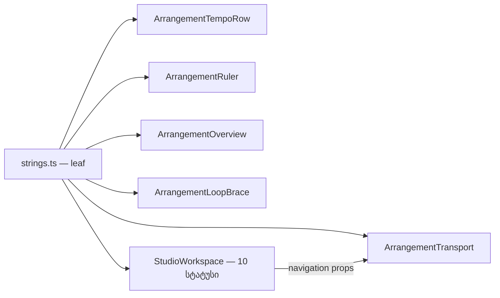

# Studio V-0.3b — Transport-ის, ტემპის ხაზის, ruler-ის, overview-ს, loop brace-ისა და ნავიგაციის სტატუსების ტექსტები ინგლისურად

**თარიღი:** 2026-10-24
**სტატუსი:** Completed (A-ის შემოწმებები მწვანეა რაუნდ 135-ში; ბრაუზერის შემოწმება C-ის რაუნდ 135-ს ელოდება)
**შეცვლილი პროექტი:** Store

## კონტექსტი

VISUAL-A-ს M2 მოთხოვნით Studio-ს მთელი UI ინგლისურია, ტექსტები კი ერთი strings მოდულიდან მოდის. V-0.3a რაუნდ 134-ში დასრულდა (doc 110, gate 134 — `16533c1`). ეს რაუნდი V-0.3b-ა: Transport-ის ზოლი, ტემპის ხაზი (BPM ველი და მეტრონომის ღილაკი), ruler, playhead, overview, loop brace და იმავე ნავიგაციის ღილაკების სტატუსები `StudioWorkspace.tsx`-ში.

B-მა `16533c1`-ზე ხელახლა გაზომა: წყაროში 33 ხაზია (Transport 20, TempoRow 3, Ruler 2, Overview 3, LoopBrace 5), MarkerMenu-ში კიდევ 4. რეალური UI pin-ები 4 ფაილის 9 ხაზზეა (`delete-selection-ui`, `grid-snap-ui`, `tempo-ui`, `metronome-ui`), `e2e/`-ში ქართული საერთოდ არ არის. რაუნდ 133-ის შეფასება (~71 სატესტო ხაზი) ფრაგმენტებზე იყო დაფუძნებული და ზედმეტად მაღალი გამოვიდა.

## მიდგომა

- `app/lib/arrangement/strings.ts`-ში **ახალი ობიექტი არ დამატებულა** (R3). ყოველი ტექსტი თავისი სფეროს არსებულ ობიექტში ჩაჯდა: `studioPlaybackStrings` (დასაწყისზე დაბრუნება, `/ end`), `studioEditStrings` (Split და Delete), `studioLoopStrings` (Loop-ის title-ები და brace), `studioTempoStrings` (BPM ველი), `studioMetronomeStrings` (ღილაკის ტექსტი), `studioViewStrings` (Follow, Zoom, Fit, ruler, overview და მათი სტატუსები). არსებული key-ები უცვლელია, მოდული ისევ leaf-ია და არაფერს აიმპორტებს.
- formatter-ები უკვე დაფორმატებულ მნიშვნელობას იღებს: `braceTitle(span)`, `overviewVisibleStart({start, extent})`, `fitStatus(extent)`, `zoomedToSelection({start, end})`. `formatArrangementTime` ისევ caller-ში ითვლება. ორ ტექსტს შორის არჩევანი (ternary) caller-ში რჩება იგივე პირობითა და რიგით.
- **Delete-ის მინიშნება:** ძველი template-ფრაგმენტი (`ყველა ხაზზე`-ს ჩასმა) შეიცვალა ორი სრული წინადადებით, `deleteRangeHint` და `deleteRangeAllTracksHint`. არჩევანს იგივე `range.allTracks` პირობა აკეთებს. ლოკალური `deleteHint` წაიშალა; title ახლა `rangeDeleteHint ?? deleteClipTitle`-ია, aria-label კი `rangeDeleteHint ?? deleteClipLabel`.
- **ლოკალური სახელები რჩება, მნიშვნელობა მოდულიდან მოდის:** `LOOP_HINT`, `LOOP_KEYBOARD_HINT`, `FOLLOW_PAUSED_MESSAGE`, `ZOOM_RANGE_MISSING_MESSAGE`, `ZOOM_HISTORY_EMPTY_MESSAGE` და `overviewValueText(visibleStart, extent)`. LoopBrace-ის aria-label (`{span} · {LOOP_KEYBOARD_HINT}`) უცვლელია.
- JSX-ის ტექსტი (`/ end`, `⌫ Delete`, `Metronome`) `{object.key}` გამოსახულებად იქცა.
- **ქცევა არ იცვლება.** უცვლელია ყველა handler, პირობა, კლავიში (0, Z, X, Ctrl/Cmd+E, Ctrl/Cmd+L, + / −, ისრები), Follow-ის state machine, zoom-ის ისტორია, loop-ის ბიჯი, ტემპისა და მეტრონომის ლოგიკა, focus-ის გადაცემა და class-ები.

### TR / NV რუკა

| # | key | ინგლისური |
|---|---|---|
| TR1 | `studioPlaybackStrings.backToStartLabel` | `Back to start` |
| TR2 | `studioPlaybackStrings.backToStartTitle` | `Back to start (0)` |
| TR3 | `studioPlaybackStrings.projectEndPrefix` | `/ end` |
| TR4 | `studioEditStrings.splitRangeTitle` | `Split at both edges of the time selection (Ctrl/Cmd+E)` |
| TR5 | `studioEditStrings.splitPlayheadTitle` | `Split at the playhead (Ctrl/Cmd+E)` |
| TR6 | `studioEditStrings.deleteRangeHint` | `Delete time selection — leaves a gap (Delete / Backspace). Cut Time closes the gap: Ctrl+Shift+X` |
| TR7 | `studioEditStrings.deleteRangeAllTracksHint` | `Delete time selection on all tracks — leaves a gap (Delete / Backspace). Cut Time closes the gap: Ctrl+Shift+X` |
| TR8 | `studioEditStrings.deleteClipTitle` | `Delete clip — leaves a gap (Delete)` |
| TR9 | `studioEditStrings.deleteClipLabel` | `⌫ Delete — the selected clip; leaves a gap` |
| TR10 | `studioEditStrings.deleteButton` | `⌫ Delete` |
| TR11 | `studioLoopStrings.selectionTitle` | `Loop the time selection (Ctrl/Cmd+L)` |
| TR12 | `studioLoopStrings.toggleTitle` | `Loop on / off (Ctrl/Cmd+L)` |
| TR13 | `studioLoopStrings.braceHint` | `Loop: make a time selection and press ↻ Loop (Ctrl+L)` |
| TR14 | `studioLoopStrings.braceKeyboardHint` | `← → nudge · Shift + ← → length` |
| TR15 | `studioLoopStrings.braceTitle(span)` | `{span} · the bar moves the loop; the edges change its length` |
| TR16 | `studioLoopStrings.braceStartTitle` | `Loop start` |
| TR17 | `studioLoopStrings.braceEndTitle` | `Loop end` |
| TR18 | `studioTempoStrings.fieldLabel` | `Project tempo (BPM)` |
| TR19 | `studioTempoStrings.fieldTitle` | `Project tempo — bars grid only; audio is not stretched (no time-stretch). Enter — save · Esc — cancel · empty — hide the bars` |
| TR20 | `studioMetronomeStrings.toggleLabel` | `Metronome` |
| NV1 | `studioViewStrings.followOffTitle` | `Follow off: the view does not follow playback` |
| NV2 | `studioViewStrings.followPausedTitle` | `Follow paused by manual navigation — press Follow or Play` |
| NV3 | `studioViewStrings.followOnTitle` | `Follow: the view follows the playback position` |
| NV4 | `studioViewStrings.zoomSliderLabel` | `Zoom (px/s)` |
| NV5 | `studioViewStrings.zoomSliderTitle` | `Zoom around the playhead · + / − · Ctrl+wheel` |
| NV6 | `studioViewStrings.zoomToSelectionLabel` | `Zoom to selection (Z)` |
| NV7 | `studioViewStrings.zoomToSelectionTitle` | `Zoom to the time selection (Z)` |
| NV8 | `studioViewStrings.zoomToSelectionNeedsRangeTitle` | `Zoom to selection: make a time selection first (Z)` |
| NV9 | `studioViewStrings.zoomBackTitle` | `Back to the previous zoom (X)` |
| NV10 | `studioViewStrings.zoomBackEmptyTitle` | `Previous zoom: the history is empty — use Fit or Zoom to selection first (X)` |
| NV11 | `studioViewStrings.fitTitle` | `Fit — the entire project is visible (double-click the ruler or the overview)` |
| NV12 | `studioViewStrings.playheadTitle` | `Playhead — drag · ←/→ = ±0.1 s` |
| NV13 | `studioViewStrings.rulerTitle` | `Click = playhead · ↔ drag = scroll · ↕ drag = Zoom · double-click = Fit / Zoom to selection` |
| NV14 | `studioViewStrings.overviewLabel` | `Overview — entire project (← → = 5 s, double-click = Fit)` |
| NV15 | `studioViewStrings.overviewTitle` | `Overview: click = centre here · ↔ drag = scroll · ↕ drag = Zoom · double-click = Fit` |
| NV16 | `studioViewStrings.overviewVisibleStart({start, extent})` | `Visible start {start} / {extent}` |
| NV17 | `studioViewStrings.followPaused` | `Follow paused by manual navigation. Follow or Play resumes it.` |
| NV18 | `studioViewStrings.zoomNeedsSelection` | `To zoom, make a time selection first.` |
| NV19 | `studioViewStrings.zoomHistoryEmpty` | `The zoom history is empty — there is no view to go back to.` |
| NV20 | `studioViewStrings.fitStatus(extent)` | `Fit: the entire project is visible ({extent}). X goes back.` |
| NV21 | `studioViewStrings.zoomedToSelection({start, end})` | `Zoom to selection: {start} — {end}. X goes back.` |
| NV22 | `studioViewStrings.zoomBackMore` | `Previous view restored. X goes back one more step.` |
| NV23 | `studioViewStrings.zoomBackDone` | `Previous view restored.` |
| NV24 | `studioViewStrings.followOff` | `Follow off: the view does not move by itself.` |
| NV25 | `studioViewStrings.followResumed` | `Follow is following the playback position again.` |
| NV26 | `studioViewStrings.followOn` | `Follow on: the view follows the playback position during playback.` |

### ფაქტები, რომლებიც უნდა შენარჩუნდეს

- TR6 / TR7: სიცარიელე რჩება, კლავიშები Delete / Backspace, Cut Time სიცარიელეს Ctrl+Shift+X-ით ხურავს. „on all tracks“ მხოლოდ მაშინ ჩანს, როცა ყველა ხაზია მონიშნული (მომხმარებლის გადაწყვეტილება 2026-10-11).
- TR8 / TR9: კლიპის წაშლა სიცარიელეს ტოვებს.
- TR4 / TR5: ორივე საზღვარი ან playhead, და Ctrl/Cmd+E.
- TR11 / TR12 და TR13: კლავიში. TR14: კლავიატურის ორივე მინიშნება. TR15: ზოლი loop-ს ამოძრავებს, კიდეები სიგრძეს ცვლის.
- TR19: მხოლოდ ბადე, აუდიო არ იწელება, Enter, Esc, ცარიელი ველი ტაქტებს მალავს.
- NV1–NV3: სამი სხვადასხვა მდგომარეობა. NV10: გამოსავალი (Fit ან Zoom to selection). NV11: ორმაგი click-ის ორივე ადგილი. NV14: 5 წამის ბიჯი და ორმაგი click. NV17: დაბრუნების ორივე გზა (Follow ან Play).
- NV20 / NV21: extent ან ორი დრო, და „X goes back“. NV22 / NV23: „one more step“ მხოლოდ მაშინ, როცა ისტორიაში კიდევ რამე რჩება.

ქართულ ტექსტთან გვერდიგვერდ შედარებისას არცერთ ხაზს ფაქტი არ დაჰკლებია.

### B-ის გადაწყვეტილებები (D-29z100)

- **R1 — MarkerMenu V-0.3c-ში გადადის.** `markers-move-ui` ერთ ფაილში pin-ავს მენიუს ელემენტებსაც და MarkerRow-ის სტატუსებსაც, ფრაზა და ბრჭყალების სტილი (`«» → “”`) კი საერთოა. მარკერის ზედაპირი მთლიანად გადადის.
- **R2 — ნავიგაციის სტატუსები ამ რაუნდს შეუერთდა.** Transport-ის tooltip-ები (Follow, Zoom to selection, Zoom back, Fit) და იგივე ღილაკების მიერ დაწერილი სტატუსები ერთი ზედაპირია. მხოლოდ tooltip-ების თარგმნისას ყოველი click ინგლისურ tooltip-სა და ქართულ სტატუსს აჩვენებდა. `StudioWorkspace.tsx`-ის 10 ხაზი ინგლისურია, ST25-ის ratchet სია **33 → 23**-მდე შემცირდა. ამ ხაზებს UI pin არ ჰქონდა, ამიტომ დაემატა ახალი UI ტესტი (`navigation-strings-ui.test.tsx`).
- **ერთი რაუნდით მიღებული შერეული ზედაპირი:** ხაზების ქვემოთ range readout (`… Delete = წაშლა, სიცარიელე რჩება · Ctrl+Shift+X = Cut Time`) V-0.3d-მდე ქართული რჩება, Delete ღილაკი კი უკვე ინგლისურია. ასევე MarkerRow / MarkerMenu (V-0.3c).
- **R3 — ახალი ობიექტი არ არის.** reviewer-ის Signal 3 ობიექტების რაოდენობას ეხება. ST-ის რუკები მხოლოდ დამატებით გაიზარდა.

### Glossary-ის დამატებები

დასაწყისზე დაბრუნება = Back to start; ბოლო = end; ორმაგი click = double-click; გადახვევა = scroll; ცენტრში = centre here; მიმოხილვა = Overview (Live 12 §6.1); Zoom მონიშნულზე = Zoom to selection (Live „Zoom to Arrangement Time Selection“); წინა Zoom = previous zoom (Live „Zoom Back“); Follow შეჩერდა = Follow paused (Live 12 §6.2); ხილვადი დასაწყისი = Visible start; დროის ამოჭრა = Cut Time (Live §42 „Cut Time“); Loop-ის დასაწყისი / დასასრული = Loop start / Loop end; პროექტის ტემპი = Project tempo; გადაადგილება (brace-ის კლავიშები) = nudge.

## არქიტექტურა

ყველა მომხმარებელი `~/lib/arrangement/strings`-ს აიმპორტებს. `strings.ts` არაფერს აიმპორტებს, ამიტომ ციკლი არ ჩნდება.

## შეცვლილი ფაილები

- `app/lib/arrangement/strings.ts` — ექვს არსებულ ობიექტს დაემატა TR1–TR20 და NV1–NV26 key-ები.
- `app/components/arrangement/ArrangementTransport.tsx` — import, Delete-ის მინიშნების არჩევა, ღილაკების title / aria-label / ტექსტი.
- `app/components/arrangement/ArrangementTempoRow.tsx` — import, BPM ველის aria-label / title, მეტრონომის ტექსტი.
- `app/components/arrangement/ArrangementRuler.tsx` — import, playhead-ისა და ruler-ის title.
- `app/components/arrangement/ArrangementOverview.tsx` — import, `overviewValueText`-ის სხეული, aria-label და title.
- `app/components/arrangement/ArrangementLoopBrace.tsx` — import, `LOOP_HINT`, `LOOP_KEYBOARD_HINT`, brace-ისა და კიდეების title.
- `app/components/arrangement/StudioWorkspace.tsx` — import-ის სახელი და ნავიგაციის 10 სტატუსის ხაზი. დანარჩენი 23 ქართული ხაზი byte-ით უცვლელია.
- `app/lib/arrangement/__tests__/strings.test.ts` — ST6/ST8, ST10/ST12, ST17/ST19-ის რუკების დამატება, ST25-ის სია (23 ხაზი), ახალი ST26–ST27.
- `app/lib/arrangement/__tests__/delete-selection-ui.test.tsx`, `grid-snap-ui.test.tsx`, `tempo-ui.test.tsx`, `metronome-ui.test.tsx` — ქართული pin-ები ხელით დაწერილ ინგლისურ literal-ებად შეიცვალა, იმავე matcher-ით.
- ახალი `app/lib/arrangement/__tests__/navigation-strings-ui.test.tsx` — NS1–NS4 და NS3b, რეალურ `StudioWorkspace`-ზე jsdom-ში.
- `docs/implementation/2026/quarter-IV/110-studio-v0-grid-snap-strings.md` — სტატუსი, ბრაუზერის შედეგი და V-0.3b-ის TODO (GATE134-DOC110-STATUS).

## პრობლემები და გადაწყვეტები

- **პრობლემა:** Delete-ის ძველი მინიშნება template-ში ფრაგმენტს სვამდა, რაც ინგლისურად ბუნებრივ წინადადებას ვერ იძლევა. **გადაწყვეტა:** ორი სრული წინადადება და იგივე `range.allTracks` პირობა caller-ში (R6-ის წესი: ორ ტექსტს შორის არჩევანი caller-ში რჩება).
- **პრობლემა:** Follow-ის შეჩერებული მდგომარეობა მხოლოდ დაკვრისას ჩნდება. **გადაწყვეტა:** jsdom-ში ის მიღწევადია fake AudioContext-ით (Play, შემდეგ scroller-ის ხელით გადახვევა), როგორც `grid-snap-menu` GM24-ში. NS3b ამოწმებს NV2-ს, NV17-სა და NV25-ს.
- **პრობლემა (A-ის შეცდომა):** იმპლემენტაციისას `ArrangementTransport.tsx` ერთხელ შეცდომით placeholder-ით გადაიწერა. **გადაწყვეტა:** წამებში აღდგა წინასწარ მომზადებული სრული შიგთავსით, sha256 დაემთხვა. დეტალი a-round-135.md-შია.

## ტესტირება

- `strings.test.ts`: 25 → 27 `it`. ST26 ახალი formatter-ების ზუსტ ინგლისურს ამოწმებს, ST27 კი ხუთ კომპონენტში ქართული codepoint-ის არარსებობას.
- `navigation-strings-ui.test.tsx`: 5 `it` (NS1, NS2, NS3, NS3b, NS4). DOM-იდან კითხულობს title-ს, aria-label-ს, ტექსტსა და live status-ს.
- `npx vitest run` 21 ფაილზე (6 granted/new და 15 მეზობელი): 386/386 მწვანეა. `npm run typecheck` მწვანეა, `npm run lint` exit 0-ით სრულდება, scoped `npx biome check` 13 ფაილზე სუფთაა.
- მუტაციები (ყოველი აღდგა და sha256-ით შემოწმდა):
  - m30 (`deleteRangeAllTracksHint`-ს აკლდება „ on all tracks“) წითელს ხდის ST6-ს, `delete-selection-ui`-სა და NS2-ს;
  - m31 (Transport-ში `range.allTracks`-ის არჩევანი შებრუნებულია) წითელს ხდის `delete-selection-ui`-სა და NS2-ს;
  - m32 (Follow-ის `next === 'off'` სტატუსები შებრუნებულია) წითელს ხდის NS3-ს;
  - m33 (`fitStatus`-ს აკლდება `({extent})`) წითელს ხდის ST26-სა და NS3-ს;
  - m34 (Zoom to selection-ის title-ის არჩევანი შებრუნებულია) წითელს ხდის NS1-სა და NS2-ს;
  - m35 (`FOLLOW_PAUSED_MESSAGE` ისევ ქართულია) წითელს ხდის ST25-ს (ratchet 24 ≠ 23);
  - m36 (მეტრონომის ტექსტი ისევ `მეტრონომი`-ა) წითელს ხდის ST27-სა და `metronome-ui` UI1-ს;
  - m37 (დამატებითი, code-reviewer-ის Low-ის შემდეგ: `overviewVisibleStart` `start`-ს აღარ იყენებს) წითელს ხდის NS4-ს. NS4 ახლა `aria-valuetext`-ს გადახვევის შემდეგაც ამოწმებს (`Visible start 00:03.000 / 00:10.000`).
- code-reviewer: 9/10, Critical / High / Medium არ არის. ერთადერთი Low (overview-ს `aria-valuetext` მხოლოდ 0-ზე მოწმდებოდა) ამავე რაუნდში გასწორდა.
- ბრაუზერის შემოწმება (TRANSPORT, FOLLOW, ZOOM-FIT, RULER-OVERVIEW, LOOP, TEMPO, GEO-COUNT, LAYOUT) C-ის რაუნდ 135-ს ელოდება.

## TODO / შემდეგი ნაბიჯები

- C round 135: ბრაუზერში შემოწმება 1440×900-სა და 1280×720-ზე.
- V-0.3c: MarkerRow და MarkerMenu. V-0.3d: StudioWorkspace-ის დარჩენილი 23 ხაზი (მათ შორის range readout) და waveform-zoom.ts.
- Backlog-ის glossary-ში ამ რაუნდის ტერმინების ჩაწერა B-ის საქმეა (`backlog.json` A-ს არ ეკუთვნის).
- frontend-architect checkpoint `strings.ts`-ის დაყოფაზე (დამატებები e–g) root-ს ელოდება.
