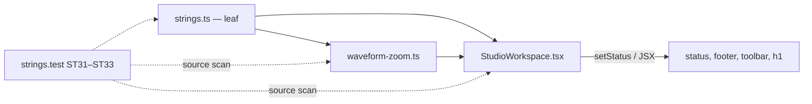

# Studio V-0.3d — StudioWorkspace-ის დარჩენილი ტექსტები და Waveform Zoom ინგლისურად

**თარიღი:** 2026-10-24
**სტატუსი:** Completed (A-ის შემოწმებები მწვანეა რაუნდ 137-ში; C round 137 — PASS, browserVerified; gate 137 — 7e6202b)
**შეცვლილი პროექტი:** Store

## კონტექსტი

VISUAL-A-ს M2 მოთხოვნით Studio-ს მთელი UI ინგლისურია, ტექსტები კი ერთი strings მოდულიდან მოდის. V-0.3c რაუნდ 136-ში დასრულდა (doc 112, gate 136 — `7d9fed0`). ეს რაუნდი V-0.3d-ა და V-0.3-ს ხურავს: `StudioWorkspace.tsx`-ის დარჩენილი ქართული ხაზები (lane-move-ის Shift მინიშნებები, ვიდეოს გაფართოების სტატუსები, ჯგუფის გადარქმევა, Envelope რეჟიმი, Waveform Zoom, სათაურის სუფიქსი, მონიშვნის, მონიშნული კლიპებისა და არჩეული კლიპის ხაზები) და `waveform-zoom.ts`-ის სტატუსი.

B-მა `7d9fed0`-ზე ხელახლა გაზომა: StudioWorkspace-ში 23 ქართული ხაზია (ზუსტად ST25-ის ratchet-ის სია), `waveform-zoom.ts`-ში 1. UI pin-ები 7 ფაილის 23 ხაზზეა, `e2e/`-ში ქართული არ არის.

## მიდგომა

- **ტექსტები თავისი სფეროს ობიექტებში ჩაჯდა (D-29z102 R2):** ვიდეოს სტატუსები `studioVideoStrings`-ში, Shift მინიშნებები `studioLaneMoveStrings`-ში, ჯგუფის გადარქმევა `studioTrackGroupStrings`-ში, Waveform Zoom `studioViewStrings`-ში. ორი ახალი ობიექტი დაემატა `studioMarkerStrings`-ის შემდეგ: `studioClipEnvelopeStrings` (Envelope-ის სფერო, რომელსაც V-0.4 გააფართოებს) და `studioWorkspaceStrings` (სათაური, მონიშვნის ხაზი, მონიშნულთა რაოდენობა, არჩეული კლიპი). არსებული key-ები უცვლელია, მოდული ისევ leaf-ია.
- **formatter-ები უკვე დაფორმატებულ მნიშვნელობებს იღებს.** `rangeReadout({start, end, length})` და `selectedClipTitle({title, start, length, offset})` named object-ს იღებს (3+ ერთტიპიანი პარამეტრი, ლოკალური interface-ით). `formatArrangementTime` და `waveformZoomPercent` caller-ში ითვლება. ternary-ები (Envelope ჩართული/გამორთული, Shift ჩაკეტილი/არა) caller-ში იმავე პირობით რჩება.
- **ჯგუფის გადარქმევა MK12-ის ფორმას იყენებს (R3):** `renameEmpty` იმავე შედეგს იძლევა, რასაც `studioMarkerStrings.renameEmpty`. `renamed` — `Group name: “{name}”.`. `«»` StudioWorkspace-ში აღარ არის.
- **"all tracks" ხელახლა გამოიყენება:** მონიშვნის ხაზის span `studioEditStrings.allTracks`-ს აჩვენებს. ახალი key არ დამატებულა.
- **`waveformZoomStatus(level)`** სახელი და სიგნატურა უცვლელია. ტანი მოდულის formatter-ს იძახებს (`waveform-zoom.ts` → `./strings`, ციკლი არ არის).
- **ლოკალური სახელები რჩება:** `CLIP_LANE_SHIFT_HINT`, `CLIP_LANE_SHIFT_LOCKED_HINT` და `VIDEO_*_MESSAGE`. ორი export (`VIDEO_RETURNED_COMPACT_MESSAGE`, `VIDEO_RETURNED_LIBRARY_RECOLLAPSED_MESSAGE`) ისევ exported-ია.
- **track-header selector (l.331) (R1) არ შეხებია.** ის `ArrangementLane.tsx`-ის aria-label-ს ემთხვევა, რომელიც V-0.4-ს ეკუთვნის. ამიტომ StudioWorkspace-ში ზუსტად ერთი ქართული ხაზი რჩება. ST33 ამას pin-ავს.
- **ქცევა არ იცვლება:** handler-ები, პირობები, კლავიშები, სტატუსების რიგი, focus-ის გადაცემა, history label-ები, `data-testid`-ები და class-ები იგივეა.

### WS რუკა (მოკლედ)

| # | key | ინგლისური |
|---|---|---|
| WS1–2 | `studioLaneMoveStrings.shiftHint` / `shiftLockedHint` | `Shift — lock the time; only the track changes` / `Shift — the time is locked; only the track changes` |
| WS3–7 | `studioVideoStrings.expanded` … `returnedLibraryRecollapsed` | `The video is expanded over the library…`, `…went back to the compact view.` |
| WS8–9 | `studioTrackGroupStrings.renameEmpty` / `renamed` | `The name is empty — “{name}” is kept` / `Group name: “{name}”.` |
| WS10–13 | `studioClipEnvelopeStrings.*` | `Envelope mode: on.` / `off.` და Env ღილაკის ორი title |
| WS14 | `studioViewStrings.waveformZoomLabel` | `Waveform Zoom — view only, the sound does not change` (aria-label, პროცენტის გარეშე) |
| WS15–16 | `studioViewStrings.waveformZoomTitle` / `waveformZoomStatus` | `Waveform Zoom {percent}% — view only, the sound does not change` (სტატუსი წერტილით) |
| WS17–23 | `studioWorkspaceStrings.*` | `· Workspace`, `Time selection: … · length … ·`, `Delete = delete, the gap remains · Ctrl+Shift+X = Cut Time`, `{count} clips selected`, `Clip:` და არჩეული კლიპის title |

## არქიტექტურა

## შეცვლილი ფაილები

- `app/lib/arrangement/strings.ts` — WS key-ები ოთხ არსებულ ობიექტში და ორი ახალი ობიექტი.
- `app/components/arrangement/StudioWorkspace.tsx` — import და §1.1-ის ხაზები მოდულის მნიშვნელობებზე.
- `app/lib/arrangement/waveform-zoom.ts` — import და `waveformZoomStatus`-ის ტანი.
- `app/lib/arrangement/__tests__/strings.test.ts` — additive რუკები, ST25-ის ratchet-ის წაშლა და გადარქმევა, ახალი ST31–ST33.
- 7 pin ფაილი (`floating-video`, `track-groups-ui`, `clip-envelope-ui`, `purchased-collection-ui`, `waveform-zoom`, `all-lane-clipboard`, `track-layout`) — ქართული pin-ები ხელით დაწერილ ინგლისურზე, იმავე matcher-ებით.
- ახალი `app/lib/arrangement/__tests__/workspace-strings-ui.test.tsx` — WSU1 (lane-move-ის მინიშნება რეალურ drag-ში) და WSU2 (მონიშნულთა რაოდენობა).
- `docs/implementation/2026/quarter-IV/112-studio-v0-marker-strings.md` — სტატუსი C round 136 PASS-ით (GATE136-DOC112-STATUS).

## პრობლემები და გადაწყვეტები

- **პრობლემა:** `selectedTitle`-ის ტიპი `string | null`-ია. ძველი template literal ამას მალავდა, ახალი named-object formatter კი `string`-ს მოითხოვს. **გადაწყვეტა:** `selectedTitle ?? selectedClip.sourceId`. `selectedClip`-ის branch-ში `selectedTitle` null არასოდეს არის, ამიტომ fallback მიუწვდომელია. type assertion არ გამოყენებულა.
- **პრობლემა:** `gesture-guard.test.tsx`-ის harness StudioWorkspace-ს არ ამონტაჟებს, footer-ის მინიშნება კი StudioWorkspace-შია. **გადაწყვეტა:** WSU-ში აღებულია `all-lane-clipboard`-ის StudioWorkspace mount და stub-ები, `gesture-guard`-იდან კი row-ების rect-ის, pointer capture-ის stub-ები და drag-ის ნაბიჯები (კოპირებით, import-ის გარეშე).
- **პრობლემა:** Biome-მა ორ ადგილას wrap მოითხოვა: მონიშვნის span (`{studioEditStrings.allTracks} ·{' '}`) და `floating-video`-ს l.134. **გადაწყვეტა:** wrap ხელით გაკეთდა, render-ის ტექსტი უცვლელია.

## ტესტირება

- `npm run typecheck` exit 0, `npm run lint` exit 0 (owned ფაილებში warning არ არის). read-only `npx biome check` 12 კოდისა და ტესტის ფაილზე 0 diagnostic-ს აჩვენებს.
- `npx vitest run` 16 ფაილზე (9 დასახელებული და 7 მეზობელი): 303/303 მწვანეა. `strings.test` 30 → 33 `it`, `workspace-strings-ui` 2. 7 pin ფაილის `it`-ების რაოდენობა უცვლელია.
- მუტაციები m45–m52: თითოეულმა დასახელებული ტესტები გააწითლა, ფაილები აღდგა და sha256-ით შემოწმდა.
- სრული suite, `npm run verify`, build და e2e root-ის gate-ზეა. ბრაუზერის შემოწმება: C round 137 — PASS (browserVerified).

## TODO / შემდეგი ნაბიჯები

- V-0.4: track-header selector (l.331) იცვლება `ArrangementLane.tsx`-ის aria-label-თან ერთად, და ST33-ის allowance 0 ხდება. ასევე lane overlay-ის `ყველა ხაზი` და detail panel.
- V-0.5: dock-ის ღილაკები (return label-ში ტერმინი "compact view").
- frontend-architect checkpoint `strings.ts`-ის დაყოფაზე root-ს ელოდება (`b-round-136-checkpoint-request.md`).
