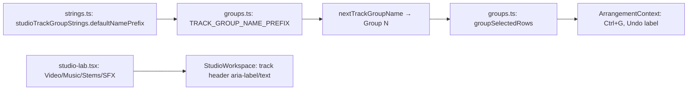

# Studio V-0.4d — ჯგუფისა და ხაზების default სახელები ინგლისურად

**თარიღი:** 2026-10-24
**სტატუსი:** In Progress (A-ის შემოწმებები მწვანეა რაუნდ 141-ში; C round 141 ჯერ არ გაშვებულა)
**შეცვლილი პროექტი:** Store

## კონტექსტი

VISUAL-A-ის V-0 ეტაპი Studio-ს UI ტექსტებს ეტაპობრივად ინგლისურზე გადაიყვანს. V-0.4c-ის შემდეგ ჯგუფის header-ი, meter-ები და Undo label-ები უკვე ინგლისურია, მაგრამ მათში ჩასმული სახელები ჯერ კიდევ ქართული იყო: ახალ ჯგუფს ერქვა `ჯგუფი N`, ხოლო `/studio-lab`-ის ხაზებს `ვიდეო`, `მუსიკა` და `სტემები`. ამის გამო ეკრანზე შერეული ტექსტი ჩანდა, მაგალითად `Mute — ჯგუფი 1`. ეს რაუნდი ამ სახელებს ცვლის (გადაწყვეტილება D-29z106).

## მიდგომა

- ჯგუფის prefix-ი `studioTrackGroupStrings`-ს ბოლო key-ად დაემატა: `defaultNamePrefix: 'Group'`. `TRACK_GROUP_NAME_PREFIX` სახელსაც და export-საც ინარჩუნებს, ოღონდ მნიშვნელობას ამ key-დან იღებს (`existing_exports` წესი).
- ნუმერაციის წესი არ შეცვლილა: ახალი ჯგუფი იღებს უმცირეს თავისუფალ ნომერს, ხოლო გადარქმეული ჯგუფი თავის ნომერს ათავისუფლებს.
- ხაზების სახელები (`Video`, `Music`, `Stems`, `Audio`; `SFX` უცვლელია) data literal-ებად დარჩა route-სა და context-ის fallback-ში. ესენი arrangement-ის მონაცემებია, რომლებსაც მომხმარებელი გადაარქმევს, და UI copy არ არის.
- Arrangement-ს persistence არ აქვს, ამიტომ ძველი `ჯგუფი N` სახელების migration საჭირო არ არის.
- ტესტებში `ჯგუფი` token-ი 10 ფაილში `Group`-ით შეიცვალა მექანიკური `replace_all`-ით: 191 ხაზი, ხაზების სხვა ნაწილი უცვლელია.
- ალტერნატივა იყო ხაზების სახელების strings მოდულში გადატანა. უარვყავით, რადგან ესენი მონაცემებია და არა interface-ის ტექსტი.

## არქიტექტურა

## შეცვლილი ფაილები

- `app/lib/arrangement/strings.ts` — `defaultNamePrefix` key.
- `app/lib/arrangement/groups.ts` — `TRACK_GROUP_NAME_PREFIX` მნიშვნელობას strings მოდულიდან იღებს.
- `app/contexts/ArrangementContext.tsx` — `fallbackArrangement`-ის სახელები `Video` / `Audio`.
- `app/routes/studio-lab.tsx` — demo ხაზების სახელები `Video` / `Music` / `Stems`. meta title V-0.5-ს ეკუთვნის.
- `app/lib/arrangement/__tests__/strings.test.ts` — ST13 (context-ში ერთი ქართული ხაზი რჩება), ST20/ST21, ST22 (`groups.ts` ქართულის გარეშე), ST39 (გამოთვლილი რაოდენობა `toBe(17)`-ის ნაცვლად) და ახალი ST40.
- 9 sweep ფაილი (`clip-gain-waveform`, `fader-touch`, `group-volume-db`, `groups.test`, `header-meter-envelope-strings-ui`, `track-group-collapse-ui`, `track-group-mix-ui`, `track-group-mix.test`, `track-groups-ui`) — მხოლოდ token-ის ჩანაცვლება.
- ახალი `app/lib/arrangement/__tests__/default-track-names-ssr.test.tsx` — DS1/DS2: server HTML-ში ოთხი ხაზის ინგლისური aria-label.
- `docs/implementation/2026/quarter-IV/116-studio-v0-header-meter-envelope-strings.md` — სტატუსი Completed (C round 140 PASS, gate 140).

## პრობლემები და გადაწყვეტები

- **Problem:** დავალების ST40 მაგალითი `createArrangement`-ს მხოლოდ audio ხაზს აწვდიდა, `createArrangement` კი ზუსტად ერთ video ხაზს მოითხოვს და გამონაკლისს აგდებს. **Solution:** ST40 seed-ში video ხაზიც დაემატა. ტესტის შინაარსი (`'Group 1'`) არ შეცვლილა.
- **Problem:** DS2-ის `/ჯგუფი \d/` regex-ი თავად შეიცავდა `ჯგუფი`-ს, ამიტომ sweep-ის შემდეგი `grep` ცარიელი ვერ იქნებოდა. **Solution:** pattern-ი `String.fromCodePoint`-ით აიწყობა და შედეგი იგივე regex-ია.
- **Problem:** m81-ის პირველი გაშვებისას მხოლოდ პირველი template შეიცვალა (`names.has`) და ST40 მწვანე დარჩა. **Solution:** mutation ხელახლა გაეშვა ორივე template-ზე, ანუ ფუნქციის რეალურ output-ზე. ST40 და `groups.test` გაწითლდა.

## ტესტირება

- `npm run typecheck` exit 0; `npm run lint` exit 0 (218 warning, ყველა ძველი, შეცვლილ ფაილებში არც ერთი); read-only `npx biome check` 15 შეცვლილ კოდისა და ტესტის ფაილზე: 0 diagnostic.
- `npx vitest run` 23 ფაილზე (10 sweep, ახალი SSR და 12 მეზობელი): 293/293 მწვანეა. `strings.test` 39 → 40 `it`, ახალ ფაილში 2. sweep ფაილების `it`-ების რაოდენობა უცვლელია.
- მუტაციები m77–m81: თითოეულმა დასახელებული ტესტები გააწითლა. ფაილები backup-იდან აღდგა და sha256-ით შემოწმდა.
- სრული suite, `npm run verify`, build და e2e root-ის gate-ზეა.

## TODO / შემდეგი ნაბიჯები

- C round 141: ბრაუზერში შემოწმება 1440×900-სა და 1280×720-ზე (TRACK-NAMES, GROUP-DEFAULT, GROUP-MIX-REG, GEO-COUNT, LAYOUT, REG-140).
- V-0.4e: detail panel (`ჯგუფი …` role-word, Clip Gain reason), `panels.ts`, `library.ts` label-ები.
- V-0.5: library, dock, route meta title, collection-ის შეტყობინებები, demo source-ების სათაურები, context-ის load-error ტექსტი.
