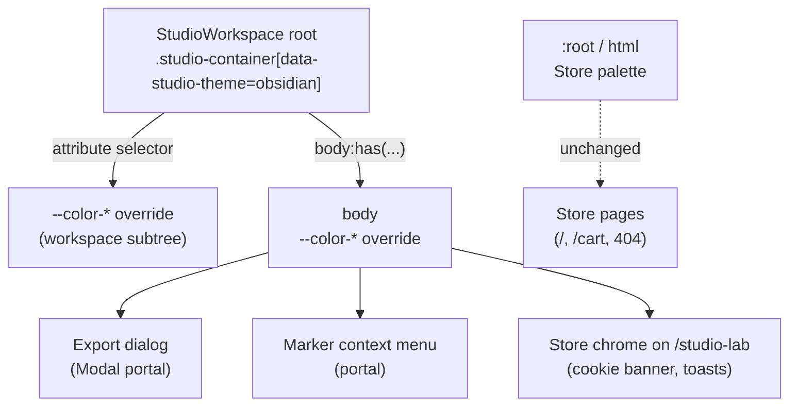

# Studio V-1a — Obsidian & Brass-ის ფერის token-ები Studio-ს scope-ში

**თარიღი:** 2026-10-24
**სტატუსი:** In Progress (C round 149 — ჯერ არ გაშვებულა)
**შეცვლილი პროექტი:** Store

## კონტექსტი

VISUAL-A-ს V-0 (ტექსტების ინგლისურად გადაყვანა) დასრულდა gate 148-ზე (b292ff4). V-1 არის პირველი ვიზუალური ეტაპი: Studio-ს ფერების გადაყვანა მომხმარებლის მიერ 2026-10-21-ს დამტკიცებულ Obsidian & Brass პალიტრაზე (`docs/technical/studio-real-workspace/visual-direction-a.md`, § „ფერები“ და § „როგორ კეთდება“, ნაბიჯი 2).

დღემდე Studio Store-ის ცივ პალიტრას იყენებდა: teal `brand` და orange `accent`. DUX-B-1-ის `text-dim` ტექსტი (53 ელემენტი) და DUX-B-4-ის მონიშნული library row-ის `text-muted` WCAG-ის 4.5:1 ზღვარს ვერ აღწევდა (`c-round-125/out/contrast-baseline.json`).

B-მ V-1 ორ ეტაპად გაყო (D-29z114):

- **V-1a (ეს დოკუმენტი):** scope-ში მოქცეული token-ების ბლოკი და scope-ის marker Studio-ს root-ზე.
- **V-1b:** text field-ის საზღვრის ხილვადობა (DUX-B-3). spec-ის outline token-ები 3:1 საზღვარს ვერ იძლევა და ამისთვის ოთხ სხვა კომპონენტში class-ის ცვლილებაა საჭირო.

## მიდგომა

- `app/styles/app.css`-ის ბოლოს დაემატა ერთი top-level ბლოკი, `@layer`/`@theme`-ის გარეთ. ის 18 `--color-*` custom property-ს ცვლის, მაგრამ მხოლოდ scope-ის შიგნით: 16 მნიშვნელობა spec-ის ცხრილიდანაა და 2 B-ის გადაწყვეტილებაა (R2, R3).
- `StudioWorkspace.tsx`-ის root `
`-ს (`studio-container`) დაემატა ერთი ატრიბუტი, `data-studio-theme="obsidian"`. კომპონენტის class-ები, handler-ები და testid-ები უცვლელია.
- Tailwind v4 utility-ები (`bg-brand`, `text-dim`, `bg-accent/20` …) `var(--color-…)`-ს კითხულობენ. ამიტომ CSS variable-ის scope-ში გადაფარვა საკმარისია და არცერთ კომპონენტს არ სჭირდება ცვლილება. `bg-accent/20`-ის inlined-hex fallback Tailwind-ის output-ია, `@supports` ბლოკის შიგნით კი `var(--color-accent)` მუშაობს.

### B-ის გადაწყვეტილებები (D-29z114)

- **R1, selector:** `[data-studio-theme="obsidian"], body:has([data-studio-theme="obsidian"])`. Export dialog-ი (გაზიარებული `Modal.tsx`) და marker-ის context menu `document.body`-ში portal-ით რენდერდება. მხოლოდ ატრიბუტის selector-ით ისინი ცივ პალიტრაში დარჩებოდა. `body:has(...)` იმეორებს `app.css`-ის არსებულ `body:has(.studio-container)` პატერნს. side effect: `/studio-lab`-ზე cookie banner-ი და toast-ებიც თბილ token-ებს იღებს (M4 ცალკე ეტაპია).
- **R2, `--color-dim` = `#928a7d`** (spec-ში `#8A8276`). მონიშნულ library row-ზე (`brand/10` surface-ზე) `#8A8276` 4.13-ს იძლევა, `#928A7D` კი 4.60-ს.
- **R3, `--color-outline-light`:** spec-ის ცხრილში არ არის, მაგრამ `ArrangementLane`-ის grid ხაზები მას იყენებს. ახალი მნიშვნელობა არის ახალი outline 50% alpha-თი.
- **R4:** `--color-brand-rgb`, `--color-accent-rgb`, `secondary`, `info`, `error*` და სხვა token-ები არ გადაიფარა, რადგან Studio მათ არ იყენებს.
- **R5, accent = brand:** spec-ის მიხედვით მეორე აქცენტი ქრება. C-ის STATE-DISTINCT row ამოწმებს, განსხვავდება თუ არა ის მდგომარეობები, რომლებიც მხოლოდ ფერით განსხვავდებოდა.

### ალტერნატივები

- `:root`-ის ან `@theme`-ის შეცვლა: უარვყავით, რადგან Store-ის გვერდებიც შეიცვლებოდა (RV-3 მოითხოვს, რომ Store უცვლელი დარჩეს).
- კომპონენტებში ახალი class-ები (`bg-obsidian-…`): უარვყავით. ეს ათეულობით ფაილის ცვლილება იქნებოდა, მაშინ როცა CSS variable-ის scope-ში გადაფარვა იგივე შედეგს ერთი ბლოკით იძლევა.
- `Modal.tsx`-ზე ატრიბუტის დამატება: ფაილი frozen-ია, და `body:has(...)` ამას აღარ საჭიროებს.

## არქიტექტურა

Tailwind utility → `var(--color-x)` → ყველაზე ახლო წინაპრის მნიშვნელობა. Studio-ს შიგნით ეს ბლოკია, Store-ის გვერდებზე `:root`.

## შეცვლილი ფაილები

- `app/styles/app.css` — ფაილის ბოლოს დაემატა 22 ხაზი (1 ცარიელი + 21 ხაზიანი ბლოკი). წაშლილი ხაზი არ არის.
- `app/components/arrangement/StudioWorkspace.tsx` — root-ზე 1 ატრიბუტის ხაზი.
- `app/lib/arrangement/__tests__/studio-theme-obsidian.test.tsx` — ახალი, 4 ტესტი (TH1–TH4).
- `docs/implementation/2026/quarter-IV/121-studio-v0-video-dock-strings.md` — სტატუსის 3 ხაზი (GATE148-S1: Completed, C round 148 PASS, gate 148 b292ff4).
- `docs/implementation/2026/quarter-IV/122-studio-v1a-obsidian-color-tokens.md` — ეს დოკუმენტი.

## პრობლემები და გადაწყვეტები

- **პრობლემა:** portal-ით რენდერებული Studio-ს ზედაპირები (`Modal.tsx`, marker menu) workspace-ის DOM subtree-ის გარეთაა. **გადაწყვეტა:** selector-ის მეორე ნაწილი `body:has([data-studio-theme="obsidian"])`. B-ის probe-მა (`b-round-148/out/probe149.json`) Export panel-ზე თბილი surface/border/foreground ცოცხალ გვერდზე დაადასტურა.
- **პრობლემა:** spec-ის `dim` (`#8A8276`) მონიშნულ row-ზე 4.5-ს ვერ აღწევდა. **გადაწყვეტა:** `#928a7d` (R2), რომელიც muted-ზე ჩამქრალი რჩება (muted/dim = 1.24).
- **პრობლემა:** task-ში baseline ფაილი ჩაწერილია როგორც `app/lib/arrangement/__tests__/studio-lab-demo.test.tsx`, ასეთი ფაილი კი არ არსებობს. **გადაწყვეტა:** გამოყენებულია რეალური `app/data/__tests__/studio-lab-demo.test.ts` (13 ტესტი). ეს გადახრა A-ის ანგარიშშია.
- **ცნობილი დროებითი გაუარესება:** DUX-B-3 (Low, deferred): field-ის საზღვარი დაახლოებით 1.51:1-დან 1.15:1-მდე ეცემა. forward constraint d29z92 V-1b-ში დაიხურება და არა V-1a-ში.

## ტესტირება

- Start: HEAD b292ff4, `git status` ცარიელი, frozen list (965) და 3 granted start hash OK.
- Baseline b292ff4-ზე: 4 ფაილი, 73/73 (`tmp/studio-real-loop/a-round-149/vitest-baseline.json`).
- ახალი ტესტები:
  - **TH1:** SSR-ში ზუსტად ერთი `data-studio-theme="obsidian"` არის, `studio-container` root-ზე, და `console.error` არ გამოიძახება.
  - **TH2:** app.css-ში selector ზუსტად ერთხელ გვხვდება, top-level-ზეა და მისი 18 declaration ზუსტად უდრის ხელით ჩაწერილ map-ს. `app/styles/**`-ში marker-ი სხვაგან არ არის.
  - **TH3:** `components/arrangement`-ში (≥ 20 ფაილი) hex-იც და colour function-იც 0-ია.
  - **TH4:** `app/`-ში marker-ი მხოლოდ StudioWorkspace-ში (1) და app.css-ში (2) გვხვდება.
- მუტაციები m114–m118: m114 → TH1, TH4; m115 → TH2; m116 → TH2, TH4; m117 → TH2; m118 → TH3. ყოველი ზუსტად მოსალოდნელ ტესტებს აწითლებს, Edit-ით აღდგა და sha256-ით შემოწმდა (`a-round-149/mutations/summary.json`).
- typecheck, lint, read-only Biome და 5 ფაილის vitest შედეგები `tmp/studio-real-loop/a-round-149.md`-შია.
- სრული suite, `npm run verify`, build და e2e root-ის gate-ზეა. ბრაუზერის row-ებს (TOKENS-SCOPED, RV-1, RV-2, RV-3, STATE-DISTINCT, VISUAL, FUNC-SMOKE) C ამოწმებს. C round 149 ჯერ არ გაშვებულა.

## TODO / შემდეგი ნაბიჯები

- C round 149: რეალურ Chromium-ში TOKENS-SCOPED, RV-1 (0 px layout delta), RV-2 (DUX-B-1/B-4 ≥ 4.5), RV-2-FIELDS (მხოლოდ ჩანაწერი), RV-3 (Store-ის გვერდები უცვლელია), STATE-DISTINCT, FUNC-SMOKE და VISUAL.
- V-1b: text field-ის საზღვარი ≥ 3:1 ან სხვა ხილული cue (DUX-B-3), RV-2-FIELDS-ის გაზომვებიდან.
- V-2 (ფონტები), V-3 (icon-ები, ღილაკის ზედაპირები, radius, motion) და M1/M3/M4 ცალკე ეტაპებია.
