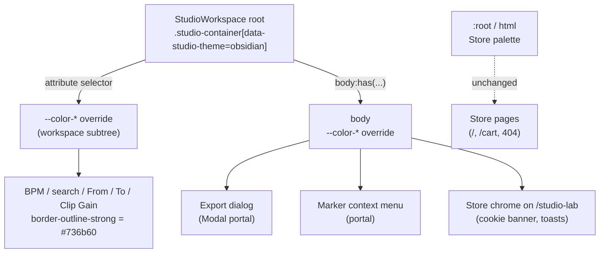

# Studio V-1 (V-1a + V-1b) — Obsidian & Brass-ის ფერის token-ები და text field-ის საზღვარი

**თარიღი:** 2026-10-24 (V-1a), 2026-10-25 (V-1b)
**სტატუსი:** In Progress (C round 150 — ჯერ არ გაშვებულა)
**შეცვლილი პროექტი:** Store

## კონტექსტი

VISUAL-A-ს V-0 (ტექსტების ინგლისურად გადაყვანა) დასრულდა gate 148-ზე (b292ff4). V-1 არის პირველი ვიზუალური ეტაპი: Studio-ს ფერების გადაყვანა მომხმარებლის მიერ 2026-10-21-ს დამტკიცებულ Obsidian & Brass პალიტრაზე (`docs/technical/studio-real-workspace/visual-direction-a.md`, § „ფერები“ და § „როგორ კეთდება“, ნაბიჯი 2).

დღემდე Studio Store-ის ცივ პალიტრას იყენებდა: teal `brand` და orange `accent`. DUX-B-1-ის `text-dim` ტექსტი (53 ელემენტი) და DUX-B-4-ის მონიშნული library row-ის `text-muted` WCAG-ის 4.5:1 ზღვარს ვერ აღწევდა (`c-round-125/out/contrast-baseline.json`).

B-მ V-1 ორ ეტაპად გაყო (D-29z114):

- **V-1a (round 149):** scope-ში მოქცეული token-ების ბლოკი და scope-ის marker Studio-ს root-ზე.
- **V-1b (round 150, D-29z115):** text field-ის საზღვრის ხილვადობა (DUX-B-3) და round 149-ის მიერ გამოწვეული ორი Low (C-R149-1, C-R149-2). round 149 და 150 ერთად ქვეყნდება, ამიტომ ეს ერთი დოკუმენტი მთელ V-1-ს მოიცავს.

## მიდგომა

### V-1a

- `app/styles/app.css`-ის ბოლოს დაემატა ერთი top-level ბლოკი, `@layer`/`@theme`-ის გარეთ. ის 18 `--color-*` custom property-ს ცვლის, მაგრამ მხოლოდ scope-ის შიგნით: 16 მნიშვნელობა spec-ის ცხრილიდანაა და 2 B-ის გადაწყვეტილებაა (R2, R3).
- `StudioWorkspace.tsx`-ის root `
`-ს (`studio-container`) დაემატა ერთი ატრიბუტი, `data-studio-theme="obsidian"`. კომპონენტის class-ები, handler-ები და testid-ები უცვლელია.
- Tailwind v4 utility-ები (`bg-brand`, `text-dim`, `bg-accent/20` …) `var(--color-…)`-ს კითხულობენ. ამიტომ CSS variable-ის scope-ში გადაფარვა საკმარისია და არცერთ კომპონენტს არ სჭირდება ცვლილება. `bg-accent/20`-ის inlined-hex fallback Tailwind-ის output-ია, `@supports` ბლოკის შიგნით კი `var(--color-accent)` მუშაობს.

#### B-ის გადაწყვეტილებები (D-29z114)

- **R1, selector:** `[data-studio-theme="obsidian"], body:has([data-studio-theme="obsidian"])`. Export dialog-ი (გაზიარებული `Modal.tsx`) და marker-ის context menu `document.body`-ში portal-ით რენდერდება. მხოლოდ ატრიბუტის selector-ით ისინი ცივ პალიტრაში დარჩებოდა. `body:has(...)` იმეორებს `app.css`-ის არსებულ `body:has(.studio-container)` პატერნს. side effect: `/studio-lab`-ზე cookie banner-ი და toast-ებიც თბილ token-ებს იღებს (M4 ცალკე ეტაპია).
- **R2, `--color-dim` = `#928a7d`** (spec-ში `#8A8276`). მონიშნულ library row-ზე (`brand/10` surface-ზე) `#8A8276` 4.13-ს იძლევა, `#928A7D` კი 4.60-ს.
- **R3, `--color-outline-light`:** spec-ის ცხრილში არ არის, მაგრამ `ArrangementLane`-ის grid ხაზები მას იყენებს. ახალი მნიშვნელობა არის ახალი outline 50% alpha-თი.
- **R4:** `--color-brand-rgb`, `--color-accent-rgb`, `secondary`, `info`, `error*` და სხვა token-ები არ გადაიფარა, რადგან Studio მათ არ იყენებს.
- **R5, accent = brand:** spec-ის მიხედვით მეორე აქცენტი ქრება. C-ის STATE-DISTINCT row ამოწმებს, განსხვავდება თუ არა ის მდგომარეობები, რომლებიც მხოლოდ ფერით განსხვავდებოდა.

### V-1b (D-29z115)

ექვსი ერთხაზიანი ცვლილება:

| ID | ფაილი | ცვლილება |
|---|---|---|
| F1 | `app.css`, მხოლოდ obsidian ბლოკში | `--color-outline-strong`: `#3a3530` → `#736b60` |
| F2 | `ArrangementTempoRow.tsx` (BPM field) | `border-outline` → `border-outline-strong` |
| F3 | `ArrangementLibrary.tsx` (search field) | `border-outline` → `border-outline-strong` |
| F4 | `ArrangementDetailPanel.tsx` (`inputClass`: From, To, Clip Gain) | `border-outline` → `border-outline-strong` |
| L1 | `ArrangementLoopBrace.tsx` (ჩართული brace) | `bg-accent/30` → `bg-accent/20` |
| L2 | `ArrangementOverview.tsx` (Overview playhead) | დაემატა `ring-1 ring-background` |

- **R1, field-ის საზღვარი = `#736b60`.** spec-ის `#3A3530` surface-ზე მხოლოდ 1.52-ს იძლევა. WCAG relative luminance-ით (sRGB) `#736b60` surface-ზე (`#161412`) = **3.50**, background-ზე (field-ის fill, `#0e0d0c`) = **3.70**, elevated-ზე (`#1d1a17`) = **3.30**. კანდიდატებს `#6b6359` (3.11/3.29/2.93) და `#6e665c` (3.25/3.44/3.07) elevated-ზე ან pixel rounding-ისთვის ძალიან მცირე მარაგი ჰქონდათ. `outline-strong`-ს `app/`-ში მომხმარებელი არ ჰყავდა და მისი utility `@theme`-იდან უკვე კომპილირდება, ამიტომ scope-ში მნიშვნელობის შეცვლა მხოლოდ სამ field-ს ეხება. Store-ის `@theme`-ის `--color-outline-strong` უცვლელია. ის `dim`-ზე (`#928a7d`, 5.38) მუქი რჩება: ხილული, მაგრამ მშვიდი საზღვარი. ეს spec-ის მნიშვნელობიდან გადახრაა, ისევე როგორც R2 (dim), იმავე მიზეზით: spec-ის საკუთარი შემოწმება და WCAG 1.4.11 `#3A3530`-ით ვერ სრულდება.
- **R2, Loop brace-ის fill `/30` → `/20`.** accent label-ი კომპოზიტურ `#3a3124`-ზე = **5.47** (`/30`-ზე 4.38 იყო). იგივე fill-ს ჩართული Loop **ღილაკი** უკვე იყენებს (`ArrangementTransport.tsx`, `border-accent bg-accent/20 text-accent`), ასე რომ brace-ს და ღილაკს ერთი „on“ სახე აქვთ. on/off cue-ები რჩება: მთლიანი vs წყვეტილი border, fill vs არაფერი, „Loop“ vs „Loop off“. hover handle-ები (`hover:bg-accent/60`) უცვლელია.
- **R3, Overview playhead-ის halo და არა ახალი ფერი.** ერთი token C-R149-2-ს ვერ ასწორებს: `foreground` სრულ ზოლზე = 1.88; `background` ზოლზე = 8.32, მაგრამ მუქ Overview-ის ფონზე ≈ 1.0. ამიტომ ხაზი brand accent-ად რჩება და იღებს 1 px `background` halo-ს (`ring-1 ring-background`, `box-shadow`). halo სრულ ზოლზე = **8.32**, ხაზი ფონზე = **8.32**. `box-shadow` bounding box-ს არ ცვლის, ამიტომ RV-1 (layout) უცვლელი უნდა დარჩეს.
- disabled და focus ვარიანტები უცვლელია (`disabled:text-dim`, search-ის `focus:border-brand`, `focus-visible:ring-*`). pending Clip Gain field-ი `border-warning`-ს ინარჩუნებს: `cn()`/twMerge `border-outline-strong`-ს აგდებს, როცა `border-warning` ემატება.

### ალტერნატივები

- `:root`-ის ან `@theme`-ის შეცვლა: უარვყავით, რადგან Store-ის გვერდებიც შეიცვლებოდა (RV-3 მოითხოვს, რომ Store უცვლელი დარჩეს).
- კომპონენტებში ახალი class-ები (`bg-obsidian-…`): უარვყავით. ეს ათეულობით ფაილის ცვლილება იქნებოდა, მაშინ როცა CSS variable-ის scope-ში გადაფარვა იგივე შედეგს ერთი ბლოკით იძლევა.
- `Modal.tsx`-ზე ატრიბუტის დამატება: ფაილი frozen-ია, და `body:has(...)` ამას აღარ საჭიროებს.
- V-1b-ში ახალი `@theme` token (მაგ. `outline-field`): უარვყავით, ეს Store-ის მასშტაბის ცვლილება იქნებოდა. არსებული, გამოუყენებელი `outline-strong` საკმარისია.
- Loop label-ისთვის `text-foreground`: უარვყავით, ოქროსფერი „on“ ტექსტის cue დაიკარგებოდა.

## არქიტექტურა

Tailwind utility → `var(--color-x)` → ყველაზე ახლო წინაპრის მნიშვნელობა. Studio-ს შიგნით ეს ბლოკია, Store-ის გვერდებზე `:root`.

## შეცვლილი ფაილები

- `app/styles/app.css` — V-1a: ფაილის ბოლოს დაემატა 22 ხაზი (1 ცარიელი + 21 ხაზიანი ბლოკი); V-1b: ბლოკში 1 მნიშვნელობა (F1).
- `app/components/arrangement/StudioWorkspace.tsx` — V-1a: root-ზე 1 ატრიბუტის ხაზი.
- `app/components/arrangement/ArrangementTempoRow.tsx` — V-1b: 1 ხაზი (F2).
- `app/components/arrangement/ArrangementLibrary.tsx` — V-1b: 1 ხაზი (F3).
- `app/components/arrangement/ArrangementDetailPanel.tsx` — V-1b: 1 ხაზი (F4).
- `app/components/arrangement/ArrangementLoopBrace.tsx` — V-1b: 1 ხაზი (L1).
- `app/components/arrangement/ArrangementOverview.tsx` — V-1b: 1 ხაზი (L2).
- `app/lib/arrangement/__tests__/studio-theme-obsidian.test.tsx` — ახალი; V-1a: TH1–TH4, V-1b: TH2-ის 1 მნიშვნელობა და TH5, TH6 (სულ 6 ტესტი).
- `docs/implementation/2026/quarter-IV/121-studio-v0-video-dock-strings.md` — სტატუსის 3 ხაზი (GATE148-S1: Completed, C round 148 PASS, gate 148 b292ff4).
- `docs/implementation/2026/quarter-IV/122-studio-v1a-obsidian-color-tokens.md` — ეს დოკუმენტი.

## პრობლემები და გადაწყვეტები

- **პრობლემა:** portal-ით რენდერებული Studio-ს ზედაპირები (`Modal.tsx`, marker menu) workspace-ის DOM subtree-ის გარეთაა. **გადაწყვეტა:** selector-ის მეორე ნაწილი `body:has([data-studio-theme="obsidian"])`. B-ის probe-მა (`b-round-148/out/probe149.json`) Export panel-ზე თბილი surface/border/foreground ცოცხალ გვერდზე დაადასტურა.
- **პრობლემა:** spec-ის `dim` (`#8A8276`) მონიშნულ row-ზე 4.5-ს ვერ აღწევდა. **გადაწყვეტა:** `#928a7d` (R2), რომელიც muted-ზე ჩამქრალი რჩება (muted/dim = 1.24).
- **პრობლემა:** task-ში baseline ფაილი ჩაწერილია როგორც `app/lib/arrangement/__tests__/studio-lab-demo.test.tsx`, ასეთი ფაილი კი არ არსებობს. **გადაწყვეტა:** გამოყენებულია რეალური `app/data/__tests__/studio-lab-demo.test.ts` (13 ტესტი). ეს გადახრა A-ის ანგარიშშია.
- **პრობლემა (C round 149, FAIL — მხოლოდ Low):** ყველა სხვა row გავიდა (`browserVerified` = `realVerified` = true), მაგრამ round 149-მა ორი Low გამოიწვია:
  - **C-R149-1:** ჩართული Loop brace-ის label „Loop“ (`text-accent` `bg-accent/30`-ზე) = 4.32 computed / 4.38 pixel (< 4.5). **გადაწყვეტა:** L1, fill `/20` (B-ის გამოთვლით 5.47).
  - **C-R149-2:** Overview playhead (`bg-accent`) სრულ `bg-brand` audio ზოლზე = 1.03:1 pixel-ით, რადგან ორივე `#c9a46a`-ია. **გადაწყვეტა:** L2, `ring-1 ring-background` halo (8.32).
- **პრობლემა:** DUX-B-3 — V-1a-ს შემდეგ field-ის საზღვარი ≈ 1.15:1 იყო (BPM, library search, detail From/To/Clip Gain). **გადაწყვეტა:** F1–F4. group-name და marker-name input-ები უკვე `border-brand`-ს იყენებს და არ შეცვლილა.
- **შენიშვნა (B-R150-PM2-SUBSTRING, info):** `pending-status.test.tsx` PM2 `className`-ზე `toContain('border-outline')`-ს ამოწმებს. F4-ის შემდეგ ის გადის მხოლოდ იმიტომ, რომ `border-outline-strong` ამ substring-ს შეიცავს (m122-მა დაადასტურა). ზუსტ token-ს ახლა TH5 ამოწმებს. code-reviewer-მა დამატებით აღნიშნა: `detail-panel-fit.test.tsx`-ის pending შემოწმება (`not.toContain('border-outline')` token-ების მასივზე) F4-ის შემდეგ აღარაფერს იცავს. pending მდგომარეობაში `border-outline-strong`-ის მოხსნას ახლა მხოლოდ PM1-ის substring შემოწმება (`pending-status.test.tsx`) იჭერს. ფაილი ამ რაუნდის ownership-ის გარეთაა და ეს B-სთვის გადაცემულ signal-ად რჩება.

## ტესტირება

### V-1a (round 149)

- Start: HEAD b292ff4, `git status` ცარიელი, frozen list (965) და 3 granted start hash OK.
- Baseline b292ff4-ზე: 4 ფაილი, 73/73 (`tmp/studio-real-loop/a-round-149/vitest-baseline.json`).
- ახალი ტესტები:
  - **TH1:** SSR-ში ზუსტად ერთი `data-studio-theme="obsidian"` არის, `studio-container` root-ზე, და `console.error` არ გამოიძახება.
  - **TH2:** app.css-ში selector ზუსტად ერთხელ გვხვდება, top-level-ზეა და მისი 18 declaration ზუსტად უდრის ხელით ჩაწერილ map-ს. `app/styles/**`-ში marker-ი სხვაგან არ არის.
  - **TH3:** `components/arrangement`-ში (≥ 20 ფაილი) hex-იც და colour function-იც 0-ია.
  - **TH4:** `app/`-ში marker-ი მხოლოდ StudioWorkspace-ში (1) და app.css-ში (2) გვხვდება.
- მუტაციები m114–m118: m114 → TH1, TH4; m115 → TH2; m116 → TH2, TH4; m117 → TH2; m118 → TH3 (`a-round-149/mutations/summary.json`).
- C round 149: FAIL, მხოლოდ Low (C-R149-1, C-R149-2); სხვა ყველა row PASS.

### V-1b (round 150)

- Start: HEAD b292ff4, `git status` = 3 ` M` + 2 `??`, frozen list (962), 8 granted start hash და start copy OK.
- Baseline (round 149-ის ხე): 6 ფაილი, 115/115 (`tmp/studio-real-loop/a-round-150/vitest-baseline.json`).
- ახალი/შეცვლილი ტესტები:
  - **TH2:** map-ში მხოლოდ `--color-outline-strong` → `#736b60`.
  - **TH5:** SSR-ში BPM, library search, detail From/To/Clip Gain field-ებს აქვს `border-outline-strong` token და არა `border-outline`; Overview playhead-ს აქვს `bg-accent`, `ring-1`, `ring-background`.
  - **TH6:** `ArrangementLoopBrace.tsx`-ში `'border-accent bg-accent/20'` ზუსტად ერთხელაა, `bg-accent/30` — 0-ჯერ.
- მუტაციები m119–m124: m119 → TH2; m120, m121, m122, m124 → TH5; m123 → TH6. ყოველმა მხოლოდ ერთი ტესტი გააწითლა (116/1), Edit-ით აღდგა და sha256-ით შემოწმდა. m122-ზე PM2 მწვანე დარჩა (B-R150-PM2-SUBSTRING) (`a-round-150/mutations/summary.json`).
- შემდეგ: 6 ფაილი, 117/117; typecheck, lint და 6 ფაილზე read-only Biome — exit 0.
- სრული suite, `npm run verify`, build და e2e root-ის gate-ზეა. ბრაუზერის row-ებს C ამოწმებს. C round 150 ჯერ არ გაშვებულა.

## TODO / შემდეგი ნაბიჯები

- C round 150: რეალურ Chromium-ში FIELD-BOUNDARY (≥ 3.0 pixel-ით ყველა field-ზე, ორივე viewport), RV-2 (Loop label ≥ 4.5), STATE-DISTINCT (Overview halo ≥ 3:1), RV-1 (0 px), TOKENS-SCOPED, RV-3, FUNC-SMOKE და VISUAL.
- signal-ები (B/root-ისთვის, ამ ეტაპში არ კეთდება): `:has()`-ის გარეშე ბრაუზერებისთვის selector-ის გაყოფა; Studio-ს წესების `app/styles/studio-theme.css`-ში გადატანა.
- V-2 (ფონტები), V-3 (icon-ები, ღილაკის ზედაპირები, radius, motion) და M1/M3/M4 ცალკე ეტაპებია.
