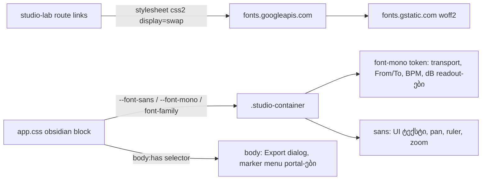

# Studio V-2a — ფონტების ჩატვირთვა /studio-lab-ზე, UI sans (Instrument Sans) და ციფრების mono (IBM Plex Mono)

**თარიღი:** 2026-10-25
**სტატუსი:** In Progress (C round 151 FAIL მხოლოდ Low; round 152 — B-ის გადაწყვეტილებები D-29z117, C-ის ხელახალი შემოწმება)
**შეცვლილი პროექტი:** Store

## კონტექსტი

VISUAL-A-ს V-1 (Obsidian & Brass-ის ფერები) დაიხურა C round 150-ის PASS-ით და gate 150-ით (e94ae88). V-2 არის ტიპოგრაფიის ეტაპი, მომხმარებლის მიერ 2026-10-21-ს დამტკიცებული `docs/technical/studio-real-workspace/visual-direction-a.md`-ის § „ტიპოგრაფია“-ს მიხედვით. გადაწყვეტილება: **D-29z116** (`docs/technical/studio-real-workspace/plan.md`).

B-მ round 151-ის დაგეგმვისას რეალურ Chromium-ში (`/studio-lab`, HEAD e94ae88) გაზომა:

- Studio-ს ტექსტი დღეს Inter-ით რენდერდება: `app.css` l.1-ის `@import` მთელ Store-ზე ტვირთავს Inter-ს, ხოლო `body` წესი (l.448) literal `'Inter', …` stack-ს აყენებს. Tailwind-ის `font-sans`/`font-mono` კი `var(--font-sans)`/`var(--font-mono)`-ში იშლება.
- Google Fonts runner-იდან მუშაობს: css2 → 200; Instrument Sans 400–700, IBM Plex Mono 400 და Noto Sans Georgian 400/500 Chromium-ში `loaded` მდგომარეობამდე მივიდა.
- ფონტის შეცვლა content-sized box-ებს ჰორიზონტალურად აძრავს. ამ რაუნდის ზუსტი ცვლილების CSS-injection სიმულაცია (`v2a`): 1440-ზე 153-დან 29 key, 1280-ზე 136-დან 27 key მოძრაობს > 1 px-ით. იმავე row-ში მომდევნო ელემენტები მოძრაობს მაქსიმუმ 9 px-ით (Master strip). shortcut-hint ხაზის სიგანე 119 px-ით მცირდება. ვერტიკალური ან სიმაღლის delta > 1 px — 0; დაკარგული/ახალი key — 0; ახალი overflow — 0. მხოლოდ mono, არსებულ `font-mono` ელემენტებზე, 5 key-ს ≤ 6 px-ით აძრავს. სრული სია: `tmp/studio-real-loop/b-round-150/out/v2a-predicted-moves-{1440,1280}.json`.

## მიდგომა

- **R1 — RV-1-ის კონტრაქტი V-2-ისთვის.** ტიპოგრაფია დამტკიცებული ცვლილების ტიპია, ხოლო glyph-ების სიგანის ცვლა მისი გარდაუვალი შედეგია და არა layout-ის გადაადგილება. V-0-ის precedent-ის მსგავსად ნებადართულია მხოლოდ ჰორიზონტალური delta (x, w) იმ ელემენტზე, რომლის ტექსტის სიგანე შეიცვალა, ან იმავე row-ში მის მომდევნოზე. ვერტიკალური/სიმაღლის delta > 1 px, დაკარგული/ახალი key, ახალი wrap/ellipsis/clipping/overflow და 1280-ზე viewport-იდან გასვლა აკრძალულია. `kind: panel` box-ები ±1 px-ში რჩება. V-3-ზე ეს არ ვრცელდება. მომხმარებელს შეუძლია veto `feature-status.md`-ში.
- **R2 — ეტაპები.** V-2a (ეს რაუნდი): ფონტების ჩატვირთვა, UI sans, ციფრების mono. V-2b: display serif (Cormorant Garamond 500, Noto Serif Georgian fallback) მხოლოდ ≥ 16 px ტექსტზე, label-ის სტილი (11 px, 500, `0.14em`, Latin UPPERCASE) და weight-ების როლები. არაფერი არ გადაიდო.
- **R3 — ჩატვირთვის ფარგლები.** stylesheet მოდის `/studio-lab` route-ის `links` export-იდან, ამიტომ Store-ის გვერდები ამ ფონტების woff2 ფაილებს არ ტვირთავს (RV-3). გამონაკლისი: Header-ის „Studio Lab“ ბმულს აქვს `prefetch="intent"`, ამიტომ Store-ის გვერდზე მასზე hover-ის ან focus-ის დროს Remix css2 stylesheet-ს `rel="prefetch"`-ით წინასწარ ითხოვს (woff2 ფაილებს — არა). npm dependency და self-hosted ფაილები არ დაემატა. `root.tsx` (protected) უცვლელია. deferred SRW-21 purchased mount-ს მოგვიანებით იგივე `links` დასჭირდება.
- **R4 — family-ის ფარგლები.** `font-family: var(--font-sans)` დგას არსებულ selector-ში `[data-studio-theme="obsidian"], body:has([data-studio-theme="obsidian"])`. ის ფარავს workspace-ს და ორივე portal-ს (Export dialog protected `Modal.tsx`-ით და marker menu), რომლებიც `body`-დან იღებენ მემკვიდრეობით. specificity (0,1,1) სჯობს `body` წესს (0,0,1). გვერდითი ეფექტი, როგორც V-1-ში: `/studio-lab`-ზე cookie banner, toast-ები და `root.tsx`-ის მიერ mount-ებული `AuthModal`-იც Studio sans-ს იღებს.
- **R5 — რომელი ციფრები გახდა mono.** უკვე `font-mono` (8 გამოყენება) token-ის ცვლით იცვლება: transport position/end, From/To/Clip Gain, detail ხაზები, grid menu, loop დროები. ახლა დაემატა: BPM (F3) და სამი dB readout (F4–F6). ოთხივე fixed-width box-შია (`w-14`, `w-16`, `w-10`), ამიტომ row-ს ვერ აძრავს. sans რჩება: pan readout, ruler label-ები, zoom readout. დარჩენილი `tabular-nums` ელემენტები (range readout-ები, library-ის count/duration) B-ის V-2b-ის გადაწყვეტილებაა.
- **R6 — ჩატვირთული weight-ები.** Instrument Sans 400–700 (Studio უკვე იყენებს `font-semibold`-ს და `font-bold`-ს; faux bold-ის თავიდან ასაცილებლად), Plex Mono 400/500 (master peak-ის over state-ს `font-medium`), Noto Sans Georgian 400/500 (`unicode-range`-ით, მხოლოდ ქართული glyph-ების არსებობისას). Plex Mono 300 V-2b-ს ელოდება.
- **R7 — A-R150-REVIEW-L1.** `detail-panel-fit` F4-ის `not.toContain('border-outline')` აღარაფერს იცავდა; ახლა ზუსტ token-ს `border-outline-strong` ამოწმებს.

**ალტერნატივები:** ფონტების `root.tsx`-ში ან `app.css`-ის `@import`-ით ჩატვირთვა უარყოფილია — ორივე Store-ის ყველა გვერდზე ჩატვირთავდა ფონტებს, ხოლო `root.tsx` protected-ია. Store-ის `@theme`-ის `--font-sans`-ის შეცვლა უარყოფილია — Studio-ს ფარგლებს გარეთ გავიდოდა.

## არქიტექტურა

## შეცვლილი ფაილები

- `app/styles/app.css` — obsidian block-ში 3 declaration: `--font-sans`, `--font-mono`, `font-family: var(--font-sans)` (18 → 21). Store-ის `@theme`, l.1-ის `@import` და `body` წესი უცვლელია.
- `app/routes/studio-lab.tsx` — `LinksFunction` import, `STUDIO_FONTS_HREF` კონსტანტა და `links` export.
- `app/components/arrangement/ArrangementTempoRow.tsx` — BPM field-ს `font-mono` token.
- `app/components/arrangement/ArrangementMaster.tsx` — master peak-სა და master readout-ს `font-mono` token.
- `app/components/arrangement/ArrangementLane.tsx` — track volume readout-ს `font-mono` token.
- `app/lib/arrangement/__tests__/studio-theme-obsidian.test.tsx` — TH2-ის map-ში 3 ახალი ჩანაწერი, ახალი TH7 და TH8.
- `app/lib/arrangement/__tests__/detail-panel-fit.test.tsx` — T1: pending-ის შემოწმება ზუსტ `border-outline-strong` token-ზე.
- `docs/implementation/2026/quarter-IV/122-studio-v1a-obsidian-color-tokens.md` — სტატუსი Completed და C round 150-ის შედეგები.

## პრობლემები და გადაწყვეტები

- **პრობლემა:** spec ერთდროულად ითხოვს ახალ ფონტებს და „ყველა box ±1 px-ში“-ს, რაც glyph-ების სიგანის შეცვლისას ვერ შესრულდება. → **გადაწყვეტა:** B-ის R1 — მხოლოდ ჰორიზონტალური, ტექსტის სიგანით გამოწვეული delta-ები დაშვებულია; ვერტიკალური და panel-ის box-ები ±1 px-ში რჩება.
- **პრობლემა:** `arrangement-track-pan-reset` SSR-ში ყოველ audio track-ზე მეორდება, ამიტომ არსებული `classTokensByTestId` helper (რომელიც ზუსტად ერთ tag-ს ელოდება) R5-ის უარყოფით შემოწმებას ვერ ემსახურება. → **გადაწყვეტა:** TH8-ში დაემატა helper, რომელიც ყველა tag-ის token-ებს აბრუნებს; track volume readout-ები (testid-ის გარეშე) `w-10` + `tabular-nums`-ით იძებნება.
- **პრობლემა (C-R151-1, Low):** C-ის d6 chain-ში `arrangement-shortcut-hint` `kind: panel`-ად იყო მონიშნული და მისი სიგანე 1189 → 1070 px-მდე შემცირდა (x, y, h უცვლელი, determinism 0 px), რაც R1-ის „panel ±1 px“ წესს არღვევდა. → **გადაწყვეტა:** B-ის R1 (D-29z117) — hint არის content-sized `
`, რომლის სიგანე მისივე ტექსტის სიგანეა და არა container. V-2-ისთვის ის ითვლება text ელემენტად და არა panel-ად; C round 152-ში მას d6-ის `PANELS` სიიდან ამოიღებს. fixed width არ დაემატა, რადგან ეს მომხმარებლის მიერ დაუმტკიცებელი layout-ის ცვლილება იქნებოდა. R1-ის დანარჩენი წესები უცვლელია. მომხმარებელს შეუძლია veto `feature-status.md`-ში.
- **პრობლემა (C-R151-2, Low):** hint-ში „ · “ separator-ები Instrument Sans-ით ვიწროა. B-ის გაზომვა რეალურ Chromium-ში (12 px, headless Linux, integer advance-ები): Instrument Sans — space 2 px, `·` 1 px, „ · “ 5 px; Inter — 3 / 3 / 9 px. → **გადაწყვეტა:** B-ის R2 — V-2-ის ფარგლებში დამტკიცებული fix არ არსებობს. `word-spacing: 0.12em` „ · “-ს ≈ 8.8 px-მდე და hint-ს 1162 px-მდე გაზრდიდა (S0-ში 17 ჰორიზონტალური მოძრაობა, 0 ვერტიკალური, 0 ახალი overflow), მაგრამ spec მხოლოდ font-ს, weight-სა და letter-spacing-ს ამტკიცებს და ერთ-პიქსელიან `·`-ს ვერ ასწორებს. separator glyph-ის შეცვლა ტექსტის შინაარსს ცვლის (94 source ხაზი, მათგან 44 `strings.ts`-ში, საერთო კონსტანტის გარეშე). C-R151-2 რჩება ღია Low-ად `deferred_low_polish`-ში და მიდის მომხმარებელთან კითხვად: მიღება / `word-spacing: 0.12em` / სხვა separator glyph. საბოლოო მიღებისთვის ის უნდა გასწორდეს ან მომხმარებელმა მიიღოს.
- **პრობლემა (C-R151-3, Low/info):** `−∞`-ში „−“ IBM Plex Mono-თია, „∞“ კი fallback DejaVu Sans Mono-თი, რადგან U+221E Plex Mono-ს subset-ში არ არის. → **გადაწყვეტა:** B-ის R3 — Google-ის css2-ის არცერთ subset-ში U+221E არ არის, ხოლო self-hosting spec-ით აკრძალულია; C-მ ვიზუალურად მისაღებად შეაფასა. `deferred_low_polish`, ხელახლა V-3-ში (glyph-ები/icon-ები) ან polish pass-ში.

## ტესტირება

- Start: HEAD e94ae88, `git status` ცარიელი, frozen list (962), 8 granted start hash და start copy — OK.
- Baseline: 12 ფაილი, 110/110 (`tmp/studio-real-loop/a-round-151/vitest-baseline.json`).
- ახალი/შეცვლილი ტესტები:
  - **TH2:** map-ში 3 ახალი ჩანაწერი, ხელით აკრეფილი F1-ის ზუსტი სტრიქონებით; სათაური — 21 declaration.
  - **TH7:** `links()` უდრის ერთ stylesheet-ს ხელით აკრეფილი href-ით; href შეიცავს `display=swap`-ს და არ შეიცავს `Cormorant`, `Inter`, `Playfair`-ს.
  - **TH8:** SSR-ში `arrangement-tempo-input`, `arrangement-master-readout`, `arrangement-master-peak`-ს აქვს `font-mono` და `tabular-nums`; `w-10` + `tabular-nums` ელემენტები ზუსტად 4-ია და ყველას აქვს `font-mono`; `arrangement-track-pan-reset`-ს `font-mono` არ აქვს.
  - **T1:** `detail-panel-fit` F4 ამოწმებს `not.toContain('border-outline-strong')`.
- მუტაციები m125–m132 და საბოლოო შედეგები: `tmp/studio-real-loop/a-round-151.md` და `a-round-151/mutations/`.
- სრული suite, `npm run verify`, build და e2e root-ის gate-ზეა. ბრაუზერის row-ებს (FONTS-APPLIED, FONTS-SCOPED, RV-1-TYPE, NO-CLIP, FONT-FAIL, RV-2, TOKENS-SCOPED, FUNC-SMOKE, VISUAL) C ამოწმებს. C round 151 ჯერ არ გაშვებულა.
- **C round 151 (FAIL მხოლოდ Low, `browserVerified` = `realVerified` = true):** რეალურ Chromium-ში ორივე viewport-ზე 13 row PASS — FONTS-APPLIED, FONTS-SCOPED, NO-CLIP, FONT-FAIL, RV-2, TOKENS-SCOPED, FUNC-SMOKE, G151-3, PX-NET, REG-HYD, SOURCE-SCOPE, AN-REVIEW, T151-TARGETED (`tmp/studio-real-loop/c-round-151.md`).
  - **RV-1-TYPE:** y/h delta > 1 px — 0, დაკარგული/ახალი key — 0, 1280-ს გარეთ ახალი ელემენტი — 0, determinism 0 px. ერთადერთი დარღვევა: shortcut-hint-ის სიგანე −119 px (C-R151-1, იხ. ზემოთ).
  - **FONT-FAIL:** ფონტების host-ების ბლოკირებისას workspace ≈ 0.2 s-ში ჩნდება; fallback არის DejaVu Sans და DejaVu Sans Mono.
  - **RV-2:** DUX-B-1/B-4-ის 61/61 text ელემენტი ≥ 4.5 (min 4.57); 0 ახალი contrast-ის ჩავარდნა.

## TODO / შემდეგი ნაბიჯები

- C round 151: რეალურ Chromium-ში ორივე viewport-ზე, `document.fonts.ready`-ის შემდეგ — FONTS-APPLIED (CDP `CSS.getPlatformFontsForNode`), FONTS-SCOPED (Store-ის გვერდებზე 0 მოთხოვნა), RV-1-TYPE (R1-ის კონტრაქტი, B-ის პროგნოზთან შედარება), NO-CLIP (BPM 300, volume-ის min/max, peak over), FONT-FAIL, RV-2, TOKENS-SCOPED, FUNC-SMOKE და VISUAL.
- V-2b: display serif ≥ 16 px ტექსტზე, label-ის სტილი, weight-ების როლები (Plex Mono 300-ის ჩათვლით) და დარჩენილი `tabular-nums` ელემენტების გადაწყვეტილება.
- SRW-21 (deferred): purchased mount-ს იგივე `links` დასჭირდება.
- მომხმარებლის გადაწყვეტილება separator-ებზე (C-R151-2): მიღება / `word-spacing: 0.12em` / სხვა separator glyph.
- C round 152: FONTS-SCOPED-ის ახალი ფორმულირება (R4, review L1) — Header-ის „Studio Lab“ ბმულზე hover/focus-ისას F2 css2-ის `rel="prefetch"` დაშვებულია და ფიქსირდება; Store-ის გვერდებზე ამ family-ების 0 woff2 კვლავ სავალდებულოა.
