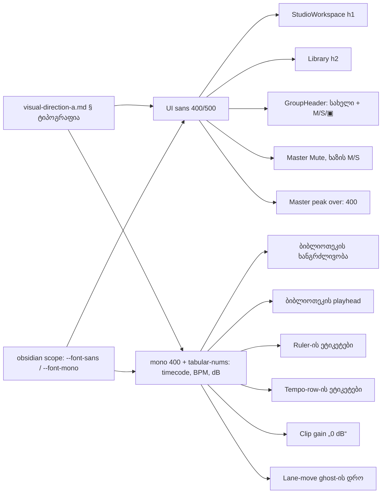

# Studio V-2b-2 — weight-ის როლები (600/700 → 500) და დარჩენილი timecode-ები mono-ში

**თარიღი:** 2026-10-25
**სტატუსი:** In Progress (awaiting C round 154)
**შეცვლილი პროექტი:** Store

## კონტექსტი

V-2b-1 (სექციების ლათინური ეტიკეტები) დაიხურა C round 153-ის PASS-ით და gate 153-ით (`037e25f`). V-2b-2 არის ტიპოგრაფიის შემდეგი ეტაპი, რომელიც მომხმარებლის მიერ დამტკიცებული `docs/technical/studio-real-workspace/visual-direction-a.md`-ის § „ტიპოგრაფია“-ს ორ რიგს ეყრდნობა:

- **UI sans — 400/500, „ყველა სხვა ტექსტი“.** Studio-ში ჯერ კიდევ იყო `font-semibold` (600) და `font-bold` (700): workspace-ის `h1`, Library-ის `h2`, ჯგუფის სახელი და ჯგუფის M/S ღილაკები, Master Mute და ხაზების M/S ღილაკები.
- **ციფრები — IBM Plex Mono 300/400, `tabular-nums` — „timecode, BPM, dB, საიდან/სადამდე“.** V-2a-მ mono მისცა BPM-ს, Master/ტრეკის volume-ს და peak-ს. დანარჩენი timecode-ები და dB sans-ში რჩებოდა (C-R151-SIG-SANS-TIMECODES).

გადაწყვეტილება: **D-29z119** (`docs/technical/studio-real-workspace/plan.md`). B-მ ცვლილება რეალურ Chromium-ში წინასწარ გაზომა (`tmp/studio-real-loop/b-round-153/out/`).

## მიდგომა

### B-ის გადაწყვეტილებები (D-29z119)

- **R1 — weight-ის როლები.** UI sans იყენებს მხოლოდ 400/500-ს. `app/components/arrangement/**`-ში ყველა `font-semibold`/`font-bold` ხდება `font-medium` (7 ადგილი, W1–W5). Master peak-ის over-state-ს მოეხსნა `font-medium` (W6), ამიტომ mono peak ღილაკი over-ის დროსაც 400-ზე რჩება, spec-ის mono რიგის მიხედვით. Mono 300 არსად გამოიყენება, ამიტომ Plex Mono 300 არ დაემატა.
- **R2 — რომელი ციფრები გადადის mono-ში.** მხოლოდ spec-ის სია: timecode, BPM, dB, საიდან/სადამდე. round 151-ის წესი, რომ pan readout სიაში არ შედის, ძალაშია (TH8).
- **R3 — Export dialog-ის სათაური (24 px / 600) არ შეცვლილა.** მისი weight მოდის დაცული `Modal.tsx`-დან. ის V-2b-DISPLAY-ის კითხვას უერთდება: როლსა და weight-ს Saba-ს არჩეული ვარიანტი განსაზღვრავს.
- **R4 — css2 URL ამ რაუნდში არ შეცვლილა.** Instrument Sans 600/700 და Plex Mono 500 შეიძლება აღარავის სჭირდებოდეს, მაგრამ backlog-ის წესით გამოუყენებელი weight-ები URL-იდან მხოლოდ C-ის ფონტების მტკიცებულებით იშლება (ქვემოთ, „css2-ის შემცირების გეგმა“).
- **R5 — ტექსტის კონტენტი უცვლელია.** იცვლება მხოლოდ კლასები, პლუს ერთი `` ბიბლიოთეკის ხანგრძლივობის გარშემო (N1). ასე meta row-ს ისევ ზუსტად 2 შვილი და იგივე კლასის სტრიქონი აქვს.

### W/N ცხრილი

| ID | კომპონენტი | ცვლილება |
|---|---|---|
| W1 | `StudioWorkspace.tsx` | workspace-ის `h1`: `font-semibold` → `font-medium` |
| W2 | `ArrangementLibrary.tsx` | Library-ის `h2`: `font-semibold` → `font-medium` |
| W3 | `ArrangementGroupHeader.tsx` | `TRACK_GROUP_MIX_BUTTON_CLASS` (ჯგუფის M/S/▣): `font-bold` → `font-medium` |
| W4 | `ArrangementGroupHeader.tsx` | ჯგუფის სახელის ღილაკი: `font-semibold` → `font-medium` |
| W5 | `ArrangementMaster.tsx`, `ArrangementLane.tsx` | Master Mute და ხაზების M/S: `font-bold` → `font-medium` |
| W6 | `ArrangementMaster.tsx` | peak-ის over branch-ს მოეხსნა `font-medium` |
| N1 | `ArrangementLibrary.tsx` | მზა ჩანაწერის ხანგრძლივობა შეიფუთა ``-ში; loading/error ტექსტები sans-ში რჩება |
| N2 | `ArrangementLibraryPreview.tsx` | ბიბლიოთეკის playhead: `tabular-nums` → `font-mono tabular-nums` |
| N3 | `ArrangementRuler.tsx` | ruler-ის ეტიკეტებს დაემატა `font-mono` |
| N4 | `ArrangementTempoRow.tsx` | tempo-row-ის bar/beat ეტიკეტებს დაემატა `font-mono`; `4/4` უცვლელია |
| N5 | `ArrangementDetailPanel.tsx` | clip-gain-ის reset ღილაკს („0 dB“) დაემატა `font-mono` |
| N6 | `ArrangementLane.tsx` | ხაზებს შორის გადატანის ghost-ის საწყის დროს დაემატა `font-mono`; pan readout უცვლელია |

### რა რჩება sans-ში და რატომ

- **zoom readout („40 px/s“)** — spec-ის სიაში არ არის (არც timecode, არც dB). mono-ში უარეს შემთხვევაში („123.4 px/s“) 70 px-ია, `w-16` (64 px) ყუთში კი არ ეტევა.
- **ბიბლიოთეკის რაოდენობები, `4/4`, pan readout (TH8), grid-division და waveform-zoom `<select>`-ები** — spec-ის სიაში არ არის. B-ის გადაწყვეტილებაა; მომხმარებელს შეუძლია ვეტო დაადოს `feature-status.md`-ში.
- **ბიბლიოთეკის preview-ის ხანგრძლივობა** — timecode-ია, მაგრამ ჯერ sans-ში რჩება (კითხვა B-R153-PREVIEW-DUR, ქვემოთ).
- **საიდან/სადამდე timecode-ები წინადადებების შიგნით** (range readout, მონიშნული clip-ის ხაზი, Export-ის scope ხაზი) — შემდეგი ეტაპი, V-2b-3 (ქვემოთ).

### კითხვები მომხმარებლისთვის

- **B-R153-PREVIEW-DUR.** mono-ში preview-ის ხანგრძლივობა default სათაურს „Middle East — საჯარო preview“ ახლა წყვეტს (slack 0 → −6 px; −0.05em tracking-ითაც −1 px). ვარიანტები Saba-სთვის:
  - (a) ადრეული ellipsis-ის მიღება (სრული სათაური `title` tooltip-ში რჩება);
  - (b) layout-ის ცვლილება (gap ან სიგანე, M-ტიპის ცვლილება);
  - (c) sans-ში დატოვება.
- **V-2b-DISPLAY (a)–(d)** — display serif-ის ვარიანტები (doc 124). ახლა მოიცავს Export dialog-ის სათაურის weight-საც (R3).

## არქიტექტურა

## შეცვლილი ფაილები

- `app/components/arrangement/StudioWorkspace.tsx` — W1.
- `app/components/arrangement/ArrangementLibrary.tsx` — W2, N1.
- `app/components/arrangement/ArrangementGroupHeader.tsx` — W3, W4.
- `app/components/arrangement/ArrangementMaster.tsx` — W5 (Master Mute), W6.
- `app/components/arrangement/ArrangementLane.tsx` — W5 (M/S), N6.
- `app/components/arrangement/ArrangementLibraryPreview.tsx` — N2.
- `app/components/arrangement/ArrangementRuler.tsx` — N3.
- `app/components/arrangement/ArrangementTempoRow.tsx` — N4.
- `app/components/arrangement/ArrangementDetailPanel.tsx` — N5.
- `app/lib/arrangement/__tests__/studio-theme-obsidian.test.tsx` — ახალი TH10.
- `app/lib/arrangement/__tests__/render-budget.test.tsx` — ბიბლიოთეკის playhead-ის ზუსტი კლასი (`font-mono tabular-nums`).
- `app/lib/arrangement/__tests__/library-row-strings-ui.test.tsx` — LRS3-ში N1-ის assertion-ები.
- `docs/implementation/2026/quarter-IV/124-studio-v2b1-label-typography.md` — სტატუსი Completed (C round 153 PASS, gate 153).
- `docs/implementation/2026/quarter-IV/125-studio-v2b2-weights-numerals.md` — ეს დოკუმენტი.

## პრობლემები და გადაწყვეტები

- **პრობლემა:** N1-ის ternary-ის ბოლო branch JSX ელემენტი გახდა და Biome-ის formatter-მა მთელი ternary JSX-ის ფორმატში გადაიტანა.
  **გადაწყვეტა:** formatter-ის განლაგება მივიღეთ; loading/error branch-ების ტექსტი და მნიშვნელობები უცვლელია, შეიცვალა მხოლოდ ხაზების განლაგება.
- **პრობლემა:** TH ფაილის არსებული helper `classTokensOfEveryTag` იყენებს `<[a-z]+\b` regex-ს, რომელიც `h1`/`h2`-ს ვერ პოულობს (ციფრი word character-ია, ამიტომ `\b` არ მუშაობს).
  **გადაწყვეტა:** TH10-ში heading-ებისთვის ცალკე ლოკალური regex (`<h[1-6]\b`), საერთო helper-ი და TH1–TH9 უცვლელია.
- **პრობლემა:** TH ფაილი `node` გარემოშია, ამიტომ ელემენტები, რომლებიც S0 SSR-ში არ ჩანს, DOM-ში ვერ მოწმდება.
  **გადაწყვეტა:** SSR probe-მა აჩვენა, რა ჩანს S0-ში. რაც ჩანს, SSR-ით მოწმდება; დანარჩენი — კომპონენტის ფაილში ზუსტი კლასის სტრიქონით (ახალი 1-ჯერ, ძველი 0-ჯერ). რეალური computed style-ის შემოწმება C-ის MONO-STYLE/WEIGHT-STYLE row-ებია.

## ტესტირება

- **TH10** (`studio-theme-obsidian.test.tsx`):
  - (a) `app/components/arrangement`-ის არცერთ `.ts`/`.tsx` ფაილში (≥ 20 ფაილი, TH3-ის მსგავსად) არ არის `font-semibold`, `font-bold`, `font-extrabold`, `font-black` ან arbitrary `font-[NNN]` token (code-reviewer-ის შენიშვნის შემდეგ გაფართოვდა); `ArrangementMaster.tsx`-ში `bg-destructive/15 font-medium` 0-ჯერ, ახალი over-ის კლასი 1-ჯერ (W6).
  - (b) S0 SSR: `h1`, Library-ის `h2`, Master Mute, 4 ხაზის Mute და 4 Solo ღილაკს აქვს `font-medium` და არც `font-semibold`, არც `font-bold`. `arrangement-library-playhead`-ს აქვს `font-mono` და `tabular-nums` (N2). `arrangement-detail-clip-gain-reset`-ს აქვს `font-mono` (N5). ruler-ის ყველა ეტიკეტს (S0-ში 30) აქვს ზუსტი კლასი `font-mono`-თი (N3). zoom readout-სა და 3 pan reset-ს `font-mono` არ აქვს.
  - (c) წყაროს დონეზე: N3 (Ruler), N4 (TempoRow), N6 (Lane ghost), W3 და W4 (GroupHeader) — ახალი ზუსტი კლასის სტრიქონი ზუსტად 1-ჯერ, ძველი 0-ჯერ. N4, N6 და ჯგუფის header-ი S0 SSR-ში არ ჩანს (საჭიროა BPM, drag ან ჯგუფი).
  - N1 მოწმდება LRS3-ში (jsdom): meta row-ის მეორე შვილში ზუსტად ერთი `span.font-mono`, `textContent` = `00:20.000`; პირველ შვილს `font-mono` არ აქვს.
- 21 vitest ფაილი (8 დავალებიდან + group header-ისა და clip gain-ის ტესტები + `grid-musical-ui`): baseline 292/292, ცვლილების შემდეგ 293/293 (TH10-ის ჩათვლით).
- მუტაციები: m137 (ხაზის Mute-ზე `font-bold` დაბრუნება) — წითლდება მხოლოდ TH10; m138 (ruler-იდან `font-mono`-ს მოხსნა) — მხოლოდ TH10; m139 (N1-ის `font-mono` meta row-ზე) — LRS3 (კლასის ზუსტი სტრიქონი); m140 (W6-ში `font-medium` დაბრუნება) — მხოლოდ TH10. დამატებით m139b (მხოლოდ შიდა span-ის კლასის მოხსნა) — LRS3 (T3-ის assertion). შედეგები: `tmp/studio-real-loop/a-round-154/mutations/`.
- `npm run typecheck`, `npm run lint` და scoped `biome check` 12 ფაილზე — სუფთა (lint-ის არსებული warning-ები ამ რაუნდს არ ეხება).
- სრული suite, `npm run verify`, build და e2e root-ის gate-ზეა. ბრაუზერის row-ებს (WEIGHT-STYLE, MASTER-OVER, MONO-STYLE, RV-1-V2B2, NO-CLIP / OVERLAP, LANE-GHOST, WEIGHT-INVENTORY, FONTS-SCOPED, FUNC-SMOKE, G154-3, PX-NET / REG-HYD) C round 154 ამოწმებს.

## css2-ის შემცირების გეგმა

ამ რაუნდის შემდეგ Instrument Sans 600/700 და Plex Mono 500 შეიძლება აღარავის სჭირდებოდეს (გარდა Export-ის `ModalTitle`-ისა, 600). C-ის WEIGHT-INVENTORY row მთელ `/studio-lab` გვერდზე (S0, S1 ჯგუფით, S2 Export, marker და grid menu, cookie banner) ჩამოწერს ყველა ხილულ ტექსტს weight ≥ 600-ით და `document.fonts`-ის ჩატვირთულ face-ებს. თუ consumer 0-ია, B შემდეგ შეზღუდულ რაუნდში (V-2b-3-თან ერთად) URL-ს TH7-თან ერთად შეამცირებს; თუ არა — consumer-ების სია ჩაიწერება და URL უცვლელი რჩება.

## TODO / შემდეგი ნაბიჯები

- C round 154: რეალურ Chromium-ში ორივე viewport-ზე — computed weight 500 / Instrument Sans, mono / 400 / tabular-nums N1–N6-ზე, Master peak over-ის weight 400, d6 bbox chain round 153-ის reference-თან (B-ის პროგნოზი: მხოლოდ clip-gain reset dw ≈ +3), clip/overlap-ის არარსებობა.
- **V-2b-3:** საიდან/სადამდე timecode-ები range readout-ში, მონიშნული clip-ის ხაზსა და Export-ის scope ხაზში — mono მხოლოდ დროებზე, part templating-ით, `textContent` byte-identical.
- **css2-ის შემცირება** — მხოლოდ C-ის WEIGHT-INVENTORY-ის მტკიცებულებით.
- **მომხმარებლის კითხვები:** B-R153-PREVIEW-DUR (a)–(c); V-2b-DISPLAY (a)–(d) Export-ის სათაურის ჩათვლით.
- მომხმარებლის შესაძლო ვეტო: Studio-ს მთელი UI ტექსტი 400/500-ზე (bold M/S და სათაურები ხდება medium); sans/mono-ს გაყოფა spec-ის სიის მიხედვით.
