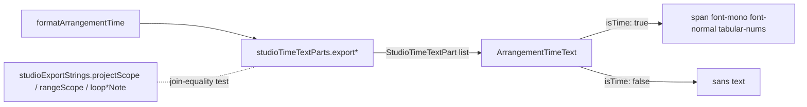

# Studio V-2b-3b — Export dialog-ის timecode-ები mono-ში, css2 URL-ის შემცირება და Export-ის „0:00“-ის გასწორება

**თარიღი:** 2026-10-25
**სტატუსი:** In Progress (awaiting C round 157)
**შეცვლილი პროექტი:** Store

## კონტექსტი

V-2b-3a დაიხურა C round 156-ის PASS-ით და gate 156-ით (`cbcd3d9`). დამტკიცებული `docs/technical/studio-real-workspace/visual-direction-a.md`-ის § „ტიპოგრაფია“-ს ციფრების რიგი ამბობს: IBM Plex Mono 300/400, `tabular-nums` — timecode, BPM, dB, საიდან/სადამდე. Workspace-ის წინადადებები უკვე mono timecode-ებს აჩვენებდა. Export dialog-ში წინადადების შიგნით ჩასმული `MM:SS.mmm` მნიშვნელობები ისევ sans-ში რჩებოდა.

ამ რაუნდში (D-29z122) სამი მჭიდროდ დაკავშირებული საკითხი გადაწყდა:

1. Export dialog-ის ოთხი ადგილი, სადაც წინადადებაში timecode ჩანს.
2. `/studio-lab`-ის Google Fonts css2 URL-დან გამოუყენებელი წონების ამოღება.
3. Low ბაგი **B-R155-EXPORT-ZERO**: project scope-ის description-ში დაწყება „0:00“ ეწერა, ხოლო project option-ში „00:00.000“.

## მიდგომა

- **R1 — mono წესი უცვლელია (D-29z121 R2).** Mono-ში გადადის მხოლოდ ხილული `MM:SS.mmm` მნიშვნელობები. წამების მნიშვნელობა („(5.000 s)“) და გაფრთხილებები `noSoundNote` / `masterMutedNote` sans-ში რჩება. ეს შეგნებული გადაწყვეტილებაა და მომხმარებელს მისი ვეტო შეუძლია.
- **R2 — ოთხი ახალი parts builder `studioTimeTextParts`-ში.** `studioExportStrings` არ შეცვლილა. მისი `rangeScope(rangeLabel)` უკვე გაერთიანებულ label-ს იღებს, ამიტომ მისგან parts-ის მიღება signature-ის შეცვლის გარეშე შეუძლებელია. ახალი builder-ები დამოუკიდებელია. მათ ტექსტს **join-equality ტესტი** ადარებს უცვლელი `studioExportStrings`-ის output-ს, ამიტომ ორ წყაროს შორის გადახრა ტესტს წითლად აქცევს.
- **R3 — B-R155-EXPORT-ZERO ამ რაუნდში სწორდება.** Project scope-ის description-ში ახლა `00:00.000` წერია, ისევე როგორც project option-ში. ეს რაუნდის ერთადერთი ხილული ტექსტის ცვლილებაა. მის გარეშე description ნახევრად mono იქნებოდა: sans „0:00“ mono end-ის გვერდით.
- **R4 — css2-ის შემცირება.** Instrument Sans 700 და IBM Plex Mono 500 ამოღებულია. Instrument Sans 600 რჩება, რადგან მას იყენებს დაცული `ModalTitle` და root Toast-ის სათაური. `/studio-lab`-ზე `body:has([data-studio-theme])` root-ში დარენდერებულ UI-საც Instrument Sans-ზე გადაიყვანს. Plex Mono 300 css2-ში არც ადრე ყოფილა და არც Studio-ს რომელიმე ელემენტი იყენებს, ამიტომ არ დაემატა.
- **R5 — ახალი source-count ცხრილი არ დამატებულა.** Round 156-ის Architecture note-ის მიხედვით, ახალი Export span-ები DOM assertion-ებით მოწმდება `export-range-ui.test.tsx`-ში. TH7-ში მხოლოდ href შეიცვალა და დაემატა ორი უარყოფითი შემოწმება.
- **R6 — ფორმა უცვლელია.** რაუნდი round 156-ის `StudioTimeTextPart` / `ArrangementTimeText` ფორმას ხელახლა იყენებს. `ARCH-CHECKPOINT-V2` ჯერ პასუხგაუცემელია.

**განხილული ალტერნატივა:** `studioExportStrings.rangeScope`-ის signature-ის შეცვლა (`{ start, end, seconds }`). ეს უარყოფილია: არსებული ტესტები `'x'` label-ს ამოწმებს, ხოლო D-29z122 R2 `studioExportStrings`-ის ყველა key-სა და output-ს უცვლელად ტოვებს.

## არქიტექტურა

Export dialog-ის ოთხი ადგილი:

| ადგილი | Builder | Mono span-ები |
|---|---|---|
| `ModalDescription` (range / project) | `exportRangeScope` / `exportProjectScope` | start, end |
| Project scope option | `exportProjectScope` | start, end |
| Range scope option (range-ის არსებობისას) | `exportRangeScope` | start, end |
| Loop note (`role="note"`) | `exportLoopRangeNote` / `exportLoopProjectNote` | start, end |

css2 URL:

- **ადრე:** `…Instrument+Sans:wght@400;500;600;700&family=IBM+Plex+Mono:wght@400;500&family=Noto+Sans+Georgian:wght@400;500&display=swap`
- **ახლა:** `…Instrument+Sans:wght@400;500;600&family=IBM+Plex+Mono:wght@400&family=Noto+Sans+Georgian:wght@400;500&display=swap`

## შეცვლილი ფაილები

- `app/lib/arrangement/strings.ts` — `studioTimeTextParts`-ს დაემატა ოთხი builder: `exportProjectScope`, `exportRangeScope`, `exportLoopRangeNote`, `exportLoopProjectNote`. ყველა id `export-`-ით იწყება. დაემატა ერთი non-exported interface `StudioExportTimeBounds`. `studioExportStrings` და round-156-ის builder-ები უცვლელია.
- `app/components/arrangement/ArrangementExportDialog.tsx` — ოთხი render site `ArrangementTimeText`-ზე გადავიდა. `rangeLabel` წაიშალა, რადგან მას მომხმარებელი აღარ ჰყავს. Project description-ის დაწყება `00:00.000`-ია (R3).
- `app/routes/studio-lab.tsx` — `STUDIO_FONTS_HREF` R4-ის URL-ზე შეიცვალა.
- `app/lib/arrangement/__tests__/strings.test.ts` — ST-TP3 ექვს builder-ს ამოწმებს. დაემატა ST-TP4 და ST-TP5.
- `app/lib/arrangement/__tests__/studio-theme-obsidian.test.tsx` — TH7-ში შეიცვალა href და დაემატა 700-ისა და Plex Mono 500-ის უარყოფითი შემოწმება.
- `app/lib/arrangement/__tests__/export-range-ui.test.tsx` — `PROJECT_DESCRIPTION` ახლა `00:00.000`-ს იყენებს. დაემატა XU6–XU8.
- `docs/implementation/2026/quarter-IV/126-studio-v2b3a-sentence-timecodes.md` — სტატუსი Completed.

## პრობლემები და გადაწყვეტები

- **პრობლემა (B-R155-EXPORT-ZERO, Low):** Project scope-ში dialog-ის description „Entire project · 0:00 — 00:20.000“ იყო, ხოლო project option „Entire project · 00:00.000 — 00:20.000“. ერთი და იგივე მონაკვეთი ორ ფორმატში ჩანდა. mono-ზე გადასვლის შემდეგ „0:00“ ერთადერთი sans timecode დარჩებოდა.
  **გადაწყვეტა:** description project option-ის იგივე `'00:00.000'` მნიშვნელობას იღებს. `export-range-ui`-ის `PROJECT_DESCRIPTION` შესაბამისად განახლდა; XU1/XU3-ის არსებული assertion-ები უცვლელია და ახალ მნიშვნელობაზე მწვანეა.
- **პრობლემა:** `rangeScope(rangeLabel)` გაერთიანებულ ტექსტს იღებს, ამიტომ parts-ის builder მისგან პირდაპირ ვერ მიიღება.
  **გადაწყვეტა:** დამოუკიდებელი builder-ები და ST-TP4-ის join-equality ტესტი უცვლელი `studioExportStrings`-ის წინააღმდეგ (R2).
- **პრობლემა:** ამოღებული წონა შეიძლება ჩუმად გამოიყენებოდეს.
  **გადაწყვეტა:** B-ის source შემოწმებამ (`cbcd3d9`) აჩვენა, რომ `/studio-lab`-ზე ხილულ UI-ში `font-bold` არ არის, ხოლო `font-mono` ელემენტს საკუთარ class-ში medium/semibold/bold არ აქვს. ამოღებული წონის მოთხოვნისას ბრაუზერი უახლოეს ჩატვირთულ face-ს იყენებს (faux bold არ ხდება). ბრაუზერში ამას C ამოწმებს (CSS2-TRIM, FONT-INVENTORY).

## ტესტირება

A-მ გაუშვა (C-ის ბრაუზერული შემოწმება ცალკეა):

- **Targeted vitest (43 ფაილი, `tmp/studio-real-loop/a-round-157/vitest-files.txt`):** baseline 679/679, ცვლილების შემდეგ 684/684. ST-TP3-ის სათაური შეიცვალა („two“ → „six builders“). დაემატა ST-TP4, ST-TP5, XU6, XU7 და XU8.
- `npm run typecheck` — 0 შეცდომა.
- `npm run lint` — 218 warning, იგივე რაც round 156-ში. შეცვლილ ფაილებში არცერთი არ არის.
- `npx biome check` 6 კოდისა და ტესტის ფაილზე — სუფთაა.
- **Mutation-ები (თითოეული აღდგენილია, sha256 ემთხვევა):**
  - **m147:** E1 range description plain string-ად → XU7-ის MONO assertion წითელია, text assertion მწვანე რჩება.
  - **m148:** `exportRangeScope`-ში `' — '` → `' - '` → ST-TP4 და XU7 (ასევე XU2/XU3) წითელია.
  - **m149:** E1-ში `'0:00'` → XU6, XU1 და XU3-ის `PROJECT_DESCRIPTION` assertion-ები წითელია.
  - **m150:** Instrument Sans-ში 700-ის დაბრუნება → TH7 წითელია.

## TODO / შემდეგი ნაბიჯები

- C round 157: TEXT-BYTES-E, MONO-STYLE-N13…N16, LAYOUT-FIT-E, CSS2-TRIM, FONT-INVENTORY, FONT-FAIL, FUNC-SMOKE-E.
- **V-2b-DISPLAY** და **B-R153-PREVIEW-DUR** — მომხმარებლის პასუხს ელოდება.
- **V-3** — lucide icons, borderless buttons, radius, hover motion (`visual-direction-a.md`).
- Frontend-architect checkpoint (`ARCH-CHECKPOINT-V2`) — V-2b-ის ბოლოს, V-3-მდე.
