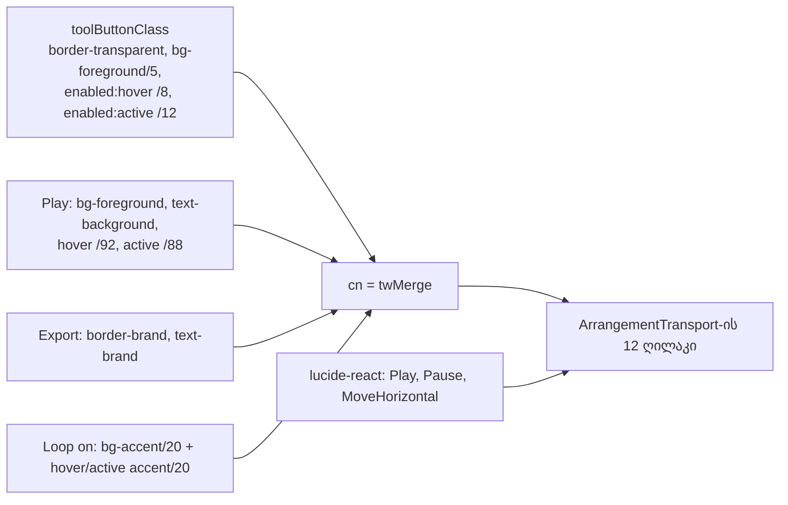

# Studio V-3a — transport-ის ღილაკების ზედაპირები, Play-ისა და Export-ის ფერის როლები და lucide icon-ები

**თარიღი:** 2026-10-25
**სტატუსი:** In Progress (awaiting C round 158)
**შეცვლილი პროექტი:** Store

## კონტექსტი

V-2b-3b დაიხურა C round 157-ის PASS-ით და gate 157-ით (`f8a316a`). V-2b-დან მხოლოდ V-2b-DISPLAY დარჩა, რომელიც მომხმარებლის პასუხს ელოდება. შემდეგი ეტაპია V-3: დამტკიცებული `docs/technical/studio-real-workspace/visual-direction-a.md`-ის § „იკონები“ და § „ღილაკები და ზედაპირები“. Spec ითხოვს:

- ღილაკებს ხილული ჩარჩო არ აქვს — მხოლოდ მკრთალი fill, hover-სა და დაჭერაზე ოდნავ მკვეთრი;
- 8 px radius;
- ფერის ცვლილება 180 ms-ში, `cubic-bezier(0.2,0.8,0.2,1)` მრუდით;
- Unicode glyph-ების ნაცვლად lucide icon-ები, 16 px, ხაზის სისქე 1.5.

B-მ V-3 ზომით გაზომა (D-29z123) და სრული მოცულობის შენარჩუნებით სამ ეტაპად გაყო (R1).

## მიდგომა

### ეტაპები (R1)

| ეტაპი | რაუნდი | მოცულობა |
|---|---|---|
| **V-3a** | 158 (ეს) | მხოლოდ `ArrangementTransport.tsx`: 12-ივე ღილაკის ზედაპირი, Play-ისა და Export-ის ფერის როლები და icon-ები ორ fixed-width ღილაკზე — Play/Pause (`w-24`) და Zoom to selection (`w-8`). |
| **V-3b** | შემდეგი | transport-ის დანარჩენი glyph-ები: ↤, ↶, ↷, ✂, ⌫, ↻, ↩ — მათ ტესტებთან და `strings.ts`-თან ერთად. |
| **V-3c** | შემდეგ | Library, Lane/GroupHeader, VideoDock, MarkerRow, Clip და strings-ის glyph-ები, სხვა კომპონენტების ღილაკების ზედაპირები და პანელის 10 px radius (token-ით). |

### რატომ მხოლოდ ორი icon ამ რაუნდში (B-ის გაზომვა)

ყველა transport glyph ბრაუზერში fallback ფონტით, DejaVu Sans-ით, იხატება. ამიტომ ძველი glyph-ის სიგანე პლატფორმაზეა დამოკიდებული:

| Glyph | Advance | მომდევნო space |
|---|---|---|
| ▶ | 10.78 px | 3.02 px |
| ↤, ↶, ↷, ✂, ↻ | 11.73 px | 3.02 px (✂, ↻) |
| ⌫ | 19.8 px | 3.0 px |
| ⇔, ↩ (text-xs) | 10.06 px | 2.02 px (↩) |

16 px icon და არსებული `gap-1` intrinsic-width ღილაკებს გადაწევდა: ↤ +4.3 px, ✂ +5.3 px, ⌫ −2.8 px, ↻ +5.3 px, ↩ +7.9 px, და მეზობლებიც იმავე მანძილით გადაიწეოდა. RV-1 V-3-ისთვის არ ფართოვდება (D-29z116). ამიტომ ამ რაუნდში მხოლოდ ის ღილაკები შევიდა, რომელთა box-ი ფიქსირებულია და glyph-ს არცერთი ტესტი არ ეძებს: Play/Pause და Zoom to selection.

### V-3b-ის icon-ის ზომა (R2, vetoable)

Default: icon ძველი glyph-ის ადგილს ავსებს — 12 px `strokeWidth={2}`-ით, 10 px text-xs ↩-ისთვის და 20 px ⌫-ისთვის. Box-ები ±1 px-ში რჩება. მომხმარებლის კითხვა **Q-V3-ICON-SIZE** (`feature-status.md`): (a) ყველგან 16 px spec-ის მიხედვით, გაზომილი გადაწევით; (b) default; (c) ფიქსირებული სიგანე თითო ღილაკზე. ეს რაუნდი პასუხზე არ არის დამოკიდებული.

### ზედაპირი (R3)

- 1 px border რჩება, მაგრამ `border-transparent` ხდება — ზომა არ იცვლება.
- Fill: `bg-foreground/5` მოსვენებულ მდგომარეობაში, `/8` hover-ზე, `/12` დაჭერისას.
- Radius: `rounded-sm` (6 px) → `rounded-md` (8 px, `--radius-md`).
- ფერის მოძრაობა `motion-safe:`-ით, `background-color, color`-ზე, 180 ms. ეს არსებულ `motion-safe:transition-[…]` pattern-ს მიჰყვება (`ArrangementLane`, `DetailPanel`), ამიტომ reduced motion-ისას transition არ არის.
- Hover და active `enabled:` variant-ით — disabled ღილაკი hover-ზე აღარ რეაგირებს. ადრე `hover:border-outline-hover` disabled-ზეც მუშაობდა.

### ფერის როლები (R4, vetoable)

- **Play:** შევსებული `bg-foreground`, ტექსტი `text-background`, Play-შიც და Pause-შიც. ადრე Pause accent-ს იყენებდა, რომელიც obsidian-ში brand-ის ტოლია, ამიტომ ორი მდგომარეობა ისედაც ერთნაირად ჩანდა. მდგომარეობას icon, label და `aria-label` გადმოსცემს.
- **Play hover/active:** fill იცვლება /92-მდე და /88-მდე — 8 %/12 % ნაბიჯების სარკე.
- **Export:** brand outline და brand ტექსტი (`border-brand text-brand`), brand fill-ის ნაცვლად.
- **მდგომარეობის მინიშნებები რჩება:** Delete range-ით, Follow paused, Follow on და Loop on თავიანთ კლასებს ინარჩუნებს.
- **Loop on** დამატებით იღებს `enabled:hover:bg-accent/20 enabled:active:bg-accent/20`-ს.

### Icon-ები (R5)

`lucide-react`-იდან პირდაპირ (`^0.561.0`, უკვე გამოიყენება auth/chat კომპონენტებში): `Play`, `Pause`, `MoveHorizontal`. თითოეულს აქვს `size-4 shrink-0`, `strokeWidth={1.5}` და `aria-hidden="true"`, ფერს `currentColor`-ით იღებს. `~/components/icons` არ გამოიყენება — იქაური `PlayIcon`/`PauseIcon` lucide არ არის. ხილული label-ები „Play“/„Pause“ ``-ში რჩება (icon-only ღილაკი M1-ის ცალკე ეტაპია). `aria-label`-ები უცვლელია.

### ტესტები (R6)

`studio-theme-obsidian.test.tsx` არ შეცვლილა (A-R156 Architecture note: ახალი source-count ცხრილი არ ემატება). ახალი კლასები ახალ DOM ტესტში ჩაიკეტა.

### კლასი — ადრე და შემდეგ

| | კლასი |
|---|---|
| ადრე | `rounded-sm border border-outline bg-elevated … hover:border-outline-hover …` |
| შემდეგ | `rounded-md border border-transparent bg-foreground/5 … motion-safe:transition-[background-color,color] motion-safe:duration-180 motion-safe:ease-[cubic-bezier(0.2,0.8,0.2,1)] enabled:hover:bg-foreground/8 enabled:active:bg-foreground/12 …` |
| Play ადრე | `border-brand text-brand` / Pause-ზე `border-accent text-accent`, ტექსტი `▶ Play` / `❚❚ Pause` |
| Play შემდეგ | `bg-foreground text-background enabled:hover:bg-foreground/92 enabled:active:bg-foreground/88`, `Play`/`Pause` icon + span |
| Export ადრე | `border-brand bg-brand font-medium text-brand-foreground` |
| Export შემდეგ | `border-brand font-medium text-brand` (fill საბაზისო `bg-foreground/5`) |

## არქიტექტურა

`cn` (`twMerge`) ერთ variant ჯგუფში ბოლო კლასს ტოვებს, ამიტომ Play-ის, Export-ის და Loop on-ის კლასები საბაზისო fill-ს, border-ს და hover-ს ანაცვლებს.

## შეცვლილი ფაილები

- `app/components/arrangement/ArrangementTransport.tsx` — lucide import, `toolButtonClass`, Play/Pause, Loop on, Zoom to selection და Export.
- `app/lib/arrangement/__tests__/transport-surface-ui.test.tsx` (ახალი) — TS1–TS6.
- `docs/implementation/2026/quarter-IV/127-studio-v2b3b-export-timecodes-font-trim.md` — სტატუსი Completed.
- `docs/implementation/2026/quarter-IV/128-studio-v3a-transport-surfaces.md` (ახალი) — ეს დოკუმენტი.

## პრობლემები და გადაწყვეტები

- **პრობლემა:** საბაზისო `enabled:hover:bg-foreground/8` Play-ის fill-ს hover-ზე 8 %-მდე დაიყვანდა — მუქი ტექსტი მუქ ფონზე დარჩებოდა. **გადაწყვეტა:** Play-ს საკუთარი `enabled:hover:bg-foreground/92` და `enabled:active:bg-foreground/88` აქვს, რომლებიც `twMerge`-ით საბაზისოს ანაცვლებს. TS2 ამოწმებს, რომ `/8` და `/5` Play-ზე აღარ არის.
- **პრობლემა:** იგივე hover Loop on-ის accent fill-ს წაშლიდა. **გადაწყვეტა:** Loop on-ს `enabled:hover:bg-accent/20` და `enabled:active:bg-accent/20` დაემატა. TS5 და m153 ამას ამოწმებს.
- **პრობლემა:** უნდა დადასტურებულიყო, რომ bare-value utility-ები (`bg-foreground/8`, `/12`, `/92`, `/88`, `duration-180`) Tailwind v4.1-ში CSS-ს ქმნის. **გადაწყვეტა:** dev server-ის `app.css`-ში ყველა selector-ი მოიძებნა: `enabled:hover:*` `@media (hover: hover)`-შია, `motion-safe:*` — `prefers-reduced-motion: no-preference`-ში, ხოლო `enabled:active:*` წესები hover-ის შემდეგ დგას. Arbitrary ფორმა საჭირო არ გახდა.
- **პრობლემა:** transport toolbar-ის სწორად მოძებნა — `closest('div')` position readout-ის box-ს აბრუნებს. **გადაწყვეტა:** ტესტი position-იდან ზემოთ მიდის პირველ `.flex-wrap` ელემენტამდე, რომელიც `arrangement-fit`-საც შეიცავს, და ამოწმებს, რომ მასში ზუსტად 12 ღილაკია.

## ტესტირება

- **Baseline:** B-ის 24 ფაილი, 380/380.
- **ცვლილების შემდეგ:** იგივე 24 ფაილი + ახალი, 386/386. ახალი ტესტებია TS1–TS6:
  - TS1 — 12-ივე ღილაკის radius, motion და pressed fill; 10 ჩვეულებრივი ღილაკის `border-transparent` და `/5`–`/8`–`/12`.
  - TS2 — Play/Pause-ის fill, ერთი aria-hidden svg, ტექსტი `Play`/`Pause`, accessible name.
  - TS3 — Zoom to selection: ერთი svg, ცარიელი ტექსტი, `aria-label` უცვლელი.
  - TS4 — Export-ის brand outline.
  - TS5 — Loop on-ის accent fill hover-სა და დაჭერაზე; Delete-ის range მინიშნება.
  - TS6 — დანარჩენი 9 ღილაკის ტექსტი byte-ით იგივეა და svg არ აქვს.
- `npm run typecheck` — 0 შეცდომა. `npm run lint` — 0 შეცდომა (218 warning, არცერთი ამ ფაილებში). Biome scoped check ორ ფაილზე — სუფთაა.
- **Mutations** — თითოეული Edit-ით აღდგა და sha256 შემოწმდა:
  - **m151:** `border-transparent` → `border-outline` → TS1 (და TS2) წითელია.
  - **m152:** Play-ის icon და span → ტექსტი `▶ Play` → TS2 წითელია.
  - **m153:** Loop on-დან `enabled:hover:bg-accent/20`-ის მოხსნა → TS5 წითელია.
  - **m154:** Export-ზე `border-brand bg-brand font-medium text-brand-foreground`-ის დაბრუნება → TS4 წითელია.
  - **m155 (დამატებითი, code-reviewer-ის Low):** Pause-ის მდგომარეობაში `<Play/>` icon → TS2 წითელია. TS2 და TS3 ახლა lucide-ის `lucide-play` / `lucide-pause` / `lucide-move-horizontal` კლასით ამოწმებს, რომელი icon იხატება. TS1-ს დაემატა `border`, focus ring-ის, `disabled:opacity-40`-ის და bare `hover:`-ის არარსებობის შემოწმება, TS2-ს — `w-24`.
- ბრაუზერის შემოწმება (computed style, hover/active, contrast, layout ±1 px, icon-ის ზომა) C round 158-ის საქმეა.

## TODO / შემდეგი ნაბიჯები

- **V-3b:** ↤, ↶, ↷, ✂, ⌫, ↻, ↩ — R2-ის default ზომით, თუ მომხმარებელი Q-V3-ICON-SIZE-ს სხვაგვარად არ უპასუხებს. მასთან ერთად იცვლება `self-disabling-focus`, `grid-snap-ui`, `navigation-strings-ui` და `delete-selection-ui`-ის glyph query-ები და `studioEditStrings.deleteButton`/`deleteClipLabel` (`strings.ts` + `strings.test.ts`).
- **V-3c:** დანარჩენი კომპონენტების glyph-ები და ზედაპირები, პანელის 10 px radius token-ით.
- **M1, M3, M4:** V-3-ის შემდეგ, დამტკიცებული მოცულობით (M1 — icon-only მრგვალი Play).
- **B-R157-EXPORT-PEAK:** C-ის OVERLOAD-CHECK ამოწმებს, გამოჩნდა თუ არა SRW-20-ის overload warning; audio კოდი ამ რაუნდში არ შეცვლილა.
