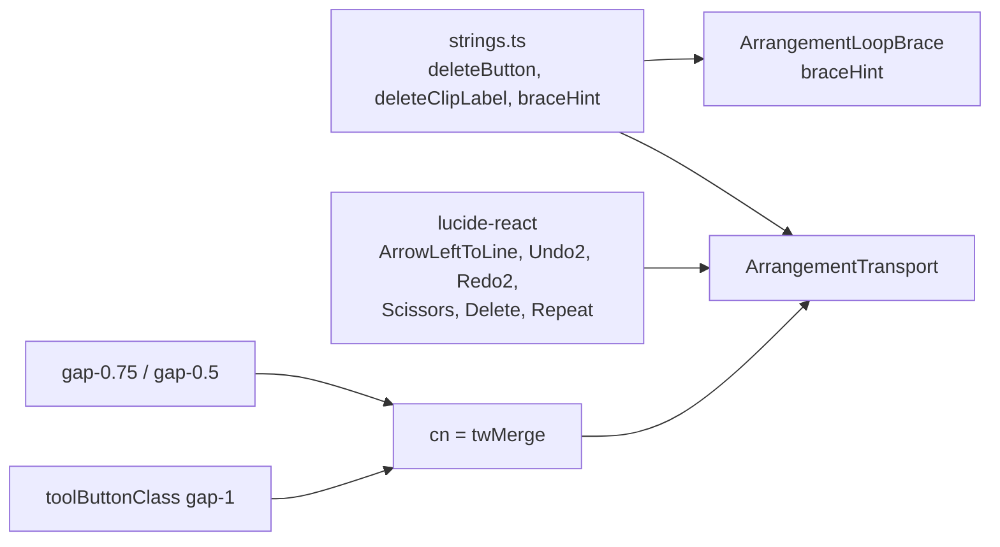

# Studio V-3b — transport-ის დარჩენილი 7 glyph lucide icon-ებად (↤ ↶ ↷ ✂ ⌫ ↻ ↩)

**თარიღი:** 2026-10-25
**სტატუსი:** In Progress (awaiting C round 160)
**შეცვლილი პროექტი:** Store

## კონტექსტი

V-3a დაიხურა C round 159-ის PASS-ით და gate 159-ით (`ad0df77`). V-3a-მ transport-ის 12-ივე ღილაკს ზედაპირი შეუცვალა და icon მისცა მხოლოდ ორ fixed-width ღილაკს: Play/Pause და Zoom to selection. V-3b (D-29z125) დანარჩენ შვიდ Unicode glyph-ს ცვლის: ↤ Back to start, ↶ Undo, ↷ Redo, ✂ Split, ⌫ Delete, ↻ Loop და ↩ Zoom back. წყაროა `docs/technical/studio-real-workspace/visual-direction-a.md`, § „იკონები“ და § „ღილაკები და ზედაპირები“.

მთავარი შეზღუდვა: ღილაკების box-ები ±1 px-ში უნდა დარჩეს (RV1). ამიტომ icon ძველი glyph-ის ადგილს ავსებს და spec-ის 16 px ზომას არ იყენებს. მომხმარებლის კითხვა **Q-V3-ICON-SIZE** ღიაა; ეს არის default.

## მიდგომა

### R2' — ზომა, ხაზის სისქე და gap (D-29z123 R2-ის შესწორება)

- Icon ძველი glyph-ის slot-ს ავსებს: 12 px (`size-3`) text-sm ღილაკებზე, 10 px (`size-2.5`) text-xs Zoom back-ზე და 20 px (`size-5`) ⌫-ზე.
- `strokeWidth` ყველგან **1 px ვიზუალურ ხაზს** ინარჩუნებს, ისე როგორც 16 px-ზე 1.5: 12 px → `2`, 10 px → `2.4`, 20 px → `1.2`.
- სამ icon+label ღილაკს intrinsic სიგანით gap ძველი space-ის ტოლი აქვს: Split და Loop — `gap-0.75` (3 px), Delete და Zoom back — `gap-0.5` (2 px).
- Undo და Redo ფიქსირებული სიგანისაა (`w-28`), ამიტომ `gap-1` რჩება.

B-ის გაზომვა (`tmp/studio-real-loop/b-round-159/icon-probe.cjs`, რეალური Chromium, `/studio-lab`, `ad0df77`):

| ვარიანტი | მაქს. კიდის გადაწევა (1440 და 1280) | მიზეზი |
|---|---|---|
| R2 როგორც ეწერა: 12/10/20 px icon, არსებული `gap-1` (4 px) | **4.0 px** (Loop-ის მარჯვენა კიდე) | ძველი `✂ Split` ერთი text node-ია: glyph + 3.02 px space. svg-ით space-ს 4 px flex gap ცვლის, ანუ +1.27 px ღილაკზე, და მწკრივში ეს გადაწევა იკრიბება. |
| gap 3 px Split/Delete/Loop-ზე, 2 px Zoom back-ზე | 1.0 px | ზუსტად ზღვარზეა, მყიფეა. |
| **gap 3 px Split/Loop-ზე, 2 px Delete/Zoom back-ზე (არჩეული)** | **0.53 px** | თითო gap ძველი glyph-ის space-ის ტოლია (3.02 px text-sm, 2.02 px text-xs). Delete-ის 20 px icon-ს ~1.7 px side bearing აქვს, ამიტომ 2 px სხვების მსგავსად იკითხება. |

`gap-0.75` = `calc(var(--spacing) * 0.75)` = 3 px (`--spacing: 0.25rem`). Arbitrary მნიშვნელობა და ახალი token საჭირო არ გახდა. `cn` (`twMerge`) `gap-1`-ს აგდებს, როცა `gap-0.75` ან `gap-0.5` ემატება.

### R8 — icon-ების შესაბამისობა

| ღილაკი | Icon | წყარო |
|---|---|---|
| Undo ↶ | `Undo2` | spec |
| Redo ↷ | `Redo2` | spec |
| Split ✂ | `Scissors` | spec |
| Delete ⌫ | `Delete` | spec |
| Loop ↻ | `Repeat` | spec |
| Zoom back ↩ | `Undo2` | spec („Undo, Zoom უკან“) — Undo-ს იგივე icon |
| Back to start ↤ | `ArrowLeftToLine` | spec-ის ცხრილში არ არის; B-ის გადაწყვეტილება. ↤-ის ფორმა ისარი + ხაზია, მოქმედება კი „საწყის ხაზამდე“. `SkipBack` media-ს „წინა ტრეკის“ კონვენციაა და track navigation-ზე მიანიშნებდა. |

Icon-ები პირდაპირ `lucide-react`-იდან მოდის (`0.561`). თითოეულს აქვს `shrink-0` და `aria-hidden="true"`, ფერს კი `currentColor`-ით იღებს. ამიტომ Delete range-ით accent ფერს, Loop on კი accent-ს ინარჩუნებს.

### R9 — სტრიქონები

- `deleteButton`: `'⌫ Delete'` → `'Delete'`.
- `deleteClipLabel`: `'⌫ Delete — the selected clip; leaves a gap'` → `'Delete — the selected clip; leaves a gap'`. Accessible name-ს „⌫“ აღარ აქვს — screen reader მას „erase to the left“-ად კითხულობდა.
- `braceHint`: `'Loop: make a time selection and press ↻ Loop (Ctrl+L)'` → `'Loop: make a time selection and press Loop (Ctrl+L)'`. V-3c-დან წინ გადმოვიდა, რადგან ღილაკს ხილული label-ით ასახელებს და glyph აღარ არსებობს.
- `⌫ Deleted …` status message (`strings.ts`) **არ შეცვლილა** — ეს status წინადადებაა და არა ღილაკის label. მის ბედს V-3c გადაწყვეტს.

### R10 და R11

- ხილული label-ები რჩება: `Undo`/`Redo` (history label-ით), `Split`, `Delete`, `Loop`, `Zoom`. Back to start ისევ icon-only-ა, თავისი `aria-label`-ით. Icon-only Play (M1) ცალკე დამტკიცებული ეტაპია.
- Zoom back-ის accessible name „↩ Zoom“-დან „Zoom“ ხდება, slider-ის „Zoom (px/s)“-ის გვერდით. `title` ისევ ხსნის მოქმედებას. ახალი `aria-label` ახალი string იქნებოდა, ამიტომ ეს ჩაიწერა სიგნალად **A11Y-R160-ZOOMBACK-NAME** polish pass-ისთვის. Finding არ არის.

### კლასი და children — ადრე და შემდეგ

| ღილაკი | ადრე | შემდეგ |
|---|---|---|
| Back to start | `toolButtonClass`, ტექსტი `↤` | `toolButtonClass`, `ArrowLeftToLine` (`size-3`, stroke 2) |
| Undo / Redo | `toolButtonClass w-28`, `↶/↷` + truncate label | იგივე კლასი, `Undo2`/`Redo2` (`size-3`, stroke 2) + იგივე truncate label |
| Split | `toolButtonClass`, ტექსტი `✂ Split` | `toolButtonClass gap-0.75`, `Scissors` (`size-3`, stroke 2) + `Split` |
| Delete | `toolButtonClass` (+ range-ზე `border-accent text-accent`), `{deleteButton}` | `toolButtonClass gap-0.5` (+ იგივე range cue), `Delete` (`size-5`, stroke 1.2) + `{deleteButton}` |
| Loop | `toolButtonClass` (+ Loop on-ის accent სტრიქონი), ტექსტი `↻ Loop` | `toolButtonClass gap-0.75` (+ იგივე Loop on სტრიქონი), `Repeat` (`size-3`, stroke 2) + `Loop` |
| Zoom back | `toolButtonClass px-2 text-xs`, ტექსტი `↩ Zoom` | `toolButtonClass gap-0.5 px-2 text-xs`, `Undo2` (`size-2.5`, stroke 2.4) + `Zoom` |

`toolButtonClass`, Play, Zoom to selection, Follow, Fit, Export, position readout, separator-ები, slider, handler-ები, `title`/`aria-*` და focus handoff უცვლელია.

## არქიტექტურა

## შეცვლილი ფაილები

- `app/components/arrangement/ArrangementTransport.tsx` — lucide import და შვიდი ღილაკის children; Split-ის, Delete-ის, Loop-ის და Zoom back-ის gap.
- `app/lib/arrangement/strings.ts` — `deleteButton`, `deleteClipLabel`, `braceHint`.
- `app/lib/arrangement/__tests__/strings.test.ts` — იმავე სამი სტრიქონის მოსალოდნელი მნიშვნელობა.
- `app/lib/arrangement/__tests__/transport-surface-ui.test.tsx` — TS5-ის query და ახალი TS6 (V-3b-ის lock).
- `app/lib/arrangement/__tests__/self-disabling-focus.test.tsx` — Undo/Redo/Delete-ის prefix query-ები და FL5/FL6/FL9/FL10-ის სათაურები glyph-ის გარეშე.
- `app/lib/arrangement/__tests__/navigation-strings-ui.test.tsx` — Split/Delete/Loop-ის prefix query-ები და მოსალოდნელი სტრიქონები.
- `app/lib/arrangement/__tests__/grid-snap-ui.test.tsx` — Zoom back-ის label `Zoom`.
- `app/lib/arrangement/__tests__/delete-selection-ui.test.tsx` — Delete ღილაკი იძებნება `button` role-ით და ზუსტი `textContent`-ით, ზუსტად ერთი შედეგის assertion-ით.
- `docs/implementation/2026/quarter-IV/128-studio-v3a-transport-surfaces.md` — სტატუსი Completed, reduced motion-ის მოძველებული მტკიცების შესწორება და „შემდეგ“ რიგის `!` token-ები.
- `docs/implementation/2026/quarter-IV/129-studio-v3b-transport-icons.md` (ახალი) — ეს დოკუმენტი.

## პრობლემები და გადაწყვეტები

- **პრობლემა:** R2-ის პირვანდელი ვერსია (`gap-1`) ბრაუზერში 4.0 px-მდე გადაწევას იძლეოდა, რადგან svg-ს და label-ს შორის ძველი 3.02/2.02 px space-ის ნაცვლად 4 px flex gap ჩნდება და მწკრივში იკრიბება. **გადაწყვეტა:** gap ღილაკის მიხედვით — Split/Loop `gap-0.75`, Delete/Zoom back `gap-0.5`. B-ის probe-ით მაქსიმუმი 0.53 px-ია; საბოლოო გაზომვა C-ის RV1-V3B-ია.
- **პრობლემა:** glyph-ის გაქრობის შემდეგ ტესტები, რომლებიც ღილაკს glyph prefix-ით ეძებდა (`'↶'`, `'⌫'`, `'✂'` …), ღილაკს ვეღარ იპოვიდა, ხოლო უბრალო `getByText('Delete')` შეიძლება რამდენიმე node-ს დაემთხვეს. **გადაწყვეტა:** prefix-ები label-ებით შეიცვალა (toolbar-ის ან workspace-ის შიგნით პირველი დამთხვევა). `delete-selection-ui`-ში ღილაკი `getAllByRole('button')`-ით, ზუსტი `textContent`-ით იძებნება და ზუსტად ერთი დამთხვევა მოწმდება.
- **პრობლემა:** m160 (Scissors-იდან `aria-hidden="true"`-ის მოხსნა) ცოცხალი დარჩა. `lucide-react` 0.561 svg-ს `aria-hidden="true"`-ს თავად უმატებს, როცა მას `aria-label`, `title` ან children არ აქვს. ამიტომ rendered DOM იდენტურია და ეს equivalent mutant-ია. **გადაწყვეტა:** დამატებითი m160b (`aria-hidden="false"`) — დაკვირვებადი ვარიანტი, რომელსაც TS6 იჭერს. Prop კოდში მაინც რჩება, ცხადი განზრახვისა და lucide-ის default-ის ცვლილებისგან დასაცავად.
- **პრობლემა:** `size-3` და `size-5` theme token-ებით იხსნება (`--spacing-3`, `--spacing-5`) და არა `calc(var(--spacing) * N)`-ით. **გადაწყვეტა:** served CSS-ში შემოწმდა, რომ `--spacing-3: 0.75rem` (12 px) და `--spacing-5: 1.25rem` (20 px) — ზომები R2'-ს ემთხვევა.

## ტესტირება

- **Baseline:** B-ის 25 ფაილი, 386/386.
- **ცვლილების შემდეგ:** იგივე 25 ფაილი, 386/386, TS1–TS6 მწვანეა. ახალი `it` არ დამატებულა; TS6 ჩანაცვლდა V-3b-ის lock-ით:
  - შვიდივე ღილაკს აქვს ზუსტად ერთი `aria-hidden="true"` svg, მოსალოდნელი lucide კლასით (`lucide-arrow-left-to-line`, `lucide-undo-2` ×2, `lucide-redo-2`, `lucide-scissors`, `lucide-delete`, `lucide-repeat`), `size-*` token-ით, `shrink-0`-ით და `stroke-width` ატრიბუტით;
  - `textContent` ზუსტად `''`, `'Undo'`, `'Redo'`, `'Split'`, `'Delete'`, `'Loop'`, `'Zoom'`;
  - არცერთი transport ღილაკის ტექსტი არ შეიცავს `↤↶↷✂⌫↻↩`-ს;
  - Split/Loop — `gap-0.75`, Delete/Zoom back — `gap-0.5`, `gap-1`-ის გარეშე; Undo/Redo — `gap-1` და `w-28`;
  - Fit და Follow — svg-ის გარეშე, ტექსტით `'Fit'`/`'Follow'`.
- `npm run typecheck` — 0 შეცდომა. `npm run lint` — 0 შეცდომა (218 warning, არცერთი შეცვლილ ფაილებში). Biome scoped check 8 კოდისა და ტესტის ფაილზე — სუფთაა.
- **Tailwind generation:** dev server-ის `app.css?direct`-ში არის `.gap-0\.75 { gap: calc(var(--spacing) * 0.75) }`, `.gap-0\.5`, `.size-2\.5`, `.size-3` და `.size-5`. `.gap-0\.75`, `.size-3` და `.size-5` ცვლილებამდე არ იყო — მათ ეს ცვლილება აგენერირებს.
- **Mutations** (Edit → transport ტესტი → Edit-ით აღდგენა → sha256 = post-edit hash):
  - **m158:** Undo/Redo-ზე `Undo2` ↔ `Redo2` → TS6 წითელია.
  - **m159:** Delete icon `size-5` → `size-4` → TS6 წითელია.
  - **m160:** Scissors-იდან `aria-hidden="true"`-ის მოხსნა → **ცოცხალი დარჩა** (equivalent mutant, იხ. ზემოთ).
  - **m160b:** Scissors `aria-hidden="false"` → TS6 წითელია.
  - **m161:** Split-იდან `gap-0.75`-ის მოხსნა (`gap-1`-ზე დაბრუნება) → TS6 წითელია.
- jsdom layout-ს არ ზომავს: box-ების ±1 px, icon-ის rendered ზომა, computed `stroke` და accessible name-ები C round 160-ის ბრაუზერის რიგებია (ICON-V3B, RV1-V3B, SURFACE-SPOT, FUNC-SMOKE-7, BRACE-HINT).

## TODO / შემდეგი ნაბიჯები

- **V-3c:** Library, Lane/GroupHeader, VideoDock, MarkerRow, Clip-ის glyph-ები და ზედაპირები, პანელის 10 px radius token-ით; ასევე გადასაწყვეტია `⌫ Deleted …` status message-ის glyph.
- **Q-V3-ICON-SIZE:** მომხმარებლის პასუხი — (a) ყველგან 16 px, გაზომილი გადაწევით, ან (c) ფიქსირებული სიგანე თითო ღილაკზე — ჯერ ღიაა.
- **A11Y-R160-ZOOMBACK-NAME:** Zoom back-ის accessible name „Zoom“ slider-ის გვერდით — polish pass.
- **M1, M3, M4:** V-3-ის შემდეგ, დამტკიცებული მოცულობით (M1 — icon-only მრგვალი Play).
