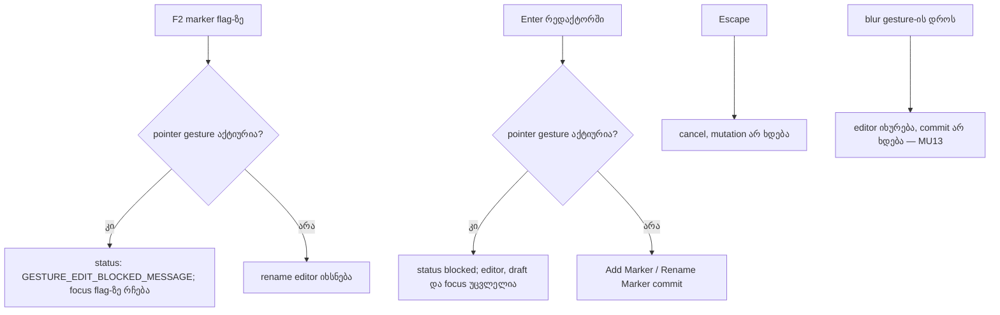

# Studio ROOT-RECON-MARKER-ENTER — marker-ის რედაქტორის დაცვა pointer gesture-ის დროს

**თარიღი:** 2026-10-25
**სტატუსი:** In Progress (awaiting C round 165)
**შეცვლილი პროექტი:** Store

## კონტექსტი

ადგილობრივი და cloud სამუშაოს შეჯერებისას (2026-10-25) აღმოჩნდა, რომ `ArrangementMarkerRow`-ის რედაქტორი აქტიური pointer gesture-ისას მხოლოდ `blur`-ს იცავდა. Enter-ს და F2-ს ეს დაცვა არ ჰქონდა. B-მ ბაგი რეალურ Chromium-ში `/studio-lab`-ზე გაიმეორა, 1440×900 და 1280×720 viewport-ებზე (`b-round-164/out/enter-stab-probe.json`). ეს **დადასტურებული Medium** ბაგია: მომხმარებლის ჩაწერილი სახელი იკარგება, Undo-ს ისტორიაში კი რჩება ნაბიჯი, რომელიც არაფერს აკეთებს.

### რეპროდუქცია (`7952439`)

1. `demo-middle-east` ემატება `music` ხაზზე 0 წამზე, snap გამორთულია. 5 წამზე ემატება marker „Intro“ (Add ღილაკი, სახელის აკრეფა, Enter).
2. მაუსის ღილაკს აჭერენ clip-ის **header**-ზე და clip-ს 40 px-ით გადაათრევენ. **ღილაკი რჩება დაჭერილი.**
3. **Shift+Tab** 14-ჯერ. focus მიდის marker-ის flag-ზე.
4. **F2** ხსნის rename-ის რედაქტორს. F2-ის branch-ი `openEditor`-ს `runUnlessGesture`-ის გარეშე იძახებდა.
5. აკრეფენ `Lost?`-ს და აჭერენ **Enter**-ს. status: `Marker name: “Lost?”.`, Undo: `Rename Marker`. `settleEditor('enter')`-ში gesture-ის შემოწმება არ იყო.
6. მაუსი კიდევ 60 px-ით გადაადგილდება. flag-ზე **ისევ „Intro“** ჩანს, რადგან clip preview `gesture.before`-დან აიგო.
7. ღილაკის აშვება. `Move clip` commit-დება. Undo stack: Move clip → **Rename Marker** → Add Marker.
8. ორი Ctrl+Z-ის შემდეგაც flag-ზე „Intro“ რჩება. აკრეფილი სახელი ვეღარ აღდგება, ისტორიაში კი ცარიელი ნაბიჯი რჩება.

## მიდგომა

B-ის გადაწყვეტილებები (D-29z130):

- **R1. F2 gesture-ის დროს უარყოფილია**, ისევე როგორც M, Add ღილაკი, ისრები, Delete და მენიუს Rename. status ხდება `GESTURE_EDIT_BLOCKED_MESSAGE` („Editing does not work while dragging — let go first.“). რედაქტორი არ იხსნება და focus flag-ზე რჩება. ეს ხურავს ერთადერთ გზას, რომლითაც მომხმარებელი ბაგამდე მიდის.
- **R2. ღია რედაქტორში Enter gesture-ის დროს უარყოფილია.** mutation და Undo ჩანაწერი არ იქმნება, status ხდება blocked. რედაქტორი **ღია რჩება აკრეფილი draft-ით და focus-ით**, ასე რომ აშვების შემდეგ Enter სახელს ზუსტად ერთხელ ჩაწერს.
- **R3. Escape gesture-ის დროს ისევ ისე მუშაობს:** აუქმებს და mutation-ს არ ქმნის. კოდი არ შეცვლილა, მხოლოდ ტესტით დაიბლოკა.
- **R4. ფარგლებს გარეთ:** `commitArrangement` gesture-ის დროს ნებისმიერ commit-ს იღებს, preview კი `gesture.before`-დან იგება. ამიტომ მომავალში keyboard-ით გაკეთებულ ნებისმიერ commit-ს drag-ის დროს იგივე ბედი ელის. owner არის დაცული `ArrangementContext.tsx`, ამიტომ ეს ჩაიწერა signal-ად `B-R164-COMMIT-DURING-PREVIEW`.

### რატომ განსხვავდება blur და Enter

blur ნიშნავს, რომ მომხმარებელი სხვაგან გადავიდა. ასეთ შემთხვევაში რედაქტორი იხურება და არაფერი commit-დება (MU13, ცვლილების გარეშე). Enter ნიშნავს „ჩაწერე ახლავე“. ამიტომ რედაქტორის დახურვა აკრეფილ ტექსტს Undo-ს გარეშე დაკარგავდა. draft-ის შენარჩუნება უფრო კეთილი და გულწრფელი პასუხია.

**უარყოფილი ალტერნატივა:** Enter-ზე რედაქტორის დახურვა, როგორც blur-ზე. ტექსტი დაიკარგებოდა და Undo ვერ აღადგენდა.

## არქიტექტურა

## შეცვლილი ფაილები

- `app/components/arrangement/ArrangementMarkerRow.tsx`: K1 — F2-ის branch-ში `openEditor` გადაეცემა არსებულ `runUnlessGesture`-ს. K2 — `settleEditor`-ში შემოწმება ხდება `settledRef`-ის დაყენებამდე: თუ მიზეზი `enter`-ია და gesture აქტიურია, ჩანს არსებული blocked status და ფუნქცია მაშინვე ბრუნდება. ახალი სტრიქონი არ დამატებულა, markup და კლასები არ შეცვლილა.
- `app/lib/arrangement/__tests__/markers-ui.test.tsx`: ემატება MU15, MU16 და MU17. არსებული ტესტები, მათ შორის MU14, უცვლელია.
- `docs/implementation/2026/quarter-IV/133-studio-saba-b1-b2-envelope-overview.md`: მხოლოდ სტატუსი შეიცვალა.
- ეს დოკუმენტი.

## პრობლემები და გადაწყვეტები

- **პრობლემა:** B-ის პირველ probe-ებში (`enter-probe`, `enter-touch-probe`) რედაქტორი drag-მდე იხსნებოდა. pointerdown-ის blur-მა სახელი gesture-მდე ჩაწერა, ამიტომ ჰიპოთეზა საერთოდ არ შემოწმებულა. **გადაწყვეტა:** ეს run-ები უარყოფით შედეგად არ ჩაითვალა. გზა, რომელიც მომხმარებელს რეალურად შეუძლია, დადასტურდა Shift+Tab → F2 თანმიმდევრობით (`enter-stab-probe`).
- **პრობლემა:** K2-ის შემოწმება `settledRef.current = true`-ის შემდეგ რომ დადგეს, რედაქტორი „დასრულებულად“ ჩაითვლება და შემდეგი Enter არაფერს გააკეთებს. **გადაწყვეტა:** შემოწმება დგას `settledRef`-ის და `setEditor(null)`-ის წინ. ამ თანმიმდევრობას იცავს MU15 (აშვების შემდეგ Enter-მა marker უნდა დაამატოს). ეს დამატებითი mutation-ით `m184-order` დადასტურდა: მასზე MU15 და MU16 წითლდება.
- **პრობლემა:** cloud-ის ტესტ-ფაილში MU14 უკვე დაკავებულია. **გადაწყვეტა:** ახალი ტესტები არის MU15–MU17. PC-ის MU14 მხოლოდ წყაროდ გამოიყენება.

## ტესტირება

- **MU15:** add editor, draft `held`, gesture, Enter. marker არ ემატება, Undo ცარიელია, status blocked-ია, input ღიაა `held`-ით და focus-ით. აშვების შემდეგ Enter ამატებს ზუსტად ერთ marker-ს (`7.000`, `held`, `Add Marker`). შემდეგი blur-ის შემოწმება (მეორე marker და duplicate status არ ჩნდება) MU2b-ის pattern-ს იმეორებს. input ამ დროს უკვე unmount-ებულია, ამიტომ jsdom-ში ეს assertion ორმაგ commit-ს ვერ დაიჭერს; განმასხვავებელ ტესტად არ ითვლება.
- **MU16:** rename editor, draft `held`, gesture, Enter. „Drop“ რჩება, arrangement-ის ობიექტი არ იცვლება, Undo ცარიელია, input ღიაა. Escape gesture-ის დროს რედაქტორს ხურავს mutation-ის გარეშე. აშვების შემდეგ F2 → `held` → Enter ქმნის `Rename Marker`-ს, Undo კი „Drop“-ს აბრუნებს.
- **MU17:** gesture-ის დროს F2 რედაქტორს არ ხსნის, status blocked-ია, focus flag-ზე რჩება. აშვების შემდეგ F2 ხსნის `Drop`-ს.
- **Test-first:** ფიქსამდე სამივე ტესტი წითელი იყო (MU15/MU16: Enter commit-დებოდა; MU17: input იხსნებოდა).
- **Mutation-ები:** m182 (K1-ის მოხსნა) → MU17 წითელია. m183 (K2-ის მოხსნა) → MU15 და MU16 წითელია, MU13 მწვანე რჩება. m184 (K2-ში რედაქტორის დახურვა) → MU15 და MU16 წითელია.
- სამიზნე vitest ფაილები: 75/75. `npm run typecheck`, `npm run lint` და scoped `biome check` სუფთაა.
- რეალური ბრაუზერის შემოწმება (MK-GESTURE, MK-ENTER-OPEN, MK-BLUR) C-ის round 165-ის საქმეა.

## TODO / შემდეგი ნაბიჯები

- `B-R164-COMMIT-DURING-PREVIEW`: `ArrangementContext`-ის კონტრაქტი, რომლის მიხედვითაც commit gesture-ის preview-ს დროს მიიღება. backlog signal-ია, დაგეგმილი არ არის. შეიძლება დაემატოს frontend-architect-ის checkpoint-ს (`b-round-160-checkpoint-request.md`).
- დარჩენილი შემთხვევა (Low, სპეციფიკაციით): gesture-ის დროს უარყოფილი Enter-ის შემდეგ, ღილაკი ჯერ კიდევ დაჭერილია და Tab/blur რედაქტორს MU13-ის გზით ხურავს, draft-ი იკარგება. B-მ შეიძლება `B-R164-COMMIT-DURING-PREVIEW`-თან ერთად განიხილოს.
- C round 165-ის browser მტკიცებულების შემდეგ სტატუსი უნდა გახდეს Completed.
