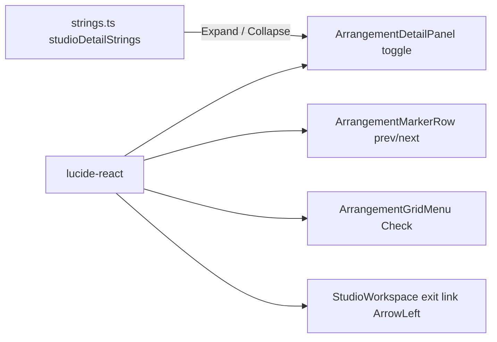

# Studio V-3c-3b — marker ◀ ▶, detail `Expand ▸` / `Collapse ▾`, grid menu ✓ და `← CZABA` lucide icon-ებად

**თარიღი:** 2026-10-25
**სტატუსი:** In Progress (awaiting C round 166)
**შეცვლილი პროექტი:** Store

## კონტექსტი

VISUAL-A-OBSIDIAN-ის V-3c ეტაპი Studio-ს ტექსტურ glyph-ებს lucide icon-ებით ცვლის (`visual-direction-a.md` § „იკონები“: „icon ძველი სიმბოლოს box-ს ემთხვევა, ელემენტი არ ინაცვლებს“). V-3c-1 (library), V-3c-2 (lane, group, clip) და V-3c-3a (video dock) უკვე დასრულდა. V-3c-3b (D-29z131, round 166) glyph-ების ბოლო ნაწილია:

- marker row-ის ◀ ▶ ღილაკები;
- detail panel-ის toggle (`Expand ▸` / `Collapse ▾`);
- grid menu-ს მონიშვნის ✓ (division radio, Snap, Triplets);
- workspace header-ის `← CZABA` back link.

ცვლილება მხოლოდ children-სა და class-ს ეხება. Handler-ები, focus, keyboard და pointer ლოგიკა უცვლელია.

## მიდგომა

### R1 — icon-ები და ზომა

| ადგილი | Glyph | Icon | ზომა / stroke | Host class-ის ცვლილება |
|---|---|---|---|---|
| marker prev | ◀ | `ChevronLeft` | `size-2.25` (9 px), stroke 2.4 | ახალი `MARKER_STEP_BUTTON_CLASS` = `MARKER_HEADER_BUTTON_CLASS` + `inline-flex items-center justify-center` |
| marker next | ▶ | `ChevronRight` | იგივე | იგივე |
| marker add | + | **რჩება ტექსტად** | — | არა (`MARKER_HEADER_BUTTON_CLASS` byte-ით უცვლელია) |
| detail toggle, ღია | `Collapse ▾` | `Collapse` + `ChevronDown` | `size-2.5`, stroke 2.4 | `px-2` → `pl-2 pr-1`, + `inline-flex items-center gap-0.5` |
| detail toggle, დაკეცილი | `Expand ▸` | `Expand` + `ChevronRight` | იგივე | იგივე |
| grid menu ✓ (3 ადგილი) | ✓ | `Check` | `size-2.5`, stroke 2.4 | span `w-3 text-accent` → `flex w-3 justify-center text-accent`; მოუნიშნავი → `null` |
| exit link | `← CZABA` | `ArrowLeft` + `CZABA` | `size-3`, stroke 2 | + `inline-flex items-center gap-0.75` |

ყველა icon არის `aria-hidden="true"` და `shrink-0` და `currentColor`-ს მიჰყვება. ფერის class არ შეცვლილა.

**რატომ 9 px marker-ზე.** prev და next content-sized ღილაკებია და ერთმანეთის გვერდით დგანან. 9.234 px glyph-ის ნაცვლად 10 px svg თითო ღილაკს 0.766 px-ით ზრდის, ორივე ერთად კი next-ის მარჯვენა კიდეს 1.53 px-ით ანაცვლებს (> 1 px). 9 px glyph-ის სიგანესთან უახლოესი საფეხურია.

**რატომ `pr-1` toggle-ზე.** სიტყვას + 10 px icon-ს 2 px gap-ით box +3.97 px-ით ფართოვდება (10 − 6.03 px glyph). მარჯვენა padding 4 px-ით მცირდება, ამიტომ box და სიტყვის x ადგილზე რჩება (−0.031 px).

### R2 — სტრიქონები (`studioDetailStrings`)

- `expandText`: `'Expand ▸'` → `'Expand'`
- `collapseText`: `'Collapse ▾'` → `'Collapse'`

`strings.ts`-ის სხვა byte-ები უცვლელია, მათ შორის `previousTitle`/`nextTitle`, კლავიშების `←`/`→` აღნიშვნა და `expandLabel`/`collapseLabel`.

### R3 — accessibility

- marker prev/next-ისა და detail toggle-ის `aria-label`, `title` და `aria-keyshortcuts` უცვლელია.
- grid menu-ს check span-ები უკვე `aria-hidden` იყო, ამიტომ item-ების სახელები უცვლელია.
- **ერთი accessible name იცვლება:** exit link ახლა `CZABA`-ა და არა `← CZABA`. ისარი დეკორატიული იყო, link-ის დანიშნულება უცვლელია; `aria-label` არ დამატებულა. B-ის გადაწყვეტილება, Saba-ს შეუძლია უარყოს.

### R4 — ამ ეტაპის გარეთ

- Surface-ები (border → fill) — V-3c-4; panel radius — V-3c-5.
- განზრახ დატოვებული ტექსტი: shortcut hint-ის `+/−`, `scenes.$productId.tsx` და `LeadMagnetPopup.tsx` (Studio-ს გარეთ).
- დაცული `/studio/$productId` route.

### R5 — marker `+` ტექსტად რჩება

`+` UI font-ის ASCII სიმბოლოა და spec-ის unicode ცხრილში არ არის. ნებისმიერი წაკითხვადი `Plus` icon (8–10 px) prev/next-ს 2–4 px-ით ანაცვლებს; 6 px icon box-ს დაემთხვეოდა, მაგრამ ძალიან პატარაა. კითხვა Saba-სთვის Q-V3-ICON-SIZE-შია.

## B-ის probe-ები (`7581483`, რეალური Chromium, `/studio-lab`)

### Probe 1 — glyph-ის ზომები (`b-round-165/out/v3c3b-probe.json`)

| ადგილი (`data-testid`) | Glyph | Font | Glyph box (w) | Host box | Host sizing |
|---|---|---|---|---|---|
| `arrangement-marker-prev` | ◀ | 12 px | 9.234 | 19.234×16 | content-sized (`h-4 px-1`, border 1) |
| `arrangement-marker-next` | ▶ | 12 px | 9.234 | 19.234×16 | content-sized |
| `arrangement-marker-add` | + | 12 px | 6.000 | 16×16 | content-sized |
| `arrangement-detail-toggle` | `Collapse ▾` / `Expand ▸` | 12 px | glyph 6.031, space 2.000 | 74.031 / 68.031 × 24 | content-sized (`h-6 px-2`) |
| `arrangement-exit` | `← CZABA` | 14 px | arrow 11.734, space 3.016 | 69.734×20 | content-sized (`px-1`) |
| grid menu span | ✓ | 12 px | 7.234 | ფიქსირებული `w-3` (12 px) | fixed |

ცალკეული ჩანაცვლების შედეგები: marker-ზე 10 px svg → 1.53 px (ორივე ღილაკი), 12 px → 2.77 px; `+`-ზე 10 px → 4 px, 8 px → 2 px; toggle-ზე სიტყვა + 10 px svg → +3.97 px; exit-ზე 12 px svg 3 px gap-ით → +0.266 px, 14 px → ≥ 1.27 px; grid ✓ → 0.000 px.

### Probe 2 — საბოლოო კომბინაცია (`b-round-165/out/v3c3b-final.json`)

ყველა R1 ერთად, სამ მდგომარეობაში (S0-default, S1-detail-toggled, S2-grid-menu), ორივე viewport-ზე:

- მაქსიმალური edge delta **0.468 px** (`next` x −0.234, მარჯვენა კიდე −0.468);
- exit სიგანე +0.266, detail toggle სიგანე −0.031, header label +0.031;
- 0 დამატებული და 0 დაკარგული key; ყველა svg host-ის ცენტრშია.

`before` მასივები C-ის ICON-BOX baseline-ია.

## არქიტექტურა

## d6 key-ების გადარქმევა (`b-round-165-r166-d6-key-renames.json`)

| ძველი key | ახალი key |
|---|---|
| `arrangement-detail-toggle:Collapse ▾` | `arrangement-detail-toggle:Collapse` |
| `arrangement-detail-toggle:Expand ▸` | `arrangement-detail-toggle:Expand` |
| `arrangement-exit:← CZABA` | `arrangement-exit:CZABA` |
| `arrangement-marker-prev:◀` | `arrangement-marker-prev:Previous marker (Ctrl+←)` |
| `arrangement-marker-next:▶` | `arrangement-marker-next:Next marker (Ctrl+→)` |
| `header:← CZABACZABA Studio Lab · WorkspaceMaste#1` | `header:CZABACZABA Studio Lab · WorkspaceMasterM#1` |

Host-ების box key-ები `data-testid`-ზეა დაფუძნებული და არ იცვლება.

## Class და children — ადრე და შემდეგ

- **Marker prev/next:** children `◀`/`▶` → `ChevronLeft`/`ChevronRight`; class `MARKER_HEADER_BUTTON_CLASS` → `MARKER_STEP_BUTTON_CLASS`. Add ღილაკი byte-ით უცვლელია.
- **Detail toggle:** children — სიტყვა (`expandText`/`collapseText`), შემდეგ `ChevronRight` (დაკეცილი) ან `ChevronDown` (ღია). Class: `px-2` → `pl-2 pr-1`, დამატებით `inline-flex items-center gap-0.5`.
- **Grid menu:** სამი span `w-3 text-accent` → `flex w-3 justify-center text-accent`; children `'✓' : ''` → `Check : null`.
- **Exit link:** children `← CZABA` → `ArrowLeft` + `CZABA` (space text node-ის გარეშე); class-ს ემატება `inline-flex items-center gap-0.75`. `StudioWorkspace.tsx`-ში მხოლოდ import და ეს hunk შეიცვალა.

## შეცვლილი ფაილები

- `app/components/arrangement/ArrangementMarkerRow.tsx` — lucide import, `MARKER_STEP_BUTTON_CLASS`, prev/next icon-ები.
- `app/components/arrangement/ArrangementDetailPanel.tsx` — lucide import, toggle-ის class და icon.
- `app/components/arrangement/ArrangementGridMenu.tsx` — lucide import, სამი check span.
- `app/components/arrangement/StudioWorkspace.tsx` — lucide import, exit link.
- `app/lib/arrangement/strings.ts` — `expandText`/`collapseText`.
- `app/lib/arrangement/__tests__/strings.test.ts` — მოსალოდნელი მნიშვნელობები, LG4.
- `app/lib/arrangement/__tests__/detail-panel-strings-ui.test.tsx` — DPS1-ის მნიშვნელობები, DPS5.
- `app/lib/arrangement/__tests__/grid-triplet-ui.test.tsx` — TU7-ში უსარგებლო `.replace('✓', '')` მოიხსნა, TU11.
- `app/lib/arrangement/__tests__/marker-strings-ui.test.tsx` — MS4.
- `app/lib/arrangement/__tests__/transport-surface-ui.test.tsx` — TS7.
- `docs/implementation/2026/quarter-IV/134-studio-marker-gesture-commit-guard.md` — სტატუსი Completed.

## პრობლემები და გადაწყვეტები

- **პრობლემა:** 10 px chevron-ი ორ მეზობელ content-sized marker ღილაკზე 1.53 px-ით ანაცვლებს next-ს. **გადაწყვეტა:** 9 px (`size-2.25`), probe 2-ით 0.468 px.
- **პრობლემა:** toggle-ის icon glyph-ზე 4 px-ით ფართოა. **გადაწყვეტა:** `pr-1` ანაზღაურებს, box-ის სიგანე −0.031 px.
- **პრობლემა:** `Plus` icon `+`-ის ნაცვლად prev/next-ს 2–4 px-ით ანაცვლებს. **გადაწყვეტა:** `+` ტექსტად რჩება (R5), კითხვა Saba-სთან.
- **პრობლემა:** TU11-ის პირველ ვერსიაში `laneBody` mount helper-იდან არ იყო ამოღებული (ReferenceError). **გადაწყვეტა:** destructure-ში დაემატა.

## ტესტირება

- Targeted vitest (11 ფაილი, `b-round-165-r166-vitest-base.txt`): baseline 206/206, ცვლილების შემდეგ 211/211 (+ MS4, DPS5, TU11, TS7, LG4).
- `npm run typecheck` და `npm run lint` — exit 0; scoped `npx biome check` 10 code/test ფაილზე — სუფთა.
- Mutation-ები (თითოეული აღდგა და sha256 შემოწმდა):
  - m185 marker icon `size-2.5` → MS4 წითელი;
  - m186 `inline-flex items-center justify-center` `MARKER_HEADER_BUTTON_CLASS`-ზე → MS4 წითელი;
  - m187 toggle `px-2` → DPS5 წითელი;
  - m188 დაკეცილ მდგომარეობაში `ChevronDown` → DPS5 წითელი;
  - m189 radio check ყველა item-ზე → TU11 წითელი;
  - m190 exit icon `ChevronLeft` → TS7 წითელი;
  - m191 `collapseText` = `'Collapse ▾'` → DPS1, DPS5, ST41 და LG4 წითელი.
- ბრაუზერის შემოწმება (ICON-V3C3B, ICON-BOX, RV1-V3C3B, FUNC-SMOKE-V3C3B) C-ის round 166-ის საქმეა.

## TODO / შემდეგი ნაბიჯები

- C round 166-ის ბრაუზერის მტკიცებულება; შემდეგ სტატუსი → Completed.
- V-3c-4 (სხვა კომპონენტების ღილაკების surface: border → fill, 8 px radius) და V-3c-5 (panel radius).
- Q-V3-ICON-SIZE Saba-სთვის, R5-ის `+` კითხვის ჩათვლით.
- DUX-R-5 (ერთი ფერის წესი).
- M1/M3/M4 დარჩენილი ეტაპები.
