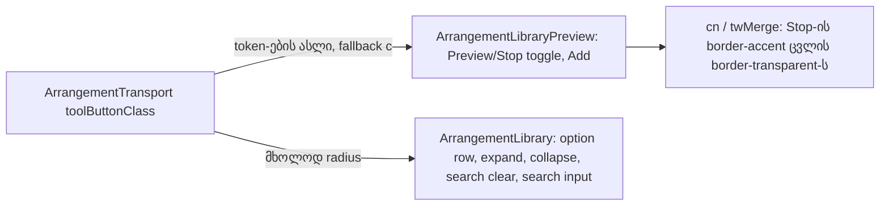

# Studio V-3c-4c-1 — Library panel-ისა და Library preview-ის ღილაკების surface: Preview/Stop toggle → 5 % fill, Add Export-ის სახით, 8 px radius

**თარიღი:** 2026-10-25
**სტატუსი:** In Progress (awaiting C round 169)
**შეცვლილი პროექტი:** Store

## კონტექსტი

VISUAL-A-OBSIDIAN-ის `visual-direction-a.md` § „ღილაკები და ზედაპირები“ ამბობს: ღილაკის `border-outline` border ქრება და ხდება `foreground` fill — 5 % მოსვენებულ მდგომარეობაში, 8 % hover-ზე, 12 % active-ზე. 1 px border რჩება, ოღონდ გამჭვირვალე, ამიტომ ზომა არ იცვლება. მთავარი მოქმედება ინარჩუნებს `brand` border-სა და `brand` ტექსტს. ღილაკებსა და ველებს 8 px radius აქვთ; motion არის `background-color, color 180ms cubic-bezier(.2,.8,.2,1)`, reduced motion-ზე გამორთული.

V-3c-4a-მ (doc 136) ეს toolbar-ს მისცა, V-3c-4b-მ (doc 137) — Lane-სა და Group-ის header-ს. V-3c-4c B-მ (გადაწყვეტილება D-29z134) სამ ეტაპად გაყო ფაილის მფლობელის მიხედვით. ეს ეტაპი (V-3c-4c-1, round 169) ეხება მხოლოდ `ArrangementLibrary`-სა და `ArrangementLibraryPreview`-ს: Preview/Stop toggle, Add, უჩარჩოო ღილაკები, ბიბლიოთეკის option row-ები და ძებნის ველი.

## მიდგომა

### R1 — token-ების ნაკრები (V-3c-4a/4b-ის მსგავსად)

Transport-ის `toolButtonClass`-იდან მხოლოდ ზედაპირის token-ები კოპირდება:

- **SURF:** `border-transparent bg-foreground/5 enabled:hover:bg-foreground/8 enabled:active:bg-foreground/12`
- **FILL** (SURF `border-transparent`-ის გარეშე): `bg-foreground/5 enabled:hover:bg-foreground/8 enabled:active:bg-foreground/12`
- **MOTION:** `motion-safe:transition-[background-color,color]! motion-safe:duration-180! motion-safe:ease-[cubic-bezier(0.2,0.8,0.2,1)]! motion-reduce:transition-none!`
- **RADIUS:** `rounded-sm` → `rounded-md` (8 px).

თითო ღილაკი ინარჩუნებს საკუთარ ზომას, padding-ს, ტექსტის ზომასა და ფერს, `font-medium`-ს, focus ring-სა და `disabled:` token-ებს. ოთხი MOTION token ერთადერთი ახალი arbitrary `[...]` მნიშვნელობაა. საერთო constant ან კომპონენტი არ შეიქმნა (checkpoint Q1 fallback (c)); ასლი თითო ფაილშია და ტესტები აფიქსირებს.

### R9 — Preview toggle, გამორთული („Preview“)

Base სტრიქონი იღებს SURF-სა და MOTION-ს, `rounded-sm` → `rounded-md`. გამორთული მდგომარეობის სტრიქონი `border-outline text-brand hover:border-brand` → `text-brand`. `hover:border-brand` ამოვიდა, რადგან spec border-ს fill-ით ცვლის და hover-ის უკუკავშირი ახლა 8 % fill-ია. გვერდითი ეფექტი: ძველი `hover:border-brand` ჩვეულებრივი `hover:` იყო და disabled toggle-საც ფერავდა; ახლა `enabled:` fill-ები disabled მდგომარეობაში hover-ზე არაფერს ცვლის.

### R10 — Preview toggle, ჩართული („Stop“)

`border-accent text-accent hover:bg-accent/10` → `border-accent text-accent`. „Stop“-ს fill არასდროს ჰქონია — ეს ფერადი outline ღილაკია, ამიტომ R2-ის (Mute/Solo on) ნიმუში არ ეხება; გამოიყენება R6/Export-ის ნიმუში: accent border და ტექსტი რჩება, ემატება 5/8/12 fill. `hover:bg-accent/10` ამოვიდა — `enabled:hover:bg-foreground/8`-ის გვერდით ვერ იმოქმედებდა, რადგან `:enabled:hover` უფრო სპეციფიკურია. Mute/Solo on-ისგან განსხვავებით (Q-R167-ON-HOVER), Stop hover-სა და press-ზე უკუკავშირს იძლევა.

### R11 — Add Export-ის სახით

`rounded-sm` → `rounded-md`, `bg-brand/10` → `bg-foreground/5`, `hover:bg-brand/20` → `enabled:hover:bg-foreground/8 enabled:active:bg-foreground/12`, ემატება MOTION. `border border-brand text-brand font-medium`, flex, gap, padding და `disabled:` token-ები რჩება. `border-transparent` **არ** ემატება — სტრიქონი სტატიკურია (არა `cn`), და ორი border ფერი ერთ სტრიქონში CSS-ის რიგზე იქნებოდა დამოკიდებული (R6-ის მიზეზი). მიზეზი: spec-ში primary მოქმედება არის brand border + brand ტექსტი (Export, C-მ round 158–159-ში შეამოწმა; R6-მ video import-ს მისცა). brand-tint fill მეორე primary სტილი იქნებოდა.

### R7 — უჩარჩოო ღილაკები და row-ები: მხოლოდ radius

Option row (`<button role="option">`, მონიშნული `bg-brand/10`), collapsed rail-ის expand, collapse და search clear ღილაკები — მხოლოდ `rounded-sm` → `rounded-md`. Fill და MOTION არ ემატება; ისინი უცვლელ გლობალურ transition-ს ინარჩუნებენ (როგორც round 168-ში). 8 px ჩანს მონიშნული row-ის fill-სა (66.5 px სიმაღლე) და focus ring-ზე.

### R3 — ველი ინარჩუნებს border-ს

Search input მხოლოდ `rounded-sm` → `rounded-md`-ს იღებს. `border-outline-strong` (TH5-ის lock) და focus-ის `border-brand` უცვლელია.

### R12 — ამ ნაწილში არ შედის

Preview waveform (`role=slider` seek ზედაპირი, არა ღილაკი ან ველი), tree node-ები (`treeNodeClass`) და tree fold ღილაკები (radius დღეს არ აქვთ, `border-l-2` active stripe — radius ფორმას შეცვლიდა), resize handle (`role=separator`) და preview სექციის `border-t` გამყოფი.

### twMerge-ის ფაქტი

B-მ დაყენებული `tailwind-merge`-ით (`cn` = `clsx` + `twMerge`) node-ში შეამოწმა: ახალ base-ზე `border-accent text-accent`-ის მიმატება შლის `border-transparent`-ს და ინარჩუნებს `bg-foreground/5`-სა და `enabled:hover`/`enabled:active` fill-ებს. `text-brand`-ის მიმატება მთელ base-ს ინარჩუნებს. LPS1 ამას DOM-ში ამოწმებს (Stop-ზე `border-transparent` არ არის, fill-ები არის).

### Token-ები ადრე და შემდეგ

| ადგილი | ადრე (e50498f) | შემდეგ |
|---|---|---|
| Preview toggle base | `rounded-sm border` | `rounded-md border border-transparent bg-foreground/5` + MOTION + `enabled:hover:bg-foreground/8 enabled:active:bg-foreground/12` |
| Toggle off | `border-outline text-brand hover:border-brand` | `text-brand` |
| Toggle on (Stop) | `border-accent text-accent hover:bg-accent/10` | `border-accent text-accent` |
| Add | `rounded-sm border border-brand bg-brand/10 … text-brand hover:bg-brand/20` | `rounded-md border border-brand bg-foreground/5 … text-brand` + MOTION + foreground hover/active |
| Option row, expand, collapse, search clear | `rounded-sm` | `rounded-md` |
| Search input | `rounded-sm border border-outline-strong` | `rounded-md border border-outline-strong` |

### B-ის browser probe (დაგეგმვის მონაცემი, `b-round-168/v3c4c1-probe.cjs`, `v3c4c1-probe-add.cjs`)

| გაზომვა | შედეგი (1440 და 1280 ერთნაირი) |
|---|---|
| Layout: ყველა `button, a, input, select, [data-testid], [role]` box | max 0.000 px, 0 დამატებული, 0 დაკარგული, P0–P3 |
| Radius | 6 px → 8 px ყველა ადგილზე |
| Toggle off („Preview“) | border rgb(36,33,30) → transparent; fill rgb(22,20,18) → rgb(33,31,28); contrast 7.88 → 7.05, hover 6.58 |
| Toggle on („Stop“) | accent border rgb(201,164,106) რჩება; fill → rgb(33,31,28); contrast 7.88 → 7.05, hover 6.58 |
| Add | brand border რჩება; fill rgb(40,35,27) → rgb(33,31,28); contrast 6.69 → 7.05, hover 5.48 → 6.58 |
| Option row, collapse, expand, search clear | მხოლოდ radius; ფერები და contrast უცვლელი (12.56; 6.68 / hover 13.94 / 14.78) |
| Search ველი | მხოლოდ radius; border rgb(115,107,96) და focus brand უცვლელი; 15.62 |
| Fill საკუთარ ზედაპირთან (WCAG 1.4.11, ცნობისთვის) | 1.12 |

ეს B-ის probe-ია; ბრაუზერის მიღება (SURF, BOX, CONTRAST, RV1, FUNC-SMOKE) C-ის round 169-ის საქმეა.

## არქიტექტურა

## შეცვლილი ფაილები

- `app/components/arrangement/ArrangementLibraryPreview.tsx` — Preview/Stop toggle-ის base, off და on სტრიქონები; Add-ის სტატიკური სტრიქონი.
- `app/components/arrangement/ArrangementLibrary.tsx` — option row, expand, collapse, search clear და search input radius.
- `app/lib/arrangement/__tests__/library-row-strings-ui.test.tsx` — ახალი describe ფაილის ბოლოს: LPS1 და LBS1.
- `docs/implementation/2026/quarter-IV/137-studio-v3c4b-lane-group-button-surfaces.md` — სტატუსი Completed, round 168-ის TODO გადახაზული.

## პრობლემები და გადაწყვეტები

- **პრობლემა:** Stop-ის სტრიქონი base-ის `border-transparent`-ს ეჯახება. **გადაწყვეტა:** `cn` (twMerge) შლის `border-transparent`-ს და ტოვებს `border-accent`-ს; LPS1 ამოწმებს, რომ Stop-ზე `border-transparent` აღარ არის.
- **პრობლემა:** Add სტატიკური სტრიქონია, `cn` არ გადის. **გადაწყვეტა:** `border-transparent` არ დაემატა, რომ `border-brand`-თან CSS-ის რიგის კონფლიქტი არ გაჩენილიყო.
- **პრობლემა:** ძველი `hover:bg-accent/10` Stop-ზე ახალ hover fill-თან ერთად უმოქმედო დარჩებოდა. **გადაწყვეტა:** ამოვიდა (R10); LPS1 მის დაბრუნებას იჭერს (m207).

## ტესტირება

- 8 targeted vitest ფაილი (`b-round-168-r169-vitest-base.txt`): baseline 163/163, ცვლილების შემდეგ 165/165 (LPS1, LBS1 ახალი).
- `npm run typecheck` და `npm run lint` — exit 0; read-only `npx biome check` 3 კოდისა და ტესტის ფაილზე — სუფთა.
- `expect(` რაოდენობა `library-row-strings-ui`-ში: 95 → 105.
- LPS1 და LBS1 ამოწმებს token-ის არსებობას ან არარსებობას (`className`-ის whitespace-ით დაყოფა), არა სრულ სტრიქონს.
- code-reviewer (9/10, Critical/High/Medium არ არის): Low — lock-ები token-ების სიაა და არა ზუსტი სტრიქონი; Nit — `beforeEach`/`afterEach` პირველი describe-ის ასლია; Nit — `expectLibraryTokens`-ის სახელი. Architecture note B-ს გადაეცა (საერთო surface constant checkpoint-ის პასუხის შემდეგ).
- Mutation-ები (ყველა მოკლულია, აღდგენილია Edit-ით და sha256 ემთხვევა post-edit hash-ს):
  - m206 toggle off-ს დაუბრუნდა `border-outline` → LPS1 წითელი;
  - m207 toggle on-ს დაუბრუნდა `hover:bg-accent/10` → LPS1 წითელი;
  - m208 Add-ზე `bg-foreground/5` → `bg-brand/10` → LPS1 წითელი;
  - m209 toggle base `rounded-md` → `rounded-sm` → LPS1 წითელი;
  - m210 option row `rounded-md` → `rounded-sm` → LBS1 წითელი;
  - m211 search input `rounded-md` → `rounded-sm` → LBS1 წითელი;
  - m212 collapse `rounded-md` → `rounded-sm` → LBS1 წითელი.
- ბრაუზერის შემოწმება, სრული suite, build და verify — C-ისა და root gate-ის საქმე.

## ცნობილი trade-off-ები

- Fill-ის კონტრასტი საკუთარ ზედაპირთან 1.12:1 (WCAG 1.4.11) — spec-ის შეგნებული გადაწყვეტილება (GATE167-WCAG-1411-FILL).
- Add კარგავს brand-tint ფონს და Export-ის სახეს იღებს (R11); Saba-ს შეუძლია veto C-ის 4× crop-ის მიხედვით.

## TODO / შემდეგი ნაბიჯები

- C round 169-ის ბრაუზერის მტკიცებულება; შემდეგ სტატუსი → Completed.
- V-3c-4c-2 (`ArrangementDetailPanel`-ის ღილაკები, toggle და input-ები).
- V-3c-4c-3 (`ArrangementExportDialog` და `ArrangementVideoDock`-ის float ღილაკები; `ArrangementMarkerRow`-ის flag chip-ის ღია კითხვა).
- V-3c-5 (panel radius).
- DUX-R-5 (ერთი ფერის წესი).
- M1/M3/M4 დარჩენილი ეტაპები.
- Checkpoint Q1 (საერთო recipe) — fallback (c) გრძელდება.
