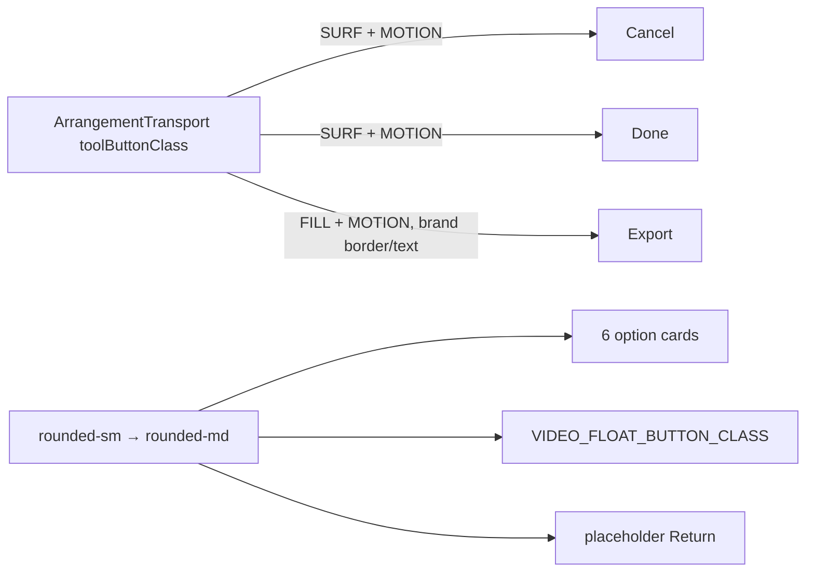

# Studio V-3c-4c-3 — Export dialog-ისა და video dock-ის surface: Cancel და Done კარგავენ outline-ს (5 % fill, 8 px), Export იღებს transport-ის Export-ის იერს, option card-ები და dock-ის ღილაკები მხოლოდ 8 px radius-ს

**თარიღი:** 2026-10-25
**სტატუსი:** In Progress (awaiting C round 171)
**შეცვლილი პროექტი:** Store

## კონტექსტი

VISUAL-A-OBSIDIAN-ის spec (`docs/technical/studio-real-workspace/visual-direction-a.md`, § „ღილაკები და ზედაპირები“) ღილაკებზე `border-outline` ჩარჩოს `foreground` fill-ით ცვლის: 5 % მოსვენებისას, 8 % hover-ზე, 12 % active-ზე. 1 px border რჩება, მაგრამ გამჭვირვალე ხდება, ამიტომ ზომა არ იცვლება. Primary action-ს („Export“) აქვს `brand` border და `brand` ტექსტი. ღილაკები და ველები 8 px radius-ს იღებენ; panel-ები 10 px-ს (V-3c-5). Motion არის `background-color, color 180ms cubic-bezier(.2,.8,.2,1)` და reduced motion-ის დროს გამორთულია.

V-3c-4a/4b/4c-1/4c-2-მა ეს გააკეთა transport-ზე, toolbar-ზე, lane/group header-ებზე, Library-ზე და Clip details panel-ზე. ეს რაუნდი (B-ის გადაწყვეტილება D-29z136) V-3c-4-ის ბოლო ნაწილია: `ArrangementExportDialog` და `ArrangementVideoDock`.

## მიდგომა

- **R1 — token set** კოპირებულია transport-ის `toolButtonClass`-იდან:
  - **SURF:** `border-transparent bg-foreground/5 enabled:hover:bg-foreground/8 enabled:active:bg-foreground/12`
  - **FILL:** SURF `border-transparent`-ის გარეშე
  - **MOTION:** `motion-safe:transition-[background-color,color]! motion-safe:duration-180! motion-safe:ease-[cubic-bezier(0.2,0.8,0.2,1)]! motion-reduce:transition-none!`
  - **RADIUS:** `rounded-sm` (6 px) → `rounded-md` (8 px).
  - ოთხი MOTION token ერთადერთი arbitrary `[...]` მნიშვნელობაა.
- **R15 — Export ღილაკი** (`exportLook` ვარიანტი): `bg-brand` → FILL, `text-brand-foreground` → `text-brand`, დაემატა MOTION, `rounded-md`. რჩება `border border-brand font-medium px-4 py-2 text-sm`, focus ring და `disabled:cursor-not-allowed disabled:opacity-40`. `border-transparent` არ დამატებულა. მიზეზი: spec primary action-ს brand border-ით და brand ტექსტით განსაზღვრავს, transport-ის Export-მა, R6 video import-მა და R11 Library Add-მა იგივე იერი უკვე მიიღეს. **ალტერნატივა (vetoable `keepFill`):** მხოლოდ `rounded-md` + MOTION, solid brand fill რჩება (კონტრასტი 8.32).
- **R16 — Cancel და Done:** `rounded-md`, `border-outline` → `border-transparent`, `hover:border-outline-hover` ამოღებულია, დაემატა SURF fill-ები და MOTION. hover-ის უკუკავშირი ახლა 8 % fill-ია (R9-ის პრეცედენტი). რჩება `border px-4 py-2 text-sm text-foreground` და focus ring. Done ინარჩუნებს წინასწარ არსებულ `disabled:opacity-40`-ს (HE5 მას ბლოკავს); Cancel-ს `disabled:` token არ აქვს.
- **R17 — option card-ები** (WAV, MP3, both, video, project, range) form control-ებია: იცვლება მხოლოდ radius. `border-outline` / `border-brand bg-brand/10` და `text-dim` რჩება, რადგან border არჩევის ნიშანია.
- **R18 — dock-ის ღილაკები:** `VIDEO_FLOAT_BUTTON_CLASS` და placeholder-ის Return იცვლიან მხოლოდ radius-ს. `bg-background/80` რჩება ვიდეოს თავზე წაკითხვადობისთვის, `hover:text-foreground` და `hover:bg-elevated` რჩება. 5 % fill და MOTION არ დაემატა (R7 borderless პრეცედენტი); ორივე global 150 ms `app.css` transition-ს ინარჩუნებს.
- **R19 — ამ ეტაპში არ შედის:** dock placeholder-ის dashed box და video box (frame-ებია, V-3c-5, 10 px), dialog footer strip (divider; FS1), progress bar, radio input-ები (`accent-brand`).
- **R20 — `ArrangementMarkerRow`-ის flag label chip** V-3c-ში არ შედის: ის flag ღილაკის შიგნით ტექსტური label-ია, h-4-ზე 8 px radius pill-ს გააკეთებდა და truncated ტექსტს მოჭრიდა. ფაილი არ შეხებია.
- **არჩეული არ არის:** საერთო constant ან component ფაილებს შორის. checkpoint-ის პასუხამდე fallback (c) მოქმედებს: class-ის ასლები თითო component-შია და ტესტებით არის დაბლოკილი.

## არქიტექტურა

### Token-ები ადრე და შემდეგ

| ადგილი | ადრე | შემდეგ |
|---|---|---|
| Cancel | `rounded-sm border border-outline … hover:border-outline-hover` | `rounded-md border border-transparent bg-foreground/5` + hover/active fill + MOTION |
| Done | იგივე + `disabled:opacity-40` | Cancel-ის შემდეგ მდგომარეობა + `disabled:opacity-40` |
| Export | `rounded-sm border border-brand bg-brand … text-brand-foreground` | `rounded-md border border-brand bg-foreground/5 … text-brand` + hover/active fill + MOTION |
| Option card-ები (6) | `rounded-sm border …` | `rounded-md border …` |
| `VIDEO_FLOAT_BUTTON_CLASS` | `rounded-sm bg-background/80` | `rounded-md bg-background/80` |
| placeholder Return | `rounded-sm hover:bg-elevated` | `rounded-md hover:bg-elevated` |

## შეცვლილი ფაილები

- `app/components/arrangement/ArrangementExportDialog.tsx` — S1 (Cancel), S2 (Done), S3 (Export), S4 (ექვსი card-ის radius). ტექსტი, aria, handler-ები, ზომა, gap, padding და `cn()`-ის სტრუქტურა უცვლელია.
- `app/components/arrangement/ArrangementVideoDock.tsx` — K1 (`VIDEO_FLOAT_BUTTON_CLASS` radius) და K2 (placeholder Return radius). drag, arrow-key და Escape handler-ები უცვლელია.
- `app/lib/arrangement/__tests__/export-dialog-hold-enter.test.tsx` — ახალი describe ფაილის ბოლოს: ESU1 და ECR1; helper-ები და setup describe-ის შიგნითაა, unmount `afterEach`-შია.
- `app/lib/arrangement/__tests__/video-dock-strings-ui.test.tsx` — ახალი describe ფაილის ბოლოს: VFR1; unmount `finally`-შია.
- `docs/implementation/2026/quarter-IV/139-studio-v3c4c2-detail-panel-button-surfaces.md` — სტატუსი → Completed, C round 170-ის TODO გადახაზულია.
- ეს დოკუმენტი.

## პრობლემები და გადაწყვეტები

- **Problem:** ახალი describe-ები ფაილის პირველი describe-ის `beforeEach`-ს (AudioContext/AudioBuffer/rAF stub-ები, URL stub-ები, anchor click spy) ვერ იღებს. → **Solution:** თითო ახალ describe-ს საკუთარი `beforeEach`/`afterEach` აქვს, ფაილის არსებული fake-ებითა და `restoreUrlStubs()`-ით.
- **Problem:** ECR1-ში video card-ის პოვნა `disabled` radio-თი არაცალსახაა — range radio-ც disabled-ია, როცა range არ არსებობს. → **Solution:** video radio იძებნება როგორც format ჯგუფის ერთადერთი radio `data-testid`-ის გარეშე; დამატებით მოწმდება, რომ ის disabled-ია.
- **Problem:** Cancel მხოლოდ `isRendering`-ის დროს ჩანს. → **Solution:** ESU1 `pendingRenders()`-ით render-ს ღიად ტოვებს, Cancel-სა და disabled Done-ს ამოწმებს და ბოლოს `settleRenders()`-ით ასრულებს.

### B-ის ბრაუზერის probe (§0.1, `b-round-170/v3c4c3-probe.cjs`, 1440 და 1280)

| საზომი | შედეგი |
|---|---|
| Layout (ყველა control box) | max 0.000 px, E0/E1/V0/V1 ყველა მდგომარეობაში, ორივე ვარიანტში |
| Radius | 6 px → 8 px ყველა შეცვლილ ადგილზე |
| Done (enabled) | border → transparent; fill rgb(22,20,18) → rgb(33,31,28); კონტრასტი 14.78 → 13.24, hover 12.35 |
| Export, `exportLook` (E1) | fill rgb(201,164,106) → rgb(33,31,28), ტექსტი brand; კონტრასტი 8.32 → 7.05, hover 6.58; brand border რჩება |
| Export, `keepFill` (E1) | 8.32, უცვლელი |
| Export, disabled (E0, `opacity-40`) | 2.29 → 2.26 — წინასწარ არსებული opacity-40 გამონაკლისი, ინფორმაციული |
| Option card-ები (6) | მხოლოდ radius; ფერები უცვლელი (selected 12.56, unselected 14.78, video და invalid range 5.38) |
| Dock float ღილაკები, Return | მხოლოდ radius; float 7.09 (hover 15.68, box-ის ფონზე), Return 15.62 (hover 13.94) |
| Cancel | probe-ში მიუწვდომელი (მხოლოდ `isRendering`-ის დროს ჩანს) — C-ის E2 მდგომარეობა |
| Fill vs surface (WCAG 1.4.11) | 1.12 — spec-ის ცნობილი trade-off |

### ცნობილი trade-off-ები

- WCAG 1.4.11: fill-ის კონტრასტი საკუთარ ზედაპირთან 1.12:1 — spec-ის გადაწყვეტილება (GATE167-WCAG-1411-FILL).
- Export ღილაკი 8.32 → 7.05 და კარგავს solid fill-ს (R15 vetoable-ია, `keepFill` ალტერნატივით).
- Dock-ის ღილაკები global 150 ms transition-ს ინარჩუნებენ (C-R168-BORDERLESS-REDUCED-MOTION).

## ტესტირება

- **Baseline (`fe6ea99`):** B-ის 19 targeted ფაილი — 279/279.
- **ცვლილების შემდეგ:** იგივე 19 ფაილი — 282/282 (ESU1, ECR1, VFR1). `expect(`: `export-dialog-hold-enter` 47 → 61, `video-dock-strings-ui` 44 → 48 (token-ების assertion-ები helper-ის loop-შია, ამიტომ სტატიკური რაოდენობა ნაკლებია runtime-ზე).
- **Code review-ის შემდეგ (Low 1, Low 3):** card-ებსა და Return-ზე დაემატა `bg-foreground/5`-ისა და `motion-` token-ების არარსებობის შემოწმება (card-ებზე `border-transparent`-იც), ESU1-ში render-ის დასრულება `finally`-შია.
- **ESU1:** Export (idle, WAV) — `border-brand`, SURF fill-ები, `text-brand`, `font-medium`, `rounded-md`, MOTION, focus ring, `disabled:cursor-not-allowed disabled:opacity-40`; არა `bg-brand`, `text-brand-foreground`, `border-transparent`, `rounded-sm`. Done (idle და render-ის დროს disabled) და Cancel (render-ის დროს) — `border-transparent`, SURF, `rounded-md`, `text-foreground`, MOTION, focus ring; არა `border-outline`, `hover:border-outline-hover`, `rounded-sm`. Done — `disabled:opacity-40`; Cancel — არცერთი `disabled:` token.
- **ECR1:** dialog-ის ექვსი radio-ს `closest('label')` — `rounded-md border p-3`, არა `rounded-sm`; WAV — `border-brand bg-brand/10`; MP3 — `border-outline`, არა `bg-brand/10`; video — `border-outline text-dim`.
- **VFR1:** compact Expand და floating drag/expand/close — `rounded-md bg-background/80 hover:text-foreground h-6 w-6 focus-visible:ring-brand`, არა `rounded-sm`/`bg-foreground/5`, არცერთი `motion-` token; placeholder Return — `rounded-md hover:bg-elevated px-2 py-0.5`, არა `rounded-sm`.
- **Mutation-ები** (თითოეული Edit-ით აღდგა და sha256 შემოწმდა):

| Mutation | ცვლილება | წითელი |
|---|---|---|
| m219 | Done: `border-transparent` → `border-outline` | ESU1 |
| m220 | Cancel: `enabled:hover:bg-foreground/8` ამოღებული | ESU1 |
| m221 | Export: `bg-foreground/5` → `bg-brand` | ESU1 |
| m222 | Export: `text-brand` → `text-brand-foreground` | ESU1 |
| m223 | Done: `disabled:opacity-40` ამოღებული | ESU1, HE5 |
| m224 | WAV card: `rounded-md` → `rounded-sm` | ECR1 |
| m225 | `VIDEO_FLOAT_BUTTON_CLASS`: `rounded-md` → `rounded-sm` | VFR1 |
| m226 | `VIDEO_FLOAT_BUTTON_CLASS`: `bg-background/80` ამოღებული | VFR1 |

- `npm run typecheck`, `npm run lint` (exit 0) და `npx biome check` ოთხ code/test ფაილზე — სუფთა.
- ბრაუზერის მიღება (SURF, BOX, CONTRAST, RV1, FUNC-SMOKE, Cancel-ის E2 მდგომარეობის ჩათვლით) — C round 171.

## TODO / შემდეგი ნაბიჯები

- C round 171-ის ბრაუზერის მტკიცებულება; შემდეგ სტატუსი → Completed.
- V-3c-5 (panel radius 10 px, dock-ის placeholder dashed box-ისა და video box-ის, ასევე DetailPanel-ის video/waveform და group-reason framed box-ების ჩათვლით).
- DUX-R-5 (ერთი ფერის წესი).
- M1/M3/M4 დარჩენილი ეტაპები.
- Architecture checkpoint-ის მოთხოვნა `b-round-170-checkpoint-request.md` (საერთო recipe) — პასუხამდე fallback (c) გრძელდება.
