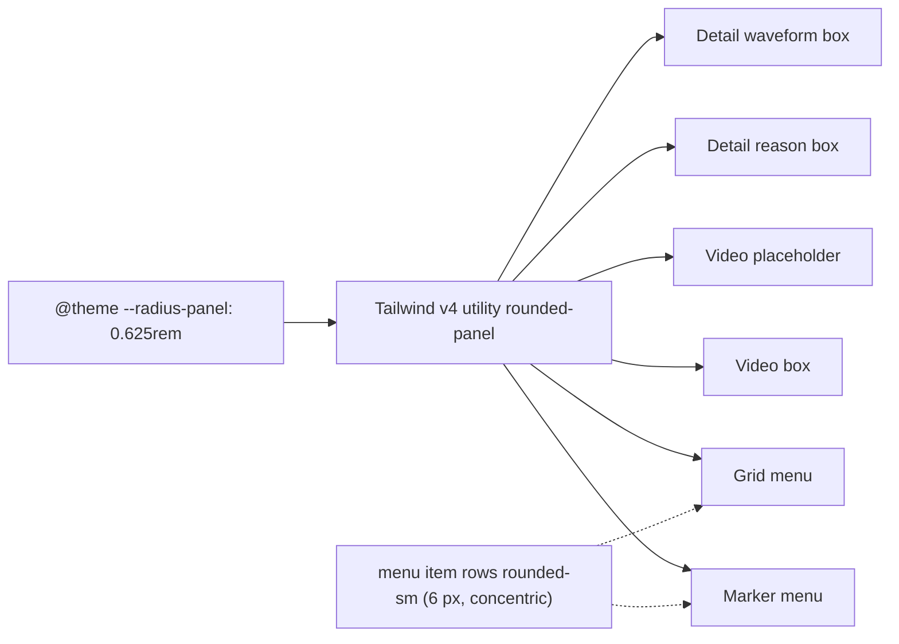

# Studio V-3c-5a — 10 px panel radius: ახალი `--radius-panel` token; Detail panel-ის box-ები, video dock-ის frame-ები და Grid/Marker menu-ები იღებენ მას; არაფერი გადაადგილდება

**თარიღი:** 2026-10-25
**სტატუსი:** Completed (C round 172 PASS; published 3810816)
**შეცვლილი პროექტი:** Store

## კონტექსტი

VISUAL-A-ის სპეციფიკაცია (`visual-direction-a.md`, „ღილაკები და ზედაპირები“) ადგენს: ღილაკები და ველები 8 px, **panel-ები 10 px**, layout-ზე გავლენის გარეშე. V-3c-4-მა ღილაკები 8 px-ზე გადაიყვანა; framed და floating panel-ები ჯერ ისევ 6 px (`rounded-sm`) ან 8 px (`rounded-md`) იყო. Tailwind-ის scale-ში 10 px-ის საფეხური არ არსებობს (`rounded-sm` 6, `rounded-md` 8, `rounded-lg` 12), ხოლო arbitrary `rounded-[10px]` აკრძალულია (Tailwind-first). V-3c-5 owner-ის მიხედვით ორად გაიყო: ეს რაუნდი (5a) — token და აშკარა panel-ები; 5b — Overview და დარჩენილი 6 px control-ები.

## მიდგომა

- **R21 — ერთი theme token.** `app/styles/app.css`-ის `@theme` ბლოკში, `--radius-md`-ის შემდეგ, დაემატა `--radius-panel: 0.625rem` (10 px). Tailwind v4 ამისგან ქმნის `rounded-panel` utility-ს.
  - ალტერნატივა 1: token მხოლოდ obsidian scope-ში — უარყოფილია: scoped ცვლადი utility-ს არ ქმნის და TH1 obsidian ბლოკს ზუსტ map-ად კეტავს.
  - ალტერნატივა 2: `--radius-lg`-ის გადაფარვა scope-ში — უარყოფილია: `body:has(...)` portal-ით რენდერებულ `Modal.tsx`-საც სწვდება და მისი `rounded-lg` ღილაკები შეიცვლებოდა.
- **R22 — რა ითვლება panel-ად.** framed ან floating box, რომელსაც კონტენტი აქვს (border და/ან საკუთარი surface; არა ღილაკი, ველი, chip, clip ან handle). Docked რეგიონები (library sidebar, Detail panel-ის body, transport, dock strip) კვლავ კვადრატულია — მათი მომრგვალება მეზობელ divider-ებთან კუთხის ჭრილებს დატოვებდა (SABA-B-2-ის ტიპის დეფექტი) ან ახალ margin-ს მოითხოვდა.
- **R23 — menu-ები floating panel-ებია** → 10 px. მათი item row-ები `rounded-sm` (6 px) რჩება: `p-1` (4 px) padding-ით 10 px container-ში 6 px concentric შიდა radius-ია (10 − 4). ალტერნატივა (8 px row-ები) აღრიცხულია.
- **R24 — ფარგლებს გარეთ:** `Modal.tsx` (დაცული საერთო ფაილი; კითხვა Q-V3C5-MODAL-RADIUS), clip-ები, drop ghost-ები, range overlay-ები, Loop brace, handle-ები, meter, group overview block-ები, Overview clip bar-ები, demo badge და marker flag chip-ები, Export dialog-ის footer strip და V-3c-5b-ის საიტები.

### საიტები (§0.2)

| ID | საიტი | ადრე | ახლა |
|---|---|---|---|
| P1 | `ArrangementDetailPanel` — waveform / video box (`arrangement-detail-waveform`) | `rounded-sm` | `rounded-panel` |
| P2 | `ArrangementDetailPanel` — group-state reason box (`arrangement-detail-reason`-ის მშობელი) | `rounded-sm` | `rounded-panel` |
| P3 | `ArrangementVideoDock` — floating placeholder (`arrangement-video-placeholder`, dashed) | `rounded-sm` | `rounded-panel` |
| P4 | `ArrangementVideoDock` — video box (`arrangement-video-box`, compact და floating) | `rounded-sm` | `rounded-panel` |
| P5 | `ArrangementGridMenu` — menu container (`role=menu`) | `rounded-md` | `rounded-panel` |
| P6 | `ArrangementMarkerMenu` — menu container (`role=menu`) | `rounded-md` | `rounded-panel` |

### Token — ადრე / შემდეგ

- ადრე: `--radius-sm` 6 px, `--radius-md` 8 px, `--radius-lg` 12 px, `--radius-xl` 16 px, `--radius-full`.
- შემდეგ: იგივე + `--radius-panel` 10 px (`0.625rem`), `--radius-md`-სა და `--radius-lg`-ს შორის.

## არქიტექტურა

`border-radius` layout box-ებს (`getBoundingClientRect`) არ ცვლის; ზომა, padding, ფერი, shadow, ტექსტი, aria და handler-ები უცვლელია.

## შეცვლილი ფაილები

- `app/styles/app.css` — მხოლოდ ერთი ახალი token-ის ხაზი `@theme`-ში.
- `app/components/arrangement/ArrangementDetailPanel.tsx` — P1, P2.
- `app/components/arrangement/ArrangementVideoDock.tsx` — P3, P4.
- `app/components/arrangement/ArrangementGridMenu.tsx` — P5.
- `app/components/arrangement/ArrangementMarkerMenu.tsx` — P6.
- `app/lib/arrangement/__tests__/detail-panel-polish.test.tsx` — `WAVEFORM_BOX_CLASS` constant-ში ერთი token (P1-ის exact-string lock).
- `app/lib/arrangement/__tests__/panel-radius-ui.test.tsx` — ახალი: PNR1–PNR3.
- `docs/implementation/2026/quarter-IV/140-…md` — სტატუსი Completed და C round 171-ის TODO გადახაზული.

## პრობლემები და გადაწყვეტები

- **პრობლემა:** 10 px-ის Tailwind საფეხური არ არსებობს, arbitrary value აკრძალულია. → **გადაწყვეტა:** ერთი სახელდებული theme token (`--radius-panel`).
- **პრობლემა:** token გლობალურია (`@theme`) და თეორიულად Store-საც მიუწვდება. → **გადაწყვეტა / trade-off:** Store-ის არცერთი ფაილი `rounded-panel`-ს არ იყენებს (PNR2 ამას კეტავს — მხოლოდ ექვსი Studio საიტი), ამიტომ Studio-ს გარეთ არაფერი იცვლება.
- **პრობლემა:** Biome-ის კონფიგურაცია `app.css`-ს არ ამოწმებს. → **გადაწყვეტა:** token-ს PNR1 კეტავს (ერთხელ, `@theme`-ში, brace depth 1; obsidian ბლოკში `--radius-` არ არის).

## ტესტირება

- **PNR1:** `app.css`-ში (კომენტარების გარეშე) `--radius-panel: 0.625rem;` ზუსტად ერთხელ, `@theme`-ში depth 1-ზე; obsidian scope-ში `--radius-` არ არის; `--radius-sm/md/lg` თითო ერთხელ.
- **PNR2:** `app/components` და `app/routes`-ის non-test ფაილებში `rounded-panel` მხოლოდ ექვს საიტზე (2/2/1/1); P1–P6-ის სრული class string-ები თითო ერთხელ; menu row constant-ებს `rounded-sm` აქვთ.
- **PNR3a–c:** rendered — video box (compact და floating, ჩატვირთული video-თი) და placeholder; group-state reason box; Grid და Marker menu-ის container-ები 10 px, row-ები 6 px.
- **Targeted vitest:** 21 ფაილი (B-ის 20 + ახალი) — 362/362 (baseline 357/357 + 5 ახალი `it`).
- **Mutations m227–m234:** ყველა წითლდება მოთხოვნილ ტესტზე და აღდგება sha256-ის შემოწმებით (`tmp/studio-real-loop/a-round-172/mutations/`).
- `npm run typecheck`, `npm run lint` და scoped `npx biome check` — სუფთა.
- ბრაუზერის მიღება (RADIUS, BOX, RV1, FUNC-SMOKE) — C round 172.

## TODO / შემდეგი ნაბიჯები

- ~~C round 172-ის ბრაუზერის მტკიცებულება; შემდეგ სტატუსი → Completed.~~
- V-3c-5b: Overview (root, outline overlay, view frame — OV1-ის განახლებითა და ვიწრო frame-ის probe-ით) და დარჩენილი 6 px control-ების გადაწყვეტა (Transport timecode readout, Library preview waveform, `← CZABA` ბმული).
- Q-V3C5-MODAL-RADIUS — Export dialog-ის panel radius დაცულ `Modal.tsx`-შია (16 px container, 12 px ღილაკები); Saba/root-ის გადაწყვეტილება.
- DUX-R-5 (ერთი ფერის წესი).
- M1/M3/M4 დარჩენილი ეტაპები.
- Architecture checkpoint-ის მოთხოვნა `b-round-170-checkpoint-request.md` — პასუხამდე fallback (c) გრძელდება.
