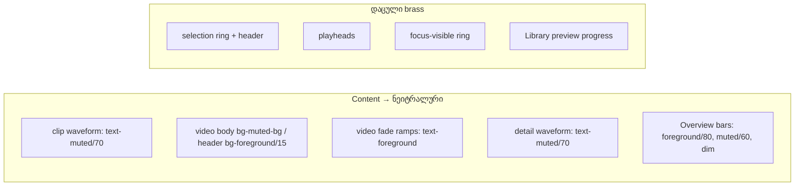

# Studio DUX-R-5a — ერთი ფერის წესი, ნაწილი 1: content ნეიტრალურია (clip waveform, video clip, detail waveform, Overview bar-ები); selection, playhead და focus ინარჩუნებს brass-ს; არაფერი გადაადგილდება

**თარიღი:** 2026-10-25
**სტატუსი:** In Progress (awaiting C round 174)
**შეცვლილი პროექტი:** Store

## კონტექსტი

Saba-მ 2026-10-25-ს დაამტკიცა DUX-R-5 (`user-review/design-ux-decisions.md`): ერთი ფერის წესი. Waveform-ები და content ნეიტრალური ფერითაა; accent (Obsidian-ში brass) დაცულია selection-ის, playhead-ის, primary ღილაკისა და focus-ისთვის. D6-ის contrast-ის ზღვრები რჩება. Review-ის F-9 finding: „ყველაზე ძლიერი ფერი waveform-ებია … selection content-ისგან არ გამოირჩევა“.

B-მ (D-29z139) `app/components/arrangement/`-ში ~150 `brand`/`accent` site დაითვალა 19 ფაილში და DUX-R-5 ორად გაყო:

- **DUX-R-5a (ეს ეტაპი):** content — waveform-ები, video clip-ის tint, detail waveform და Overview bar-ები, სამ component ფაილში.
- **DUX-R-5b (შემდეგი ეტაპი):** დანარჩენი არა-დაცული brass site-ები — fader thumb-ები (`accent-brand`), fade handle-ები (`ArrangementClip`-ის `bg-brand`), trim-edge hover (`hover:bg-accent/60`), on-state ღილაკები, `text-brand` label-ები და `StudioWorkspace`-ის `text-accent` site-ები. თითო site-ს მიეცემა ruling: selection, playhead, primary, focus ან არცერთი. DUX-R-5 „მზადაა“ არ არის, სანამ 5b C-ს არ გაივლის.

## მიდგომა

გადაწყვეტილებები (ყველა მომხმარებლისთვის vetoable `feature-status.md`-ში):

- **R30 — content-ის ფერი.** audio და video clip-ის waveform და detail waveform → `text-muted/70`.
- **R31 — video vs audio.** video body `bg-accent/10` → `bg-muted-bg`, video header `bg-accent/30` → `bg-foreground/15`. ფერის ტონი აღარ განასხვავებს video-ს audio-სგან; ეს „content ნეიტრალურია“-ს შეგნებული შედეგია. video განირჩევა სიღიავის საფეხურით (header ~1.52:1 audio header-თან, body #24201c vs #1d1a17) და header-ის `Film` vs `GripVertical` icon-ით.
- **R32.** video fade ramp-ები `text-accent` → `text-foreground`, როგორც audio-ზე. fade-ის ფორმა content-ია.
- **R33 — Overview bar-ები.** audio-ს კიბე `bg-brand`/`bg-brand/50`/`bg-dim` → `bg-foreground/80`/`bg-muted/60`/`bg-dim`. სამი განსხვავებული ნეიტრალური საფეხური რჩება; მეორე track 2.87-დან ≈3.3-მდე იზრდება. video bar `bg-foreground/25` უცვლელია.
- **K1–K6 — brass რჩება (დაცული როლები).**
  - K1, selection: არჩეული clip-ის root `border-brand ring-2 ring-brand` და header `bg-brand text-brand-foreground`.
  - K2, playhead: Overview-ს playhead `bg-accent ring-1 ring-background`.
  - K3, playhead: detail playhead `w-px bg-accent`.
  - K4, focus: ყველა `focus-visible:ring-brand`.
  - K5, playhead-ის როლი: Library preview-ის დაკრული ნაწილი `fill-brand` (playback progress). ფაილი არ შეცვლილა.
  - K6: envelope უცვლელია (SABA-B-1: `stroke-foreground` `stroke-background` halo-თი, `bg-foreground` handle).
- **Ableton:** parity-ის მტკიცება არ არის. ეს CZABA-ს brand-ის გადაწყვეტილებაა; Live-ის წყარო clip-ის ფერის წესზე არ არის დაფიქსირებული.

**არ გაკეთდა:** `style=`, arbitrary value, hex, ახალი CSS ან `app/styles/`-ის ცვლილება; `data-*`, aria, handler-ის, layout-ის, ზომის ან პოზიციის ცვლილება; `cn()`-ში ერთი property-სთვის მეორე ფერის token.

### B-ის ფერის გამოთვლა (sRGB WCAG, Obsidian token-ები)

| კანდიდატი | Composite rgb | საკუთარ ზედაპირთან | შენიშვნა |
|---|---|---|---|
| დღევანდელი `text-brand/70` `bg-elevated`-ზე | 149,123,81 | 4.30 | brass — წესს არღვევს |
| `text-muted/70` `bg-elevated`-ზე (audio waveform) | 123,116,106 | 3.76 | ≥ 3:1 (WCAG 1.4.11, D6). envelope line halo-ს გარეშე: 3.71 (იყო 3.24) |
| `text-muted/70` `bg-muted-bg`-ზე (video waveform) | 125,118,108 | 3.61 | |
| `text-muted/70` `bg-background`-ზე (detail waveform) | 118,112,103 | 3.98 | |
| `text-dim/70`, `text-muted/60` | — | 3.16 / 3.11 | უარყოფილია: 3:1-თან ძალიან ახლოს |
| video header `bg-foreground/15` `bg-muted-bg`-ზე | 66,62,56 | header text: 8.57; audio header-თან: 1.52 | `bg-outline-strong` უარყოფილია (text მხოლოდ 4.22) |
| Overview bar-ები `bg-background`-ზე: `bg-foreground/80` / `bg-muted/60` / `bg-dim` | 192,187,177 / ≈103,98,90 / 146,138,125 | 10.11 / ≈3.3 / 5.69 | ადრე: 8.32 / 2.87 / 5.69 |

C-ის brass ტესტი: `R − B ≥ 45`. ყველა ნეიტრალურ token-ს R − B ≤ 21 აქვს; brass composite-ებს — ≥ 68.

## არქიტექტურა

## შეცვლილი ფაილები

- `app/components/arrangement/ArrangementClip.tsx` — video body, video header, clip body-ის waveform ფერი და video fade ramp-ები (C1–C4).
- `app/components/arrangement/ArrangementOverview.tsx` — audio bar-ების კიბე (O1).
- `app/components/arrangement/ArrangementDetailPanel.tsx` — detail waveform box-ის ფერი (P1).
- `app/lib/arrangement/__tests__/detail-panel-polish.test.tsx`, `panel-radius-ui.test.tsx` — ზუსტი className string-ის განახლება (L1, L2).
- `app/lib/arrangement/__tests__/video-fades-ui.test.tsx` — ramp-ის ფერის assertion `text-foreground` და `text-accent`-ის არარსებობა (L3).
- `app/lib/arrangement/__tests__/content-colour-ui.test.tsx` — ახალი, DXC1–DXC6.
- `docs/implementation/2026/quarter-IV/141-…`, `142-…` — gate-173-ის finding 1/2-ის ჩანაწერები და doc 142-ის სტატუსი.

## პრობლემები და გადაწყვეტები

- **პრობლემა:** waveform `currentColor`-ით იღებს ფერს — შეიძლება text child-ებსაც შეეხოს და 4.5:1 ზღვარი დასჭირდეს. **გადაწყვეტა:** B-ის inheritance check — clip body-სა და detail box-ში ყველა text child საკუთარ ფერს აყენებს, ამიტომ `currentColor` მხოლოდ waveform `<path>`-ს აღწევს და ზღვარი 3:1-ია.
- **პრობლემა:** Overview bar-ებს `data-*` არ აქვს, ახლის დამატება კი აკრძალულია. **გადაწყვეტა:** DXC4 track row-ებს პოზიციით პოულობს (`[data-timeline-overview]`-ის მეორე child-ის row-ები track-ების რიგით) — იგივე სელექტორი, რომელიც gate-173-მა Low-ად გადადო.

## ტესტირება

- `content-colour-ui.test.tsx`: DXC1 (audio waveform, unselected/selected), DXC2 (video body/header/waveform/ramp-ები), DXC3 (K1 selection lock), DXC4 (Overview-ს კიბე სამი audio track-ით და video bar, K2 playhead), DXC5 (detail waveform), DXC6 (source lock-ები, K5 ჩათვლით).
- Mutation-ები m241–m247 (`tmp/studio-real-loop/a-round-174/mutations/`): თითო დროებითი ცვლილება, დაბრუნებული და sha-ით შემოწმებული.
- `npm run typecheck`, `npm run lint`, scoped `npx biome check`; ბრაუზერის მიღება (CC-COLOUR, NO-BRASS-CONTENT, SELECTION-BRASS, CONTRAST-DUX5A, ENV-VIS, STATE-DISTINCT, RV1, FUNC-SMOKE) — C round 174.

## TODO / შემდეგი ნაბიჯები

- C round 174-ის ბრაუზერის მტკიცებულება; შემდეგ სტატუსი → Completed.
- DUX-R-5b: დარჩენილი არა-დაცული brass site-ები per-site ruling ცხრილით (StudioWorkspace-ის ჩათვლით).
- R31-ის (video-ს cue სიღიავე + icon) და R33-ის Saba-ს veto-ს შესაძლებლობა `feature-status.md`-ში.
- M1/M3/M4 დარჩენილი ეტაპები.
- ROOT-RECON-GRID-HARNESS — `content-colour-ui.test.tsx`-იც იმეორებს fake Web Audio / ResizeObserver harness-ს (code-reviewer-ის Architecture note); საერთო სატესტო დამხმარე ცალკე test-only დავალებაა.
