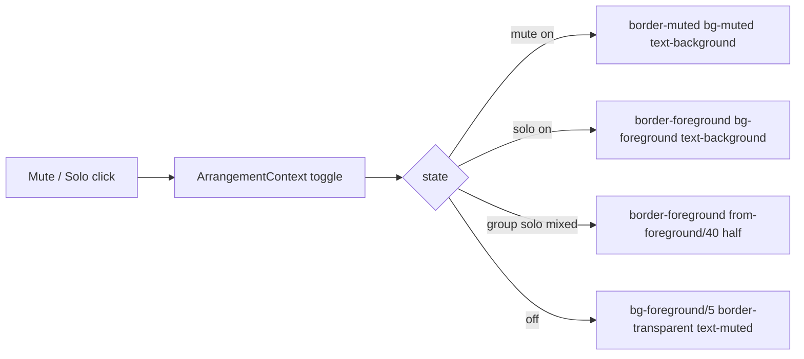

# Studio DUX-R-5b-2a — ერთი ფერის წესი, ნაწილი 2, ეტაპი 2a: mixer-ის on-state-ები ნეიტრალური და ერთმანეთისგან განსხვავებულია (track / group / Master Mute, track / group Solo, group Solo mixed) + Clip details separator-ის hover; არაფერი გადაადგილდება

**თარიღი:** 2026-10-25
**სტატუსი:** In Progress (awaiting C round 176)
**შეცვლილი პროექტი:** Store

## კონტექსტი

- Saba-ს გადაწყვეტილება (`user-review/design-ux-decisions.md`, 2026-10-25): **DUX-R-5 დამტკიცებულია**. Accent (Obsidian-ში brass) რჩება მხოლოდ selection-ისთვის, playhead-ისთვის, primary button-ისთვის და focus-ისთვის. D6-ის contrast-ის ზღვრები ძალაში რჩება.
- **R34** (round 175, veto შესაძლებელია): mode toggle-ები, on-state-ები, affordance-ები, label-ები და warning-ები selection არ არის, ამიტომ ნეიტრალური ხდება.
- Round 176-მდე Mute-ის on-state იყო `bg-accent`, Solo-ს კი `bg-brand`. Obsidian-ში ორივე ერთი და იგივე brass-ია (B-R174-ACCENT-EQ-BRAND, 1:1), ამიტომ ფერით Mute-სა და Solo-ს ვერ გაარჩევდით.
- C-მ round 175-ში იპოვა **A-R175-DETAIL-SEP-ACCENT**: Clip details-ის სიმაღლის separator-ს hover-ზე ისევ brass ჰქონდა (`hover:bg-accent/60`), 1440-ზე 22860/22860 px. ეს იგივე affordance-ია, რაც track-height handle, ამიტომ ამ რაუნდში სწორდება.

## მიდგომა

§0.1-ის ცხრილი (B-ის გამოთვლა, sRGB WCAG; Obsidian token-ები `app/styles/app.css` l.3920–3942; backdrop-ები: lane header `bg-surface` #161412, group header `bg-elevated` #1d1a17, Master `bg-surface`):

| Site | ადრე | ახლა (on-state) | Contrast |
|---|---|---|---|
| Mute on (Lane, GroupHeader, Master) | `border-accent bg-accent text-background` | `border-muted bg-muted text-background enabled:hover:bg-muted enabled:active:bg-muted` | fill vs surface 6.68, vs elevated 6.30, vs off fill 6.03; letter vs fill 7.06 |
| Solo on (Lane, GroupHeader) | `border-brand bg-brand text-brand-foreground` | `border-foreground bg-foreground text-background enabled:hover:bg-foreground enabled:active:bg-foreground` | fill vs surface 14.78, vs elevated 13.94; letter vs fill 15.62 |
| Group Solo mixed | `border-brand … from-brand …` (letter brass-ზე 1.88) | `border-foreground bg-gradient-to-r from-foreground/40 from-50% to-transparent to-50% text-foreground` | B: ნახევარი vs header 3.62 (hover 3.80, press 4.07; B-ის floor 3.3), letter ნახევარზე 3.85 (press 3.42); border vs elevated 13.94. **A-ს შესწორება ქვემოთ.** |
| Detail separator hover | `hover:bg-accent/60` (3.58) | `hover:bg-foreground/50` (track-height handle-ის მსგავსად, round 175 A5) | fg/50 vs background 4.53, surface 4.49, elevated 4.40 |

- **A-ს შესწორება (mixed, rest):** B-ის 3.62 ვარაუდობს, რომ ნახევარი base-ის `bg-foreground/5`-ზე იხატება. სინამდვილეში tailwind-merge v3 `bg-gradient-to-r`-ის დამატებისას `bg-foreground/5`-ს შლის. ეს UM11-შიც ჩანს: მისი mixed assertion `bg-foreground/5`-ის არარსებობას ამოწმებს. Hover/press-ის `/8`/`/12` token-ები რჩება. ამიტომ rest-ზე ნახევარი ≈ rgb(112,108,101) elevated-ზე: **3.30** vs header, letter **4.22**. Hover: 3.81 / letter 3.66. Press: 4.08 / letter 3.42. 3:1 მაინც სრულდება, rest კი B-ის 3.3-იან floor-ზე ზუსტად დგას. C-მ ეს CONTRAST-ONSTATE-ში უნდა გაზომოს.
- **Mute vs Solo (შეგნებული არჩევანი, veto შესაძლებელია):** ორივე შევსებულია, სიღიავით 2.21:1-ით განსხვავდება. ეს 3:1-ზე ნაკლებია, ამიტომ მთავარ განმასხვავებელ ნიშნად რჩება M/S ასო. On vs off-ს ≥ 6:1 fill აჩვენებს. ნაცრისფერი Mute შეიძლება Live-ის ჩამქრალ Track Activator-ს წააგავდეს, მაგრამ ეს **დასკვნაა და არა დადასტურებული ფაქტი**.
- **R2 (hover rule) ძალაშია:** Q-R167-ON-HOVER ჯერ `awaiting_user`-ია, ამიტომ on-state-ის hover და press იმავე fill-ს ინარჩუნებს (`enabled:hover:bg-X` = `bg-X`).
- **R29 (tailwind-merge):** თითო property-ზე ერთი token. `cn()` base token-ს ისე ცვლის, როგორც ადრე.
- **R35 (ახალი, veto შესაძლებელია):** outlined "add" action-ები (video import, Library Add) primary არ არის; K9 მხოლოდ Export-ია. ისინი 5b-3-ში ნეიტრალური ხდება.
- **Semantic token-ი 5b-2-მდე — არა (D-29z141).** `app/styles/` ამ ეტაპის grant-ში არ შედის. Checkpoint-ზე პასუხი ჯერ არ მოსულა (fallback c). 5b-2-ს ორი სხვადასხვა recipe სჭირდება (შევსებული mixer და bordered toggle). ტესტები token-ებს ისევ rendered element-ზე ამოწმებს.
- **Alternatives:** Mute-ისთვის `warning`/`destructive` token-ი უარყოფილია, რადგან ის გაფრთხილების ფერია და არა state-ის. ერთი საერთო semantic token-ი ზემოთ ხსენებული მიზეზებით არ მივიღეთ.

## არქიტექტურა

ქცევა, aria, `data-*`, handler-ები, ზომები (`h-6 w-6`, `h-5 w-5`, separator `h-1.5`) და პოზიციები უცვლელია. იცვლება მხოლოდ on-state-ის class token-ები და separator-ის hover token-ი.

### §0.3 ინვენტარი (`c53eefc`, B)

| ეტაპი | Site-ები |
|---|---|
| K (რჩება) | Clip l.826/838; Lane l.665/698/712/840; GroupHeader l.195/252/270/355; Library l.49/100/473/638; MarkerRow l.806/813/847; StudioWorkspace l.450/2504; Ruler l.221/233; Overview l.334; DetailPanel l.180; Transport l.339 და ExportDialog l.615 (Export); ExportDialog-ის არჩეული card / radio l.289/300/322/333/345/356/395/405/420/435; LibraryPreview l.270; ClipEnvelope |
| 5b-2a (ეს რაუნდი) | Lane l.615, l.633; GroupHeader l.288, l.304, l.306; Master l.173; DetailPanel l.1121 |
| 5b-2b (შემდეგი) | Transport l.218/234/255/256; TempoRow l.243; StudioWorkspace l.2287/2368/2388; LoopBrace l.239/257; LibraryPreview l.308; Library l.132 |
| 5b-3 (შემდეგ) | Lane l.842/874/886/887/922/923/723/731; LibraryPreview l.332; DetailPanel l.676/752/861/1142; StudioWorkspace l.2197/2210/2562/2568/2605; GridMenu l.204/226/246; ExportDialog l.524/562/569; Library l.492 |
| Scope-ის გარეთ | `app/components/studio/*` |

### §0.4 recipe 5b-2b-ისთვის (ჩაწერილია, ამ რაუნდში არ გამოიყენება)

- Mode toggle on (Loop, Metronome, Snap, Env, Waveform Zoom-ის არანაგულისხმევი მნიშვნელობა, ჩართული LoopBrace): `border-foreground bg-foreground/20 text-foreground`, hover/press-ზე იგივე fill (R2). State-ს border აჩვენებს (14.78 vs surface).
- Follow: on — toggle-on recipe, paused — `border-dashed border-foreground text-foreground`. Delete with a range: `border-foreground`. LibraryPreview: previewing — `border-foreground text-foreground`, idle — `text-foreground`. Library previewing label: `text-foreground`.
- ჩართული loop edge-ის hover: `foreground/50` brace-ის ახალ fill-ზე — 3.43 (surface).
- 5b-2b ამ რიცხვებს საკუთარ დავალებაში ხელახლა ამოწმებს.

## შეცვლილი ფაილები

- `app/components/arrangement/ArrangementLane.tsx` — track Mute on (M1) და Solo on (M2).
- `app/components/arrangement/ArrangementGroupHeader.tsx` — group Mute on (M3), Solo on (M4), Solo mixed (M5).
- `app/components/arrangement/ArrangementMaster.tsx` — Master Mute on (M6).
- `app/components/arrangement/ArrangementDetailPanel.tsx` — separator hover (B1).
- `app/lib/arrangement/__tests__/lane-strings-ui.test.tsx` — LSU7-ის მოსალოდნელი on token-ები (L1).
- `app/lib/arrangement/__tests__/track-group-mix-ui.test.tsx` — UM4/UM11-ის მოსალოდნელი on და mixed token-ები (L2).
- `app/lib/arrangement/__tests__/transport-surface-ui.test.tsx` — Master Mute on token-ები (L3).
- `app/lib/arrangement/__tests__/affordance-colour-ui.test.tsx` — round 175-ის separator-ის გამონაკლისი და scope-ის გარეთა ორი count ამოღებულია (L4).
- `app/lib/arrangement/__tests__/mixer-onstate-colour-ui.test.tsx` — ახალი, DXM1–DXM6.
- `docs/implementation/2026/quarter-IV/144-studio-dux-r5b1-affordance-colour.md` — სტატუსი და TODO-ები (D1).

## პრობლემები და გადაწყვეტები

- **პრობლემა:** Obsidian-ში Mute და Solo on ერთი და იგივე brass იყო (1:1). **გადაწყვეტა:** ორი სხვადასხვა ნეიტრალური fill (grey vs light, 2.21:1) და M/S ასო.
- **პრობლემა:** mixed Solo-ზე ასო brass-ის ნახევარზე 1.88:1 იყო. **გადაწყვეტა:** `from-foreground/40` ნახევარი. ასო rest-ზე ≈ 4.22:1, press-ზე ≈ 3.42:1 (A-ს გამოთვლა, ზემოთ). glyph-ის მეორე ნახევარი ≈ 13:1. 4.5:1-ს (WCAG 1.4.3) ჯერ არ აღწევს და C-ს info-დ აქვს ჩასაწერი.
- **პრობლემა:** affordance ტესტს (DXA7) separator-ის ძველი token-ი გამონაკლისად ჰქონდა. **გადაწყვეტა:** გამონაკლისი ამოღებულია; retired token-ები ცხრა ფაილში 0-ს უნდა უდრიდეს.

## ტესტირება

- Edit-ებამდე: 13 base ფაილი, 184/184.
- Edit-ების შემდეგ: 13 base ფაილი და `mixer-onstate-colour-ui.test.tsx`, 190/190 (`tmp/studio-real-loop/a-round-176/vitest-files.txt`).
- DXM1–DXM5 აწყობს რეალურ workspace-ს (provider + `StudioWorkspace`). DXM1–DXM4 state-ს ნამდვილი button click-ით რთავს და class token-ებს ამოწმებს. DXM2 დამატებით ამოწმებს Mute-სა და Solo-ს `bg-*`-ის განსხვავებას. DXM3-ში შედის nesting-ით მიღებული mixed parent. DXM5 rendered separator-ს ამოწმებს, DXM6 — source lock-ებს.
- Mutation-ები m258–m265 (`tmp/studio-real-loop/a-round-176/mutations/`): 8-ვე წითლდება მოთხოვნილ ტესტებზე. თითოეული დაბრუნდა და sha-ით შემოწმდა.
- `npm run typecheck`, `npm run lint` და scoped `npx biome check`. ბრაუზერის მიღება (CC-ONSTATE, NO-BRASS-ONSTATE, SEP-HOVER, CONTRAST-ONSTATE, STATE-DISTINCT, FUNC-SMOKE, ENV-VIS, RV1) C-ს ეკუთვნის, round 176.

## TODO / შემდეგი ნაბიჯები

- C round 176-ის ბრაუზერის მტკიცებულება; შემდეგ სტატუსი → Completed.
- DUX-R-5b-2b — mode toggle-ები §0.4-ის recipe-ით (StudioWorkspace-ის ვიწრო grant: l.2287/2368/2388, TempoRow, Transport, LoopBrace, LibraryPreview, Library).
- DUX-R-5b-3 — label-ები, ghost-ები, Export dialog და §0.3-ის ახალი site-ები (R35-ის ჩათვლით).
- Saba-ს veto-ს შესაძლებლობა `feature-status.md`-ში: ნაცრისფერი Mute, ღია Solo, ღია mixed Solo, M/S ასო, როგორც Mute-სა და Solo-ს განმასხვავებელი ნიშანი, R35 და §0.4.
- ROOT-RECON-GRID-HARNESS — `mixer-onstate-colour-ui.test.tsx`-იც იმეორებს fake Web Audio / ResizeObserver harness-ს; საერთო სატესტო დამხმარე ცალკე test-only დავალებაა.
