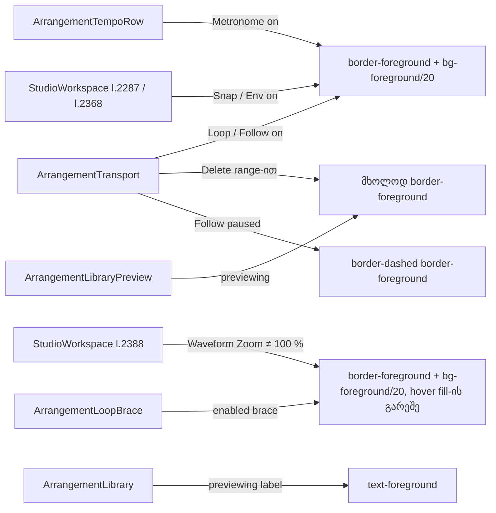

# Studio DUX-R-5b-2b — ერთი ფერის წესი, ნაწილი 2, ეტაპი 2b: mode toggle-ები ნეიტრალური ხდება (Loop, Delete range-ით, Follow, Metronome, Snap, Env, Waveform Zoom, Loop brace, Library preview) + gate-176 S1; არაფერი გადაადგილდება

**თარიღი:** 2026-10-25
**სტატუსი:** In Progress (awaiting C round 177)
**შეცვლილი პროექტი:** Store

## კონტექსტი

- Saba-ს გადაწყვეტილება (`user-review/design-ux-decisions.md`, 2026-10-25): **DUX-R-5 დამტკიცებულია**. Accent (Obsidian-ში brass) რჩება მხოლოდ selection-ისთვის, playhead-ისთვის, primary button-ისთვის და focus-ისთვის. D6-ის contrast-ის ზღვრები ძალაში რჩება.
- **R34** (round 175, veto შესაძლებელია): mode toggle-ები, on-state-ები, affordance-ები, label-ები და warning-ები selection არ არის, ამიტომ ნეიტრალური ხდება.
- 5b-2a-მ (round 176, doc 145) mixer-ის on-state-ები გადაიყვანა ნეიტრალურზე. ამ რაუნდში იგივე წესი ვრცელდება transport-ისა და timeline-ის mode toggle-ებზე, Loop brace-სა და Library preview-ზე (B-ის გადაწყვეტილება D-29z142).
- **gate-176 S1 (Low):** round 176-მა DXA7-დან ამოიღო ორი count: `ArrangementExportDialog.tsx`-ის `accent-brand` = 6 (K7, დატოვებული) და `ArrangementLane.tsx`-ის ghost string = 2 (5b-3 site). მათ სხვა ტესტი აღარ ითვლიდა, ამიტომ ამ რაუნდში აღდგა (G1).

## მიდგომა

**Recipe (round-176 §0.4):** ჩართულ toggle-ს აქვს **`border-foreground`** და **`bg-foreground/20`** fill. Hover-ზე და press-ზე fill იგივე რჩება (R2, რადგან Q-R167-ON-HOVER ჯერ `awaiting_user`-ია). State-ს **border ატარებს**, fill მეორეხარისხოვანია.

- R2 მოიცავს filled on-state-ებს: Loop, Follow on, Metronome, Snap, Env. Waveform Zoom-ს hover/press fill საერთოდ არ აქვს, ამიტომ ისიც მუდმივია.
- Border-only state-ები (Delete range-ით, Follow paused, Preview previewing-ის დროს) ინარჩუნებს base fill-ის საფეხურებს `fg/5` → `fg/8` → `fg/12`, როგორც brass ვერსიაში. მათთვის rest-ის ტოლი უნდა იყოს მხოლოდ border-ის ფერი, `border-style` და ტექსტი.
- სადაც base-ს უკვე აქვს `text-foreground`, text token არ ემატება. სადაც base `text-muted`-ია, ემატება `text-foreground`. Base-ის `hover:text-foreground` რჩება: brass-ის `hover:text-accent` override უბრალოდ მოიხსნა.
- **R29 (tailwind-merge):** თითო property-ზე ერთი token. ის base token-ს `cn()`-ით ანაცვლებს (`border-transparent`/`border-outline` → `border-foreground`, `bg-foreground/5`/`bg-surface` → `bg-foreground/20`). `border-dashed` base-ის token-ს არ ანაცვლებს (base-ს style token არ აქვს); ის Tailwind v4-ის default solid სტილს ცვლის.

| გაზომვა | background-ზე | surface-ზე | elevated-ზე | კრიტერიუმი |
|---|---|---|---|---|
| On **border** `foreground` backdrop-თან | 15.62 | 14.78 | 13.94 | **≥ 3:1** |
| On text `foreground` `fg/20` fill-თან | 9.40 | 8.56 | 7.92 | **≥ 3:1** (≥ 4.5 ჩაწერილია) |
| Off `muted` text off fill `fg/5`-თან (უცვლელი) | 6.45 | 6.03 | 5.61 | უცვლელი |
| `fg/20` fill backdrop-თან | 1.66 | 1.73 | 1.76 | **მხოლოდ info** |
| `fg/20` fill off / off-hover / off-press fill-თან | 1.52 / 1.42 / 1.27 | 1.56 / 1.44 / 1.29 | 1.57 / 1.44 / 1.29 | **მხოლოდ info** |
| Enabled loop-edge hover `fg/50` brace fill-ზე | — | **3.43** | (3.27) | **≥ 3:1** რეალურ strip-ზე (`bg-surface`) |
| Disabled brace border `muted` (dashed, უცვლელი) | 7.06 | 6.68 | 6.30 | უცვლელი |

**რატომ არის fill მხოლოდ info:** `fg/20` tint თითქმის შავ surface-თან 3:1-ს ვერ მიაღწევს ისე, რომ მასზე ტექსტი ≥ 3:1 დარჩეს. On/off-ს განასხვავებს border (≥ 13.94 გამჭვირვალე off border-თან) და `aria-pressed`. გადაწყვეტილება round-176 §0.4-ში დაფიქსირდა, veto შესაძლებელია.

**Brass-ის ტესტი:** `R − B ≥ 45`. `foreground`-ს აქვს R − B = 18, `muted`-ს 21, ამიტომ recipe ნეიტრალურია. `warning` / `destructive` token არ გამოიყენება.

### Follow (B-ის გადაწყვეტილება, veto შესაძლებელია)

- `followMode` იწყება `'on'`-ით, ამიტომ Follow პირველივე paint-ზე bordered და filled on-state-ს აჩვენებს. ადრე მას brass ტექსტი ჰქონდა, ამიტომ თვალსაჩინოობა დაახლოებით იგივეა. იცვლება მხოლოდ ფერის ნიშანი.
- სამი state: **on** = მყარი `foreground` border + `fg/20` fill, `aria-pressed="true"`; **paused** = dashed `foreground` border base fill-ზე, label `Follow ‖`, `aria-pressed="false"`; **off** = ჩვეულებრივი tool button.
- `border-dashed` ცვლის მხოლოდ არსებული 1 px border-ის სტილს. სიგანე და ზომა არ იცვლება.

### G1 და რატომ

- gate-175 S2 და gate-176 S1 ერთმანეთს ეწინააღმდეგებოდა. B-მ S1 აირჩია, რადგან 5b-2b და 5b-3 ჯერ კიდევ არედაქტირებს ახლომდებარე site-ებს და დაუბლოკავი K site შეიძლება ჩუმად შეიცვალოს.
- DXA7 ახლა ითვლის `KEPT_BRASS_COUNTS`-ს (ExportDialog `accent-brand` = 6) და `LATER_STAGE_BRASS_SITES`-ს (Lane ghost = 2). Lane-ის entry 5b-3-ში გადავა ნეიტრალურ recipe-ზე (`TODO` ტესტში).

## არქიტექტურა

### §0.3 inventory (`ff3f710`, ყველა non-focus `brand|accent` class token)

| ეტაპი | Site-ები |
|---|---|
| **K (დატოვებული)** | Clip l.826, l.838 (K1); Lane l.665, l.698, l.712, l.840; GroupHeader l.195, l.252, l.270, l.355; Library l.49, l.100 (K7), l.473, l.638 (K10); MarkerRow l.806, l.813 (K7), l.847 (K10); StudioWorkspace l.450 (K8), l.2504 (K7); Ruler l.221, l.233; Overview l.334; DetailPanel l.180 (K8); Transport l.339 და ExportDialog l.615 Export (K9); ExportDialog chosen card / radio (K7); LibraryPreview l.270 `fill-brand` (K11); ClipEnvelope (K6/K12) |
| **5b-1-ში ნეიტრალური (`accent-foreground`)** | DetailPanel l.841; GroupHeader l.338; Lane l.766, l.820; Master l.199; Transport l.277 |
| **5b-2a-ში შესრულებული** | Lane l.615/633, GroupHeader l.288/304/306, Master l.173, DetailPanel l.1121 |
| **5b-2b (ეს რაუნდი)** | Transport l.218, l.234, l.255, l.256; TempoRow l.243; StudioWorkspace l.2287, l.2368, l.2388; LoopBrace l.239, l.257; LibraryPreview l.308; Library l.132 |
| **5b-3 (შემდეგ)** | Lane l.842, l.874, l.886/887, l.922/923, l.723/731 (R35); LibraryPreview l.332 (R35); DetailPanel l.676, l.752, l.861, l.1142; StudioWorkspace l.2197, l.2210, l.2562, l.2568, l.2605; GridMenu l.204, l.226, l.246; ExportDialog l.524, l.562, l.569; Library l.492 |
| **Scope-ის გარეთ** | `app/components/studio/*` (SRW-21 `deferred_user`) |

### C-R176-ის info-ები (B-ის გადაწყვეტილებები)

- **C-R176-MIXED-VS-OFF-FILL** (2.96): fill-ის ქვედა ზღვარი არ ემატება; mixed და off-ს border განასხვავებს (13.94). Veto შესაძლებელია.
- **C-R176-INVENTORY-ACCENT-COLOR:** 6 `accent-foreground` token §0.3-ში ჩაიწერა 5b-1-ის ნეიტრალურ site-ებად.
- **C-R176-NOBRASS-LCD-GLYPH:** glyph-იანი ღილაკის NO-BRASS row ეშვება `--disable-lcd-text`-ით.
- **A-R176-MIXED-REST-BASE** (3.32) და **C-R176-MIXED-LETTER-4.5** (4.20): ჩაწერილია, ცვლილება არ არის.

## შეცვლილი ფაილები

- `app/components/arrangement/ArrangementTransport.tsx`: Delete range-ით, Loop on, Follow on და Follow paused.
- `app/components/arrangement/ArrangementTempoRow.tsx`: Metronome on.
- `app/components/arrangement/StudioWorkspace.tsx`: მხოლოდ 3 ხაზი (Snap on, Env on, Waveform Zoom ≠ 100 %).
- `app/components/arrangement/ArrangementLoopBrace.tsx`: enabled brace და მისი label.
- `app/components/arrangement/ArrangementLibraryPreview.tsx`: Preview / Stop toggle.
- `app/components/arrangement/ArrangementLibrary.tsx`: option-ის „previewing“ label.
- ტესტები: `transport-surface-ui`, `metronome-ui`, `waveform-zoom`, `clip-envelope-ui`, `studio-theme-obsidian`, `library-row-strings-ui`, `affordance-colour-ui` (G1) და ახალი `mode-toggle-colour-ui.test.tsx` (DXT1–DXT8).
- `docs/implementation/2026/quarter-IV/145-studio-dux-r5b2a-mixer-onstate-colour.md`: სტატუსი Completed.

## პრობლემები და გადაწყვეტები

- **Problem:** TS1 („plain 10“ ღილაკს ჰქონდეს `border-transparent` და base fill) წითლდება, რადგან Follow mount-ზე `'on'`-ია და ახლა bordered/filled-ია. B-ის L1 ამ ხაზს არ ითვალისწინებდა. → **Solution:** TS1-ში Follow ცალკე მოწმდება: `aria-pressed="true"`, `border-foreground`, `bg-foreground/20`, `border-transparent`-ისა და `bg-foreground/5`-ის გარეშე. დანარჩენ 9-ზე შემოწმება უცვლელია. ეს A-ის deviation-ია, B განიხილავს.
- **Problem:** LRS3 (`library-row-strings-ui` l.235) previewing label-ის სრულ className-ს ამოწმებს `text-brand`-ით. B-ის L6 ამ ხაზს არ ითვალისწინებდა. → **Solution:** მოსალოდნელი string → `text-foreground` (Y1-ის პირდაპირი შედეგი). Deviation, B განიხილავს.

## ტესტირება

- Edit-ებამდე: 13 base ფაილი **134/134**.
- Edit-ების შემდეგ: 13 base ფაილი + `mode-toggle-colour-ui.test.tsx` = 14 ფაილი, **142/142**. 33 მეზობელი ფაილი (loop, follow, snap, envelope, metronome, library, navigation, transport და სხვები): 522/522.
- Mutation-ები m266–m277 (`tmp/studio-real-loop/a-round-177/mutations/`): 12-ვე წითლდება მოთხოვნილ ტესტებზე. თითოეული დაბრუნდა და sha-ით შემოწმდა.
- `npm run typecheck`, `npm run lint` და scoped `npx biome check`. ბრაუზერის row-ები (CC-TOGGLE, NO-BRASS-TOGGLE, CONTRAST-TOGGLE, STATE-DISTINCT-TOGGLE, LOOP-EDGE, FUNC-SMOKE-TOGGLE, ENV-VIS, RV1, RV3, G177-3) C-ს ეკუთვნის, round 177.

## TODO / შემდეგი ნაბიჯები

- C round 177-ის ბრაუზერის მტკიცებულება; შემდეგ სტატუსი → Completed.
- DUX-R-5b-3: label-ები, ghost-ები, drop hint-ები, demo badge, status ტექსტები, GridMenu, Export dialog-ის notes / progress / overload, detail group count, Library filter, R35 import/Add და `hover:text-brand` site-ები. DUX-R-5 მზადაა მხოლოდ 5b-3-ის C PASS-ის შემდეგ.
- ROOT-RECON-GRID-HARNESS: საერთო სატესტო დამხმარე (ახალი ტესტი ამ რაუნდშიც იმეორებს fake AudioContext / ResizeObserver ბლოკს).
- Saba-ს veto-ს შესაძლებლობა `feature-status.md`-ში: border-ზე დაფუძნებული on recipe (fill მხოლოდ info), Follow on bordered პირველ paint-ზე, Follow paused dashed border-ით, ნეიტრალური Preview / previewing label და enabled brace `foreground`-ში.
