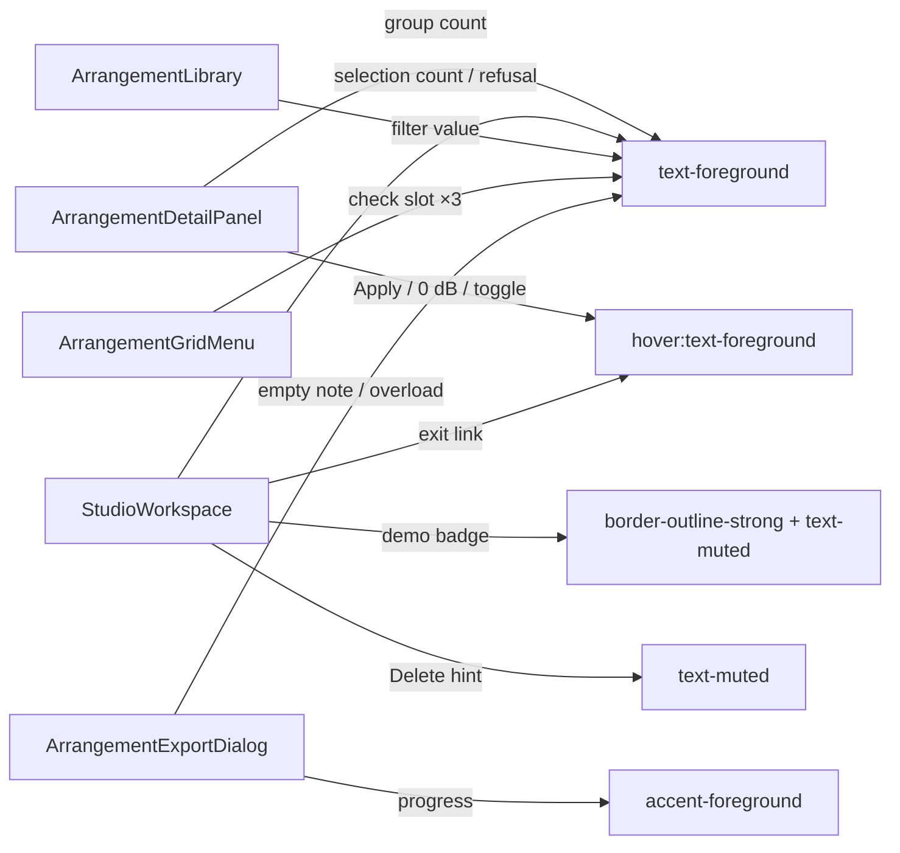

# Studio DUX-R-5b-3a — ერთი ფერის წესი, ნაწილი 3, ეტაპი 3a: label-ები, status ტექსტები, hover ტექსტი, demo badge, Grid menu-ს check-ები და Export dialog-ის note / progress / overload ნეიტრალური ხდება + gate-177 S5 + C-R177-G1-562; არაფერი გადაადგილდება

**თარიღი:** 2026-10-26
**სტატუსი:** In Progress (awaiting C round 178)
**შეცვლილი პროექტი:** Store

## კონტექსტი

- Saba-ს გადაწყვეტილება (`user-review/design-ux-decisions.md`, 2026-10-25): **DUX-R-5 დამტკიცებულია**. Accent (Obsidian-ში brass) რჩება მხოლოდ selection-ისთვის, playhead-ისთვის, primary button-ისთვის და focus-ისთვის. D6-ის contrast-ის ზღვრები ძალაში რჩება.
- **R34** (round 175, veto შესაძლებელია): brass რჩება ობიექტის მონიშვნაზე, playhead-ებზე, primary action-ზე (Export) და focus-ზე. Mode toggle-ები, on-state-ები, affordance-ები, label-ები და warning-ები ნეიტრალური ხდება. **R35** (round 176): add/import ღილაკები primary action არ არის (ისინი 5b-3b-შია).
- 5b-1 (doc 144), 5b-2a (doc 145) და 5b-2b (doc 146) უკვე დასრულდა. ეს რაუნდი იწყებს მესამე ნაწილს.

### რატომ გაიყო 5b-3

5b-3 მოიცავდა 7 კომპონენტს, მინიმუმ 8 ტესტის lock-ს და ხუთ სხვადასხვა recipe-ს. B-მ (D-29z143) ის ორად გაყო:

- **5b-3a (ეს რაუნდი):** მხოლოდ ტექსტის site-ები. 5 კომპონენტი, თითო site-ზე ერთი token.
- **5b-3b (შემდეგ):** Lane-ის drop ring, drop hint და ghost-ები, R35 import/Add ღილაკები (Lane l.723/731, LibraryPreview l.332). მათ მიღებას რეალური drag სჭირდება; `affordance-colour-ui`-ის `LATER_STAGE_BRASS_SITES` მათთან ერთად გადავა.
- DUX-R-5 მზადაა მხოლოდ მაშინ, როცა 5b-3a-ც და 5b-3b-ც C-ს გაივლის.

## მიდგომა

თითო site-ზე ერთი token იცვლება ერთი property-ის ფარგლებში (**R29**, tailwind-merge-ის კონფლიქტი არ ჩნდება). `style=`, arbitrary value, hex, ახალი CSS და `app/styles/`-ის ცვლილება არ არის. `data-*`, aria, role, handler, ტექსტი, layout, ზომა და პოზიცია უცვლელია.

| Recipe | Site-ები | backdrop: background | surface | elevated | კრიტერიუმი |
|---|---|---|---|---|---|
| **Label / count / warning → `text-foreground`** (`font-medium` რჩება) | Detail group count, footer selection count, lane-move refusal, Library filter value, Export empty note, Export overload alert, Grid menu-ს check glyph-ები | 15.62 | 14.78 | 13.94 | **≥ 4.5:1** |
| **Hint → `text-muted`** | range Delete hint | 7.06 | 6.68 | 6.30 | **≥ 4.5:1** |
| **Hover ტექსტი → `hover:text-foreground`** | Apply, 0 dB, Detail panel toggle (base უკვე `text-foreground`-ია, ამიტომ hover-ის ნიშანი არსებული fill-ის საფეხურია); `← CZABA` exit link (base `text-muted` → hover-ზე `foreground`) | 15.62 | 14.78 | 13.94 | **≥ 4.5:1** |
| **Badge → `border-outline-strong` + `text-muted`** | demo badge (header, `bg-surface`) | 7.06 / 3.70 | 6.68 / 3.50 | 6.30 / 3.30 | ტექსტი **≥ 4.5:1**; border **≥ 3:1** (ჩაწერილია, badge ინტერაქტიული არ არის) |
| **Progress → `accent-foreground`** (5b-1-ის pattern) | Export progress bar | — | — | — | **0** brass pixel |

Obsidian-ის token-ები (`app/styles/app.css`): `foreground` #ece6da, `muted` #a39b8e, `outline-strong` #736b60, `background` #0e0d0c, `surface` #161412, `elevated` #1d1a17.

**Brass-ის ტესტი:** `R − B ≥ 45`. `foreground`-ს აქვს 18, `muted`-ს 21, `outline-strong`-ს 19, ამიტომ ყველა ნეიტრალურია. `warning` / `destructive` / `positive` token არ დამატებულა.

### რატომ ნეიტრალური და არა `text-warning`

- Obsidian-ის `--color-warning` არის `#d9a35b` (R − B = 126), ანუ brass-ის ტესტს ვერ გადის. R34 warning-ებს ნეიტრალურ მხარეს აყენებს.
- გარჩევადობა რჩება: refusal ზის `text-muted` hint-ის ხაზში; empty-project note მოსდევს `text-muted` note-ს; overload alert-ს რჩება `role="alert"`; `text-destructive` რჩება მხოლოდ export-ის error-ისთვის (master-ui-ში `not text-destructive` ძალაშია).

### რატომ ნეიტრალურია Grid menu-ს check-ები

ყოველი check mark არის `menuitemradio` / `menuitemcheckbox`-ის `aria-checked`-ის ხილული ნახევარი (Snap mode toggle-იცაა). ეს on-state-ია და არა ობიექტის მონიშვნა (R34). Export dialog-ის K7 არჩეული ბარათები დიდი selection surface-ებია primary-action dialog-ში და brass რჩება. Veto შესაძლებელია.

### რატომ `text-muted` Delete hint-ზე

მის წინ range-ის readout უკვე `text-foreground`-ია. `muted` hint გარჩევადი რჩება (2.21:1 მათ შორის) და ემთხვევა lane-move hint-ის ხაზს (`text-muted`).

### Folded in

- **Gate-177 S5:** doc 146-ის სტატუსი → Completed.
- **C-R177-G1-562:** `affordance-colour-ui`-ის `KEPT_BRASS_COUNTS` ExportDialog-ის `accent-brand`-ს 6-ად ითვლიდა, მათ შორის progress bar-ს (5b-3 site). Progress ნეიტრალური გახდა, ამიტომ count არის **5** (K7 radio-ები).
- **Round-177 DXT8-ის label fix:** `mode-toggle-colour-ui`-ში demo badge "kept" სიაში იყო; ის 5b-3 site-ია და იმავე პოზიციაზე count 0-ით მოწმდება.

## არქიტექტურა

### §0.3 inventory (`cc984b6`-ზე, ყოველი non-focus `brand|accent` class token)

| ეტაპი | Site-ები |
|---|---|
| **K (დატოვებული)** | Clip l.826, l.838 (K1); Lane l.665, l.698, l.712, l.840; GroupHeader l.195, l.270, l.355; Library l.49, l.100 (K7), l.473, l.638 (K10); MarkerRow l.806, l.813 (K7), l.847 (K10); StudioWorkspace l.450 (K8), l.2504 (K7); Ruler l.221, l.233; Overview l.334; DetailPanel l.180 (K8); Transport l.340 და ExportDialog l.615 Export (K9); ExportDialog l.289/300/322/333/345/356/395/405/420/435 (K7); LibraryPreview l.270 `fill-brand` (K11); ClipEnvelope (K6/K12) |
| **5b-1 (`accent-foreground`)** | DetailPanel l.841; GroupHeader l.338; Lane l.766, l.820; Master l.199; Transport l.278 |
| **5b-2a / 5b-2b** | დასრულებულია (doc 145, doc 146) |
| **5b-3a (ეს რაუნდი)** | DetailPanel l.676, l.752, l.861, l.1142; StudioWorkspace l.2197, l.2210, l.2562, l.2568, l.2605; Library l.492; GridMenu l.204, l.226, l.246; ExportDialog l.524, l.562, l.569 |
| **5b-3b (შემდეგ)** | Lane l.842, l.874, l.886/887, l.922/923, l.723/731; LibraryPreview l.332 |
| **Scope-ის გარეთ** | `app/components/studio/*` (SRW-21 `deferred_user`) |

## შეცვლილი ფაილები

- `app/components/arrangement/ArrangementDetailPanel.tsx`: group count `text-foreground`; Apply, 0 dB და panel toggle `hover:text-foreground`.
- `app/components/arrangement/StudioWorkspace.tsx`: exit link hover, demo badge, Delete hint, selection count, lane-move refusal.
- `app/components/arrangement/ArrangementLibrary.tsx`: filter value.
- `app/components/arrangement/ArrangementGridMenu.tsx`: სამი check slot.
- `app/components/arrangement/ArrangementExportDialog.tsx`: empty note, progress bar, overload alert.
- `app/lib/arrangement/__tests__/detail-panel-strings-ui.test.tsx`, `panel-radius-ui.test.tsx`, `grid-triplet-ui.test.tsx`, `master-ui.test.tsx`, `affordance-colour-ui.test.tsx`, `mode-toggle-colour-ui.test.tsx`: lock-ები ახალ token-ზე (L1–L6).
- `app/lib/arrangement/__tests__/label-status-colour-ui.test.tsx` (ახალი): DXL1–DXL8.
- `docs/implementation/2026/quarter-IV/146-studio-dux-r5b2b-mode-toggle-colour.md`: სტატუსი Completed და TODO-ს suffix.

## პრობლემები და გადაწყვეტები

- **Problem:** `font-medium text-foreground` 4–5 სიმბოლოთი გრძელია, ვიდრე წინა token. ორ ხაზზე (DetailPanel group count, StudioWorkspace refusal) და ერთ ტესტის ხაზზე (`surfaceForbidden`) Biome-ის `lineWidth` 100 გადაჭარბდა და `biome check` format error-ს აჩვენებდა.
  **Solution:** ეს სამი ფაილი Biome-ის formatter-მა (`biome format --write`) გადაატანა. ხელით არაფერი შეცვლილა. შედეგად StudioWorkspace-ის diff 5 site-ია, მაგრამ refusal ერთი ხაზიდან 4 ხაზი გახდა; DetailPanel-ის group count 3 ხაზი გახდა. DXL8-ის ეს ორი "new" needle whitespace-normalised source-ზე მოწმდება (count 1 რჩება), რომ indent-ის ცვლილებამ ტესტი არ დაარღვიოს.
- **Problem:** ორი დაცული ტესტი header badge-ს `span.border-accent` selector-ით პოულობს: `library-row-strings-ui.test.tsx` l.330 (LRS5) და `purchased-collection-ui.test.tsx` l.230 (`badgeText()`, რომელსაც PW1 და PW6 იყენებს). W2 `border-accent`-ს აშორებს, ამიტომ სამივე ტესტი წითლდება. მეორე code-reviewer-მა იპოვა.
  **Solution:** არცერთი ფაილი ამ რაუნდის grant-ში არ არის და არ შეცვლილა. B-მ უნდა გადაწყვიტოს (მაგალითად, ორივე selector-ის `span.border-outline-strong`-ზე შეცვლის grant, ან badge-ის ტექსტით/`data-testid`-ით პოვნა).

## ტესტირება

- Edit-ებამდე: B-ის 12 base ფაილი, **134/134**.
- Edit-ების შემდეგ: 12 base + `label-status-colour-ui.test.tsx` = 13 ფაილი, **143/144**; წითელია LRS5 (ზემოთ). დამატებით გაშვებული `purchased-collection-ui.test.tsx`: **4/6**, წითელია PW1 და PW6 (იგივე selector).
- მეზობელი 9 ფაილი (export-dialog-hold-enter, export-cancel-ui, export-mp3, detail-panel-fit, detail-panel-polish, studio-theme-obsidian, content-colour-ui, grid-snap-ui, grid-musical-ui): **108/108**.
- Mutation-ები m278–m287 (`tmp/studio-real-loop/a-round-178/mutations/`): 10-ვე წითლდება მოთხოვნილ ტესტებზე. თითოეული დაბრუნდა და sha-ით შემოწმდა.
- `npm run typecheck` (exit 0), `npm run lint` (exit 0) და scoped `npx biome check` (0 error). ბრაუზერის row-ები (CC-TEXT, NO-BRASS-TEXT, CONTRAST-TEXT, REFUSAL, EXPORT-STATES, FUNC-SMOKE-TEXT, ENV-VIS, RV1, RV3, G178-3) C-ს ეკუთვნის, round 178.

## TODO / შემდეგი ნაბიჯები

- C round 178-ის ბრაუზერის მტკიცებულება; შემდეგ სტატუსი → Completed.
- Badge-ის selector `library-row-strings-ui.test.tsx` l.330-სა და `purchased-collection-ui.test.tsx` l.230-ში — B-ის გადაწყვეტილება.
- DUX-R-5b-3b: Lane drop ring / drop hint / ghost-ები და R35 import/Add; `LATER_STAGE_BRASS_SITES` → ნეიტრალური count. შემდეგ stage-exit INVENTORY-GREP: ყოველი non-focus `brand|accent` token მხოლოდ K-ზე.
- ROOT-RECON-GRID-HARNESS: საერთო სატესტო დამხმარე (ახალი ტესტი ისევ იმეორებს fake AudioContext / ResizeObserver ბლოკს).
- Toggle-recipe-ის extraction-ის სიგნალი და token-based test lock-ები — architecture checkpoint-ის მოთხოვნა DUX-R-5-ის საზღვარზე.
- Saba-ს veto-ს შესაძლებლობა `feature-status.md`-ში: ნეიტრალური warning-ები (refusal, empty note, overload), ნეიტრალური Grid menu check-ები, muted demo badge `outline-strong` border-ით, muted Delete hint, `foreground` count-ები და filter value.
