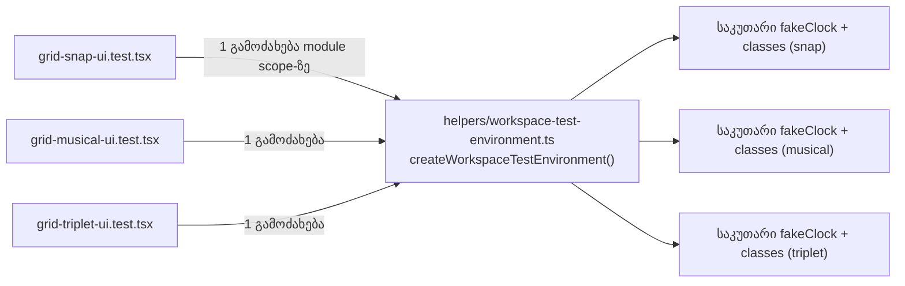

# Studio — grid UI suite-ების საერთო სატესტო გარემო

**თარიღი:** 2026-10-26
**სტატუსი:** In Progress (awaiting C round 184)
**შეცვლილი პროექტი:** Store (მხოლოდ ტესტები)

## კონტექსტი

- **დამტკიცების წყარო:** `agent-workflow.md`, „ადგილობრივი და cloud სამუშაოს შეჯერება — 2026-10-25“, პუნქტი 2 (ROOT-RECON-GRID-HARNESS). მომხმარებელმა დაამტკიცა ცალკე, შეზღუდული test-only დავალება: `helpers/workspace-test-environment.ts`-ში `createWorkspaceTestEnvironment` factory. თითო suite-ს საკუთარი clock/classes აქვს, ხოლო assertions, setup/teardown და canonical ცვლილებები უცვლელი რჩება. B-ის გადაწყვეტილებაა D-29z149 (`backlog.json` → VISUAL-A-OBSIDIAN `harness_plan_d29z149`).
- `grid-snap-ui.test.tsx`, `grid-musical-ui.test.tsx` და `grid-triplet-ui.test.tsx` ერთსა და იმავე Web Audio / ResizeObserver fake-ების ბლოკს შეიცავდა. ბლოკი იწყება `const fakeClock`-ით და მთავრდება `class FakeResizeObserver`-ით.
- **B-ის შემოწმება HEAD `423fbc4`-ზე:** სამივე ბლოკი byte-identical-ია (`diff` ცარიელია), თითო 79 ხაზით: grid-snap-ui l.23–101, grid-musical-ui l.29–107, grid-triplet-ui l.30–108.
- **რატომ არა `3ea2e04`:** ეს ადგილობრივი commit cloud-ში არ არის. ის PC-ის `refactor/grid-test-harness` ბრენჩზეა. extraction ხელახლა გაკეთდა მიმდინარე canonical ფაილებიდან, cherry-pick-ისა და source ფუნქციების ხელახალი იმპლემენტაციის გარეშე. მისი ძველი „44 targeted / 1683 full“ რიცხვები ამ commit-ს არ ეხება.

## მიდგომა

- **H1:** ახალი `app/lib/arrangement/__tests__/helpers/workspace-test-environment.ts` ახდენს `createWorkspaceTestEnvironment()`-ის export-ს. ფუნქციის body-ში არის 79-ხაზიანი ბლოკი, ქცევის ცვლილების გარეშე გადმოტანილი (მხოლოდ indentation +2). `FakeAudioContext`-ის `currentTime` კითხულობს ამავე გამოძახების `fakeClock`-ს. ფუნქცია აბრუნებს `{ fakeClock, FakeAudioContext, FakeOfflineAudioContext, FakeAudioBuffer, FakeResizeObserver }`-ს. `FakeParam`, `FakeNode`, `FakeGain`, `FakePanner` და `FakeSource` არ ბრუნდება და არ ხდება მათი export.
- **H2–H4:** თითო suite-ში ზუსტად ორი ცვლილებაა: import ხაზი (`../`-ის import-ების შემდეგ, Biome-ის რიგით) და ბლოკის ჩანაცვლება ერთი module-scope destructure-ით. ხაზის სიგრძის გამო ის ისეთი ფორმით დაიწერა რამდენიმე ხაზზე, რომელსაც Biome იღებს. `vi.mock`, `beforeEach` / `afterEach`, კონსტანტები, helper-ები, `describe` / `it` და assertions byte-identical-ია.
- **R47 — destructure module scope-ზე.** `beforeEach` გარემოს არ აგებს, ამიტომ setup/teardown byte-identical რჩება. helper-ს module-level state არ აქვს. `fakeClock` და ყველა class factory-ის შიგნით იქმნება, ასე რომ ორი გამოძახება სხვადასხვა ობიექტს და სხვადასხვა class identity-ს აბრუნებს. `fakeClock.base = …` `beforeEach`-ში property-ს წერს და `const` binding-თან უცვლელად მუშაობს.
- **R48 — helper-ის path** `app/lib/arrangement/__tests__/helpers/`. სახელში `.test.` არ არის, ამიტომ vitest-ის `include: ['app/**/*.test.{ts,tsx}']` მას suite-ად არ აგროვებს. `tsconfig`-ის `include` მას მაინც typecheck-ს უკეთებს.
- **R49 — 45 სახელის lock.** ცვლილების შემდეგ დალაგებული `file :: fullName :: status` სია უნდა ემთხვეოდეს `b-round-183/out/vitest-base-names.txt`-ს. ნებისმიერი გადახრა FAIL-ია.
- **ალტერნატივა, რომელიც უარყოფილია:** გარემოს `beforeEach`-ში აგება. ის setup-ს შეცვლიდა, რაც მომხმარებლის პირობას ეწინააღმდეგება.
- explicit return type არ დაწერილა, TypeScript მას თავად ადგენს. Biome-მა და tsc-მ exported type არ მოითხოვა.

## არქიტექტურა

## შეცვლილი ფაილები

- `app/lib/arrangement/__tests__/helpers/workspace-test-environment.ts`: ახალი, factory (H1).
- `app/lib/arrangement/__tests__/grid-snap-ui.test.tsx`: import + destructure (H2).
- `app/lib/arrangement/__tests__/grid-musical-ui.test.tsx`: import + destructure (H3).
- `app/lib/arrangement/__tests__/grid-triplet-ui.test.tsx`: import + destructure (H4).
- `docs/implementation/2026/quarter-IV/151-studio-m4-cookie-banner-studio.md`: სტატუსი Completed, TODO შესრულებულად მონიშნულია (C round 183 PASS, `423fbc4`), შემდეგი ნაბიჯი განახლდა.
- ეს doc. ძველი doc063 ნომერი დაკავებულია, ამიტომ ახალი თავისუფალი ნომერი 152 გამოიყენება.

## პრობლემები და გადაწყვეტები

- **Problem:** destructure ერთ ხაზზე 100 სიმბოლოს (Biome `lineWidth`) აჭარბებს. → **Solution:** დაიწერა ის ფორმა, რომელსაც Biome ითხოვს: object pattern რამდენიმე ხაზზე. `biome check` ოთხივე ფაილზე 0 diagnostic-ს აჩვენებს.
- **Problem:** helper ახალი ფაილია და start ასლი არ აქვს, mutation-ის შემდეგ კი აღდგენაა საჭირო. → **Solution:** სუფთა ასლი და sha256 შეინახა `tmp/studio-real-loop/a-round-184/helper-clean.ts`-ში. ყოველი mutation-ის შემდეგ ფაილი აღდგა და sha შემოწმდა.

## ტესტირება

- **Base (B, HEAD):** 3 ფაილი, 45/45 (grid-snap-ui 20, grid-musical-ui 14, grid-triplet-ui 11).
- **After (A):** 3 ფაილი, 45 passed, 0 failed, 0 skipped. helper ტესტ-ფაილად არ შეგროვდა: `npx vitest run helpers/workspace-test-environment` → "No test files found" (`a-round-184/not-collected.txt`).
- **Name lock (R49):** `a-round-184/vitest-after-names.txt` vs `b-round-183/out/vitest-base-names.txt`: `diff` ცარიელია.
- **Mechanical check:** factory-ის body (2 space indentation-ის მოხსნის შემდეგ, `return`-ის გარეშე) start ასლის grid-snap-ui l.23–101-ს ემთხვევა: `diff` ცარიელია.
- **R47 probe** (`a-round-184/tools/r47-identity.mjs`): ორი გამოძახება სხვადასხვა `fakeClock`-ს და სხვადასხვა class-ს აბრუნებს. ერთის `base`-ის ცვლილება მეორეს არ ეხება და `currentTime` თავის clock-ს კითხულობს.
- **m312 (wiring):** export → `createWorkspaceTestEnvironmentX`. `tsc` თითო suite-ში TS2724-ს იძლევა (grid-snap-ui 14,10; grid-musical-ui 20,10; grid-triplet-ui 21,10). vitest-ში 3 ფაილი ჩავარდა. აღდგენის sha OK-ია.
- **m313 (clock, observe):** `currentTime` → `0`. 45-დან **0** ტესტი გაწითლდა. ეს ნიშნავს, რომ ეს suite-ები clock-ის მნიშვნელობას არ ამოწმებენ; ეს ინფორმაციაა B-სთვის და A-ს დეფექტი არ არის. აღდგენის sha OK-ია.
- `npm run typecheck` OK. `npm run lint` OK: 218 warning, იგივე რაც gate 183-ზე, 0 შეცვლილ ფაილებში.
- ბრაუზერის row-ები (STUDIO-RV-184, G184-3, PX-NET / REG-HYD) C-ს ეკუთვნის, round 184.

### Ableton-ის წყარო

| ქცევა | წყარო | იქ დადასტურებული | CZABA-ს გადაწყვეტილება | შესაბამისობა |
|---|---|---|---|---|
| სატესტო გარემოს გამოყოფა (მომხმარებლისთვის ხილული ქცევა არ იცვლება) | **არ არის.** ეს შიდა სატესტო ინფრასტრუქტურაა. | არაფერი. | მომხმარებლის მიერ დამტკიცებული test-only refactor (2026-10-25). | არ ეხება (C: STUDIO-RV-184) |

## TODO / შემდეგი ნაბიჯები

- C round 184-ის მტკიცებულება (T184-TARGETED, SCOPE-184, AN-REVIEW-184, MUT-184, STUDIO-RV-184); შემდეგ სტატუსი → Completed.
- **სიგნალი, არ არის დაგეგმილი:** იგივე ბლოკის ასლი კიდევ 73 suite-შია. მომხმარებელმა მხოლოდ ეს 3 suite დაამტკიცა. დანარჩენის გადატანა ცალკე გადაწყვეტილებას საჭიროებს (`expectTokens` / `countOccurrences` ცალკე checkpoint Q2-ია, root-ის გადაწყვეტილება).
- m313-მა აჩვენა, რომ clock-ის მნიშვნელობა ამ suite-ებში არ მოწმდება. ახალი assertion-ის დამატება B-ის გადასაწყვეტია.
- შემდეგი: REGRESSION round (2026-10-27-ის ან შემდგომი დაგეგმვისას).
