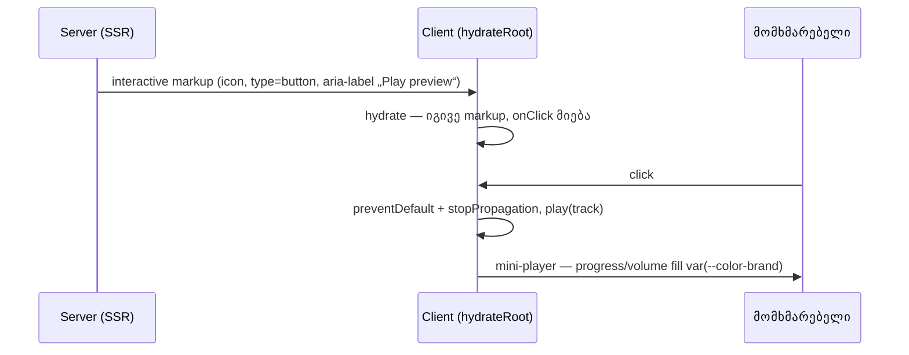

# Store — preview player-ის უხილავი fill და preview ღილაკის mount-ის შემდგომი ცვლილება (STORE-1b)

**თარიღი:** 2026-10-26
**სტატუსი:** In Progress (awaiting C round 187)
**შეცვლილი პროექტი:** Store

## კონტექსტი

- **წყარო:** Store redesign-ის STORE-1 („bugs and quick wins“, `docs/technical/store-redesign/store-redesign-spec.md`). B-ის გადაწყვეტილებით (D-29z151, D-29z152) STORE-1 ოთხ მცირე რაუნდად დაიყო; ეს დოკუმენტი 1b-ს ეხება.
- **უხილავი fill:** ქვედა mini-player-ის (`AudioPlayer`) progress და volume slider-ები inline `background` gradient-ს `var(--color-primary)`-ით აგებდნენ. ეს token `app/`-ში არსად არის განსაზღვრული, ამიტომ gradient არავალიდური იყო და დაკრული ან დაყენებული ნაწილი არ იხატებოდა: მომხმარებელი ვერ ხედავდა, სად იყო preview და რა ხმაზე იყო volume. არსებული token არის `--color-brand` (`app/styles/app.css`-ის `@theme` ბლოკი, `hsl(175, 85%, 46%)`).
- **ღილაკის flip mount-ის შემდეგ:** `AudioPreviewButton` `isClient` flag-ს (`useState(false)` + `useEffect`) იყენებდა. server render და პირველი client render ერთსა და იმავე „სტატიკურ“ ღილაკს აჩვენებდა: `onClick`-ის გარეშე, overlay variant-ზე კი დამატებითი „Preview“ წარწერით. effect-ის შემდეგ ღილაკი ხელახლა რენდერდებოდა წარწერის გარეშე და handler-ით. hydration mismatch არ იყო, მაგრამ icon ხტებოდა, როცა წარწერა ქრებოდა, და effect-მდე ღილაკი მკვდარი იყო.

## მიდგომა

- **K1 — სწორი token.** ორივე gradient-ში `var(--color-primary)` შეიცვალა `var(--color-brand)`-ით (ოთხი ადგილი ორ ხაზზე). შეუვსებელი ნაწილის `rgba(255, 255, 255, 0.1)`, პროცენტები, კლასები და markup უცვლელია.
  - **არ ავირჩიეთ:** fill-ის class-ში გადატანა. `app.css` ამ რაუნდში frozen-ია და STORE-2-ს ეკუთვნის; token-ის შეცვლა ყველაზე მცირე სწორი ფიქსია. browser-ში შემოწმდა, რომ Chromium inline gradient-ში `var()`-ს სწორად ხსნის.
- **K2 — ერთი markup ყველგან.** `isClient` state, მისი effect და მთელი სტატიკური branch წაიშალა, ასევე გამოუყენებელი `useEffect`/`useState` import-ები. server და ყველა client render ახლა ერთსა და იმავე interactive markup-ს იძლევა, რომელსაც მომხმარებელი mount-ის შემდეგ ისედაც ხედავდა. ორივე ღილაკს დაემატა `type="button"`. `handleClick`, aria-label-ები, `aria-busy`, icon-ები, კლასები და public API (`track`, `variant`) უცვლელია. `AudioContext`-ის საწყისი state დეტერმინისტულია (`currentTrack: null`), ამიტომ guard-ის გარეშე server და პირველი client render ერთსა და იმავე idle მდგომარეობას ხედავს.
- **R55 — idle overlay-ს „Preview“ წარწერა არ აქვს.** ერთიანი markup არის interactive ვერსია: მხოლოდ icon, accessible name „Play preview“.
  - **უარყოფილი ალტერნატივა:** წარწერის შენარჩუნება ყველა მდგომარეობაში. B-მ უარყო, რადგან hydration-ის შემდეგ დღეს წარწერას არავინ ხედავს (ასე რეალურად გამოყენებული UI 0 px-ით იცვლება და C-ის hydration-ის შემდგომი baseline-ები ძალაში რჩება), წარწერა მხოლოდ მკვდარ, mount-მდე markup-ში არსებობდა (Pause და Loading მდგომარეობებს არასდროს ჰქონია), და accessible name ორივე შემთხვევაში ერთია.
  - ხილული ცვლილება მხოლოდ hydration-მდე პირველ კადრს ეხება. `app.css`-ში `.audio-preview-overlay-text` გამოუყენებელი ხდება; `app.css` frozen-ია, ამიტომ ეს STORE-2/5-ის cleanup-ის სიგნალად ჩაიწერა.

## არქიტექტურა

## შეცვლილი ფაილები

- `app/components/audio/AudioPlayer.tsx` — progress და volume gradient-ის token (K1).
- `app/components/audio/AudioPreviewButton.tsx` — `isClient` guard-ის წაშლა, `type="button"` (K2).
- `app/lib/__tests__/audio-preview-player.test.tsx` — ახალი რეგრესიული ტესტები (T1).
- `docs/implementation/2026/quarter-IV/153-store-1a-product-page-bugs.md` — სტატუსი `Completed` და C-ის რაუნდი 186-ის შედეგი (K3).
- ეს დოკუმენტი (D1).

## პრობლემები და გადაწყვეტები

- **პრობლემა:** პირველი client render-თან შედარება start კოდზეც გაივლიდა, რადგან ორივე სტატიკურ branch-ს რენდერავს. **გადაწყვეტა:** B1 server markup-ს ადარებს DOM-ს effect-ების შესრულების შემდეგ (`await act(async () => {})`), B4 კი `hydrateRoot`-ის შემდგომ DOM-ს. ორივე start კოდზე წითელია.
- **პრობლემა:** start კოდზე წითელი hydration ტესტი თავის host-ს `document.body`-ში ტოვებდა და შემდეგ click ტესტს ორ „Play preview“ ღილაკს აჩვენებდა, ანუ ყალბ წითელს. **გადაწყვეტა:** hydration host-ის unmount და წაშლა `afterEach`-ში გადავიდა, ჩავარდნის შემთხვევაშიც.
- **პრობლემა:** `AudioPlayer` Remix-ის `Link`-ს იყენებს და router context-ს ითხოვს. **გადაწყვეტა:** P1/P3 `react-router-dom`-ის `MemoryRouter`-ში რენდერდება. ეს `@remix-run/react`-ის იგივე (hoisted, ერთადერთი) instance-ია და პირდაპირი dependency არ არის, ამიტომ ახალი package არ დამატებულა.
- **პრობლემა:** start ფაილების ასლზე (`b-round-186/r187-granted-start/`) ტესტის გაშვება loop folder-იდან ვერ მოხერხდა: Vite bare import-ებს store-ის `node_modules`-ში ვერ პოულობს. **გადაწყვეტა:** წითელი გაშვება ორჯერ შესრულდა: ჯერ ხელუხლებელ tree-ზე K1/K2-მდე, შემდეგ საბოლოო T1-ით, როცა ორი granted code ფაილი დროებით start ასლით შეიცვალა და შემდეგ end ასლი აღდგა (sha256 შემოწმდა).
- **პრობლემა (code-reviewer, Medium):** `useAudio` სრულად mock-ში იყო, ამიტომ hydration ტესტი რეალური `AudioProvider`-ის საწყის state-ს არ ამოწმებდა, რომელზეც guard-ის მოხსნა ახლა დამოკიდებულია. **გადაწყვეტა:** ორივე variant-ისთვის დაემატა ტესტი, რომელიც `vi.doUnmock` + `vi.resetModules`-ით რეალურ `AudioContext`-სა და ღილაკს dynamic import-ით ტვირთავს და `AudioProvider`-ში hydration-ს ამოწმებს. ის ჯერ ადასტურებს, რომ რეალური hook ჩაიტვირთა (provider-ის გარეშე „useAudio must be used within an AudioProvider“ შეცდომა). პირველი ვარიანტი (mock-ში პირობითი hook-ის გამოძახება) Biome-ის `useHookAtTopLevel` warning-ს იწვევდა და უარვყავით.

## ტესტირება

- **T1 (14 ტესტი):** B1 (ორივე variant: server markup = DOM effect-ების შემდეგ), B2 (არ არის „Preview“ text node, `type="button"`, `aria-label="Play preview"`, play path), B3 (click → `play` ერთხელ, მშობელი ბმული არ იღებს click-ს, default action-ი შეჩერებულია; Pause → `pause`; Loading → `aria-busy="true"` და „Cancel loading preview“), B4 (`hydrateRoot`: `onRecoverableError` და `console.error` 0, DOM = static markup; ერთხელ mock-ით და ერთხელ რეალურ `AudioProvider`-ში), P1 (`var(--color-brand) 25%` და `70%`, `--color-primary` არ არის), P2 (`--color-brand:` `@theme` ბლოკშია, `--color-primary` არსად არ არის declared), P3 (track-ის გარეშე ცარიელი markup).
- **წითელი start კოდზე (საბოლოო T1):** 14-დან 10: B1 ×2, B2 ×2, B4 ×4 (ყველგან DOM შედარება; recoverable/console spy-ები start-ზეც 0-ია), Loading ტესტი (მხოლოდ `type="button"`) და P1. მწვანე დარჩა click, Pause, P2, P3 — ისინი შენარჩუნებულ ქცევას იცავს.
- `npx vitest run` სამ ფაილზე (`audio-preview-player`, `product-handle-route`, `product-presentation`): 3 ფაილი, 34 ტესტი PASS. P1/P3-ში `MemoryRouter`-ის server render jsdom-ში `useLayoutEffect` warning-ს ბეჭდავს. ეს ცნობილი ხმაურია (იგივე ჩანს `product-presentation`-შიც) და ტესტს არ აფერხებს.
- code-reviewer: Critical/High არ არის. Medium (რეალური provider) გასწორდა. `--color-primary`-ის არარსებობის assertion-ი და `react-router-dom`-ის `MemoryRouter` B-ის დავალების მოთხოვნაა, ამიტომ დარჩა; reviewer-ის შენიშვნა B-ს გადაეცა.
- `npm run typecheck` და `npm run lint` exit 0. Biome check სამ code ფაილზე: 0 error; `AudioPlayer.tsx`-ში 5 წინასწარ არსებული `useButtonType` warning რჩება (K1 სხვა ცვლილებას კრძალავს).
- **SSR (mock :5199, dev server :5173):** `/products/middle-east`, `/` და `/store`-ზე `audio-preview-overlay-text` 0-ჯერ გვხვდება; პროდუქტის გვერდზე 1 და მთავარ გვერდზე 14 preview ღილაკი `type="button"`-ით.
- **Playwright Chromium, 1440×900, `/products/middle-east`:** Play preview → 2 s. runtime probe `var(--color-brand)` → `rgb(18, 217, 200)`. progress და volume input-ის computed `background-image` ამ ფერს შეიცავს (volume 70%-მდე). ღილაკის label გახდა „Pause preview“. pageerror 0, hydration შეტყობინება 0, remote host-ები მხოლოდ Google Fonts.
- C-ის დამოუკიდებელი ბრაუზერის შემოწმება (რაუნდი 187) ჯერ არ ჩატარებულა.

## TODO / შემდეგი ნაბიჯები

- **STORE-1c:** D15 header, ორმაგი h1 და footer-ის „Czaba Music“.
- **STORE-1d:** D10 entrance loader.
- **სიგნალები STORE-2/5-ისთვის:** შეუვსებელი track-ის hardcoded `rgba(255, 255, 255, 0.1)` (Tailwind-first), გამოუყენებელი `.audio-preview-overlay-text` `app.css`-ში R55-ის შემდეგ, `AudioPlayer`-ის დანარჩენი ღილაკების `type`-ის არქონა (Biome warning).
