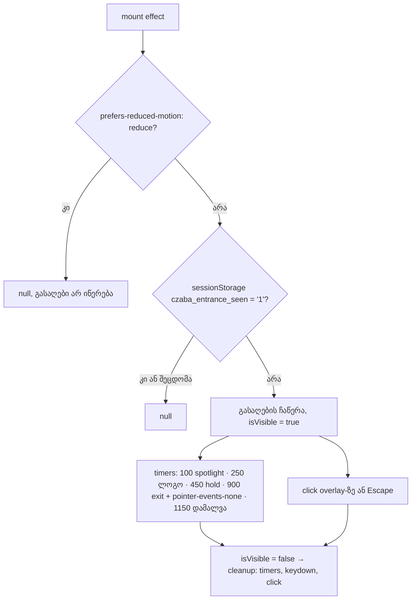

# Store — D10 შესასვლელი loader: ≤ 1.2 წმ, გამოტოვებადი, სესიაში ერთხელ, reduced motion-ზე გამორთული (STORE-1d)

**თარიღი:** 2026-10-26
**სტატუსი:** In Progress (awaiting C round 189)
**შეცვლილი პროექტი:** Store

## კონტექსტი

Store redesign-ის STORE-1 ეტაპის მეოთხე ნაწილი. spec-ის D10 პუნქტი ითხოვს: „entrance loader ≤ 1.2 s, skippable, once per session, off under `prefers-reduced-motion`“. კვლევა (`research/luxury-and-galleries.md`) იგივეს ამბობს: მოკლე, შეწყვეტადი reveal spinner-ის ნაცვლად.

დასაწყისში (`850445c`) `SpotlightLoader`, რომელიც მხოლოდ მთავარ გვერდზე (`_index.tsx`) არის mount-ებული, ამ მოთხოვნებს არ აკმაყოფილებდა:

- **ხანგრძლივობა 5.6 წმ** იყო (800 ms სიბნელე, 1.2 წმ spotlight, 600 ms ლოგოს დაყოვნება, 2 წმ ჩვენება, 1 წმ გასვლა). C-მ რაუნდ 188-ში 0.64 → 6.3 წმ გაზომა.
- **ჩვენების წესი** `localStorage`-ის 5–7 საათიანი შემთხვევითი ინტერვალი იყო და არა სესია. reduced motion არ მოწმდებოდა.
- **C-R187-I1:** overlay (`fixed inset-0 z-50`) მთელი 5.6 წმ ყლაპავდა hover-სა და click-ს, ამიტომ ბარათის Play preview ვერ ჭერდა. გამოტოვების საშუალება არ არსებობდა.
- **C-R188-I1:** overlay-ში `motion.h1` „CZABA“ იყო, ამიტომ loader-ის დროს გვერდზე ორი h1 ჩანდა.

## მიდგომა

იცვლება მხოლოდ `SpotlightLoader.tsx`. export-ის სახელი და props (არცერთი) იგივე დარჩა. ვიზუალი (შავი სცენა, spotlight cone, glow, ლოგო, ხაზი, tagline, მტვერი, vignette, grain) და არსებული inline ფერები უცვლელია; მხოლოდ დრო შეიკუმშა.

- **დრო (K1):** ერთი მუდმივა `SPOTLIGHT_ENTRANCE_TOTAL_MS = 1150` (≤ 1200) mount-იდან unmount-მდე, exit fade-ის ჩათვლით. 50 ms-იანი მარაგი ფარავს იმას, რომ timer-ები effect-ში, commit-ის შემდეგ იწყება (ბრაუზერში +15–20 ms). ფაზები: spotlight 100 ms-ზე, ლოგო 250 ms-ზე (fade 0.25 წმ), ხაზი და tagline 450 ms-ზე, გასვლა 900 ms-ზე (fade 0.25 წმ), unmount 1150 ms-ზე. framer-ის `transition.duration` მნიშვნელობები შესაბამისად შემცირდა, რომ ლოგო ნამდვილად გამოჩნდეს.
- **არ ბლოკავს (K2):** გასვლის ფაზიდან overlay-ს აქვს `pointer-events-none`, ამიტომ fade-ის დროს click და hover ქვემოთ გვერდს აღწევს.
- **გამოტოვება (K3):** overlay-ზე `click` ან document-ზე `Escape` loader-ს მაშინვე ხურავს, fade-ის გარეშე. ყველა timer, keydown და click listener ერთ effect-შია და მის cleanup-ში იშლება: გამოტოვებისას, ბუნებრივი დასრულებისას და unmount-ისას.
- **სესიაში ერთხელ (K4):** mount effect კითხულობს `sessionStorage`-ის `czaba_entrance_seen` გასაღებს. თუ `'1'`-ია, არაფერი ჩანს; თუ არა, loader ჩანს და გასაღები იწერება. storage-ის შეცდომა (დაბლოკილი storage) ნიშნავს loader-ის გარეშე, exception-ის გარეშე.
- **Reduced motion (K5):** იმავე effect-ში, გადაწყვეტილებამდე, `matchMedia('(prefers-reduced-motion: reduce)')` მოწმდება. თუ ემთხვევა, loader არ ჩანს და სესიის გასაღები არ იწერება. ერთი სინქრონული გადაწყვეტილებაა, ამიტომ overlay ერთ კადრსაც არ ჩნდება.
- **heading-ის გარეშე (K6):** overlay root-ს აქვს `aria-hidden="true"` და `data-testid="entrance-loader"`. `motion.h1` შეიცვალა `motion.span`-ით (`block` + იგივე კლასები და სტილები), ამიტომ ვიზუალურად იგივეა. გვერდის ერთადერთი h1 hero-ს „CZABA“-ა.

### გადაწყვეტილებები (Saba-ს შეუძლია უარყოს)

- **R61: „სესიაში ერთხელ“ ნიშნავს `sessionStorage`-ს** (`czaba_entrance_seen`). tab-ის სესიაში `/`-ზე პირველი ვიზიტი loader-ს ერთხელ აჩვენებს, მაშინაც კი, თუ ვიზიტორმა ჯერ სხვა გვერდები გახსნა. reload, client navigation `/`-ზე და შემდეგი ვიზიტები იმავე სესიაში მას აღარ აჩვენებს. ახალი tab ან ფანჯარა ახალი სესიაა. დაბლოკილი storage ნიშნავს loader-ის გარეშე.
  - უარყოფილია: `localStorage` ინტერვალით, რადგან spec სესიას ამბობს.
  - უარყოფილია: დაბლოკილ storage-ზე ყოველ ვიზიტზე ჩვენება, რადგან `/`-ზე ყოველ გადასვლაზე განმეორდებოდა.
  - ძველი `localStorage` გასაღები (`czaba_spotlight_last_shown`) აღარ იკითხება და აღარ იწერება, მაგრამ არც იშლება: უვნებელია, წაშლა კი ზედმეტ ჩაწერას დაამატებდა.
  - კომპრომისი Saba-სთვის: სერვერი `sessionStorage`-ს ვერ კითხულობს, ამიტომ overlay მხოლოდ hydration-ის შემდეგ ჩნდება (პირველი paint-იდან დაახლოებით 0.6–0.7 წმ-ში). სერვერზე რენდერი ყოველ ვიზიტზე აჩვენებდა მას, „სესიაში ერთხელ“-ის საწინააღმდეგოდ.
- **R62: ≤ 1.2 წმ იზომება mount-იდან unmount-მდე, exit fade-ის ჩათვლით.** გვერდი ინტერაქტიულია გასვლის ფაზის დასაწყისიდან (K2). უარყოფილია: „≤ 1.2 წმ fade-ის დაწყებამდე“, რადგან overlay 1.2 წმ-ზე მეტხანს დარჩებოდა.
- **R63: გამოტოვება overlay-ზე click-ით ან Escape-ით, ხილული ღილაკის გარეშე.** გამოტოვების click overlay-ზე სრულდება და გვერდამდე არ აღწევს. გამოიყენება `click` და არა `pointerdown`: pointerdown-ზე unmount-ისას pointerup და compatibility click ქვემოთ მდებარე ელემენტზე მოხვდებოდა. უარყოფილია:
  - ხილული „Skip“ ღილაკი — 1.2 წამიან reveal-ს focus target-სა და ვიზუალურ ხმაურს უმატებს;
  - ნებისმიერი ღილაკით გამოტოვება — Tab-სა და screen reader-ის ღილაკებს გვერდითი ეფექტი არ უნდა ჰქონდეს;
  - click-ის გატარება გვერდზე — ვიზიტორი უხილავ ღილაკს დააჭერდა.
- **R64: reduced motion ნიშნავს loader-ის სრულ არარსებობას**, არა უფრო მოკლე ან მხოლოდ fade ვერსიას, და სესიის გასაღები არ იწერება. თუ ვიზიტორი იმავე სესიაში reduced motion-ს გამორთავს, loader შეიძლება ერთხელ გამოჩნდეს.
- **R65: overlay დეკორატიულია:** `aria-hidden="true"`, heading-ის გარეშე. tagline-ის `
` რჩება.
- **R66: ვიზუალი რჩება, მხოლოდ დრო იკუმშება.** ფერები, glow და gradient text STORE-2-ის (მიმართულება A) საქმეა; ახალი hardcoded ფერი ან custom CSS არ დამატებულა.

## არქიტექტურა

## შეცვლილი ფაილები

- `app/components/loading/SpotlightLoader.tsx` — დრო, `pointer-events-none` გასვლისას, click/Escape გამოტოვება, `sessionStorage` სესია, reduced motion, `aria-hidden` და h1 → span. ახალი export: მხოლოდ `SPOTLIGHT_ENTRANCE_TOTAL_MS`.
- `app/lib/__tests__/store-entrance-loader.test.tsx` — ახალი, 15 ტესტი (L1–L11, L10b).
- `docs/implementation/2026/quarter-IV/155-store-1c-header-footer.md` — სტატუსი Completed და C-ის რაუნდ 188-ის შედეგი (ორი ხაზი).
- ეს დოკუმენტი.

## პრობლემები და გადაწყვეტები

- **Problem:** ძველი timer-ები `phase`-ს ცვლიდნენ; გამოტოვების შემდეგ დარჩენილი timer-ი overlay-ს დააბრუნებდა. → **Solution:** დასრულება და გამოტოვება ერთ `isVisible` state-ს ცვლის, ხოლო timer-ები და listener-ები იმ effect-შია, რომელიც `isVisible`-ზეა დამოკიდებული, ამიტომ cleanup ყველაფერს ერთად შლის.
- **Problem:** `onClick` სტატიკურ `div`-ზე Biome-ის `useKeyWithClickEvents` warning-ს იწვევს, overlay კი `aria-hidden`-ია და focus არ უნდა მიიღოს. → **Solution:** click listener ref-ით იმავე effect-ში ემატება და cleanup-ში იშლება.
- **Problem:** პირველ ვარიანტში (ლოგო 350 ms-ზე) dev რეჟიმში მთავარი thread-ის ~200 ms-იანმა შეფერხებამ ლოგოს ≥ 0.9 opacity-ის ფანჯარა 245 ms-მდე შეამცირა. → **Solution:** ლოგო 250 ms-ზე გადავიდა; საბოლოო სამ გაზომვაში ფანჯარა 506–525 ms-ია.
- **Problem:** code-reviewer-მა აღნიშნა, რომ 1200 ms-იან მუდმივაზე ბრაუზერში 1215–1217 ms გაიზომა, მარაგის გარეშე. → **Solution:** სრული ხანგრძლივობა 1150 ms-მდე შემცირდა (exit fade 0.25 წმ); გაზომვა 1166–1171 ms.
- **Problem:** listener-ების hygiene ტესტები ცარიელ სიაზე მწვანე იქნებოდა, L11 კი React 18-ზე ვერ ჩავარდებოდა. → **Solution:** hygiene შემოწმება ჯერ ამოწმებს, რომ keydown listener საერთოდ დაემატა; L5 და L11 ამოწმებს `vi.getTimerCount() === 0`-ს გამოტოვებისა და unmount-ის შემდეგ; L5 ამოწმებს, რომ `pointerdown` არ ხურავს loader-ს; დაემატა L10b (`setItem`-ის შეცდომა).
- **Problem:** rAF-ში წაკითხული ლოგოს opacity ერთ sample-ში 0-ზე ეცემოდა. framer-motion 12 WAAPI ანიმაციის `onfinish`-ში motion value-ს აყენებს და ანიმაციას მაშინვე `cancel()`-ს უკეთებს; style framer-ის მომდევნო batch-ში იწერება. → **Solution:** კოდი არ შეცვლილა; ResizeObserver-ით paint-მდე (ყველა rAF callback-ის შემდეგ) წაკითხვამ სამივე გაზომვაში 0 dip აჩვენა, ანუ დახატულ კადრში ლოგო არ ქრება. ეს probe-ის რიგითობის არტეფაქტია.

## ტესტირება

- `npx vitest run app/lib/__tests__/store-entrance-loader.test.tsx`: 15/15 მწვანე. start კოდზე (`b-round-188/r189-granted-start/SpotlightLoader.tsx`) 12 ჩავარდა: L2, L3, L4, L5, L6-ის სამივე hygiene/Escape შემთხვევა, L7, L8, L9, L10, L10b. მწვანე დარჩა L1 (SSR), L6 Tab და L11 (start კოდიც ასუფთავებდა timer-ებს unmount-ზე). start კოდს `SPOTLIGHT_ENTRANCE_TOTAL_MS` არ აქვს, ამიტომ L3/L4 იქ ნაწილობრივ ამ მიზეზითაც ჩავარდა. Mutant-ები: click → `pointerdown` აწითლებს L5-ს; `removeEventListener`-ის წაშლა აწითლებს L6-ის სამ hygiene შემთხვევას.
- `npm run typecheck` exit 0; `npm run lint` 214 warning + 1 info (იგივე, რაც რაუნდ 188-ში). Biome ორ ფაილზე: 0 error, 1 წინასწარ არსებული `noArrayIndexKey` warning უცვლელ მტვრის ბლოკში.
- **Playwright Chromium, 1440×900, `/` (mock :5199, dev :5173):** overlay-ის insertion → removal 1166 / 1171 / 1168 ms (insertion გვერდის ჩატვირთვიდან 0.65–0.9 წმ-ზე, hydration-ის შემდეგ); h1-ის მაქსიმუმი ყველა კადრში 1; ლოგოს opacity 1-ს აღწევს, ≥ 0.9 ფანჯარა 506–525 ms; `pointer-events: none` insertion-იდან 919–935 ms-ზე; იმავე context-ში reload: 0 insertion 3 წმ-ში; `reducedMotion: 'reduce'` context: 0 insertion, გასაღები არ ჩაიწერა. `sessionStorage.czaba_entrance_seen = '1'`, ძველი `localStorage` გასაღები არ არსებობს. pageerror 0.
- C-ის დამოუკიდებელი ბრაუზერის შემოწმება (რაუნდი 189) ჯერ არ ჩატარებულა.

## TODO / შემდეგი ნაბიჯები

- **STORE-2:** loader-ის hardcoded teal, glow და gradient text მიმართულება A-ზე (Obsidian & Brass).
- **STORE-5:** `CinemaCurtainLoader`, `PianoCurtainLoader` და `PianoLoadingAnimation` ორივე barrel-იდან exported-ია, მაგრამ არცერთი route არ იყენებს.
- `noArrayIndexKey` მტვრის ნაწილაკებზე და render-ში `Math.random()` წინასწარ არსებული საკითხებია; შეიძლება STORE-2-ის retheme-თან ერთად გასწორდეს.
