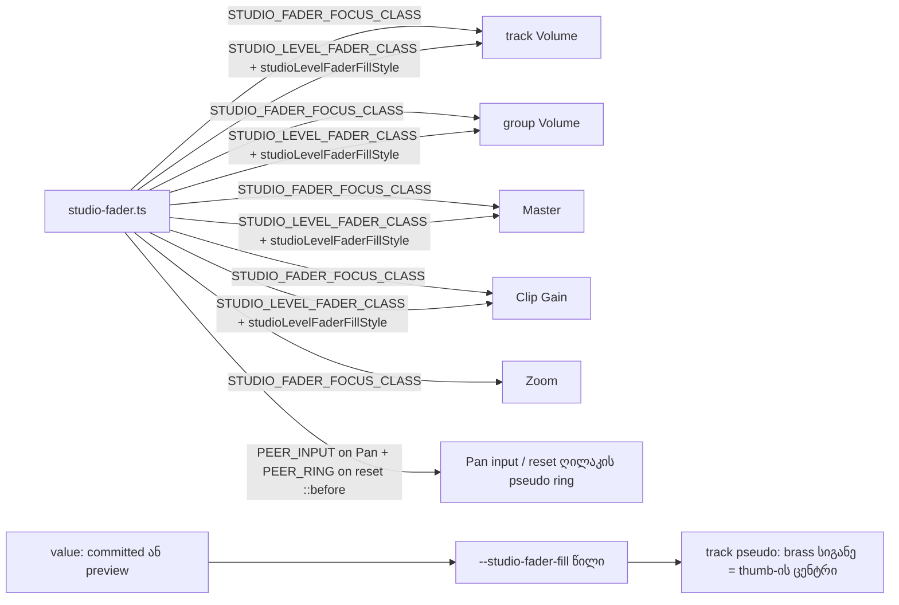

# Studio — fader-ის დაჭერილი მდგომარეობა: ერთი მშვიდი look და ერთი თხელი focus ring (SABA-B-3)

**თარიღი:** 2026-10-26
**სტატუსი:** In Progress (awaiting C round 191)
**შეცვლილი პროექტი:** Store (Studio)

## კონტექსტი

Saba-მ 2026-10-26-ს შენიშნა (`loop/user-review/img/saba-2026-10-26-volume-fader-click.png`): track-ის Volume fader-ზე დაჭერისას მთელი control მყარ brass ყუთად იქცევა, თეთრი track-ითა და დიდი თეთრი thumb-ით. მისი მოთხოვნა: დაჭერილი, focus-ის და აქტიური მდგომარეობები მშვიდი უნდა დარჩეს. ეს ნიშნავს graphite track-ს brass value fill-ით, ჩვეულ thumb-ს და თხელ brass focus ring-ს (მხოლოდ `focus-visible`, offset-ით), შევსებული ყუთის გარეშე. იგივე ეხება ყველა ამ ტიპის fader-ს: track, group, Master და Clip Gain. Severity: **Medium** (Saba-მ თავად ნახა).

ექვსივე range control-ს (track Volume, Pan, group Volume, Master, Clip Gain, Zoom) ერთი და იგივე კლასები ჰქონდა: `accent-foreground focus-visible:outline-none focus-visible:ring-2 focus-visible:ring-brand`.

## მიდგომა

### გადაწყვეტილებები (Saba-ს შეუძლია უარყოს)

- **R68 — level fader-ის look (track Volume, group Volume, Master, Clip Gain).** ოთხივე fader ყველა მდგომარეობაში (rest, hover, დაჭერა, drag, გაშვების შემდეგ, keyboard focus) ერთნაირად გამოიყურება:
  - **track:** graphite, token `outline-hover` (`#2e2a26`), 4 px სისქის, მომრგვალებული;
  - **fill:** brass (`brand`), მარცხენა ბოლოდან thumb-ის ცენტრამდე; minimum-ზე ცარიელია;
  - **thumb:** ivory (`foreground`), მრგვალი, 15 px. ეს იგივე ზომაა, რაც Chromium-ის ძველ native thumb-ს ჰქონდა (29–30 device px DPR 2-ზე). დაჭერისას არ იზრდება და ფერს არ იცვლის;
  - ყუთი და ფონის ცვლილება არცერთ მდგომარეობაში არ არის.
  - Saba-ს შენიშნა DUX-R-5b-1-ზე ახალია, ამიტომ ამ ოთხი fader-ის fill-ზე R68 DUX-R-5b-1-ს ანაცვლებს. thumb-ები ნეიტრალური რჩება, brass სხვაგან კვლავ დაცულია.
  - ეს შეგნებულად ცვლის ოთხი fader-ის **rest** look-საც (ადრე ივორის native fill იყო).
- **R69 — ერთი focus indicator.** ექვს control-ს აქვს ერთი brass ring, 2 px სისქის, control-იდან 2 px offset-ით, ასე რომ შუაში parent-ის ფონი ჩანს. ring ჩანს მხოლოდ მაშინ, როცა `:focus-visible` ემთხვევა. Chromium-ში ეს მაუსით დაჭერისასაც ხდება (იხ. პრობლემები), ამიტომ click-ის შემდეგ თხელი ring სწორი ქცევაა.
- **R70 — Pan და Zoom native look-ს ინარჩუნებენ.** მათ მხოლოდ R69 შეეხო; track, fill და thumb უცვლელია. უარყოფილია: brass fill Pan-ზე და Zoom-ზე (არ მოთხოვნილა; Pan ცენტრზე დაფუძნებული control-ია, Zoom კი level არ არის). ასევე უარყოფილია: Pan-ისა და Zoom-ის ორმაგი ring-ით დატოვება (იგივე ბაგი, იგივე კლასები).
- **R71 — ერთი საერთო recipe.** კლასები ერთ ახალ მოდულშია, `app/components/arrangement/studio-fader.ts` (პრეცედენტი: `studio-scrollbar.ts`). ზომის კლასები (`w-12`, `w-24`, `flex-1`, `w-20`) და Clip Gain-ის `disabled:opacity-50` თავის ადგილზე დარჩა.

### ტექნიკა

- **ring:** outline-ის utility-ები `!` modifier-ით (`focus-visible:outline-2! outline-offset-2! outline-brand!`) და `rounded-full`, ამიტომ ring pill-ის ფორმისაა. `!` საჭიროა, რადგან `app.css`-ის unlayered გლობალური `:focus-visible` წესი layered utility-ს სჯობს; `app/styles/*` ამ რაუნდში frozen-ია. box-shadow ring (`ring-2`) ამოღებულია. გლობალური input transition box-shadow-ს ანიმირებდა, outline კი ასეთ შუალედურ მდგომარეობას არ ქმნის.
- **level fader-ები:** `appearance-none`, `bg-transparent` და pseudo-element utility-ები (`[&::-webkit-slider-runnable-track]`, `[&::-webkit-slider-thumb]`, `[&::-moz-range-track]`, `[&::-moz-range-progress]`, `[&::-moz-range-thumb]`). input-ის სიმაღლე 4 px-იდან 16 px-მდე გაიზარდა (`h-4`), რომ მისმა box-მა 15 px-იანი thumb მოიცვას და ring thumb-ს არ გადაკვეთოს. ხილული track 4 px-იანი დარჩა. სიგანე, x პოზიცია და ვერტიკალური ცენტრი უცვლელია, row-ის სიმაღლეებიც (`items-center`, h-5/h-6 ღილაკები).
- **Forced colors:** `forced-colors:appearance-auto` — Windows High Contrast-ში level fader-ები native control-ს უბრუნდება, რომ თვითნახატი thumb სისტემურ ფერებში არ დაიკარგოს (code-review M1). წესი დაკომპილირდა (`(forced-colors: active) { appearance: auto }`) და Chromium-ის `emulateMedia({ forcedColors: 'active' })`-ში Master-ის `appearance` = `auto`-ა. რეალური Windows High Contrast ხელით შესამოწმებელი რჩება.
- **fill:** input-ზე inline style ატარებს **უერთეულო წილს** `--studio-fader-fill` (0…1) და არა ფერს. track-ის pseudo-element ამ custom property-ს მემკვიდრეობით იღებს: brass ფენის სიგანე = thumb-ის ნახევარი (7.5 px) + (track-ის სიგანე − 15 px) × წილი; თუ property აკლია, fallback 0-ია და fill ცარიელია. ეს ზუსტად thumb-ის ცენტრია, რადგან Chromium thumb-ს `width − thumb` მანძილზე ამოძრავებს. მარტივი პროცენტი ბოლოებში ნახევარი thumb-ით (~7.5 px) აცდებოდა. წილს `studioLevelFaderFillStyle` ითვლის value-დან (ის preview-ის დროსაც იცვლება), ამიტომ fill drag-ს მიჰყვება commit-მდე. ტიპი `StudioLevelFaderFillStyle extends CSSProperties` არის, `as`-ის გარეშე.
- **Pan:** native Chromium-ში track-ის სისქე input-ის სიმაღლეზეა დამოკიდებული (4 px სიმაღლეზე 4 px, ≥ 8 px სიმაღლეზე 8 px; padding არ შველის). Pan-ის 16 px-მდე გაზრდა მის rest look-ს შეცვლიდა (R70-ის დარღვევა). ამიტომ Pan-ის input `h-1` დარჩა. wrapper `span` ვერ გამოვიყენეთ, რადგან frozen `track-pan.test.tsx` (`row 1 DOM order…`) მოითხოვს, რომ Pan input row-ის პირდაპირი შვილი იყოს. ამიტომ ring იხატება მომდევნო sibling-ის, Pan reset ღილაკის, `::before` pseudo-element-ზე: input-ს აქვს `peer`, pseudo კი 48×16 ზომისაა, `end-full me-1`-ით (logical sides, RTL-ისთვისაც) ზუსტად Pan-ის ადგილზე დგას და `peer-focus-visible:before:outline-…!`-ით მხოლოდ Pan-ის `:focus-visible`-ზე ჩნდება. `before:pointer-events-none` აუცილებელია: ფოკუსირებულ Pan-ზე მეორე დაჭერა input-ს უნდა მოხვდეს და არა reset-ს (გადამოწმდა `elementFromPoint`-ით და drag-ით). input-ზე `focus-visible:outline-none!` გლობალურ outline-ს თიშავს, ამიტომ ring ერთია. DOM-ის სტრუქტურა, input, მისი ref-ები, handler-ები და ARIA უცვლელია.
- **ტესტი-ბარიერი თვითნახატ geometry-ზე:** FS1 ამოწმებს, რომ Pan-ს აქვს `w-12`, row-ს `gap-1` და 4 შვილი, ხოლო reset ღილაკს არ აქვს `disabled:opacity` (pseudo ring მასთან ერთად ჩაქრებოდა). ring-ის სიგანე და შუალედი ამ მნიშვნელობებზეა მიბმული (code-review run 2).
- **Zoom:** native სიმაღლე უკვე 16 px-ია, ამიტომ მხოლოდ ring-ის კლასები შეიცვალა.

## არქიტექტურა

## შეცვლილი ფაილები

- `app/components/arrangement/studio-fader.ts` (ახალი) — focus ring-ის სამი recipe, level fader-ის recipe და fill-ის წილის ფუნქციები.
- `app/components/arrangement/ArrangementLane.tsx` — track Volume: level recipe, fill style და `h-4`. Pan: `peer` + outline-ის გამორთვა; ring reset ღილაკის `::before`-ზე.
- `app/components/arrangement/ArrangementGroupHeader.tsx` — group Volume: level recipe, fill style და `h-4`.
- `app/components/arrangement/ArrangementMaster.tsx` — Master: level recipe, fill style და `h-4`.
- `app/components/arrangement/ArrangementDetailPanel.tsx` — Clip Gain: level recipe და fill style (`h-4` და `disabled:opacity-50` უცვლელია).
- `app/components/arrangement/ArrangementTransport.tsx` — Zoom: ring-ის კლასები.
- `app/lib/arrangement/__tests__/fader-style-ui.test.tsx` (ახალი) — FS0–FS6.
- `app/lib/arrangement/__tests__/affordance-colour-ui.test.tsx` — მხოლოდ DXA1 და `expectNeutralThumb` (R68).

## პრობლემები და გადაწყვეტები

- **პრობლემა (SABA-B-3):** დაჭერისას fader brass ყუთად იქცეოდა.
  **მიზეზი (დადასტურებულია K0-ის toggle-ებით, Chromium, 1440 და 1280):** ერთდროულად ორი brass ring იხატებოდა: `ring-2` (2 px box-shadow, 4 px სიმაღლის input-ზე მიკრული) და გლობალური `:focus-visible` outline (2 px, 2 px offset-ით). ეს უკანასკნელი `outline-none`-ს სჯობდა, რადგან unlayered წესია. ერთად ისინი 2 px-იან შუალედს ავსებდნენ და ~6 px ზოლად ჩანდნენ. ცალკე `ring`-ის მოხსნა (outline რჩება) ან outline-ის მოხსნა (shadow რჩება) ერთ ring-ს ტოვებდა, თუმცა ორივე შემთხვევაში ის thumb-ს კვეთდა. მტკიცებულება: `tmp/studio-real-loop/a-round-191/shots/fresh-before-*`.
  **გადაწყვეტა:** ერთი outline ring `!`-ით და input-ის box, რომელიც thumb-ს მოიცავს (Pan-ზე — reset ღილაკის `::before` peer ring).
- **დაკვირვება (დადასტურებული):** ახალ გვერდზე მაუსით დაჭერა `:focus-visible`-ს ემთხვევა იმ სამ fader-ზე, რომლებიც `useRelativeFaderDrag`-ს იყენებენ, Zoom-ზე კი არა (hook არ აქვს). წინა ინტერაქციის შემდეგ შეიძლება არ დაემთხვეს.
  **დასკვნა (ცალკე არ დამტკიცებულა):** hook pointerdown-ზე `preventDefault()`-ს და შემდეგ `fader.focus()`-ს იძახებს. ეს script focus-ია, რომელსაც Chromium-ის heuristic focus-visible-ად თვლის, როცა pointer focus-ის ისტორია არ არსებობს.
- **პრობლემა:** Pan-ის 16 px-მდე გაზრდისას native track 4-იდან 8 px-მდე გასქელდა (765 შეცვლილი px თითო Pan-ზე). native input-ზე track-ის pseudo-ს სტილიც არ მუშაობს.
  **პირველი გადაწყვეტა:** wrapper span — frozen `track-pan.test.tsx:716–720` (`toHaveLength(4)`, `children[2]` = Pan) გაწითლდა.
  **საბოლოო გადაწყვეტა:** peer ring reset ღილაკის `::before`-ზე, input `h-1`. შედეგი: rest-ზე 0 შეცვლილი px, Pan-ის 4 suite მწვანეა.
- **პრობლემა:** `-mt-1.375` Tailwind-მა არ დააგენერირა (0.25-ის ჯერადი არ არის), ამიტომ thumb ქვემოთ ჩამოცურდა.
  **გადაწყვეტა:** `-mt-[calc(var(--spacing)*1.375)]`.

### სიგნალი, რომელიც ამ რაუნდში არ სწორდება

**GLOBAL-FOCUS-VISIBLE-UNLAYERED:** unlayered `:focus-visible { outline … }` წესი ორ ადგილასაა: `app/styles/app.css:379` და `app/styles/base/utilities.css:79` (ამ უკანასკნელს `app.css` import-ით რთავს). ის `focus-visible:outline-none`-ს ყველგან სჯობს. სავარაუდოდ, ამის გამო ring ორმაგდება ყველა იმ control-ზე, რომელიც `focus-visible:outline-none focus-visible:ring-2` კომბინაციას იყენებს (B-მ 53 ადგილი დათვალა). ეს უკავშირდება C-R169-N1-ს (deferred Low) და შემდეგი RETRO-ს სისტემური ამოცანის კანდიდატია.

## ტესტირება

- **Unit (jsdom):** `fader-style-ui.test.tsx` FS0–FS7 და `affordance-colour-ui.test.tsx` — 15/15. Red proof start ასლებზე: FS1, FS2, FS3, FS4, FS6 წითელია; FS0, FS5 და FS7 მწვანეა (FS0/FS7 ახალ მოდულს ამოწმებს). mutant-ები: m1 → FS1 წითელი; m3 → FS0/FS2/FS3/FS6 წითელი; m4 → DXA1 წითელი. მეზობელი 18 suite, Pan-ის 4 suite (`track-pan`, `fader-focus-order`, `pan-release-recovery`, `lane-strings-ui`) და T1/T2: 354/354. typecheck სუფთაა. lint: 214 warning + 1 info (როგორც რაუნდ 190-ში).
- **ბრაუზერი (Playwright Chromium, DPR 2, 1440×900 და 1280×720):** 6 control × 5 მდგომარეობა. ring ერთია, 2 css px სისქის, 2 css px შუალედით (შუალედის ყველა პიქსელი parent-ის ფერისაა). thumb 30×29 device px ყველა მდგომარეობაში. fill-ის კიდე thumb-ის ცენტრიდან ±1 css px-შია. rest screenshot რაუნდ 190-ის baseline-თან: ოთხი level fader-ის მასკის გარეთ 0 შეცვლილი px. x, სიგანე და ცენტრის y უცვლელია.
- **Contrast:** fill/track 6.1:1; thumb/track 11.45:1; ring/parent 7.88:1 (surface) და 7.42:1 (elevated). track/parent: 1.29:1 (არხებზე სხვაობა 24/22/20) და 1.22:1 (17/16/15). **thumb brass fill-თან მხოლოდ 1.88:1-ია** — ღია საკითხი B-სთვის.
- **აუდიო:** playback-ის დროს AnalyserNode-ის peak: Master −17 dB → −25.6 dBFS (−8.5-იდან), Master −60 → −67 dBFS, დაბრუნების შემდეგ აღდგა; track −∞ → 0, reset-ის შემდეგ აღდგა.

## TODO / შემდეგი ნაბიჯები

- **TECH-LEAD-MANUAL:** რეალური Windows High Contrast; Safari-ისა და Firefox-ის რენდერი (`::-moz-range-progress`, თუ რამდენად სწორად დგას thumb Safari-ში) cloud-ში ვერ მოწმდება.
- thumb-ისა და brass fill-ის contrast 1.88:1-ია; თუ 3:1 საჭიროა, thumb-ის ირგვლივ მუქი კიდე Saba-ს გადაწყვეტილებაა.
- GLOBAL-FOCUS-VISIBLE-UNLAYERED — სისტემური ამოცანა RETRO-სთვის.
