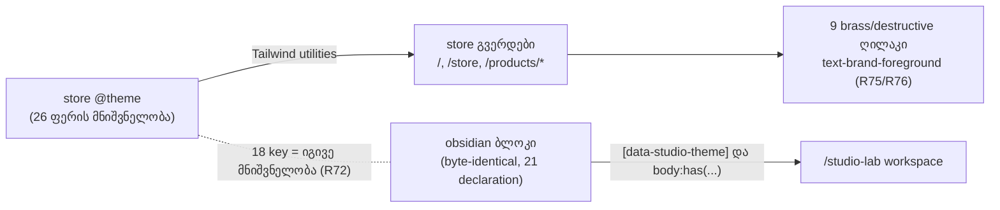

# Store — `@theme` ფერის ტოკენები Obsidian & Brass-ზე და მუქი ტექსტი brass/destructive ღილაკებზე (STORE-2a)

**თარიღი:** 2026-10-26
**სტატუსი:** In Progress (awaiting C round 193)
**შეცვლილი პროექტი:** Store

## კონტექსტი

Saba-მ store-ის რედიზაინისთვის აირჩია მიმართულება A — Obsidian & Brass (პროექტის root-ის `docs/technical/store-redesign/direction-decision.md`, 2026-10-25). Spec-ის STORE-2 სტრიქონი ითხოვს store-ის `@theme`-ის გადაყვანას იმავე პალიტრაზე: სათაურები `#ECE6DA`, ძირითადი ტექსტი დაახლოებით `#CFC7BA`, caption-ები `#A39B8E`. Studio-ს obsidian ბლოკი byte-identical უნდა დარჩეს და store-ის markup-ს `data-studio-theme` არ ემატება.

STORE-2 ოთხ ეტაპად იყოფა: **2a** (ეს დოკუმენტი) — მხოლოდ `@theme`-ის ფერის მნიშვნელობები და ტექსტის ტოკენი ცხრა ღილაკზე; **2b** — hardcoded teal, glow blob-ები, gradient ტექსტი და `shadow-glow`; **2c** — ტიპოგრაფია და font loading; **2d** — motion და reduced motion, Lenis-ის ჩათვლით.

### რატომ არ შესრულდა 192-ე რაუნდში

192-ე რაუნდის დავალება ოთხ ღილაკს აძლევდა ნებართვას. A-ს K0.4 სკანირებამ იპოვა ხუთი დამატებითი, არადაცული ადგილი, სადაც ღია ფერის ტექსტი ან icon brass, buy ან destructive ფონზე დგას. დავალება ასეთ შემთხვევაში გაჩერებას ითხოვდა, ამიტომ A-მ კოდი არ შეცვალა. C-მ დამოუკიდებლად დაადასტურა, რომ სია სრული იყო და გაჩერება სწორი. ეს B-ს grant-ების დაგეგმვის ხარვეზი იყო და არა იმპლემენტაციის დეფექტი. 193-ე რაუნდში grant-ები ცხრა ადგილზე გაფართოვდა.

## მიდგომა

### გადაწყვეტილებები (Saba-ს შეუძლია ვეტო)

- **R72 — store-ის პალიტრა Studio-ს პალიტრას უდრის.** obsidian ბლოკის 18-ივე ფერის key store-ის `@theme`-ში ზუსტად იმავე მნიშვნელობას იღებს. ასე ისინი ერთმანეთს ვერ დაშორდება და `/studio-lab` უცვლელად რენდერდება.
  - უარყოფილი ალტერნატივა (a): store-ს override-ებულ key-ებზე Studio-სგან განსხვავებული მნიშვნელობები. ეს drift-ს ქმნის, ორ წყაროს ერთი ფერისთვის.
  - უარყოფილი ალტერნატივა (b): store-ის markup-ზე `data-studio-theme`. ამას კრძალავს TH4 და spec-ი.
- **R73 — ტექსტის ტონები spec-ს მიჰყვება.** სათაური `foreground` `#ece6da`, ძირითადი ტექსტი `secondary` `#cfc7ba`, caption `muted` `#a39b8e`. იცვლება მხოლოდ მნიშვნელობა; რომელი ელემენტი რომელ ტოკენს იყენებს, STORE-2c-ის საქმეა.
- **R74 — წარმოებული ტოკენები.** `bg-alt` და `surface-glass` თავისი წყვილის channel-wise შუა მნიშვნელობას იღებს (`.5` round-half-to-even-ით: `#1a1714`, `#12100f`). `surface-glass-strong` უდრის `surface`-ს. `*-rgb` triplet-ები brass-ს მიჰყვება. `buy` და `buy-hover` brass ხდება: buy-blue store-იდან გადის.
- **R75 — ღია ტექსტი brass-ზე ან ახალ destructive წითელზე აღარ რჩება.** ivory brass-ზე 1.88:1-ია (hover `#d9b87f`-ზე 1.52:1), ivory `#d2776a`-ზე — 2.57:1. ცხრავე არადაცული ადგილი `text-brand-foreground`-ზე (`#0e0d0c`) გადადის: brass-ზე 8.32:1, destructive-ზე 6.09:1.
  - უარყოფილი ალტერნატივა (c): ivory brass-ზე დატოვება (1.88:1, WCAG 1.4.3-ის დარღვევა).
- **R76 — keep-list-ის LeadMagnet CONTINUE ღილაკს მხოლოდ ტექსტის ფერი ეცვლება.** Saba-ს წესია „restyle them only; never remove or reword“. ტექსტის ფერის ტოკენი restyle-ია: copy, პოზიცია, ზომა და ქცევა უცვლელია.
  - უარყოფილი ალტერნატივა (d): CONTINUE-ის ivory-ზე დატოვება keep-list-ის შეუხებლობისთვის. ღილაკი 2.57:1-მდე ჩამოვარდებოდა, ანუ რეგრესია, რომელსაც ეს რაუნდი გამოიწვევდა.

### განზრახ უცვლელი

`info`, `error-*`, social, დეკორატიული (crystal/premium), video და `blue-*` alias ფერები; `glow-*`, ყველა `--shadow-*` და `--gradient-*` (STORE-2b); `--font-*` (STORE-2c); ანიმაციის ტოკენები (STORE-2d). შედეგად store-ში დროებით შერეული სახე რჩება: brass, და ზოგან teal gradient ან glow. ეს მოსალოდნელი შუალედური მდგომარეობაა.

## არქიტექტურა

Studio-ზე ეფექტი: obsidian ბლოკი 18 key-ს Studio-ს root-ზე და `body`-ზე override-ს უკეთებს, ამიტომ Studio ამ key-ებს store-ის მნიშვნელობიდან არ კითხულობს. დანარჩენი რვა key-ის (store-only) Studio-ში მოხმარება ქვემოთ ცხრილშია.

### K0 — Studio-ს მიერ override-ის გარეშე დარჩენილი ტოკენების მოხმარება

192-ე რაუნდის A-ს K0.1–K0.3 ცხრილი (ლუპის საქაღალდის `a-round-192.md`, რაუნდის ანგარიში), 193-ე რაუნდში ხელახლა გამოყენებული:

| ტოკენი | Studio-ში გამოყენება | obsidian override | ჩანს Studio-ს rest-ზე? |
|---|---|---|---|
| surface-glass | 0 | არა | — |
| surface-glass-strong | 0 | არა | — |
| secondary | `Toast.tsx:82` `text-secondary` | არა | **არა.** toast მხოლოდ CartContext-ის add/remove-ით იქმნება; `/studio-lab`-ს cart UI არ აქვს. |
| bg-alt | 0 | არა | — |
| brand-rgb | 0 (keyframe `glow-pulse` მხოლოდ store selector-ებში) | არა | — |
| accent-rgb | 0 | არა | — |
| buy / buy-hover | 0 | არა | — |
| obsidian-ის 18 key | ბევრი | კი | დიზაინით უცვლელია (R72) |

- `app.css`-ის class rule-ებში ამ var-ების 29 გამოყენებიდან არცერთი selector Studio-ს რენდერში არ გვხვდება.
- **ახალი ხაზი 193-ე რაუნდისთვის — `Modal.tsx`:** იცვლება მხოლოდ `ConfirmDialog`-ის destructive სტრიქონი. `ConfirmDialog`-ს მხოლოდ `routes/cart.tsx` იყენებს (default variant-ით). `ArrangementExportDialog` იმპორტს აკეთებს `Modal, ModalBody, ModalDescription, ModalHeader, ModalTitle`-ზე და არა `ConfirmDialog`-ზე (`ArrangementExportDialog.tsx:2`). ამიტომ export dialog-ის პიქსელები არ იცვლება; ეს ბრაუზერშიც გაიზომა (ქვემოთ, ტესტირება).

### ცხრა ადგილი (S1–S9)

| # | ფაილი | ელემენტი | ფონი | ivory ადრე (ძველ ფონზე) | ivory ახალ ფონზე | `text-brand-foreground` |
|---|---|---|---|---|---|---|
| S1 | `ui/Button.tsx` | `buy` variant | `bg-buy` | 4.05 | 1.88 | 8.32 |
| S2 | `ui/Button.tsx` | `destructive` variant | `bg-destructive` | 3.29 | 2.57 | 6.09 |
| S3 | `routes/hire-us.tsx` | submit | `bg-brand` | 1.55 | 1.88 | 8.32 |
| S4 | `routes/account.orders.tsx` | „Browse Music“ CTA | `bg-brand` | 1.55 | 1.88 | 8.32 |
| S5 | `product/PurchaseHeader.tsx` | Buy Now | `bg-buy` | 4.05 | 1.88 | 8.32 |
| S6 | `marketing/LeadMagnetPopup.tsx` | CONTINUE submit | `bg-destructive` | 3.29 | 2.57 | 6.09 |
| S7 | `ui/Modal.tsx` | ConfirmDialog destructive confirm | `bg-destructive` | 3.29 | 2.57 | 6.09 |
| S8 | `chat/ChatButton.tsx` | unread badge | `bg-destructive` | 3.29 | 2.57 | 6.09 |
| S9 | `auth/ForgetPassword.tsx` | `CheckCircle` icon `bg-brand` წრეში | `bg-brand` (მშობელი) | 1.55 | 1.88 | 8.32 |

- `ChatWidget`/`ChatButton` `caa09af`-ზე არცერთ route-ზე არ არის mount-ებული (`app/components/chat/`-ის გარეთ grep — 0 import). S8-ს მხოლოდ ST5 ფარავს.
- `Button`-ის `buy` და `destructive` variant-ს `caa09af`-ზე არცერთი route არ იყენებს; `ConfirmDialog`-ის destructive variant-საც (cart default variant-ს იყენებს). S1, S2 და S7 ბრაუზერში მიუწვდომელია და მათ ST5 ფარავს.
- დაცული `studio.$productId.tsx:440/471` და `account.downloads.tsx:261` იმავე pattern-ს შეიცავს და შეუხებელი რჩება (სიგნალი `STORE2A-PROTECTED-BRASS-TEXT`).

## შეცვლილი ფაილები

- `app/styles/app.css` — store-ის `@theme`-ში 26 `--color-*` მნიშვნელობა; ორ ხაზზე იმავე ხაზის კომენტარი ახალ ფერს ასახელებს (`#C9A46A`, `Brass`). obsidian ბლოკი, `:focus-visible` rule და დანარჩენი ფაილი უცვლელია.
- `app/components/ui/Button.tsx` — `buy` და `destructive` variant-ის ტექსტის ტოკენი.
- `app/routes/hire-us.tsx`, `app/routes/account.orders.tsx` — submit და CTA-ს ტექსტის ტოკენი.
- `app/components/product/PurchaseHeader.tsx` — Buy Now-ის ტექსტის ტოკენი.
- `app/components/marketing/LeadMagnetPopup.tsx` — CONTINUE-ის ტექსტის ტოკენი (copy უცვლელია).
- `app/components/ui/Modal.tsx` — `ConfirmDialog`-ის destructive სტრიქონი (ერთი ხაზი).
- `app/components/chat/ChatButton.tsx` — unread badge-ის ტექსტის ტოკენი.
- `app/components/auth/ForgetPassword.tsx` — `CheckCircle` icon-ის ფერის ტოკენი.
- `app/lib/__tests__/store-theme-tokens.test.ts` (ახალი, T1) — ST1–ST6. ST6 marker-ს ფაილების მიხედვითაც ამოწმებს (`StudioWorkspace.tsx`: 1, `app.css`: 2).
- `docs/implementation/2026/quarter-IV/157-saba-b-3-fader-pressed-state.md` — სტატუსი და `FS0–FS7`.

## პრობლემები და გადაწყვეტები

- **პრობლემა:** 192-ე რაუნდის grant-ები ოთხ ღილაკს ფარავდა, საჭირო კი ცხრა იყო. **გადაწყვეტა:** A გაჩერდა კოდის შეცვლამდე, B-მ 193-ე რაუნდში grant-ები ცხრა ადგილზე გააფართოვა. ხელახალმა K0 სკანირებამ S1–S9-ის გარეთ ახალი ადგილი არ იპოვა.
- **პრობლემა:** `Button.tsx`-ის `buy` variant ერთ ხაზზე იყო. `text-brand-foreground`-ით ხაზი 100 სიმბოლოს აღემატება და Biome formatter მას მრავალხაზოვან მასივად შლის. **გადაწყვეტა:** ფაილი Biome-ის formatter-ით დაფორმატდა, რადგან `npx biome check` 0 error-ს მოითხოვს. შინაარსობრივად იცვლება ერთი ტოკენი, მაგრამ diff-ში S1 ერთი ამოღებული და ექვსი დამატებული ხაზით ჩანს, იმავე სტილით, როგორც მეზობელი variant-ები. ეს SCOPE-ის „ერთი ხაზის“ მოთხოვნიდან გადახვევაა და B-ს ეცნობა.
- **პრობლემა:** start copy-ზე ახალი ტესტის (T1, `store-theme-tokens.test.ts`) red proof-ისთვის grant-ების დროებით გადაწერა dev server-ს ცვლის. **გადაწყვეტა:** T1 store root-ს `STORE_THEME_TOKENS_ROOT` გარემოს ცვლადიდან კითხულობს (default — რეალური repo). red proof და mutant-ები scratch ასლზე გაეშვა, repo-ს შეხების გარეშე.

## ტესტირება

- `npx vitest run app/lib/__tests__/store-theme-tokens.test.ts` — 6/6 მწვანე.
- Red proof start copy-ზე (`caa09af`-ის grant-ები, scratch ასლი): ST1, ST2, ST3, ST5 წითელია; ST4 და ST6 მწვანე.
- Mutant-ები (ერთი ცვლილება scratch ასლზე): m1 store `--color-brand` ძველ teal-ზე, m2 obsidian-ის `--color-muted`, m3 `--color-secondary` ძველზე, m4 `buy` variant, m5 hire-us submit, m6 `--color-buy` `#006AFF`-ზე, m7 Buy Now, m8 Modal destructive სტრიქონი, m9 `CONTINUE` → `Continue`. შედეგი: m1→ST1+ST3, m2→ST1+ST4, m3→ST2, m4/m5/m7/m8/m9→ST5, m6→ST2+ST3; დამატებით ChatButton, ForgetPassword, ConfirmDialog-ის ნეიტრალური სტრიქონი და orders CTA → ST5.
- მეზობელი suite-ები (37 ფაილი, მათ შორის `studio-theme-obsidian`, `panel-radius-ui`, `affordance-colour-ui`, `fader-style-ui`, export dialog-ის ყველა suite, `audio-preview-player`, `store-header-footer`) — 423/423 მწვანე.
- `npm run typecheck` — 0 error; `npm run lint` — 214 warning + 1 info (იგივე, რაც 191-ე რაუნდში); შეცვლილ ფაილებზე `npx biome check` — 0 error.
- ბრაუზერი (Playwright Chromium, :5173, mock :5199, DPR 2): 26-ვე ტოკენი სამ გვერდზე და სამ viewport-ზე ემთხვევა; `body` ფონი `rgb(14, 13, 12)`; Buy Now და hire-us submit — `rgb(14, 13, 12)` brass-ზე; CONTINUE — `rgb(14, 13, 12)` `#d2776a`-ზე. `/studio-lab` rest 1440/1280 და grid menu, marker menu, export dialog 1440-ზე — 0 შეცვლილი პიქსელი HEAD-თან. store-ის layout box-ები ±1 px-ში უცვლელია, keep-list-ის ტექსტი იდენტურია.

## TODO / შემდეგი ნაბიჯები

- [ ] C round 193: ბრაუზერის მიღება (TOKENS, CONTRAST, BRASS-TEXT, KEEP, LAYOUT, STUDIO-RV).
- [ ] დაცული `studio.$productId.tsx:440/471` და `account.downloads.tsx:261`-ის brass ტექსტი — auth სამუშაოს owner-ისთვის (`STORE2A-PROTECTED-BRASS-TEXT`).
- [ ] შეძენილი `/studio/:id` legacy view (`components/studio/**`) store-ის ტოკენებს კითხულობს — Tech Lead / backend-ით შემოწმება, cloud-ში მიუწვდომელია.
- [ ] STORE-2b: hardcoded teal, glow, gradient ტექსტი, `shadow-glow`; STORE-2c: ტიპოგრაფია; STORE-2d: motion.
- [ ] STORE-2b: `@theme`-ის მოძველებული კომენტარები (`#333640 - was 18%`, `#434750 - was 25%`, `was 35%`, WCAG შენიშვნა border-ებზე) — ამ რაუნდში მხოლოდ ორი, ახალ ფერზე პირდაპირ მიმთითებელი კომენტარი შეიცვალა.
- [ ] T1-ის byte guard-ები (`Button`-ის ოთხი უცვლელი variant, მათ შორის `hover:shadow-glow`) STORE-2b-ში განზრახ შესაცვლელი იქნება.
