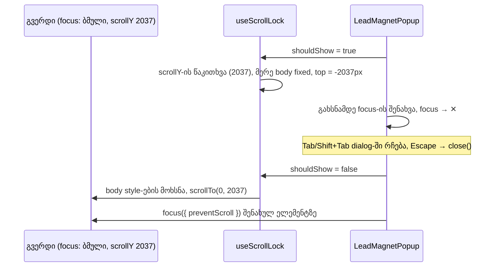

# LeadMagnet popup, როგორც ნამდვილი dialog, და scroll lock-ის პოზიციის შენახვა

**თარიღი:** 2026-10-27
**სტატუსი:** In Progress (იმპლემენტაცია დასრულდა; რაუნდი 205-ში C-ის browser შემოწმებას ელოდება)
**შეცვლილი პროექტი:** Store

## კონტექსტი

"FREE DOWNLOAD" popup (`LeadMagnetPopup`) keep-list-შია: ტექსტი, ვიზუალი და ნაბიჯები უცვლელი უნდა დარჩეს. ის ავტომატურად იხსნება, ჩატვირთვიდან 8 წამში, როცა მომხმარებელი გვერდის 40%-ზე მეტს ჩამოსქროლავს (ან exit-intent-ზე). B-მ რაუნდი 205-ის დაგეგმვისას (D-29z170) HEAD-ზე ორი Medium ბაგი გაზომა. ორივე ერთი კლასისაა: overlay-ის გახსნა/დახურვისას focus და გვერდის პოზიცია იკარგება.

| Finding | რა გაიზომა | სად |
|---|---|---|
| **B-R203-LEADMAGNET-AUTO-OPEN-FOCUS** | popup-ის გახსნის შემდეგ focus გვერდზე რჩება, Tab header-სა და გვერდზე დადის overlay-ის უკან, Escape არაფერს აკეთებს, `role="dialog"` არ არის (WCAG 2.4.3, 4.1.2). | `LeadMagnetPopup.tsx` |
| **B-R204-SCROLLLOCK-POSITION-LOST** | `useScrollLock` body-ს ჯერ `position: fixed`-ს ანიჭებს და მხოლოდ მერე კითხულობს `window.scrollY`-ს. document უკვე "ჩამოშლილია", `scrollY` 0-ია, ამიტომ `top = 0px` და unlock-ზე გვერდი თავში ბრუნდება. | `app/hooks/useScrollLock.ts` (მომხმარებლები: `LeadMagnetPopup`, `ui/Modal`, `AuthModal`) |

**B-ის probe-ის რიცხვები (1280×720):**
- HEAD: LeadMagnet გაიხსნა `scrollY` 2037-ზე, ✕-ით დახურვის შემდეგ — 0 (`lm-head-close-1280.json`). Sign In (AuthModal) გაიხსნა 1500-ზე, Escape-ის შემდეგ — 0 (`authmodal-scroll-5173.json`).
- B-ის sketch: LeadMagnet 2037 → 2037, AuthModal 1500 → 1500 (`lm-sketch2-close-1280.json`, `authmodal-scroll-5176.json`). Lenis აღდგენას არ ეწინააღმდეგება: +1.8 წამზეც 2037-ია.

## მიდგომა

### R110: `useScrollLock` (B-R204-SCROLLLOCK-POSITION-LOST)

- `window.scrollY` იკითხება კონსტანტაში **body-ის ნებისმიერი style-ის დაყენებამდე** და სწორედ ის იწერება `top`-ში.
- unlock, cleanup, scrollbar padding, export და signature უცვლელია. ეს საერთო hook-ია, ამიტომ ფიქსი სამივე consumer-ზე მოქმედებს: LeadMagnet, AuthModal და `ui/Modal` (მაგ. `/studio-lab`-ის Export dialog).

### R109: LeadMagnet popup, როგორც modal dialog (B-R203-LEADMAGNET-AUTO-OPEN-FOCUS)

ყველა ხილული string, class string და ნაბიჯების flow უცვლელია. დაემატა მხოლოდ semantics და focus მართვა (APG modal dialog pattern-ის მინიმუმი):

1. **Semantics:** გარე `fixed inset-0` ელემენტს აქვს `role="dialog"`, `aria-modal="true"` და `aria-labelledby`, რომელიც **მიმდინარე ნაბიჯის საკუთარ h2-ებზე** მიუთითებს. სახელები: offer — "Get Your Tracks, Sound Effects & More"; email — "CONTINUE TO CLAIM YOUR OFFER"; success — "We've sent your free mystery pack to your email!". h2-ებს მხოლოდ `id` დაემატა (`useId`-ით); ახალი ტექსტი ან `aria-label` არ არის.
2. **საწყისი focus:** გახსნისას focus გადადის ✕ ღილაკზე ("Close"). ის DOM-ში პირველი control-ია და მომხმარებელს არაფერზე არ აწერს.
3. **ნაბიჯის focus:** offer → email გადასვლისას focus email input-ზე გადადის; success-ზე — "BACK TO SITE"-ზე. გახსნის მომენტში ეს effect არ მოქმედებს (წინა ნაბიჯი ref-ში ინახება), ასე რომ საწყისი focus ✕-ზე რჩება მაშინაც, როცა popup email ნაბიჯზე იხსნება. ჩავარდნილი submit-ის შემდეგ focus dialog-ში რჩება: თუ submit-ის დროს focus გვერდზე გადავიდა (იხ. "პრობლემები და გადაწყვეტები"), ის email input-ს უბრუნდება.
4. **Escape:** dialog-ის შიგნით keydown იძახებს არსებულ `close()`-ს (იგივე, რაც ✕: `dismissed: true`) და `stopPropagation()`-ს. IME composition-ის დროს (`nativeEvent.isComposing`) Escape იგნორირდება.
5. **Tab-ის შეკავება:** ბოლო ჩართული control-იდან Tab პირველზე გადადის, პირველიდან Shift+Tab — ბოლოზე, ყველა ნაბიჯში (offer: ✕, FREE DOWNLOAD; email: ✕, input, CONTINUE; success: ✕, BACK TO SITE). dialog ელემენტს აქვს `tabIndex={-1}`: არა-focusable შიგთავსზე mouse click-ი focus-ს dialog-ზე ტოვებს, და იქიდან Shift+Tab ბოლო control-ზე გადადის, ხოლო Tab — browser-ის ჩვეულებრივი მოძრაობით ✕-ზე.
6. **Focus-ის დაბრუნება:** დახურვისას (✕, Escape, BACK TO SITE) focus უბრუნდება გახსნამდე focus-ის მქონე ელემენტს, თუ ის ჯერ კიდევ DOM-შია, `preventScroll: true`-ით. ეს ხდება effect-ის cleanup-ში, რომელიც `useScrollLock`-ის **შემდეგაა** გამოცხადებული. React cleanup-ებს გამოცხადების რიგით უშვებს, ამიტომ ჯერ scroll აღდგება და მერე focus. თუ გახსნამდე focus body-ზე იყო, არაფერი ფოკუსდება.
7. შეცდომის `
`-ს დაემატა `role="alert"` (ტექსტი უცვლელია).
8. ✕, FREE DOWNLOAD და BACK TO SITE ღილაკებს დაემატა `type="button"` (Biome `useButtonType` ამ ფაილში 0-ია); submit ღილაკი `type="submit"` რჩება.

ფაილში არ დამატებულა `focus:`, `focus-visible:`, `ring-*`, `outline-*` ან `outline-none` token, და submit ღილაკისა და email ველის class string-ები არ შეცვლილა (STF2, ST5, ST7). ring მხოლოდ global წესიდან მოდის.

### უარყოფილი ალტერნატივები

| ალტერნატივა | რატომ უარვყავით |
|---|---|
| `inert` გვერდის დანარჩენ ნაწილზე | React 18-ს ტიპიზებული `inert` prop არ აქვს, `root.tsx` კი frozen-ია. |
| Portal ან `ui/Modal`-ის ხელახალი გამოყენება | შეცვლიდა keep-list-ის markup-სა და ვიზუალს; `ui/Modal`-საც არ აქვს focus მართვა (`shared-modal-no-focus-management`). |
| საწყისი focus FREE DOWNLOAD-ზე | Enter-ის შემთხვევითი დაჭერა მომხმარებელს offer-ში შეიყვანდა. APG-ის default პირველი control-ია. |
| Escape, როგორც "snooze" (ახალი state) | ახალი პროდუქტის ქცევა იქნებოდა. Escape იგივე `close()`-ია, რაც ✕. |

## არქიტექტურა

## შეცვლილი ფაილები

| ფაილი | დანიშნულება |
|---|---|
| `app/hooks/useScrollLock.ts` | R110: `scrollY` იკითხება body-ის lock-ამდე |
| `app/components/marketing/LeadMagnetPopup.tsx` | R109: dialog semantics, საწყისი/ნაბიჯის focus, Escape, Tab-ის შეკავება, focus-ის დაბრუნება, `role="alert"`, `type="button"` |
| `app/lib/__tests__/store-lead-magnet-dialog.test.tsx` | ახალი jsdom ტესტები LM1–LM9 |
| `docs/implementation/2026/quarter-IV/162-lead-magnet-dialog-focus.md` | ეს დოკუმენტი |

## პრობლემები და გადაწყვეტები

**პრობლემა:** jsdom-ში `window.scrollY` body-ის fixed მდგომარეობაზე არ რეაგირებს, ამიტომ ორიგინალური თანმიმდევრობის ბაგი ჩვეულებრივ ტესტში არ ჩანს.
- **გადაწყვეტა:** LM8-ში `scrollY`-ის getter აბრუნებს 0-ს, როცა `body.style.position === 'fixed'`, სხვა შემთხვევაში 1500-ს (browser-ის clamp-ის იმიტაცია). ორიგინალურ hook-ზე (m10) LM8 წითელია.

**პრობლემა:** testing-library-ის ავტომატური cleanup `vi.restoreAllMocks()`-ის შემდეგ ეშვებოდა, და unmount-ზე hook ნამდვილ `window.scrollTo`-ს იძახებდა ("Not implemented" jsdom-ში).
- **გადაწყვეტა:** ტესტის `afterEach` ჯერ `cleanup()`-ს იძახებს, მერე mock-ებს აღადგენს.

**პრობლემა:** mock-ირებული hook-ის მდგომარეობის შეცვლის შემდეგ `rerender`-ს ახალი element სჭირდება, თორემ React bail-out-ს აკეთებს და hook-ს თავიდან არ კითხულობს (L27).
- **გადაწყვეტა:** ყოველ `rerender`-ს ახლად შექმნილი `<LeadMagnetPopup />` გადაეცემა.

**პრობლემა (code-reviewer-ის Medium, browser-ში დადასტურდა):** submit-ის დროს (`isSubmitting`) input და CONTINUE disabled ხდება. Chromium focus-ს body-ზე გადაიტანს. server-ის შეცდომის შემდეგ focus body-ზე რჩებოდა, ანუ dialog-ის გარეთ: Escape არ მუშაობდა და dialog-ის keydown handler არ ეშვებოდა (`lm-submit-error-before-fix.json`).
- **გადაწყვეტა:** ცალკე effect ადევნებს თვალს `isSubmitting`-ის true → false გადასვლას. თუ ნაბიჯი ისევ email-ია და focus dialog-ში არ არის, focus email input-ზე გადადის (`preventScroll`). success-ზე გადასვლას ნაბიჯის effect ამუშავებს. შედეგი: შეცდომის შემდეგ focus input-ზეა (`lm-submit-error-after-fix.json`). submit-ის მიმდინარეობისას (~ქსელის დრო) focus ისევ body-ზეა; ეს ცნობილი ხარვეზია (TODO).
- **B-ისთვის:** R109(3) ამბობდა "ჩავარდნილი submit focus-ს არ ცვლის". ბრაუზერში focus უკვე იკარგებოდა, ამიტომ input-ზე დაბრუნება ამ წესის განზრახვის შესრულებაა. B-ს შეუძლია veto.

## ტესტირება

- **jsdom (`store-lead-magnet-dialog.test.tsx`, 18 ტესტი, LM1–LM9):**
  - **LM1** (offer/email/success): ერთი `role="dialog"`, `aria-modal="true"`, სახელი მიმდინარე ნაბიჯის h2-ებიდან; ყოველი ღილაკის სახელი უნიკალურია (L14);
  - **LM2:** გახსნისას focus გვერდიდან ✕-ზე გადადის; email ნაბიჯზე გახსნილი popup-იც ✕-ით იწყება;
  - **LM3:** email ნაბიჯი → email input, success → BACK TO SITE; ჩავარდნილი submit-ის შემდეგ, თუ focus გვერდზე იყო, ის email input-ს უბრუნდება;
  - **LM4:** Escape ერთხელ იძახებს `close()`-ს და document listener-მდე არ აღწევს; `isComposing: true`-ზე `close()` არ იძახება;
  - **LM5** (სამივე ნაბიჯი): Tab ბოლოდან → პირველი, Shift+Tab პირველიდან → ბოლო, `preventDefault`-ით; submit-ის დროს (input და CONTINUE disabled) Tab და Shift+Tab ✕-ზე რჩება;
  - **LM6:** focus თვითონ dialog-ზეა → Shift+Tab ბოლო control-ზე;
  - **LM7:** დახურვის შემდეგ focus გახსნამდე focus-ის მქონე ღილაკზეა; თუ ის DOM-იდან წაიშალა, შეცდომა არ არის და focus არსად არ გადადის (ამ ნაწილს red-proof არ აქვს: `focus()` მოხსნილ ელემენტზე `isConnected` guard-ის გარეშეც არაფერს აკეთებს); ღია popup-ის unmount-ზეც focus ბრუნდება და body unlock-დება;
  - **LM8** (ნამდვილი `useScrollLock`): lock → `top = -1500px`; unlock და unmount → `scrollTo(0, 1500)` და body-ის `position/overflow/top/width` მოხსნილია;
  - **LM9:** hook-ის შეცდომის `
`-ს აქვს `role="alert"`, ტექსტი უცვლელია; ცარიელი submit-ის validation შეცდომა ("Please enter your email address") `role="alert"`-შია და `submitEmail` არ იძახება.
- **start copy-ზე** (რაუნდი 204-ის grants) 18-დან 17 ტესტი წითელია. მწვანეა "LM7 unmounting while open…": ძველ popup-ს focus საერთოდ არ გადაჰქონდა, ამიტომ focus გარე ღილაკზე რჩება. მისი red-proof არის m8 (LM7, 2 failed).
- **Mutants** (scratch copy-ზე, `store/`-ის გარეთ; თითოეული თავის row-ს აწითლებს):

| Mutant | ცვლილება | წითელი row |
|---|---|---|
| m1 | `role`/`aria-modal` წაშლილია | LM1 (3) |
| m2 | საწყისი focus არ არის | LM2 (2) |
| m3 | ნაბიჯის focus არ არის | LM3 (1) |
| m4 | Escape არ მუშავდება | LM4 (1) |
| m5 | `isComposing` არ მოწმდება | LM4 (1) |
| m6 | Tab-ის wrap არ არის | LM5 (4) |
| m7 | wrap-ს dialog ელემენტის შემთხვევა არ აქვს | LM6 (1) |
| m8 | focus-ის დაბრუნება არ არის | LM7 (2) |
| m9 | დაბრუნება მხოლოდ ✕-ის handler-შია | LM7 (2) |
| m10 | `useScrollLock`-ის ორიგინალური თანმიმდევრობა | LM8 (1) |
| m11 | scratch `Header.tsx`-იდან `isAuthenticated` effect წაშლილია | HF6b (1) (`store-hidden-focusables.test.tsx`, doc 161) |
| m12 | `role="alert"` წაშლილია | LM9 (2) |
| m13 | submit-ის შემდეგ input-ზე დაბრუნება არ არის | LM3 (1) (ჩავარდნილი submit) |
| m14 | ნაბიჯის effect-ს გახსნის guard არ აქვს | LM2 (1) (email ნაბიჯზე გახსნა) |
| m15 | Tab-ის სიაში disabled control-ებიც შედის | LM5 (1) (submit-ის დროს) |

- **Collision ტესტები:** `store-focus-ring.test.ts` (STF2), `store-theme-tokens.test.ts` (ST5, ST7), `store-header-footer.test.tsx` და `store-hidden-focusables.test.tsx` მწვანეა.
- **Browser (Playwright, :5173, 1280×720), A-ის self-check:**
  - გახსნისას focus ✕-ზეა, `body.style.top = -2037px`;
  - Tab ×4 და Shift+Tab მხოლოდ ✕ ↔ FREE DOWNLOAD-ზე დადის;
  - Escape, ✕ და BACK TO SITE ხურავს; focus უბრუნდება "Browse the Collection"-ს, `scrollY` 2037-ია +300ms-სა და +1.8 წამზე;
  - CZABA wordmark-ზე click-ის შემდეგ Tab/Shift+Tab dialog-ში რჩება, dialog-ზე ring არ ჩანს;
  - email ნაბიჯი: focus input-ზე, cycle ✕ → input → CONTINUE → ✕; ცარიელი submit → "Please enter your email address" `role="alert"`-ში; success: focus BACK TO SITE-ზე;
  - server-ის შეცდომა (`page.route` 500, 800ms დაყოვნებით): შეცდომის შემდეგ focus email input-ზეა (ფიქსამდე — body);
  - AuthModal: 1500 → 1500, `top = -1500px`.
- Ableton-თან შესაბამისობა: **არ ეხება** (store overlay და hook).

## TODO / შემდეგი ნაბიჯები

- **C-R202-06-ის CommandPalette-ის ნაწილი** ღიაა (deferred Low).
- **`shared-modal-no-focus-management`:** `ui/Modal`-სა და AuthModal-ს საწყისი focus, Tab-ის შეკავება და focus-ის დაბრუნება ჯერ არ აქვს. R110-ის scroll ფიქსი მათზეც მოქმედებს, focus — არა.
- **submit-ის მიმდინარეობისას focus body-ზეა** (disabled control-ები). ამ წამებში Escape და Tab-ის შეკავება არ მუშაობს; შეცდომის ან success-ის შემდეგ focus dialog-ში ბრუნდება. შესაძლო ფიქსი (submit-ის დროს focus dialog ელემენტზე) B-ის გადასაწყვეტია.
- 375×812-სა და 1440×900-ზე, exit-intent trigger-ითა და `ui/Modal`-ის consumer-ებზე შემოწმება C-ის row-ებია (LM-OPEN-205, LM-EXIT-205, SCROLL-LOCK-205).
