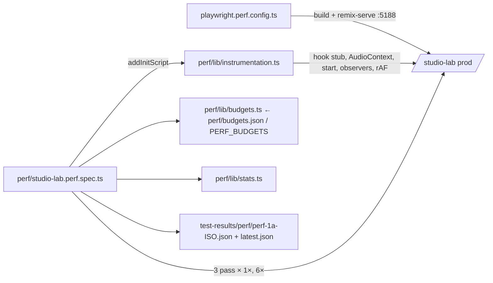

# Studio-ს performance harness (PERF-1a): fader drag-ის გაზომვა

**თარიღი:** 2026-10-27
**სტატუსი:** In Progress (C round 206 PASS — c-round-206.md; published 60c82ed; open: SABA-B-5 fix in PERF-FADER, C-R206-01 Low)
**შეცვლილი პროექტი:** Store (მხოლოდ სატესტო ინფრასტრუქტურა; `app/` არ შეცვლილა)

## კონტექსტი

საბამ Studio ნელად შეაფასა და მაგალითად fader-ის drag დაასახელა (SABA-B-5, Medium). სანამ რამეს გავასწორებთ, საჭიროა გამეორებადი გაზომვა, რომელიც PERF-FADER-ის ფიქსამდე და შემდეგ ერთსა და იმავე რიცხვებს გვაჩვენებს. PERF-1 ორად გაიყო: PERF-1a (ეს რაუნდი) ზომავს load-ს, playback-ს და ხუთ fader-ს; PERF-1b დაამატებს zoom-ს, clip click-ს, range/fade/trim drag-ს, export-ს, bytes-ს, DOM-სა და memory-ს.

## მიდგომა

- **ცალკე testDir.** სპეციფიკაციები `perf/`-შია და არა `e2e/`-ში, ამიტომ ჩვეულებრივი `playwright test`, `npm run test:e2e` და smoke gate მათ ვერ ხედავს. `playwright.perf.config.ts` ცალკე config-ია; `npm run test:perf` არ შედის `verify`-ში.
- **Production build.** config-ის `webServer` ასრულებს `npm run build`-ს და შემდეგ `remix-serve`-ს `PORT=5188`-ზე; `reuseExistingServer: false`. root-ის dev server (:5173) უცვლელი რჩება.
- **აპის კოდის გარეშე.** ყველა საზომი `addInitScript`-ით ჩაიდგმება: React devtools hook-ის stub, `AudioContext`-ის subclass, `start()`-ის patch, PerformanceObserver-ები და rAF loop. `page.route`/`context.route` არ გამოიყენება (perf-plan-ის gotcha: გვერდი "Loading…"-ზე რჩებოდა). `localStorage.czaba_analytics_consent = 'denied'` დაშვებულია (smoke-ის პრეცედენტი).
- **Budget-ის ფაილი.** `perf/budgets.json` — 161 სტრიქონი. ყოველი: `id, scenario, metric, unit, kind, mode, budget, owner, note`. `budget` არის `null` ან `{ "op": "<" | "<=" | "==" | ">=" | ">", "value": number }`. ვარდნა შეუძლია მხოლოდ `mode: "assert"` სტრიქონს; `record` იბეჭდება და იწერება. ამ რაუნდში არცერთი `wallclock` სტრიქონი assert არ არის. `PERF_BUDGETS=<path>` ცვლის ფაილს (C-ის red-proof-ისა და შემდეგი PERF დავალებებისთვის).
- **სამი pass თითო CPU rate-ზე.** pass = ერთი ახალი browser context, რომელიც მთელ თანმიმდევრობას ასრულებს. 1×-ზე 3 pass და 6×-ზე (`Emulation.setCPUThrottlingRate`) 3 pass, სულ 6 page load. 6×-ზე throttle ირთვება ready-სა და Add-ის შემდეგ, ამიტომ load/playback/harness სტრიქონები მხოლოდ 1×-ზე იწერება.
- **ალტერნატივა, რომელიც უარვყავით.** `pointermove`-ის capture/bubble wrapper ზომავს მხოლოდ handler-ს (~0.1 ms): React native listener-ის update-ს შემდეგ task-ში არენდერებს. ამიტომ wall-clock მტკიცებულება rAF ინტერვალებიდან და LoAF-იდან მოდის.

### Pass-ის თანმიმდევრობა (ინტერპრეტაცია)

ამოცანა ითხოვს "group last"-ს, რადგან Ctrl+G lane tree-ს ცვლის. აქედან გამომდინარე, ჯგუფი იქმნება მხოლოდ მას შემდეგ, რაც დანარჩენი ოთხი fader გაიზომა ორივე მდგომარეობაში; შემდეგ ჯგუფის fader-ი იზომება stopped და playing მდგომარეობაში. ასე რვა არაჯგუფური სცენარი B-ის probe-ის მსგავსად ჯგუფის გარეშე იზომება. ზუსტი თანმიმდევრობა ინახება შედეგის JSON-ის `sequence` ველში:

1. `/studio-lab` → ready (`load.ready-ms`, `load.longtask-max`, `load.longtasks-over-50`, `load.commits`, `load.components`)
2. ბიბლიოთეკის Add click (`harness.hook-live`)
3. track → pan → master → clip gain, stopped (clip gain-ის წინ click ირჩევს დამატებულ clip-ს)
4. Space → playing (`harness.audio-running`); 1 s settle, 5 s idle (`play.idle-commits`, `play.idle-components`, `play.idle-longtasks-over-50`)
5. track → pan → master → clip gain, playing
6. დამატებული clip-ის header-ის drag 40 px-ით (1 s, 40 px/s-ზე) playing-ის დროს (`harness.restart-live`)
7. Space → stopped; Stems ხაზის სახელის click, SFX-ზე Shift+click, Ctrl+G
8. group, stopped → Space → group, playing

Drag: `mouse.down` შუაში, 60 step 5 %-მდე, 60 step 95 %-მდე, `mouse.up` — 121 pointermove. Drag-ის წინ fader უნდა იყოს enabled; slider-ის მნიშვნელობა იკითხება down-ის შემდეგ, 5 %-ზე და 95 %-ზე, და თუ ის არ ჩამოვიდა და არ ავიდა, run ვარდება ("did not move"). ასე გაცდენილი ან disabled fader ვერ გაივლის "0 კომპონენტად".

**Settle.** pointerup-ის შემდეგ ფანჯარა იხურება, როცა გვერდი "ჩუმდება": მინიმუმ 600 ms (clip drag-ზე 500 ms), შემდეგ 200 ms ახალი commit-ისა და `start()`-ის გარეშე, მაქსიმუმ 3 s. ფაქტობრივი დრო იწერება `components-per-commit`-ის detail-ში (`settleMs`).

## არქიტექტურა

## მეტრიკების განმარტება და ზღვრები

| მეტრიკა | განმარტება | ცნობილი ზღვარი |
|---|---|---|
| `components-per-commit` | drag-ის დროს (pointerdown-იდან pointerup + 600 ms-მდე) თითო commit-ში ხელახლა დარენდერებული კომპონენტების მედიანა; detail: `max`, `commits` | fiber walk ითვლის კომპონენტს (tag 0, 1, 11, 14, 15), თუ ის ახალია ან PerformedWork flag (1) აქვს, და ჩადის მხოლოდ იქ, სადაც `child !== alternate.child`. ევრისტიკაა: hook bailout-ებს შეიძლება ოდნავ ნაკლებად ითვლიდეს, `memo(forwardRef(…))`-ს კი შეიძლება ორჯერ ითვლიდეს (wrapper და შიდა fiber). შეცდომა ყოველ run-ში ერთნაირია. ეყრდნობა React 18-ის შიდა tag/flag-ებს: React-ის განახლებისას ხელახლა უნდა შემოწმდეს |
| `commits-per-move` | commit-ები ÷ გაგზავნილი move-ები | მხოლოდ ზედა ზღვარია: Scheduler commit-ებს აერთიანებს; determinism-ის შემოწმება არ ეხება |
| `moves-dispatched` | window-მდე მისული `pointermove` (1 + 60 + 60) | — |
| `restarts` | `start()` გამოძახებები არა-offline context-ზე drag-ის ფანჯარაში; detail აჯგუფებს მათ task-ების მიხედვით (`tasks`, `startsPerTask`) | export-ის `OfflineAudioContext` არ ითვლება; task-ის საზღვარი მიახლოებითია (`MessageChannel`-ის შეტყობინება): უკვე რიგში მდგომი task (input, timer) შეიძლება იმავე ჯგუფში მოხვდეს, 6×-ზე უფრო ხშირად; `start()` ითვლება native გამოძახების წარმატების შემდეგ |
| `frame-p95`, `frames-over-33` | rAF ინტერვალების p95 და 33.4 ms-ზე გრძელი ინტერვალების რაოდენობა pointerdown-იდან pointerup-მდე | wall-clock; მხოლოდ ტრენდი (±30 % ხმაური) |
| `loaf-count` | `long-animation-frame` entries, რომლებიც drag-ის დროს იწყება | wall-clock; ტრენდი |
| `event-share-16` | move-ების წილი, რომლებსაც აქვს `pointermove` ან `input` Event Timing entry ≥ 16 ms | Event Timing-ის `durationThreshold` 16 ms-ზე დაბლა ვერ ჩადის; handler-ის დრო ≠ render-ის დრო; Chromium უწყვეტ `pointermove`-ს Event Timing-ში პრაქტიკულად არ აქვეყნებს, ამიტომ ეს რეალურად native range-ის `input` entries-ის წილია |
| `load.ready-ms` | navigation start → ready. Ready = ბიბლიოთეკის Add ღილაკი enabled და preview waveform-ის ზოლები დახატულია | wall-clock |
| `load.longtask-max`, `load.longtasks-over-50` | ready-მდე ყველაზე გრძელი long task და 50 ms-ზე გრძელების რაოდენობა | — |
| `load.commits`, `load.components` | ready-მდე commit-ები და დარენდერებული კომპონენტების ჯამი | record |
| `play.idle-commits`, `play.idle-components`, `play.idle-longtasks-over-50` | 5 s playback-ის დროს | idle long task assert მხოლოდ 1×-ზე |
| `harness.hook-live`, `harness.audio-running`, `harness.restart-live` | hook-ს ნამდვილად მოსდის commit-ები; playback ნამდვილად მუშაობს; restart-ის მთვლელი ნამდვილად ითვლის (clip-ის start უნდა შეიცვალოს, თორემ run ვარდება) | assert; გამორთული hook ვერ გაივლის "0 commit"-ად. autoplay flag-ით ნებისმიერი context შეიძლება `running` იყოს, ამიტომ playback-ის ნამდვილი მტკიცებულება `harness.restart-live`-ია. `harness.restart-live`-ის metric არის `restart-live` და determinism-ის შემოწმება მას არ ეხება |

**ზოგადი ზღვრები.** fiber walk სინქრონულად ეშვება ყოველ commit-ში, ამიტომ მისი მცირე ღირებულება wall-clock სტრიქონებშიც ხვდება. Ctrl+G (`Control+g`) Linux/Windows-ის კომბინაციაა; macOS-ზე harness არ გაშვებულა. `commits-per-move` commit-ებს ითვლის settle-ის ჩათვლით, move-ებს კი მხოლოდ pointerup-მდე. ის მხოლოდ ზედა ზღვარია. იმ სტრიქონებს, რომლებსაც determinism-ის შემოწმება არ ეხება, მედიანა ერთ ცუდ pass-ს უმალავს (R-D). playing მდგომარეობა ცალკე მოწმდება ყოველი drag-ის წინ და შემდეგ.

**Determinism.** `components-per-commit`, `restarts` და `moves-dispatched` სტრიქონების სამი sample უნდა თანხვდეს ±10 %-ით ან ±2-ით (რომელიც მეტია), თორემ run ვარდება "nondeterministic count &lt;id&gt;"-ით. `components-per-commit` და `restarts` ასევე უნდა თანხვდეს 1×-სა და 6×-ს შორის. სტრიქონის id-ები: deterministic fader სტრიქონი 1×-ზე სუფიქსის გარეშეა (`fader.track.stopped.components-per-commit`), 6×-ზე აქვს `.6x`; wall-clock სტრიქონებს ყოველთვის აქვს `.1x` ან `.6x`.

## შეცვლილი ფაილები

- `playwright.perf.config.ts` — ახალი: perf config (testDir `./perf`, 1 worker, retries 0, Chromium, autoplay flag, :5188 webServer, `outputDir` `test-results/perf-artifacts`)
- `perf/studio-lab.perf.spec.ts` — ახალი: სცენარები, აგრეგაცია, assert-ები, შედეგების ჩაწერა
- `perf/lib/instrumentation.ts` — ახალი: in-page საზომები
- `perf/lib/stats.ts` — ახალი: median/percentile/თანხვედრა
- `perf/lib/budgets.ts` — ახალი: `budgets.json`-ის ვალიდაცია
- `perf/budgets.json` — ახალი: 161 სტრიქონი
- `package.json` — `test:perf` script
- `docs/implementation/2026/quarter-IV/162-lead-magnet-dialog-focus.md` — მხოლოდ სტატუსის ხაზი (R112)

## პრობლემები და გადაწყვეტები

- **Problem:** Playwright რაუნდის დასაწყისში `test-results/`-ს შლის, ამიტომ წინა run-ის JSON იკარგებოდა. **Solution:** config-ის `outputDir` არის `test-results/perf-artifacts`; შედეგები `test-results/perf/`-ში რჩება.
- **Problem:** `biome.json` მხოლოდ `app/**`-ს მოიცავს, ამიტომ `npx biome format perf …` ფაილებს არ ამუშავებს. **Solution:** ფორმატი შემოწმდა ფაილების ასლზე იმავე formatter/linter პარამეტრებით; ყველა შესწორება დაბრუნდა ფაილებში.
- **Problem:** LoAF და Event Timing entries ასინქრონულად მოდის და "მიმდინარე mark"-ით მიკუთვნება აცდენს. **Solution:** ყველა ჩანაწერს აქვს `performance.now()`/`startTime`, ფანჯრები `[t0, t1]`-ით იჭრება.
- **Problem:** 6×-ზე playing drag-ები დიდხანს გრძელდება. **Solution:** ყოველი playing drag-ის წინ და შემდეგ მოწმდება Play ღილაკის `Pause` label და `running` context; დარღვევა run-ს აგდებს.
- **Problem (code-review H1):** pass-ის შიგნით ამოგდებული შეცდომა შედეგის ჩაწერას გამოტოვებდა. **Solution:** ყოველი pass-ის შეცდომა იწერება `aborted at <step>`-ად, ხოლო JSON იწერება ყოველი pass-ის შემდეგ (`complete: false`, სანამ ექვსივე არ დასრულდება). შეწყვეტილი pass-ის გამო დაკლებული სტრიქონები ერთ შემაჯამებელ ხაზად იწერება; ცარიელ სტრიქონს მედიანა არ ენიჭება და cross-rate შემოწმებაში არ მონაწილეობს (მეორე code-review). ამიტომ timeout-ის შემთხვევაშიც რჩება ნაწილობრივი შედეგი.
- **Problem:** 6×-ზე pass უფრო დიდხანს გრძელდება, ამიტომ playhead ხილულ არეს (1152 px ÷ 40 px/s ≈ 29 s) სცდება და Follow timeline-ს გადაახვევს. ამის შემდეგ `clip.x + 200` (ან timeline scroller-ის მარცხენა კიდე) ხვდებოდა sticky lane header-ზე (288–512 px), ამიტომ clip-ის drag clip-ს ვერ ამოძრავებდა. ჯერ ეს აპის ბაგი ეგონათ, მაგრამ 1×-ზეც მეორდება იგივე scroll-ის შემდეგ, ანუ harness-ის გეომეტრიის შეცდომაა. **Solution:** grab point ირჩევა `document.elementFromPoint`-ით: პირველი წერტილი, რომელიც ნამდვილად clip-ს ეკუთვნის, + 200 px. clip-ის მოძრაობა (`data-clip-start`) მოწმდება და თუ არ შეიცვალა, run ვარდება.
- **Problem (code-review M3):** მიუწვდომელი PerformanceObserver ტიპი ჩუმად ნულებს მისცემდა. **Solution:** `observerErrors` გადადის pass-ის problems-ში და run-ს აგდებს.

## ტესტირება

`npm run test:perf` რეალურ headless Chromium-ში (cloud runner, 1440×900), საბოლოო კოდზე ორჯერ, ცალ-ცალკე გაშვებით: ორივე exit 0. ხანგრძლივობა build-ის ჩათვლით: 383 s და 422 s; თავად ტესტი: 369.5 s და 407.9 s. deterministic მედიანები ორ run-ს შორის ზუსტად ემთხვევა (`commits-per-move` გარდა, ის ისედაც record-ია). B-ის probe (c274930, prod build) და A-ის მედიანები (3 pass; 1× და 6× ერთნაირია):

| სცენარი | B: კომპონენტი/commit | A: კომპონენტი/commit (stopped / playing) | A: restarts playing (1× / 6×) | A: frame p95 playing (1× / 6×; 6× wall-clock-ია და run-ებს შორის იცვლება) |
|---|---|---|---|---|
| track volume "Volume — Music" | 83 | 83 / 83 | 0 / 0 | 16.8 / 33.4–50 ms |
| master "Master Volume" | 80 | 80 / 80 | 0 / 0 | 16.7 / 33.4–50 ms |
| pan "Pan — Music" | 4 | 4 / 4 | 0 / 0 | 16.7 / 16.8–33.4 ms |
| group volume (Stems + SFX) | — | 85 / 85 | 0 / 0 | 16.7 / 33.4–50 ms |
| clip gain "Clip Gain — fader" | — | 79 / 87 | 0 / 0 | 33.4 / 66.6–66.7 ms |

Harness: `harness.hook-live` = 2, `harness.audio-running` = 1, `harness.restart-live` = 1 (ერთი task, clip start 0.000 → 1.000). Load: `load.ready-ms` ≈ 1.01–1.16 s, `load.longtask-max` ≈ 359–366 ms, `load.longtasks-over-50` = 2, `load.commits` = 5, `load.components` = 320. perf-plan-ის baseline (463–491 ms / 2.3–2.5 s) სხვა მანქანაზე და სხვა ready-ის განმარტებით იყო გაზომილი, ამიტომ პირდაპირ არ ედრება. `play.idle-commits` = 0, `play.idle-longtasks-over-50` = 0.

**Red-proof.** `PERF_BUDGETS` ასლით, სადაც `harness.restart-live`-ს `>= 1000` სჭირდება და `fader.track.stopped.components-per-commit` არის `assert` (`<= 3`), run ვარდება (exit 1) და ორივე სტრიქონს ასახელებს გაზომილი მნიშვნელობით (1 და 83).

**იზოლაცია.** `npx playwright test --list` (default config) და smoke config-ის `--list` `perf/`-ის ფაილს არ აჩვენებს.

## TODO / შემდეგი ნაბიჯები

- **PERF-1b:** zoom, clip click, range drag, fade-handle drag, trim drag, play/pause commit size, export, bytes, DOM, memory.
- **PERF-FADER (SABA-B-5):** fader-ის preview-მ AudioParam პირდაპირ უნდა ჩაწეროს (pan-ის ნიმუში) და ყველა fader-ის `components-per-commit` სტრიქონი (მაგ. `fader.track.stopped.components-per-commit`) `assert`-ზე (`<= 3`) გადაიყვანოს; playing `restarts` სტრიქონები (მაგ. `fader.track.playing.restarts`) assert რჩება.
- `npx biome format perf` პროექტის `biome.json`-ით ფაილებს არ ამოწმებს; scope-ის გაფართოება root/B-ის გადაწყვეტილებაა.
