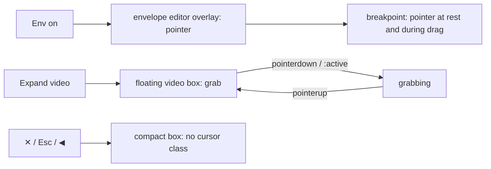

# Timeline-ის "+" cursor-ის შეცვლა pointer-ით (SABA-B-6)

**თარიღი:** 2026-10-27
**სტატუსი:** In Progress (C round 207 check pending)
**შეცვლილი პროექტი:** Store (`/studio-lab`-ის Arrangement workspace)

## კონტექსტი

საბამ 2026-10-27-ს აღნიშნა, რომ timeline-ის ერთ ადგილას hover-ზე cursor "+"-ის ფორმისაა, და მოითხოვა pointing finger (pointer), "როგორც Ableton-შია". B-მ რეალურ Chromium-ში (1440×900 და 1280×720) `elementFromPoint`-ის computed `cursor` 6 px-იანი ბადით გაზომა და სამი "+"-ის მსგავსი cursor იპოვა:

| ელემენტი (testid) | წყარო | ადრე | სად |
|---|---|---|---|
| `arrangement-clip-envelope-editor` | `ArrangementClipEnvelope.tsx` | `crosshair` | Env ჩართულისას ყოველი audio clip-ის მთელი სხეული |
| `arrangement-clip-envelope-point` | `ArrangementClipEnvelope.tsx` | `move` (ოთხი ისარი) | breakpoint, hover-ზეც და drag-ის დროსაც |
| `arrangement-video-box` (floating) | `ArrangementVideoDock.tsx` | `move` | expanded ვიდეო ბიბლიოთეკის თავზე |

legacy `TransportBar.tsx`-ის `crosshair` `/studio-lab`-ზე არ რენდერდება და frozen ფაილია, ამიტომ უცვლელი დარჩა.

## მიდგომა

მხოლოდ სამი cursor utility შეიცვალა. handler-ები, hit area, z-order და ქცევა იგივე დარჩა.

### Cursor map

| ელემენტი | ადრე | Ableton | ახლა | მიზეზი |
|---|---|---|---|---|
| Envelope editor overlay (clip-ის სხეული, Env on) | `crosshair` | ფორმა დაუდასტურებელია; ხაზზე click აქვს | `pointer` | საბას default: არე clickable-ია (click — მონიშვნა, double-click — წერტილის დამატება) |
| Envelope breakpoint (hover და drag) | `move` | ფორმა დაუდასტურებელია; draggable-ია, readout-ით | `pointer` (`hover:scale-125` დარჩა) | საბას default |
| Floating expanded video | `move` | Live-ის ვიდეოს ფანჯარა scope-ის გარეთაა | `grab`, დაჭერისას `grabbing` (`active:cursor-grabbing`) | ბოლო "+"-ის ფორმის cursor ქრება; ემთხვევა CZABA-ს სხვა drag-ით გადასაადგილებელ ობიექტებს (clip title bar, marker, loop brace) |
| Clip waveform, Env off | `text` | დროის მონიშვნა | უცვლელი | "+" არ არის, როლი ემთხვევა Live-ს |
| ბიბლიოთეკიდან drag lane-ზე | OS `copy` | — | უცვლელი | ამას drag-ის დროს OS ხატავს და hover cursor არ არის |
| `TransportBar.tsx` | `crosshair` | — | უცვლელი | აქ არ რენდერდება და frozen ფაილია |

compact ვიდეოს box-ს cursor-ის კლასი არ მიუღია, ის ისევ `auto`-ა.

### Ableton-ის წყარო: ჩანაწერი "no reference found"

- **დადასტურებული ქცევა:** Live 12 manual-ის [Automation and Editing Envelopes → Editing Breakpoints](https://www.ableton.com/en/live-manual/12/automation-and-editing-envelopes/#editing-breakpoints) სექციის მიხედვით, ხაზის სეგმენტები და breakpoint-ები draggable-ია, სეგმენტზე click კი ახალ წერტილს ამატებს. hover-ზე და drag-ის დროს ჩანს მნიშვნელობის readout. [Arrangement View → Moving and Resizing Clips](https://www.ableton.com/en/live-manual/12/arrangement-view/#moving-and-resizing-clips) ადასტურებს, რომ clip-ის გადატანა მხოლოდ clip bar-ით ხდება, waveform-ზე drag კი დროს მონიშნავს.
- **Cursor-ის ფორმა დადასტურებული არ არის.** ableton-arrangement-expert-მა ნახა Live 12 manual-ის თავები: arrangement-view, automation-and-editing-envelopes, clip-envelopes, clip-view, working-with-the-browser, warping, editing-midi, comping, session-view, keyboard shortcuts და concepts. არცერთში pointer-ის ფორმა არ არის დასახელებული. help.ableton.com-ზე ძებნამ ("mouse cursor") 0 სტატია დააბრუნა, ოფიციალური ვიდეოც ვერ მოიძებნა. მესამე მხარის გზამკვლევებში (Loupedeck, Ultimate Outsider 2015) მხოლოდ სეგმენტის highlight ჩანს, cursor-ის ფორმა არა.
- **დასკვნა:** `pointer` საბას მოთხოვნაა და არა დადასტურებული Ableton ფაქტი. Ableton-თან შესაბამისობის სტატუსია "დაუდასტურებელი".

### Deviations

- **D1.** Env ჩართულისას finger clip-ის მთელ სხეულზე ჩანს და არა მხოლოდ ხაზის მახლობლად. Live-ში წერტილი სეგმენტზე click-ით ემატება, CZABA-ში კი სხეულზე ნებისმიერ ადგილას double-click-ით (SRW-18-ის არსებული კონტრაქტი). hit area-ს ხაზამდე შევიწროება ქცევას შეცვლიდა და საბას თანხმობას საჭიროებს: `SABA-B-6-R1`, `awaiting_user`.
- **D2.** Cursor-ის ფორმა (`pointer`) საბას მოთხოვნაა და Ableton-ის დადასტურებული ფაქტი არ არის (წყარო ვერ მოიძებნა).
- **D3.** Floating ვიდეო იყენებს `grab`/`grabbing`-ს CZABA-ს კონვენციით. Ableton-ის წყარო ამისთვის არ არსებობს.

## არქიტექტურა

## შეცვლილი ფაილები

- `app/components/arrangement/ArrangementClipEnvelope.tsx` — editor overlay-ზე `cursor-crosshair` შეიცვალა `cursor-pointer`-ით, breakpoint-ზე `cursor-move` — `cursor-pointer`-ით.
- `app/components/arrangement/ArrangementVideoDock.tsx` — floating branch-ში `cursor-move`-ის ნაცვლად არის `cursor-grab active:cursor-grabbing`. compact branch არ შეცვლილა.
- `app/lib/arrangement/__tests__/clip-envelope-ui.test.tsx` — დაემატა სტრიქონები CU1 და CU2.
- `app/lib/arrangement/__tests__/floating-video.test.tsx` — დაემატა სტრიქონი CU3.
- `app/lib/arrangement/__tests__/timeline-cursor-map.test.ts` — ახალი ფაილი, სტრიქონი CU4 (source scan).
- `docs/implementation/2026/quarter-IV/163-studio-perf-harness.md` — მხოლოდ სტატუსის სტრიქონი (R113).

## პრობლემები და გადაწყვეტები

- **Problem:** headless screenshot cursor-ს არ ხატავს, ამიტომ ვიზუალური მტკიცებულება შეუძლებელია. **Solution:** რეალურ pointer-ის პოზიციაზე იზომება `getComputedStyle(elementFromPoint(x, y)).cursor`.
- **Problem:** floating box-ის `pointerdown` handler `preventDefault`-ს იძახებს და შეიძლებოდა `:active`-ს დაბლოკვა. **Solution:** Chromium-ში გაიზომა, რომ floating ვიდეოს დაჭერისას და მისი drag-ის ოთხივე ნაბიჯზე `grabbing` ჩანს, ხოლო release-ის შემდეგ ისევ `grab`. გაზომვა მხოლოდ Chromium-ს ეხება; Firefox-სა და Safari-ში `preventDefault`-იანი pointerdown-ის შემდეგ `:active` შეიძლება არ გააქტიურდეს, ამ შემთხვევაში drag-ის დროსაც `grab` დარჩება (კოსმეტიკური, შეუმოწმებელი).
- **Problem (წინა მდგომარეობიდან, ამ რაუნდში არ შეცვლილა):** ⠿ handle-ს `cursor-grab` კლასი აქვს, მაგრამ მისი computed cursor არის `pointer`. მიზეზი `app/styles/app.css`-ის unlayered `button { cursor:pointer }` წესია, რომელიც layered Tailwind utility-ს სჯობს. ფაილი დაცულია, ამიტომ ჩანაწერი B-ს გადაეცა (`A-R207-01`).

## ტესტირება

- **CU1:** Env ჩართულისას ყოველი editor overlay-ს `classList` შეიცავს `cursor-pointer`-ს და არ შეიცავს `cursor-crosshair`-ს.
- **CU2:** ყოველი `arrangement-clip-envelope-point` შეიცავს `cursor-pointer`-ს, არ შეიცავს `cursor-move`-ს, და EV1-ის token-ები ადგილზეა.
- **CU3:** floating box შეიცავს `cursor-grab`-ს და `active:cursor-grabbing`-ს, `cursor-move`-ს კი არა. compact box-ს არცერთი ეს კლასი არ აქვს.
- **CU4:** `app/components/arrangement/`-ის ყოველი `.tsx` და `.ts` ფაილი მთლიანად იკითხება. ის არ უნდა შეიცავდეს crosshair, move, cell, copy ან all-scroll cursor-ს არც utility-ის (`hover:`/`active:` prefix-ითაც), არც arbitrary value-ის (`cursor-[move]`, `[cursor:move]`) და არც inline style-ის (`cursor: 'move'`) სახით.
- **Red-proof:** start copy-ზე CU1–CU4 ოთხივე ვარდება. CU4 ვარდება ექვს named mutant-ზეც: `cursor-move` მრავალსტრიქონიან `cn(` call-ში, `cursor-[move]`, `[cursor:move]`, `{ cursor: 'move' }`, `hover:cursor-all-scroll` და `.ts` ფაილში `active:cursor-crosshair`.
- **Chromium (A-ს self-check, 1440 და 1280):** editor-ის ექვს წერტილზე `pointer`. breakpoint-ზე `pointer` მოსვენებისას, დაჭერისას, breakpoint-ის drag-ის ხუთივე ნაბიჯზე და release-ის შემდეგ, ხოლო `data-gain` შეიცვალა. floating ვიდეოზე `grab` → `grabbing` (ვიდეოს drag-ის ოთხივე ნაბიჯზე) → `grab`, box გადაადგილდა 40 px-ით. compact-ზე `auto`. ბადის scan-მა "+"-ის ფორმის cursor 0-ჯერ იპოვა.
- C round 207-ის დამოუკიდებელი შემოწმება ჯერ წინაა.

## TODO / შემდეგი ნაბიჯები

- `SABA-B-6-R1` (`awaiting_user`): envelope-ის hit area ხაზამდე შევიწროვდეს თუ არა.
- `A-R207-01`: ⠿ handle-ის computed cursor არის `pointer` და არა `grab`. საჭიროა B-ის გადაწყვეტილება დაცულ `app.css`-ზე.
