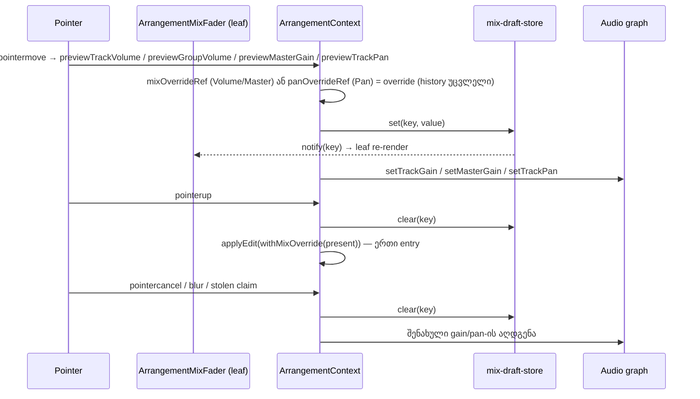

# Fader-ის pointer preview history-ის გარეშე (PERF-FADER-a, SABA-B-5 ნაწილი 1)

**თარიღი:** 2026-10-27
**სტატუსი:** In Progress (C round 210 check pending)
**შეცვლილი პროექტი:** Store (Studio arrangement)

## კონტექსტი

საბამ Studio ნელად შეაფასა და მაგალითად fader-ის drag დაასახელა (SABA-B-5, Medium). PERF-FADER-a0-ის გაზომვამ (C round 208, production build) აჩვენა, რომ თითო `pointermove`-ზე ყველაზე დიდი commit 83 კომპონენტს არენდერებს track Volume-ზე, 85-ს group Volume-ზე, 80-ს Master-ზე და 4-ს Pan-ზე. მიზეზი: `previewVolumeTarget` და `previewMasterGain` ყოველ move-ზე იძახებდნენ `updateHistory`-სა და `syncPlayback`-ს, ამიტომ მთელი context value იცვლებოდა და ყველა consumer ხელახლა რენდერდებოდა. Pan-ი AudioParam-ს უკვე პირდაპირ წერდა, მაგრამ draft-ს lane-ის state-ში ინახავდა, ამიტომ მთელი lane რენდერდებოდა.

ეს ეტაპი ასწორებს track, group და master Volume-სა და Pan-ს. Clip gain (ერთი clip და members) PERF-FADER-b-ია.

## მიდგომა

- **ორი გზა.** context ირჩევს, ფლობს თუ არა target-ს pointer gesture (`volumeGestureRef`, `masterGestureRef`, `panGestureRef`).
  - **Pointer გზა (ახალი):** თითო move-ზე იწერება context-ის override ref (`mixOverrideRef`: ერთი ჩანაწერი track/group volume-ისთვის ან master `gainDb`-ისთვის), draft store და ცოცხალი graph-ის პარამეტრები (`setTrackGain` ყველა track-ისთვის `trackEffectiveGains(withMixOverride(...))`-დან, ან `setMasterGain`). `updateHistory`, `syncPlayback` და `setStatus` move-ზე არ გამოიძახება; history-ის arrangement commit-მდე არ იცვლება.
  - **Pending გზა (უცვლელი):** კლავიატურის ისრები, native `onChange` pointer gesture-ის გარეშე, double-click reset და keyup/blur commit ისევე მუშაობს, როგორც ადრე, undo label-ების ჩათვლით.
- **`withMixOverride`** ერთი pure helper-ია. ის გამოიყენება `startGraph`-შიც და `syncPlayback`-ის setter branch-შიც, ამიტომ Space mid-drag, loop wrap და ნებისმიერი restart graph-ს გადაწეული მნიშვნელობით აშენებს და არა შენახულით.
- **Commit (pointerup / lost capture):** override-ის ზუსტი მნიშვნელობა იკითხება, override და draft იშლება და შემდეგ ერთხელ გამოიძახება `applyEdit` იმავე მნიშვნელობით. label-ები უცვლელია: `Volume`, `Master Volume`, `Pan — <name>`. თუ drag საწყის მნიშვნელობაზე დასრულდა, history entry არ იწერება, მაგრამ draft მაინც იშლება (ეს არის release commit-ი), თუ ერთმა move-მა მაინც შეცვალა stepped მნიშვნელობა; თუ არცერთმა არ შეცვალა, draft არ არსებობს და release commit-ს არ აკეთებს.
- **Cancel (pointercancel, fader blur gesture-ის დროს, stolen claim):** override და draft იშლება, ყველა შეხებული track-ის (group-ის შემთხვევაში ყველა member-ის) ცოცხალი gain/pan შენახულ მნიშვნელობას უბრუნდება და history entry არ იწერება. **Unmount** override-ებს, draft-ებსა და gesture-ებს შლის და graph-ს აჩერებს; ცოცხალ gain/pan-ს უკან არ წერს, რადგან graph აღარ არსებობს.
- **ჩვენება = store + leaf.** ახალი `mix-draft-store.ts` არის keyed store (`subscribe`, `get`, `set`, `clear`), რომლის იდენტობა არ იცვლება. ის `useArrangementMixDraftStore()` hook-ით მიეწოდება, ამიტომ `ArrangementContextValue`-ს ტიპი არ შეცვლილა. ახალი `ArrangementMixFader` ერთადერთი კომპონენტია, რომელიც draft-ს კითხულობს (`useSyncExternalStore`). ის ფლობს `<input type="range">`-ს, fill style-ს, `aria-valuetext`/`title`-ს და readout-ს. move-ზე მხოლოდ ეს leaf რენდერდება. Lane, group header და master მას Volume-ისთვის იყენებენ, lane კი Pan-ისთვისაც (`panDraft` state წაიშალა).
- **ვიზუალი უცვლელია:** იგივე class-ები, DOM-ის რიგი და accessible name-ები. ახალი `cursor-*`, `focus*`, `ring-` ან `outline` token არ დამატებულა.
- **უარყოფილი ალტერნატივა:** მხოლოდ ref-ით DOM-ის წერა, commit-ის გარეშე. ნებისმიერი მშობლის re-render thumb-ს უკან დააბრუნებდა, ამიტომ არჩეულია ერთი პატარა leaf commit თითო move-ზე.
- **გესტის მანქანა context-ში რჩება** (D-29z182, default keep). code-reviewer-ის Architecture note B-სა და root-ს გადაეცა, როგორც შეთავაზება.

### ქცევის შეგნებული ცვლილება (D-29z186)

`f535ab3`-ზე native Pan `change`, რომელიც stolen claim-ის შემდეგ მოდიოდა (lane-ის cleanup ჯერ კიდევ armed იყო), აჩენდა მხოლოდ ჩვენების `panDraft`-ს: ხმა და მოდელი არ იცვლებოდა, thumb კი იმ მნიშვნელობას აჩვენებდა, რომელიც არ ჟღერდა. ახლა `previewTrackPan` gesture-ის გარეშე ასეთ `change`-ს უარყოფს, draft არ ჩნდება და ჩვენება, ხმა და მოდელი ერთმანეთს ემთხვევა. ამას ამოწმებს FP13.

## არქიტექტურა

## შეცვლილი ფაილები

- `app/contexts/ArrangementContext.tsx` — pointer გზა, `mixOverrideRef`, `withMixOverride` `startGraph`-სა და `syncPlayback`-ში, commit/cancel, draft store-ის provider და `useArrangementMixDraftStore`, unmount cleanup
- `app/lib/arrangement/mix-draft-store.ts` — ახალი: keyed draft store და key helper-ები
- `app/components/arrangement/ArrangementMixFader.tsx` — ახალი: draft-ის მკითხველი leaf (forwardRef)
- `app/components/arrangement/ArrangementLane.tsx` — Volume და Pan leaf-ით; `panDraft` state წაიშალა
- `app/components/arrangement/ArrangementGroupHeader.tsx` — group Volume leaf-ით
- `app/components/arrangement/ArrangementMaster.tsx` — Master Volume leaf-ით
- `app/lib/arrangement/__tests__/fader-pointer-preview.test.tsx` — ახალი: FP1–FP14
- `app/lib/arrangement/__tests__/mix-draft-store.test.ts` — ახალი: MD1–MD5
- granted ტესტები (`fader-click`, `group-volume-db`, `master-ui`, `track-group-mix-ui`, `track-volume-db`, `gesture-guard`) — მხოლოდ gesture-ის შუაში მოდელის წამკითხველი assert-ები გადაიწერა სამ შემოწმებად: leaf-ის DOM მნიშვნელობა / `aria-valuetext`, ცოცხალი gain (სადაც playback მიდის) და მოდელი, რომელიც pointerup-მდე უცვლელია
- `perf/budgets.json` — 48 სტრიქონი `assert`-ზე, `harness.move-window-live`-ის note
- `docs/implementation/2026/quarter-IV/163-studio-perf-harness.md` — D-29z181-ის ხაზები

## პრობლემები და გადაწყვეტები

- **Problem:** jsdom-ის ტესტები drag-ს ასე ატარებენ: `pointerDown` → `fireEvent.change` → `pointerUp`. ფიქსის შემდეგ შუაში მოდელის წაკითხვა შენახულ მნიშვნელობას ხედავს. **Solution:** B-ის L23 წესით თითოეული ასეთი assert გადაიწერა (leaf DOM / ცოცხალი gain / მოდელი pointerup-მდე უცვლელი). row-ის id და სათაური შენარჩუნდა. ერთი hit გაყინულ `gesture-guard.test.tsx`-ში იყო; A-მ რაუნდი 209 გააჩერა (L11), B-მ იგი D-29z183-ით grant-ში დაამატა.
- **Problem:** harness-ის track/group drag max-ზე იწყება და მთავრდება (I-208-b), ამიტომ ბევრი move მნიშვნელობას არ ცვლის და commit-ს არ აკეთებს. **Solution:** D-29z184: "≥ 100 window commit"-ის კრიტერიუმი ეხება მხოლოდ C-ის max-ის ქვემოთ დაწყებულ drag-ს. სხვა drag-ებში ყოველი მნიშვნელობის შემცვლელი move commit-ს აკეთებს.
- **Problem:** start copy-ზე red-proof-ს import-ის შეცდომა გააწითლებდა და არა assert-ი. **Solution:** start copy-ს დაემატა `mix-draft-store.ts` და მინიმალური `useArrangementMixDraftStore` export; FP3–FP5, FP7–FP9, FP11–FP13 და FP14a/b/c-ს დასახელებული mutant-ები აქვს.

## ტესტირება

- `fader-pointer-preview.test.tsx`: FP1–FP13 და FP14a/FP14b/FP14c (pan-ის cancel: pointercancel, fader blur, stolen claim) — 16/16. `mix-draft-store.test.ts`: MD1–MD5 — 5/5.
- **Red-proof:** start copy-ზე (`f535ab3` + `mix-draft-store.ts` + მინიმალური hook) FP1–FP8, FP10, FP11, FP13 და FP14a/b/c წითელია assert-ზე (FP4, FP5 და FP7-ს round 210-ში დაემატა შემოწმება "მოდელი gesture-ის შუაში უცვლელია"); FP9 და FP12 მწვანეა (უცვლელი ქცევის row-ებია). დასახელებული mutant-ები: FP3/FP4 — revert ცოცხალ gain-ს არ აღადგენს; FP5 — revert override-ს შლის draft-ის გარეშე; FP7/FP8 — `startGraph` override-ს არ იყენებს; FP9 — group-ის კლავიატურის `change` pointer გზაზე გადადის; FP11 — unmount override-ის draft-ს არ შლის; FP12 — override float32 სიზუსტით ინახება; FP13 — `previewTrackPan`-ის gesture guard-ის მოხსნა; FP14a/b — `cancelTrackPan` pan-ს არ აღადგენს; FP14c — stolen claim-ის abort pan-ს არ აღადგენს; FP14a/b/c — აღდგენა შენახული pan-ის ნაცვლად ცენტრს (0) წერს (FP13/FP14 შენახული pan-ით 10 step იწყება, ამიტომ "0-ის ჩაწერა" და "შენახულის აღდგენა" ერთმანეთისგან განსხვავდება). ყველა mutant შესაბამის row-ს აწითლებს.
- `npm run test:perf` ორჯერ (production build, 1× და 6×): შედეგები ქვემოთ.

ორივე run: exit 0, `complete: true`, 266 სტრიქონი, 66 assert, 0 ჩავარდნა; 48 გადაყვანილი სტრიქონი ორივეში PASS. deterministic მედიანები 1×-სა და 6×-ზე და ორ run-ს შორის ერთნაირია. ხანგრძლივობა: 376 s და 372 s.

| fader | `move-components-max` (stopped / playing) | `move-components-per-move` (stopped / playing) | `release-commits` | playing `restarts` | `move-to-paint-p95.1x` ms (stopped / playing) |
|---|---|---|---|---|---|
| track | 83 / 83 → 1 / 1 | 62.25 / 62.25 → 0.75 / 0.75 | 1 → 1 | 0 → 0 | 4.1 / 5.5 → 2.0–2.1 / 3.6–3.7 |
| group | 85 / 85 → 1 / 1 | 63.75 / 63.75 → 0.75 / 0.75 | 1 → 1 | 0 → 0 | 3.2 / 5.3 → 1.9–2.0 / 3.5–3.7 |
| master | 80 / 80 → 1 / 1 | 63.333 / 59.333 → 0.792 / 0.742 | 1 → 1 | 0 → 0 | 2.9 / 5.1 → 1.7–1.8 / 3.3–3.6 |
| pan | 4 / 4 → 1 / 1 | 3.5 / 2.6 → 0.875 / 0.65 | 2 → 1 | 0 → 0 | 1.4 / 3.4 → 1.7 / 3.2–3.3 |

"ადრე" = C round 208 (`f535ab3`, production build, `c-round-208/out/perf-run1.json`); "შემდეგ" = A-ის round 210-ის ორი run (დიაპაზონი = run1–run2). `move-to-paint` wall-clock record სტრიქონია (ტრენდი, ±30 %). pointerdown-ის commit-ები: 0 ყველა drag-ში (D-29z180). window commit-ები თითო drag-ზე: track/group 90, master 95 / 89, pan 105 / 78 (120 move-დან; მნიშვნელობის შეუცვლელი move commit-ს არ აკეთებს, D-29z184).

## TODO / შემდეგი ნაბიჯები

- **PERF-FADER-b:** clip gain (ერთი clip და members), იგივე ნიმუშით; მისი `move-components-*` და `release-commits` სტრიქონები მაშინ გადავა `assert`-ზე.
- playing მდგომარეობაში pointerup-ისა და Ctrl+Z-ის შემდეგ graph თავიდან შენდება (წინასწარ არსებული ქცევა, perf-plan §1.5) — PERF-2+.
- frontend-architect-ის checkpoint `ArrangementContext.tsx`-ის volume მანქანაზე PERF-FADER-b-ის შემდეგ.
