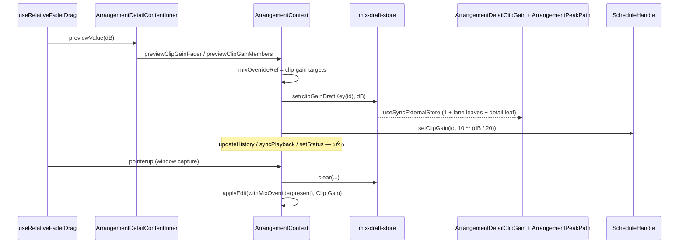

# Clip Gain-ის pointer preview history-ის გარეშე (PERF-FADER-b, SABA-B-5 ნაწილი 2)

**თარიღი:** 2026-10-27
**სტატუსი:** In Progress (C round 211 check pending)
**შეცვლილი პროექტი:** Store (Studio arrangement)

## კონტექსტი

SABA-B-5-ის პირველმა ნაწილმა (PERF-FADER-a, round 210) track, group, master და pan fader-ები გააჩქარა. Clip Gain fader-ი detail panel-ში ყველაზე ნელი დარჩა: round 210-ის harness-ით ერთ move-ზე 95-მდე კომპონენტი რენდერდებოდა და ყოველი move ორ commit-ს აკეთებდა. მიზეზი: `previewClipGainFader` და `previewClipGainMembers` ყოველ move-ზე იძახებდნენ `updateHistory`-ს და `syncPlayback`-ს, ამიტომ context-ის მთელი value იცვლებოდა; მეორე commit-ს detail panel-ის `clipGainText` sync effect იწვევდა.

## მიდგომა

PERF-FADER-a-ს დიზაინი (doc 165) Clip Gain-ზე გავრცელდა, ერთი clip-ისთვისაც და members-ისთვისაც (multi-select):

- **ორი გზა.** Pointer gesture-ის მფლობელობას ამოწმებს `clipGainGestureRef.current?.memberKey === memberKey`. Pointer გზაზე ყოველი move: target-ები ითვლება ისევე, როგორც ადრე (`setClipGainDb`, members-ზე `clipGainShiftTargets` pointerdown-ის committed arrangement-იდან), ინახება override-ში, live graph-ში იწერება `handle.setClipGain(clipId, 10 ** (dB / 20))` მხოლოდ gesture-ის clip-ებისთვის (ერთი clip ან members-ის ყველა წევრი, ყოველ move-ზე) და იწერება draft-ები. `updateHistory`, `syncPlayback` და `setStatus` არ იძახება. Pending გზა (fader-ის ArrowUp/Down, native `onChange` gesture-ის გარეშე, double-click reset, ტექსტური ველი, reset ღილაკი) უცვლელია.
- **Trap 1.** Pointer გზაზე `next === present` early return არ მოქმედებს: შენახულ მნიშვნელობაზე დაბრუნებისას draft იწერება შენახული მნიშვნელობით, ამიტომ ეკრანზე წინა move-ის draft არ რჩება.
- **Override.** `MixOverride`-ს დაემატა `clip-gain` სახე (`memberKey`, `clipIds`, dB-ების `Map`). `claimPointerGesture`-ის ერთი slot-ის გამო ის volume override-თან ერთად ვერ იარსებებს. `withMixOverride` მას `applyClipGainTargets`-ით იყენებს, ამიტომ committed შედეგი pending გზის შედეგის იდენტურია და 0 dB-ზე `gainDb` იშლება. `withMixOverride` აღარ არის export-ი (S2).
- **Restart.** `startGraph`-ის `clipGains` და `syncPlayback`-ის setter loop overridden arrangement-ს კითხულობს, ამიტომ Space და loop wrap gesture-ის შუაში dragged მნიშვნელობით აშენებს graph-ს.
- **Commit (pointerup ან lost capture):** override-ის აღება, draft-ების გასუფთავება, ერთი `applyEdit` `CLIP_GAIN_LABEL`-ით; members-ზე (> 1 clip) status ისევ `formatClipGainMembersStatus`-ით. საწყის მნიშვნელობაზე დასრულებული drag entry-ს არ წერს, მაგრამ draft-ებს ასუფთავებს (release commit).
- **Cancel (pointercancel, fader blur, stolen claim, unmount):** override და draft-ები იშლება, live graph-ში ყველა შეცვლილ clip-ს შენახული linear gain უბრუნდება, entry არ იწერება.
- **ეკრანი = store + leaf.** `mix-draft-store.ts`-ს დაემატა `clipGainDraftKey(clipId)`. ორი leaf:
  - `ArrangementPeakPath` (`ArrangementClip.tsx`-ში, `buildPeakShape`-ის გვერდით): lane-ისა და detail-ის waveform-ის `<svg>`/`<path>`, draft dB-ით ან შენახული gain-ით; lane-ზე waveform zoom კვლავ მრავლდება. detail panel მას 480 სვეტით იყენებს, playhead და range overlay კი მის გარეთ, sibling-ებად რჩება.
  - `ArrangementDetailClipGain` (`ArrangementDetailPanel.tsx`-ში): Clip Gain ბლოკის ყველა draft-ზე დამოკიდებული DOM — ველი, range ტექსტი, fader, reset და pending marker. ბლოკის snapshot პრიმიტიული string-ია; ის ჩვენებული clip-ების per-clip draft-ებს კითხულობს. როცა არჩევანს `reason` აქვს (მაგ. ვიდეო clip), draft არ ჩანს. typed-text state, sync effect, handler-ები და `useId` id-ები `ArrangementDetailContentInner`-ში რჩება.
  - ორივე leaf granted ფაილშია და არა ახალ ფაილში: ცალკე `ArrangementPeakPath.tsx` `ArrangementClip.tsx`-თან import cycle-ს ქმნიდა (code-review Medium), ხოლო frozen repo-scan ტესტები DXL8 და SFR4 Clip Gain ბლოკის source ტექსტს `ArrangementDetailPanel.tsx`-ში ეძებენ. D-29z189 item 7 ბლოკისთვის ამას პირდაპირ უშვებს.
- **Export gesture-ის შუაში** `historyRef.current.present`-ს კითხულობს, ანუ committed მნიშვნელობას არენდერებს — ისევე, როგორც volume PERF-FADER-a-ს შემდეგ. ეს მიღებულია (D-29z189 item 5).
- **ალტერნატივა, რომელიც უარვყავით:** ref-ით `d`-ის პირდაპირ ჩაწერა ან rAF coalescing. ეს per-move რიცხვებს 1×/6×-ზე არადეტერმინისტულს გახდიდა და parent-ის ნებისმიერი re-render drawing-ს უკან დააბრუნებდა.

### ქცევის შეგნებული განსხვავება

ქცევა უცვლელია: waveform კვლავ მიჰყვება drag-ს (WG4 ruling). ერთადერთი შიდა განსხვავება: gesture-ის შუაში model (`getArrangement()`) შენახულ მნიშვნელობას აჩვენებს, ხოლო ეკრანი და audio — dragged მნიშვნელობას. ამიტომ შეიცვალა granted ტესტების L23 hunk-ები (round 211-ის A ანგარიში).

## არქიტექტურა

## შეცვლილი ფაილები

- `app/contexts/ArrangementContext.tsx` — `clip-gain` override, pointer გზა, commit/cancel, `startGraph`/setter override, unmount cleanup, `withMixOverride` export-ის გარეშე
- `app/lib/arrangement/mix-draft-store.ts` — `clipGainDraftKey`
- `app/components/arrangement/ArrangementMixFader.tsx` — `useMixDraftValue` export (საერთო hook; fader-ის ქცევა და DOM უცვლელი)
- `app/components/arrangement/ArrangementClip.tsx` — ახალი `ArrangementPeakPath` leaf; lane waveform მისით; `buildPeakShape` უცვლელი
- `app/components/arrangement/ArrangementDetailPanel.tsx` — ახალი `ArrangementDetailClipGain` leaf; detail waveform `ArrangementPeakPath`-ით
- `app/lib/arrangement/__tests__/clip-gain-pointer-preview.test.tsx` — ახალი: CP1–CP14, CP5b, CP10b
- `app/lib/arrangement/__tests__/mix-draft-store.test.ts` — MD6 (`clipGainDraftKey`)
- `app/lib/arrangement/__tests__/clip-gain-fader.test.tsx`, `clip-gain-multi.test.tsx`, `clip-gain-waveform.test.tsx`, `waveform-zoom.test.tsx` — მხოლოდ L23 hunk-ები
- `perf/studio-lab.perf.spec.ts` — members სცენარი; `perf/budgets.json` — 12 flip და 50 members სტრიქონი
- `docs/implementation/2026/quarter-IV/163-studio-perf-harness.md`, `165-fader-pointer-preview.md` (l.4)

## პრობლემები და გადაწყვეტები

- **Problem:** D-29z190 ითხოვდა "დამატებულ clip-სა და Music clip-ს", მაგრამ `/studio-lab` ცარიელი იწყება და harness-ის ამ ეტაპზე მხოლოდ ერთი audio clip არსებობს. **Solution:** members სცენარი ბიბლიოთეკიდან Soft impact-ს ამატებს აქტიურ SFX ხაზზე და შემდეგ დამატებულ clip-ს + Soft impact-ს (Shift+click) ირჩევს. სცენარი ყველა სხვა გაზომვის შემდეგ ეშვება.
- **Problem:** members-ის მონიშვნისას ზოგი ჩვენებული clip შეიძლება gesture-ის წევრი არ იყოს (MG11, მონიშვნის შეცვლა drag-ის შუაში). **Solution:** ბლოკი თითო clip-ის draft-ს კითხულობს და draft-ის არქონისას შენახულ gain-ს იღებს.
- **Problem:** `syncPlayback`-ის setter loop-ის override gesture-ის შუაში public API-ით მიუწვდომელია: ყველა non-forced გამომძახებელი ან სხვა pointer gesture-ს ეკუთვნის, ან gesture-ის დროს უარყოფილი edit-ია. **Solution:** override მაინც გამოიყენება (defence in depth); mutant M7s ამიტომ ცოცხალი რჩება და ეს ანგარიშშია.

## ტესტირება

- CP1–CP14, CP5b, CP10b (`clip-gain-pointer-preview.test.tsx`; CP3, CP4 და CP5-members ერთი parametrised ბლოკია) და MD6 (`mix-draft-store.test.ts`).
- L23 hunk-ები: CF2, CF4, CF12, CF13, MG4, MG5, MG11, MG12, MG14, WG4, WG8, WZ3.
- Perf harness (`npm run test:perf` ×2 round 211-ის საბოლოო tree-ზე, 7m30s და 7m40s; ორივე exit 0, 316 სტრიქონი, 92 assert, 0 failure). "ადრე" = C round 210 (`c-round-210/out/perf-run1.json`); "ახლა" = run1 / run2:

  | სტრიქონი | ადრე | ახლა |
  |---|---|---|
  | `fader.clipgain.stopped.move-components-max` | 95 | 3 / 3 |
  | `fader.clipgain.stopped.move-components-per-move` | 89.833 | 2.75 / 2.75 |
  | `fader.clipgain.stopped.release-commits` | 1 | 2 / 2 |
  | `fader.clipgain.playing.move-components-max` | 95 | 3 / 3 |
  | `fader.clipgain.playing.move-components-per-move` | 73.5 | 2.25 / 2.25 |
  | `fader.clipgain.playing.release-commits` / `.restarts` | 1 / 0 | 1 / 0 |
  | `fader.clipgain.stopped.move-to-paint-p95.1x` (ms) | 25.1 | 17.6 / 17.7 |
  | `fader.clipgain.playing.move-to-paint-p95.1x` (ms) | 66.5 | 60.1 / 60.0 |
  | `fader.clipgain-members.{stopped,playing}.move-components-max` | — | 3 / 3 |
  | `fader.clipgain-members.{stopped,playing}.move-components-per-move` | — | 2.25 / 2.25 |
  | `fader.clipgain-members.playing.restarts` | — | 0 / 0 |
  | `fader.clipgain-members.stopped.move-to-paint-p95.1x` (ms) | — | 7 / 8 |
  | `fader.clipgain-members.playing.move-to-paint-p95.1x` (ms) | — | 10.1 / 9.7 |
  | `load.components` | 344 | 345 / 345 |

  - `load.components` +1: load-ისას ჩნდება ერთი `ArrangementDetailClipGain`; `/studio-lab` ცარიელი იწყება, ამიტომ `ArrangementPeakPath` load-ისას 0-ია.
  - `fader.clipgain.stopped.release-commits` = 2: release-ის პირველი commit draft-ებს ასუფთავებს და entry-ს წერს; მეორე არის `ArrangementDetailContentInner`-ის layout-effect-ის text sync (ახალი committed ტექსტი), ორივე paint-მდე. playing/members drag-ები max-ზე იწყება და მთავრდება, entry არ იწერება და commit 1-ია.
  - wall-clock: single Clip Gain-ის playing move-to-paint p95 ≈ 60 ms რჩება (ადრე 59–66), თუმცა move-ზე 3 კომპონენტია. members playing ≈ 10 ms. დარჩენილი ღირებულება React commit-ში არ ჩანს; შესაძლო მიზეზი paint-ია (ჰიპოთეზა, არ გაზომილა). ეს B-ს გადაეცემა.
  - `harness.move-latency-live.sync`, `harness.move-latency-live.deferred` და `harness.move-latency-control` (wall-clock) ≈ 0.5 ms-ით მაღლაა round 210-თან შედარებით; liveness ახლა members სცენარის შემდეგ, ორ clip-იან arrangement-ზე ეშვება. assert `>= 30` გადის.

## TODO / შემდეგი ნაბიჯები

- C round 211-ის ბრაუზერის შემოწმება (WINDOW, LIVE-DISPLAY, AUDIO, MEMBERS, INVARIANTS, EXPORT, VISUAL).
- frontend-architect-ის checkpoint `ArrangementContext.tsx`-ის gesture/override machine-ზე (B-ის 211→212 მოთხოვნა).
