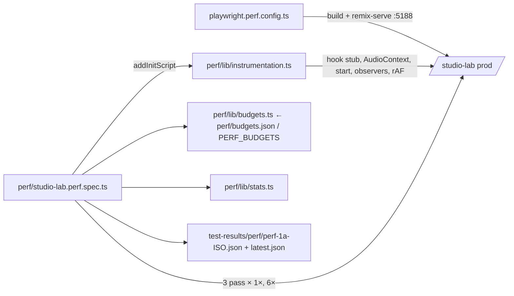

# Studio-ს performance harness (PERF-1a): fader drag-ის გაზომვა

**თარიღი:** 2026-10-27
**სტატუსი:** Completed (PERF-1a C round 206 PASS, published 60c82ed; PERF-FADER-a0 C round 208 PASS, published f535ab3)
**შეცვლილი პროექტი:** Store (მხოლოდ სატესტო ინფრასტრუქტურა; `app/` არ შეცვლილა)

## კონტექსტი

საბამ Studio ნელად შეაფასა და მაგალითად fader-ის drag დაასახელა (SABA-B-5, Medium). სანამ რამეს გავასწორებთ, საჭიროა გამეორებადი გაზომვა, რომელიც PERF-FADER-ის ფიქსამდე და შემდეგ ერთსა და იმავე რიცხვებს გვაჩვენებს. PERF-1 ორად გაიყო: PERF-1a (ეს რაუნდი) ზომავს load-ს, playback-ს და ხუთ fader-ს; PERF-1b დაამატებს zoom-ს, clip click-ს, range/fade/trim drag-ს, export-ს, bytes-ს, DOM-სა და memory-ს.

## მიდგომა

- **ცალკე testDir.** სპეციფიკაციები `perf/`-შია და არა `e2e/`-ში, ამიტომ ჩვეულებრივი `playwright test`, `npm run test:e2e` და smoke gate მათ ვერ ხედავს. `playwright.perf.config.ts` ცალკე config-ია; `npm run test:perf` არ შედის `verify`-ში.
- **Production build.** config-ის `webServer` ასრულებს `npm run build`-ს და შემდეგ `remix-serve`-ს `PORT=5188`-ზე; `reuseExistingServer: false`. root-ის dev server (:5173) უცვლელი რჩება.
- **აპის კოდის გარეშე.** ყველა საზომი `addInitScript`-ით ჩაიდგმება: React devtools hook-ის stub, `AudioContext`-ის subclass, `start()`-ის patch, PerformanceObserver-ები და rAF loop. `page.route`/`context.route` არ გამოიყენება (perf-plan-ის gotcha: გვერდი "Loading…"-ზე რჩებოდა). `localStorage.czaba_analytics_consent = 'denied'` დაშვებულია (smoke-ის პრეცედენტი).
- **Budget-ის ფაილი.** `perf/budgets.json` — 316 სტრიქონი (PERF-1a-ში 161; PERF-FADER-a0-მა 266-მდე გაზარდა; PERF-FADER-b-მ clip gain members სცენარის 50 სტრიქონით 316-მდე). ყოველი: `id, scenario, metric, unit, kind, mode, budget, owner, note`. `budget` არის `null` ან `{ "op": "<" | "<=" | "==" | ">=" | ">", "value": number }`. ვარდნა შეუძლია მხოლოდ `mode: "assert"` სტრიქონს; `record` იბეჭდება და იწერება. PERF-1a-ში არცერთი `wallclock` სტრიქონი assert არ იყო; PERF-FADER-a0-იდან ერთადერთი გამონაკლისია `harness.move-latency-live.sync` და `.deferred` (იხ. "wall-clock assert-ის გამონაკლისი"). `PERF_BUDGETS=<path>` ცვლის ფაილს (C-ის red-proof-ისა და შემდეგი PERF დავალებებისთვის).
- **სამი pass თითო CPU rate-ზე.** pass = ერთი ახალი browser context, რომელიც მთელ თანმიმდევრობას ასრულებს. 1×-ზე 3 pass და 6×-ზე (`Emulation.setCPUThrottlingRate`) 3 pass, სულ 6 page load. 6×-ზე throttle ირთვება ready-სა და Add-ის შემდეგ, ამიტომ load/playback/harness სტრიქონები მხოლოდ 1×-ზე იწერება.
- **ალტერნატივა, რომელიც უარვყავით.** `pointermove`-ის capture/bubble wrapper ზომავს მხოლოდ handler-ს (~0.1 ms): React native listener-ის update-ს შემდეგ task-ში არენდერებს. ამიტომ wall-clock მტკიცებულება rAF ინტერვალებიდან, LoAF-იდან და PERF-FADER-a0-იდან `move-to-paint` sampler-იდან (rAF → `MessageChannel`, იხ. მეტრიკების ცხრილი) მოდის.

### Pass-ის თანმიმდევრობა (ინტერპრეტაცია)

ამოცანა ითხოვს "group last"-ს, რადგან Ctrl+G lane tree-ს ცვლის. აქედან გამომდინარე, ჯგუფი იქმნება მხოლოდ მას შემდეგ, რაც დანარჩენი ოთხი fader გაიზომა ორივე მდგომარეობაში; შემდეგ ჯგუფის fader-ი იზომება stopped და playing მდგომარეობაში. ასე რვა არაჯგუფური სცენარი B-ის probe-ის მსგავსად ჯგუფის გარეშე იზომება. ზუსტი თანმიმდევრობა ინახება შედეგის JSON-ის `sequence` ველში:

1. `/studio-lab` → ready (`load.ready-ms`, `load.longtask-max`, `load.longtasks-over-50`, `load.commits`, `load.components`)
2. ბიბლიოთეკის Add click (`harness.hook-live`)
3. track → pan → master → clip gain, stopped (clip gain-ის წინ click ირჩევს დამატებულ clip-ს)
4. Space → playing (`harness.audio-running`); 1 s settle, 5 s idle (`play.idle-commits`, `play.idle-components`, `play.idle-longtasks-over-50`)
5. track → pan → master → clip gain, playing
6. დამატებული clip-ის header-ის drag 40 px-ით (1 s, 40 px/s-ზე) playing-ის დროს (`harness.restart-live`)
7. Space → stopped; Stems ხაზის სახელის click, SFX-ზე Shift+click, Ctrl+G
8. group, stopped → Space → group, playing
9. PERF-FADER-b-დან: ბიბლიოთეკაში Soft impact → Add აქტიურ SFX ხაზზე; დამატებული clip-ის click და Soft impact-ზე Shift+click (members, N = 2); clip gain members, playing → Space → stopped → clip gain members, stopped (`fader.clipgain-members.*`)
10. მხოლოდ 1×-ზე (PERF-FADER-a0-იდან): Pan — Music-ის სამი liveness drag: `.sync`, `.deferred` და injection-ის გარეშე `.control` (`harness.move-latency-live.sync`, `harness.move-latency-live.deferred`, `harness.move-latency-control`)

Drag: `mouse.down` შუაში, 60 step 5 %-მდე, 60 step 95 %-მდე, `mouse.up` — 121 pointermove. Drag-ის წინ fader უნდა იყოს enabled; slider-ის მნიშვნელობა იკითხება down-ის შემდეგ, 5 %-ზე და 95 %-ზე, და თუ ის არ ჩამოვიდა და არ ავიდა, run ვარდება ("did not move"). ასე გაცდენილი ან disabled fader ვერ გაივლის "0 კომპონენტად".

**Settle.** pointerup-ის შემდეგ ფანჯარა იხურება, როცა გვერდი "ჩუმდება": მინიმუმ 600 ms (clip drag-ზე 500 ms), შემდეგ 200 ms ახალი commit-ისა და `start()`-ის გარეშე, მაქსიმუმ 3 s. ფაქტობრივი დრო იწერება `components-per-commit`-ის detail-ში (`settleMs`).

## არქიტექტურა

## მეტრიკების განმარტება და ზღვრები

| მეტრიკა | განმარტება | ცნობილი ზღვარი |
|---|---|---|
| `components-per-commit` | drag-ის დროს (pointerdown-იდან pointerup + 600 ms-მდე) თითო commit-ში ხელახლა დარენდერებული კომპონენტების მედიანა; detail: `max`, `commits` | fiber walk ითვლის კომპონენტს (tag 0, 1, 11, 14, 15), თუ ის ახალია ან PerformedWork flag (1) აქვს, და ჩადის მხოლოდ იქ, სადაც `child !== alternate.child`. ევრისტიკაა: hook bailout-ებს შეიძლება ოდნავ ნაკლებად ითვლიდეს, `memo(forwardRef(…))`-ს კი შეიძლება ორჯერ ითვლიდეს (wrapper და შიდა fiber). შეცდომა ყოველ run-ში ერთნაირია. ეყრდნობა React 18-ის შიდა tag/flag-ებს: React-ის განახლებისას ხელახლა უნდა შემოწმდეს. PERF-FADER-a0-იდან: pointerdown-ისა და release-ის commit-ებსაც შეიცავს, ამიტომ per-move ბიუჯეტის მეტრიკა არ არის; `budget` = `null` |
| `commits-per-move` | commit-ები ÷ გაგზავნილი move-ები | მხოლოდ ზედა ზღვარია: Scheduler commit-ებს აერთიანებს; determinism-ის შემოწმება არ ეხება |
| `moves-dispatched` | window-მდე მისული `pointermove` (1 + 60 + 60) | — |
| `restarts` | `start()` გამოძახებები არა-offline context-ზე drag-ის ფანჯარაში; detail აჯგუფებს მათ task-ების მიხედვით (`tasks`, `startsPerTask`) | export-ის `OfflineAudioContext` არ ითვლება; task-ის საზღვარი მიახლოებითია (`MessageChannel`-ის შეტყობინება): უკვე რიგში მდგომი task (input, timer) შეიძლება იმავე ჯგუფში მოხვდეს, 6×-ზე უფრო ხშირად; `start()` ითვლება native გამოძახების წარმატების შემდეგ |
| `frame-p95`, `frames-over-33` | rAF ინტერვალების p95 და 33.4 ms-ზე გრძელი ინტერვალების რაოდენობა pointerdown-იდან pointerup-მდე | wall-clock; მხოლოდ ტრენდი (±30 % ხმაური) |
| `loaf-count` | `long-animation-frame` entries, რომლებიც drag-ის დროს იწყება | wall-clock; ტრენდი |
| `move-to-paint-p95`, `move-to-paint-over-16` | თითო `pointermove`-ზე: capture-phase window listener-ში `t0 = performance.now()`, შემდეგ `requestAnimationFrame`, მის შიგნით `MessageChannel`-ის შეტყობინება; `onmessage`-ში იწერება `performance.now() - t0` (move-ის ინდექსით). სტრიქონები: drag-ის sample-ების p95 და 16 ms-ზე გრძელი sample-ების წილი | wall-clock; მხოლოდ ტრენდი (±30 %). ითვლის handler-ს, შემდეგ task-ში გადადებულ React render-ს და მომდევნო frame-მდე დროს; რეალური paint-ის დასრულებას პირდაპირ არ ზომავს. რამდენიმე move ერთ frame-ში ერთსა და იმავე rAF-ს იზიარებს. Policy target: p95 < 16 ms (SABA-B-5). ცოცხალი რომაა, ამტკიცებს `harness.move-latency-live.sync` / `.deferred`. ძველი `event-share-16` (20 სტრიქონი) წაიშალა: Event Timing `pointermove`-ს არ აქვეყნებს და fader-ები mouse drag-ის დროს native `input`-ს არ აგზავნიან (C-R206-01), ამიტომ ის ყოველთვის 0 იყო |
| `load.ready-ms` | navigation start → ready. Ready = ბიბლიოთეკის Add ღილაკი enabled და preview waveform-ის ზოლები დახატულია | wall-clock |
| `load.longtask-max`, `load.longtasks-over-50` | ready-მდე ყველაზე გრძელი long task და 50 ms-ზე გრძელების რაოდენობა | — |
| `load.commits`, `load.components` | ready-მდე commit-ები და დარენდერებული კომპონენტების ჯამი | record |
| `play.idle-commits`, `play.idle-components`, `play.idle-longtasks-over-50` | 5 s playback-ის დროს | idle long task assert მხოლოდ 1×-ზე |
| `harness.hook-live`, `harness.audio-running`, `harness.restart-live` | hook-ს ნამდვილად მოსდის commit-ები; playback ნამდვილად მუშაობს; restart-ის მთვლელი ნამდვილად ითვლის (clip-ის start უნდა შეიცვალოს, თორემ run ვარდება) | assert; გამორთული hook ვერ გაივლის "0 commit"-ად. autoplay flag-ით ნებისმიერი context შეიძლება `running` იყოს, ამიტომ playback-ის ნამდვილი მტკიცებულება `harness.restart-live`-ია. `harness.restart-live`-ის metric არის `restart-live` და determinism-ის შემოწმება მას არ ეხება |
| `move-to-paint-samples` | drag-ის `pointermove`-ებისთვის მიღებული sample-ები; detail: `movesDispatched`, `missing` | მოსალოდნელია = `moves-dispatched`; ცოცხალი რომაა, ამტკიცებს `harness.move-samples-live` |
| `move-components-max`, `move-components-per-move` | move-ის ფანჯარა: commit-ები in-page pointerdown-ის შემდეგ პირველი `pointermove`-ის შემდეგ და in-page `pointerup`-მდე (capture-phase window listener-ები). `-max` = ერთ commit-ში ყველაზე დიდი `rendered` (commit-ის გარეშე 0); `-per-move` = ფანჯრის `rendered`-ის ჯამი ÷ ფანჯრის move-ები (120; down-მდე hover move არ ითვლება); detail: `windowCommits`, `downCommits`, `movesInWindow` | pointerdown-ისა და release-ის commit-ები განმარტებით გამორიცხულია. deterministic, `assert` `<= 3`: track, group, master და pan-ისთვის PERF-FADER-a-დან, clip gain-ისთვის (single და members) PERF-FADER-b-დან; members-ზე ზღვარი N + 1-ია (N = 2). determinism-ის და 1×/6× შემოწმება ეხება. pointerup-ის timestamp-ის გარეშე run ვარდება |
| `release-commits` | commit-ები in-page `pointerup`-იდან "ჩუმობამდე"; detail: `releaseComponentsMax` | deterministic, `assert` `>= 1` (history entry და draft-ის გასუფთავება release-ზე): track, group, master და pan-ისთვის PERF-FADER-a-დან, clip gain-ისთვის (single და members) PERF-FADER-b-დან; determinism-ის შემოწმების გარეშე |
| `harness.move-latency-live.sync`, `harness.move-latency-live.deferred`, `harness.move-latency-control` | მხოლოდ 1×, pass-ის ბოლოს (clip gain members stopped-ის შემდეგ): Pan — Music-ის drag injected bubble-phase window `pointermove` listener-ით, რომელიც 30 ms busy-wait-ს აკეთებს სინქრონულად (`.sync`) ან `MessageChannel`-ის handler-ში (`.deferred`); შემდეგ listener-ები იშლება და იგივე drag injection-ის გარეშე (`.control`) | `.sync`/`.deferred` assert `>= 30`; `.control` record, detail-ში `pointermove` listener-ების რაოდენობა დასაწყისში და წაშლის შემდეგ (CDP `DOMDebugger.getEventListeners`); შეუსაბამობა run-ს აგდებს. მნიშვნელობები მხოლოდ `harness.*` სტრიქონებში იწერება, არა `fader.pan.*`-ში |
| `harness.move-samples-live`, `harness.move-window-live` | track stopped drag, 1×: `moves-dispatched − move-to-paint-samples` და `move-components-max` | assert `<= 2` და `>= 1`. `move-window-live` baseline-ზე ≈ 83-ია, PERF-FADER-a-ს შემდეგ 1. სტრიქონი უცვლელი რჩება და ცოცხალია, რადგან მნიშვნელობის შემცვლელი ყოველი move კვლავ leaf-ის commit-ს აკეთებს |

**ზოგადი ზღვრები.** fiber walk სინქრონულად ეშვება ყოველ commit-ში, ამიტომ მისი მცირე ღირებულება wall-clock სტრიქონებშიც ხვდება. Ctrl+G (`Control+g`) Linux/Windows-ის კომბინაციაა; macOS-ზე harness არ გაშვებულა. `commits-per-move` commit-ებს ითვლის settle-ის ჩათვლით, move-ებს კი მხოლოდ pointerup-მდე. ის მხოლოდ ზედა ზღვარია. იმ სტრიქონებს, რომლებსაც determinism-ის შემოწმება არ ეხება, მედიანა ერთ ცუდ pass-ს უმალავს (R-D). playing მდგომარეობა ცალკე მოწმდება ყოველი drag-ის წინ და შემდეგ.

**Determinism.** `components-per-commit`, `restarts`, `moves-dispatched`, `move-components-max` და `move-components-per-move` სტრიქონების სამი sample უნდა თანხვდეს ±10 %-ით ან ±2-ით (რომელიც მეტია), თორემ run ვარდება "nondeterministic count &lt;id&gt;"-ით. `components-per-commit`, `restarts`, `move-components-max` და `move-components-per-move` ასევე უნდა თანხვდეს 1×-სა და 6×-ს შორის. სტრიქონის id-ები: deterministic fader სტრიქონი 1×-ზე სუფიქსის გარეშეა (`fader.track.stopped.components-per-commit`), 6×-ზე აქვს `.6x`; wall-clock სტრიქონებს ყოველთვის აქვს `.1x` ან `.6x`.

## შეცვლილი ფაილები

- `playwright.perf.config.ts` — ახალი: perf config (testDir `./perf`, 1 worker, retries 0, Chromium, autoplay flag, :5188 webServer, `outputDir` `test-results/perf-artifacts`)
- `perf/studio-lab.perf.spec.ts` — ახალი: სცენარები, აგრეგაცია, assert-ები, შედეგების ჩაწერა
- `perf/lib/instrumentation.ts` — ახალი: in-page საზომები
- `perf/lib/stats.ts` — ახალი: median/percentile/თანხვედრა
- `perf/lib/budgets.ts` — ახალი: `budgets.json`-ის ვალიდაცია
- `perf/budgets.json` — ახალი: 161 სტრიქონი (PERF-1a); PERF-FADER-a0-ის შემდეგ 266 (იხ. ქვემოთ); PERF-FADER-b-ის შემდეგ 316
- `package.json` — `test:perf` script
- `docs/implementation/2026/quarter-IV/162-lead-magnet-dialog-focus.md` — მხოლოდ სტატუსის ხაზი (R112)

## პრობლემები და გადაწყვეტები

- **Problem:** Playwright რაუნდის დასაწყისში `test-results/`-ს შლის, ამიტომ წინა run-ის JSON იკარგებოდა. **Solution:** config-ის `outputDir` არის `test-results/perf-artifacts`; შედეგები `test-results/perf/`-ში რჩება.
- **Problem:** `biome.json` მხოლოდ `app/**`-ს მოიცავს, ამიტომ `npx biome format perf …` ფაილებს არ ამუშავებს. **Solution:** ფორმატი შემოწმდა ფაილების ასლზე იმავე formatter/linter პარამეტრებით; ყველა შესწორება დაბრუნდა ფაილებში.
- **Problem:** LoAF და Event Timing entries ასინქრონულად მოდის და "მიმდინარე mark"-ით მიკუთვნება აცდენს. **Solution:** ყველა ჩანაწერს აქვს `performance.now()`/`startTime`, ფანჯრები `[t0, t1]`-ით იჭრება.
- **Problem:** 6×-ზე playing drag-ები დიდხანს გრძელდება. **Solution:** ყოველი playing drag-ის წინ და შემდეგ მოწმდება Play ღილაკის `Pause` label და `running` context; დარღვევა run-ს აგდებს.
- **Problem (code-review H1):** pass-ის შიგნით ამოგდებული შეცდომა შედეგის ჩაწერას გამოტოვებდა. **Solution:** ყოველი pass-ის შეცდომა იწერება `aborted at <step>`-ად, ხოლო JSON იწერება ყოველი pass-ის შემდეგ (`complete: false`, სანამ ექვსივე არ დასრულდება). შეწყვეტილი pass-ის გამო დაკლებული სტრიქონები ერთ შემაჯამებელ ხაზად იწერება; ცარიელ სტრიქონს მედიანა არ ენიჭება და cross-rate შემოწმებაში არ მონაწილეობს (მეორე code-review). ამიტომ timeout-ის შემთხვევაშიც რჩება ნაწილობრივი შედეგი.
- **Problem:** 6×-ზე pass უფრო დიდხანს გრძელდება, ამიტომ playhead ხილულ არეს (1152 px ÷ 40 px/s ≈ 29 s) სცდება და Follow timeline-ს გადაახვევს. ამის შემდეგ `clip.x + 200` (ან timeline scroller-ის მარცხენა კიდე) ხვდებოდა sticky lane header-ზე (288–512 px), ამიტომ clip-ის drag clip-ს ვერ ამოძრავებდა. ჯერ ეს აპის ბაგი ეგონათ, მაგრამ 1×-ზეც მეორდება იგივე scroll-ის შემდეგ, ანუ harness-ის გეომეტრიის შეცდომაა. **Solution:** grab point ირჩევა `document.elementFromPoint`-ით: პირველი წერტილი, რომელიც ნამდვილად clip-ს ეკუთვნის, + 200 px. clip-ის მოძრაობა (`data-clip-start`) მოწმდება და თუ არ შეიცვალა, run ვარდება.
- **Problem (code-review M3):** მიუწვდომელი PerformanceObserver ტიპი ჩუმად ნულებს მისცემდა. **Solution:** `observerErrors` გადადის pass-ის problems-ში და run-ს აგდებს.

## ტესტირება

`npm run test:perf` რეალურ headless Chromium-ში (cloud runner, 1440×900), საბოლოო კოდზე ორჯერ, ცალ-ცალკე გაშვებით: ორივე exit 0. ხანგრძლივობა build-ის ჩათვლით: 383 s და 422 s; თავად ტესტი: 369.5 s და 407.9 s. deterministic მედიანები ორ run-ს შორის ზუსტად ემთხვევა (`commits-per-move` გარდა, ის ისედაც record-ია). B-ის probe (c274930, prod build) და A-ის მედიანები (3 pass; 1× და 6× ერთნაირია):

| სცენარი | B: კომპონენტი/commit | A: კომპონენტი/commit (stopped / playing) | A: restarts playing (1× / 6×) | A: frame p95 playing (1× / 6×; 6× wall-clock-ია და run-ებს შორის იცვლება) |
|---|---|---|---|---|
| track volume "Volume — Music" | 83 | 83 / 83 | 0 / 0 | 16.8 / 33.4–50 ms |
| master "Master Volume" | 80 | 80 / 80 | 0 / 0 | 16.7 / 33.4–50 ms |
| pan "Pan — Music" | 4 | 4 / 4 | 0 / 0 | 16.7 / 16.8–33.4 ms |
| group volume (Stems + SFX) | — | 85 / 85 | 0 / 0 | 16.7 / 33.4–50 ms |
| clip gain "Clip Gain — fader" | — | 79 / 87 | 0 / 0 | 33.4 / 66.6–66.7 ms |

Harness: `harness.hook-live` = 2, `harness.audio-running` = 1, `harness.restart-live` = 1 (ერთი task, clip start 0.000 → 1.000). Load: `load.ready-ms` ≈ 1.01–1.16 s, `load.longtask-max` ≈ 359–366 ms, `load.longtasks-over-50` = 2, `load.commits` = 5, `load.components` = 320. perf-plan-ის baseline (463–491 ms / 2.3–2.5 s) სხვა მანქანაზე და სხვა ready-ის განმარტებით იყო გაზომილი, ამიტომ პირდაპირ არ ედრება. `play.idle-commits` = 0, `play.idle-longtasks-over-50` = 0.

**Red-proof.** `PERF_BUDGETS` ასლით, სადაც `harness.restart-live`-ს `>= 1000` სჭირდება და `fader.track.stopped.components-per-commit` არის `assert` (`<= 3`), run ვარდება (exit 1) და ორივე სტრიქონს ასახელებს გაზომილი მნიშვნელობით (1 და 83).

**იზოლაცია.** `npx playwright test --list` (default config) და smoke config-ის `--list` `perf/`-ის ფაილს არ აჩვენებს.

## PERF-FADER-a0 (round 208): per-move მეტრიკა

**რატომ.** fader-ის ფიქსი (PERF-FADER-a/b) ისეთ ბიუჯეტზე უნდა შემოწმდეს, რომელსაც ნამდვილად შეუძლია ჩავარდნა. `event-share-16` ყოველთვის 0 იყო (C-R206-01). `components-per-commit` კი pointerdown-ისა და release-ის commit-ებს ურევს, ამიტომ ფიქსის შემდეგ "≤ 3 კომპონენტი თითო move-ზე"-ს ვერ აჩვენებს. ამ რაუნდში იცვლება მხოლოდ harness-ი; `app/` უცვლელია.

**რა შეიცვალა.**
- `instrumentation.ts`: capture-phase, passive window listener-ები `pointerdown` (`downs`) და `pointerup` (`ups`) timestamp-ებისთვის; `move-to-paint` sampler (`moveLatency`). ზედა ცხრილის აღწერილობები: `move-to-paint-*`, `move-components-*`, `release-commits`, `harness.move-*`.
- `budgets.json`: 20 `event-share-16` სტრიქონი წაიშალა; დაემატა 120 fader სტრიქონი (6 მეტრიკა × 5 fader × 2 მდგომარეობა × 2 rate) და 5 `harness.move-*` სტრიქონი, სულ **266**. ზედა "161 სტრიქონი" ეხება PERF-1a-ს. 20 `components-per-commit` სტრიქონის `budget` = `null`, note კი განმარტავს, რომ ის per-move მეტრიკა არ არის. არცერთი არსებული `assert` სტრიქონი არ შეცვლილა (R-2).
- pass-ის თანმიმდევრობას (ზემოთ, 1–8) **მხოლოდ 1×-ზე ემატება მე-9 ნაბიჯი**: Space → stopped, შემდეგ Pan — Music-ის სამი liveness drag: `.sync`, `.deferred` და injection-ის გარეშე `.control`. ზუსტი სია ინახება JSON-ის `sequence`-ში.
- Determinism-ის და 1×/6×-ის შემოწმება (ზემოთ) ახლა `move-components-max`-სა და `move-components-per-move`-საც ეხება. 1×/6× გაყოფა არ გამოჩნდა, ამიტომ fallback (-per-move-ის ჩვეულებრივ record-ად გადაყვანა) არ გამოგვჭირდა.
- **move-ის ფანჯრის ინტერპრეტაცია (B-მ უნდა დაადასტუროს).** task-ის ტექსტი ამბობს: "after the first pointermove". გაგზავნილი პირველი move კი pointerdown-მდე hover move-ია, ამიტომ ფანჯარა იწყება in-page pointerdown-ის შემდეგ პირველი move-იდან. pointerdown-ის commit-ები გამოთვლაში არ შედის, მაგრამ detail-ში იწერება (`downCommits`, `downComponentsMax`). `-per-move` იყოფა 120-ზე (ფანჯრის move-ები). `move-to-paint` კი ყველა 121 move-ს ითვლის.
- **I-206-d (drag-ის ორივე ბოლო).** შემოწმება: `valueLow < valueStart < valueHigh` ან `valueStart = valueHigh = max`; detail `endsCase` = `strict` | `max`. გზა (50 % → 5 % → 95 %) და 121 move უცვლელია. fader-ები relative drag-ით მოძრაობს, ამიტომ `max` შემთხვევა მოდის: track და group ორივე მდგომარეობაში (0 dB = max), master და clip gain — playing-ში (stopped drag max-ზე მთავრდება). pan და stopped master/clip gain — `strict`.

**შედეგები (round 208; ორი საბოლოო `npm run test:perf`, run3/run4, ორივე exit 0, 18/18 assert PASS, deterministic მედიანები ზუსტად ემთხვევა).**

| fader | `move-components-max` | `move-components-per-move` | `release-commits` | `move-to-paint-p95` 1× (ms, stopped / playing) | 6× (ms, stopped / playing) |
|---|---|---|---|---|---|
| track | 83 | 62.25 | 1 | 4.1–4.4 / 5.5–5.6 | 30.2–30.8 / 36.5–36.7 |
| group | 85 | 63.75 | 1 | 3.1–3.2 / 5.3–5.7 | 27.3–27.9 / 35.9–37.3 |
| master | 80 | 63.333 (stopped) / 59.333 (playing) | 1 | 2.9 / 4.9–5.3 | 23.5–24.3 / 35.4–36.1 |
| pan | 4 | 3.5 / 2.6 | 2 | 1.3 / 3.2–3.3 | 7.5 / 21.9–23.5 |
| clip gain | 87 | 82.5 / 67.5 | 1 | 27.6–30.3 / 64.4–66.2 | 56.8–59.1 / 76.7–78.2 |

კომპონენტების რიცხვები 1×-სა და 6×-ზე ერთნაირია. `move-to-paint-samples` = 121 ყველა drag-ში. Liveness: `harness.move-latency-live.sync` 31.6–32.0 ms, `.deferred` 31.2–31.3 ms (≥ 30), `harness.move-latency-control` 1.2–1.3 ms, `pointermove` listener-ები 1 → 1. `harness.move-samples-live` = 0, `harness.move-window-live` = 83. თითო run 419–421 s.

**Red-proof (scratch ასლზე, 1 pass, 1×; granted ფაილები უცვლელია).**
- (i) sampler-ის `requestAnimationFrame` ნაბიჯი ამოიღეს (შეტყობინება პირდაპირ listener-იდან იგზავნება): `harness.move-latency-live.deferred` = 0.8 ms → `assert failed` (exit 1). `.sync` = 30.9 ms, ისევ გადის.
- (ii) ფანჯარა release-ის commit-მდე გაფართოვდა: pan-ის `move-components-max` 4 → 83 (stopped და playing). `-per-move` შეიცვალა ათივე fader × მდგომარეობისთვის (მაგ. track 62.25 → 62.942). track/group/master/clip gain-ის max უცვლელია, რადგან release commit move-ის უდიდეს commit-ზე დიდი არ არის (`releaseComponentsMax`: track 83, clip gain stopped 79).
- scratch ორივე run-ში დამატებით ჩავარდა 6× `restarts` assert-ები 0 sample-ით. ეს 1×-only scratch-ის შედეგია და harness-ის ქცევას არ ეხება.

**wall-clock assert-ის გამონაკლისი.** `harness.move-latency-live.sync` და `.deferred` `wallclock` სტრიქონებია, მაგრამ `assert`. ეს შეგნებული გამონაკლისია PERF-1a-ის წესიდან („არცერთი `wallclock` სტრიქონი assert არ არის“): მათ ქვედა ზღვარს 30 ms busy-wait ადგენს და არა მანქანის სიჩქარე.

**ზღვარი.** `move-to-paint` სრულდება rAF-ის შემდეგ გაგზავნილი შეტყობინებით და frame-ის რეალურ paint-ს პირდაპირ არ ზომავს. ამ მეთოდით ამოიღება წინა ქვეთავში "ალტერნატივა, რომელიც უარვყავით" აღწერილი შეზღუდვა: handler-ის შემდეგ გადადებული render-იც ითვლება.

## TODO / შემდეგი ნაბიჯები

- **PERF-1b:** zoom, clip click, range drag, fade-handle drag, trim drag, play/pause commit size, export, bytes, DOM, memory.
- **PERF-FADER (SABA-B-5):** fader-ის preview-მ AudioParam პირდაპირ უნდა ჩაწეროს (pan-ის ნიმუში) და fader-ების `move-components-max` / `move-components-per-move` სტრიქონები `assert`-ზე (`<= 3`), ხოლო `release-commits` `assert`-ზე (`>= 1`) გადაიყვანოს. `components-per-commit` per-move მეტრიკა არ არის და `budget` = `null` რჩება; playing `restarts` სტრიქონები (მაგ. `fader.track.playing.restarts`) assert რჩება.
- **PERF-FADER-a (round 210):** track, group, master და pan fader-ების 48 სტრიქონი (`move-components-max`, `move-components-per-move`, `release-commits`; stopped/playing; 1× და `.6x`) `assert`-ზე გადავიდა; clip gain-ის სტრიქონები PERF-FADER-b-მდე `record` რჩება. დეტალები: `165-fader-pointer-preview.md`.
- **PERF-FADER-b (round 211):** clip gain-ის 12 სტრიქონი (`move-components-max`, `move-components-per-move`, `release-commits`; stopped/playing; 1× და `.6x`) `assert`-ზე გადავიდა და დაემატა members სცენარის 50 სტრიქონი (`fader.clipgain-members.*`). დეტალები: `166-clip-gain-pointer-preview.md`.
- `npx biome format perf` პროექტის `biome.json`-ით ფაილებს არ ამოწმებს; scope-ის გაფართოება root/B-ის გადაწყვეტილებაა.
