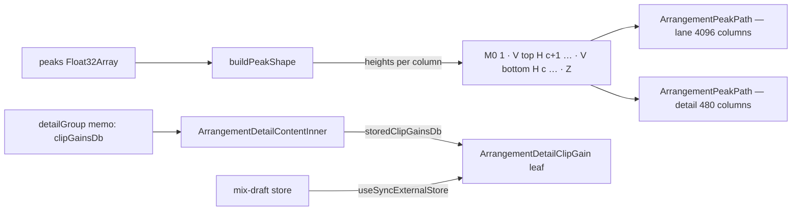

# Waveform-ის outline path და Clip Gain-ის ერთი release commit (PERF-FADER-c, SABA-B-5 ნაწილი 3)

**თარიღი:** 2026-10-27
**სტატუსი:** In Progress (C round 212 check pending)
**შეცვლილი პროექტი:** Store (Studio arrangement)

## კონტექსტი

SABA-B-5 (Medium): საბამ თქვა, რომ fader-ის drag ნელია. რაუნდმა 211 Clip Gain-ის drag-ზე React-ის სამუშაო 95-დან 3 კომპონენტამდე შეამცირა თითო move-ზე. მიუხედავად ამისა, C-ის production harness-მა ერთი კლიპის Clip Gain-ის move-to-paint p95 მაინც გაზომა: **18.1 / 18.6 ms** გაჩერებულზე და **59.7 / 58.1 ms** playback-ის დროს (C-R211-02). მიზანია p95 < 16 ms. შედარებისთვის, members drag 6–10 ms იყო, track fader კი 1.7–3.8 ms.

B-მ მიზეზი გაზომა dev server-ზე, 1440×900-ზე, ერთ კლიპზე, harness-ის მეთოდით (`pointermove` → rAF → MessageChannel):

| ექსპერიმენტი | stopped p95 (ms) | playing p95 (ms) |
|---|---|---|
| როგორც არის | 14.4–21.7 | 23.2–45.9 |
| lane-ის clip svg-ები `display:none` | — | 6.0–6.9 |
| detail waveform svg `display:none` | — | 15.9–16.2 |
| ყველა playhead `display:none` | — | 45.8–47.2 (მოგება არ არის) |
| detail playhead `display:none` | — | 24.1–24.3 (მოგება არ არის) |
| `will-change: transform` waveform svg-ებზე (layer promotion) | 35.6–38.9 (უარესი) | 56.7–58.6 (უარესი) |
| იგივე გეომეტრია ერთი outline path-ით | 6.4–7.7 | 8.8–10.5 |

Playback-ის დროს drag-ის CDP trace-ში RasterTask ჯამში 1,730 ms იყო, Commit კი 372 ms. ძირითად დროს peak path-ის software raster იღებს. `buildPeakShape` თითო სვეტზე ერთ 1-ერთეულიან მართკუთხედ subpath-ს ქმნიდა: lane-ზე 4,096-მდე, detail panel-ზე 480-ს. ამდენი ერთმანეთის გვერდით მდგარი antialiased მართკუთხედის rasterize ძვირი ჯდება.

ამავე owner-ში ორი მცირე საკითხიც გადაწყდა:
- **C-R211-01 (Low):** მნიშვნელობის შემცვლელი ერთი drag-ის release-ზე ჩნდებოდა დამატებითი commit, რომელიც Clip Gain-ის ველს ძველი typed ტექსტით და pending მდგომარეობით არენდერებდა. ეს მდგომარეობა არასოდეს იხატებოდა, მაგრამ `release-commits` ორჯერ იზრდებოდა.
- **GATE211-S1:** block leaf render-ის დროს `getArrangement()`-ს კითხულობდა, ანუ mutable ref-ს. გარდა ამისა, optional prop-ის არქონისას 0 dB-ზე გადადიოდა.

## მიდგომა

**Outline path (D-29z197).** `buildPeakShape`-ის signature, `columns` შედეგი, სიმაღლის ფორმულა `height = max(0.02, min(1, max × s))`, bucketing (`from`/`to`/`perColumn`) და `null` შემთხვევები უცვლელია. იცვლება მხოლოდ `path`-ის string. ახლა ის ერთი დახურული კონტურია: `M0 1`, შემდეგ თითო სვეტზე წინ `V{1−h}H{c+1}`, შემდეგ უკან `V{1+h}H{c}`, ბოლოს `Z`. ზედმეტი `V`/`H` ბრძანებები არ იშლება, რომ ფორმატი დეტერმინისტული დარჩეს ტესტებისა და C-ის შემოწმებისთვის. svg, `viewBox`, `preserveAspectRatio`, ფერი, კლასები, test id-ები, სვეტების რაოდენობა (4096 / 480) და ყველა caller უცვლელია.

**უარყოფილი ვარიანტები (B-ის გაზომვით):**
- layer promotion (`will-change: transform`) — უარესი: 35.6–38.9 / 56.7–58.6 ms;
- playhead-ის transform-ზე გადატანა — მოგება არ აქვს (45.8–47.2 და 24.1–24.3 ms);
- canvas — გაზომილი საჭიროება არ არსებობს. jsdom-ს 2D context არ აქვს, ხოლო server-ის პირველი paint ცარიელი იქნებოდა.

**C-R211-01.** Clip Gain-ის ველის სინქრონიზაცია layout effect-იდან React-ის „adjust state when a prop changes“ pattern-ზე გადავიდა. კომპონენტი ინახავს `syncedClipGainText`-ს. თუ render-ის დროს ის `displayedClipGainText`-ისგან განსხვავდება, ორივე state იმავე render-ში ახლდება. React კომპონენტს commit-მდე ხელახლა არენდერებს, ამიტომ release ერთხელ commit-დება და ველის ტექსტი უკვე სწორია. pointer-up handler-ში ტექსტის დაწერა საკმარისი არ არის: commit context-ის window listener-იდან მოდის, Undo/Redo-ს კი იგივე სინქრონიზაცია სჭირდება.

**GATE211-S1.** `ArrangementDetailGroup` მიიღო სავალდებულო `clipGainsDb`, რომელიც `clipIds`-ის ინდექსებს ემთხვევა. block leaf `getArrangement`-ის ნაცვლად იღებს `storedClipGainsDb`-ს: ჯგუფისთვის `clipGainGroup.clipGainsDb`-ს, ერთი კლიპისთვის `[clipGainDb ?? 0]`-ს. draft-ის არმქონე member-ის მნიშვნელობა ამ prop-იდან იკითხება, ამიტომ render-ის დროს mutable read აღარ ხდება. მშობელს `getArrangement` მხოლოდ `readClipGainAnchorDb`-ისთვის რჩება, რომელიც pointer handler-ში გამოიძახება.

## არქიტექტურა

## შეცვლილი ფაილები

- `app/components/arrangement/ArrangementClip.tsx` — `buildPeakShape`-ის path ფორმატი.
- `app/components/arrangement/ArrangementDetailPanel.tsx` — C-R211-01-ის render-time სინქრონიზაცია; `storedClipGainsDb` prop; `ArrangementDetailGroup.clipGainsDb`.
- `app/components/arrangement/StudioWorkspace.tsx` — `clipGainsDb` ველი `detailGroup` memo-ში.
- `app/lib/arrangement/__tests__/waveform-zoom.test.tsx` — WZ1: მართკუთხედების literal-ები reference გეომეტრიად დარჩა.
- `app/lib/arrangement/__tests__/clip-gain-waveform.test.tsx` — WG1, WG2: WG2 legacy formatter-ით კვლავ ამოწმებს ძველ sha-ს.
- `app/lib/arrangement/__tests__/clip-gain-pointer-preview.test.tsx` — ახალი CP15–CP17.
- `app/lib/arrangement/__tests__/waveform-outline-path.test.tsx` (ახალი) — PO1–PO5.
- `docs/implementation/2026/quarter-IV/166-clip-gain-pointer-preview.md` — სტატუსის ხაზი (l.4).

## პრობლემები და გადაწყვეტები

- **პრობლემა:** რაუნდმა 211 `buildPeakShape`-ის string ზუსტ literal-ებით (WZ1, WG1) და sha-ით (WG2) გაყინა. **გადაწყვეტა:** გაყინვა მხოლოდ string-ის ფორმატზე მოიხსნა. ძველი literal-ები reference გეომეტრიად დარჩა. ტესტის ლოკალური parser-ი `columnsOf` ორივე ფორმატს კითხულობს, `outlineOf` ახალ ფორმატს აგებს, `rectPathOf` კი ძველ ფორმატს აღადგენს. WG2-ში `rectPathOf(columnsOf(path))`-ის სიგრძე 2530-ია და sha იგივე `WG2_PRE_ROUND_SHA256`-ია. ეს ამტკიცებს, რომ ახალი path ზუსტად ძველ ნახაზს აღწერს.
- **პრობლემა:** ტესტის helper-ების საერთო ფაილი grant-ში არ იყო, ხოლო ტესტის ფაილის მეორე ტესტის ფაილიდან import მის row-ებს ორჯერ დაარეგისტრირებდა. **გადაწყვეტა:** პატარა parser-ები თითო ფაილში ცალკეა.
- **პრობლემა:** CP12 ერთ ტესტში 841 drag-ს ატარებდა (ყოველი 0.1 dB, −60.0-დან +24.0-მდე), თითოეულს სრულად mount-ებულ workspace-ზე. ცალკე ის 15–17 s გრძელდებოდა, gate 212-ის სრულ პარალელურ vitest run-ში კი (`maxWorkers: 4`, ≈2.1× დატვირთვა) 33.3 s-ს მიაღწია და describe-ის 30 s timeout-ს გადააჭარბა; start copy-ის წყაროებითაც იგივე ხდებოდა (33.8 s), ანუ მიზეზი რაუნდი 212-ის კოდი არ იყო. **გადაწყვეტა (რაუნდი 213, GATE212-B1):** CP12 ოთხ მიმდევრობით ნაწილად გაიყო `CP12_SLIDER_CHUNKS`-ით (−600…−391, −390…−181, −180…29, 30…240 მეათედი dB). CP12-COVER ამოწმებს, რომ ნაწილები ზუსტად სრულ სიას იძლევა, გადაფარვისა და ხარვეზის გარეშე; CP12a–CP12d (`it.each(CP12_SLIDER_CHUNKS)`-ით შექმნილი row-ები, სათაური `'CP12%s: …'`) თითო ნაწილს საკუთარ mount-ზე ამოწმებს; CP12e Shift-fine-სა და members-ის სამ anchor-ს ამოწმებს. ბიჯი, დიაპაზონი, ყველა `expect` და describe-ის 30 s timeout უცვლელია. გაზომვა: ფაილი ცალკე ორჯერ 25/25, CP12a–d 2.0–2.3 s, CP12e 135–137 ms; covering run (`app/lib/arrangement app/components app/hooks`) 155 ფაილი / 2236 ტესტი მწვანე, CP12a–d 4.6–5.1 s, CP12e 313 ms.

## ტესტირება

PO1–PO5 row-ები `waveform-outline-path.test.tsx`-შია; `pending-status.test.tsx`-ში იგივე id-ების მქონე სხვა row-ები არსებობს. CP15–CP17 `clip-gain-pointer-preview.test.tsx`-შია, WZ1 — `waveform-zoom.test.tsx`-ში, WG1/WG2 — `clip-gain-waveform.test.tsx`-ში.

- **PO1** — WZ1, WG1 და WG2 fixture-ებზე outline თითო სვეტის top/bottom-ს დოკუმენტირებული ფორმულით აღწერს.
- **PO2** — ერთი `M`, ერთი `Z`, `2 × columns` `V`/`H` წყვილი, `M0 1`-ით იწყება და `H0Z`-ით მთავრდება.
- **PO3** — ჩუმი სვეტი `0.980`/`1.020`-ს ხატავს, clipping სვეტი `0.000`/`2.000`-ს.
- **PO4** — ერთი სვეტი `M0 1V{t}H1V{b}H0Z`-ს იძლევა.
- **PO5** — `null` შემთხვევები უცვლელია.
- **WZ1, WG1, WG2** — გეომეტრია ძველ literal-ებთან და ძველ sha-სთან.
- **CP15** — typed −12 dB-დან მნიშვნელობის შემცვლელი ერთი drag-ის release-ზე `ArrangementDetailClipGain` ერთხელ commit-დება. `data-pending`, warning title და pending `
` არ ჩნდება (MutationObserver).
- **CP16** — release-ის შემდეგ Undo, Redo, typing + Escape და reset ღილაკი ველს და pending მდგომარეობას ისე სინქრონიზებს, როგორც ადრე.
- **CP17** — members drag-ის range draft-ებიდან და prop-ად გადმოცემული stored gain-ებიდან აიგება. drag-ის შუაში selection-ის შეცვლა ახალი selection-ის stored gain-ებს აჩვენებს.

Red-proof: PO1–PO4 და CP15 start copy-ზე წითელია. PO5, CP16 და CP17 დასახელებული mutant-ებით წითლდება (PO5 — `columns <= 0` guard-ის მოხსნა; CP16 — სინქრონიზაციის block-იდან `setClipGainText`-ის წაშლა; CP17 — draft-ის არმქონე member-ისთვის 0-ის წაკითხვა).

**A-ს გაზომვები** (`npm run test:perf` ორჯერ, თანმიმდევრულად, production build, 1440×900). ორივე run დასრულდა exit 0-ით: 316 row, 0 ჩავარდნილი assert, restarts 0.

| row | C round 211 (run1 / run2) | A round 212 (run1 / run2) |
|---|---|---|
| `fader.clipgain.stopped.move-to-paint-p95.1x` | 18.1 / 18.6 ms | 7.0 / 6.1 ms |
| `fader.clipgain.playing.move-to-paint-p95.1x` | 59.7 / 58.1 ms | 7.6 / 7.4 ms |
| `fader.clipgain-members.stopped.move-to-paint-p95.1x` | 7 / 6 ms | 6.0 / 5.1 ms |
| `fader.clipgain-members.playing.move-to-paint-p95.1x` | 10.2 / 9.4 ms | 8.3 / 7.8 ms |
| `fader.clipgain.stopped.move-to-paint-p95.6x` | 34.4 / 33.8 ms | 47.8 / 40.9 ms |
| `fader.clipgain.playing.move-to-paint-p95.6x` | 43.1 / 42.3 ms | 61.4 / 56.4 ms |
| `fader.clipgain.stopped.release-commits` | 2 / 2 | 1 / 1 |
| `fader.clipgain.stopped.move-components-max` | 3 / 3 | 3 / 3 |

- 6× CPU throttle-ზე clipgain-ისა და clipgain-members-ის p95 ორივე run-ში C-ის მნიშვნელობებზე მაღალია. ეს record row-ებია და LATENCY-212-ის კრიტერიუმი (1×) არ არის, მაგრამ B-ს ცალკე გადაეცა.
- `fader.clipgain.stopped.commits-per-move` 0.926-დან 0.917-მდე შეიცვალა (1× და 6×). ეს 121 move-ზე ზუსტად ერთი commit-ით ნაკლებია, ანუ მოხსნილი release commit. B-ის გამონაკლისების სიაში ეს row არ იყო, ამიტომ მასზე B-ის გადაწყვეტილება საჭიროა.

**Pixel შემოწმება** (B-ის `pixdiff.cjs` მეთოდი; before = `28a274c` dev server-ზე, after = ახალი კოდი). შემოწმდა lane და detail waveform, 1440×900 და 1280×720 (detail panel გახსნილი), მდგომარეობები: rest 0 dB, −12 dB, +24 dB (clipping) და zoom 8×. 16-ვე შემთხვევაში 8-ზე მეტი სხვაობის მქონე pixel 0-ია, არხის მაქსიმალური სხვაობა 5/255-ია, svg-ის box, `viewBox` და ფერი კი იდენტურია.

## TODO / შემდეგი ნაბიჯები

- C round 212: LATENCY-212, PIX-212, RELEASE-212, SYNC-212, WAVE-LIVE-212, EXPORT-212.
- GATE211-S2 ელოდება architecture checkpoint-ს (D-29z195).
- სრული vitest gate-ში CP12a–CP12d-ის დრო 30 s-ის ფარგლებში უნდა დადასტურდეს (root gate, რაუნდები 212+213 ერთად).
