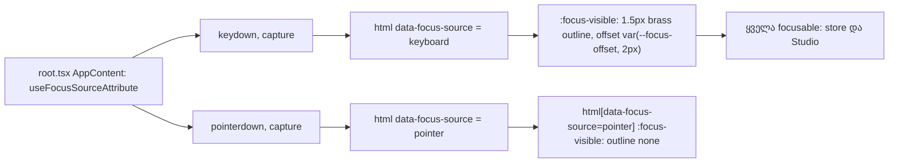

# SABA-B-4 ეტაპი 2 — ერთი focus ring მაღაზიის გვერდებზე

**თარიღი:** 2026-10-27
**სტატუსი:** In Progress (C-ის browser შემოწმებას ელოდება)
**შეცვლილი პროექტი:** Store

## კონტექსტი

საბამ (2026-10-26) მოითხოვა ერთი საერთო focus სტილი მთელ საიტზე: მხოლოდ `:focus-visible`-ზე, 1.5px brass outline (≤ 80 % opacity), 2px offset, ელემენტის საკუთარი radius-ით, layout-ის გადაადგილების გარეშე. არც შევსებული ფონი, არც სქელი pill, არც glow, და არც ring მაუსის დაჭერის შემდეგ. პირველი ეტაპი (Studio) დოკუმენტ 159-შია. ეს მეორე ეტაპია: მაღაზიის გვერდები.

მაღაზიაში დარჩენილი იყო 155 ძველი focus token 31 ფაილში (`focus-visible:ring-*`, `focus:ring-*`, `focus:border-*`, `focus:outline-none` და სხვ.). ამის გამო ბევრ ელემენტზე ორი ინდიკატორი ჩანდა ერთად (box-shadow ring და outline). ზოგიერთ CSS class-ს კი (`.audio-player-progress`, `.command-palette-input`) `outline: none` ჰქონდა და ring საერთოდ არ ჩანდა. გარდა ამისა, `html[data-focus-source]` ატრიბუტი მხოლოდ Studio-ში იწერებოდა, ამიტომ მაღაზიაში მაუსის დაჭერაც ring-ს აჩენდა.

რაუნდ 201-ში იმპლემენტაცია გაჩერდა (STOP): SfxVideoSync-ის "Choose video" ღილაკის ერთადერთი ინდიკატორი label-ის `focus-within:ring` იყო, ფოკუსი კი `opacity-0` file input-ზე ხვდებოდა. Token-ის წაშლის შემდეგ ring საერთოდ აღარ ჩანდა. B-მ ამაზე R98 გამოიტანა და დამატებით ყველა დამალული focusable ელემენტი გადაამოწმა (R99, R100).

## მიდგომა

მიღებული გადაწყვეტილებები (B, D-29z166 / D-29z167):

- **R92** — გლობალური `:focus-visible` წესი `app.css`-ში რჩება unlayered და უცვლელი. `app.css`-ში ახალი `:focus-visible` ტექსტი არ ემატება.
- **R93** — `useFocusSourceAttribute()` ერთხელ ერთვება, `root.tsx`-ის `AppContent`-ში, ყველა route-ისთვის. `StudioWorkspace.tsx`-დან ამოღებულია (import და call).
- **R94** — მაღაზიის token sweep. წაიშალა focus-variant ring, ring-offset, outline, border და bare `outline-none`. დარჩა `peer-focus:*` (Input-ის მცურავი label) და focus-ის გარეშე ring-ები (selection, დეკორატიული class-ები). შეცდომის border რჩება ძირითად `border-destructive`-ად.
- **R95** — `app.css`-ში წაიშალა 5 `outline: none` (AudioPlayer progress/volume, VideoShowcase-ის ორი slider, ⌘K input), `.sort-select:focus` და ორი გამოუყენებელი glow წესი (`.newsletter-input-large:focus`, `.glass-input:focus`).
- **R96 (C-R196-03)** — პროდუქტის ბარათის `<Link>`-ს დაემატა `block rounded-xl`.
- **R97** — inset offset `[--focus-offset:-2px]` დაშვებულია მხოლოდ გაზომვით. ამ რაუნდში **არ გამოყენებულა** (იხ. ქვემოთ, R96-ის გაზომვა).
- **R98** — SfxVideoSync "Choose video" ნამდვილ `<button type="button">`-ად იქცა, რომელიც `fileInputRef.current?.click()`-ს იძახებს. გვერდით დგას `hidden`, `tabIndex={-1}` file input, იგივე `aria-label="Choose local video"`-ით.
- **R99** — ProductCard-ის md+ hover-only overlay-ს დაემატა `focus-within:opacity-100`. ფოკუსირებული ღილაკი მხოლოდ გლობალურ outline-ს ატარებს; overlay-ის გამოჩენა ფოკუსის fill არ არის.
- **R100** — VideoShowcase არსად არ არის import-ირებული, ამიტომ კომპონენტი არ შეცვლილა. მისი ორი `outline: none` მაინც წაიშალა R95-ით.

### უარყოფილი ალტერნატივები

- **გლობალური წესის `@layer`-ში გადატანა** — უარყოფილია (R92). Unlayered წესს მომავალი `outline-none` utility ჩუმად ვერ გათიშავს, sweep-ის შემდეგ კი layer-ის რიგზე აღარაფერია დამოკიდებული.
- **SfxVideoSync, ვარიანტი (a)** — label-ზე `has-[:focus-visible]:outline …` გამონაკლისი. საჭიროებდა STF2-ის გამონაკლისს და ring-ის მნიშვნელობების მეორე ასლს.
- **ვარიანტი (b)** — input `sr-only`/`peer` და label-ზე `peer-focus-visible` წესი. ასევე საჭიროებდა STF2-ის გამონაკლისს.
- **ვარიანტი (c)** — დაკარგული ინდიკატორის Low-ად მიღება. ეს WCAG 2.4.7-ის Medium დანაკლისს ტოვებდა.
- **ვარიანტი (d)** — label-ზე `focus-within:ring-*`-ის დატოვება. ეს box-shadow ring-ია, რაც საბას წესს ("outline, არა ring") ეწინააღმდეგება.
- R98 არცერთ გამონაკლისს არ საჭიროებს, ინარჩუნებს ერთ საერთო წესს და იმავე ვიზუალს.

## არქიტექტურა

## შეცვლილი ფაილები

- `app/root.tsx` — focus-source hook-ის ერთადერთი mount.
- `app/components/arrangement/StudioWorkspace.tsx` — hook-ის import-ი და call ამოღებულია.
- `app/styles/app.css` — R95-ის წაშლები.
- `app/components/product/ProductCard.tsx` — Link-ზე `block rounded-xl` (R96), overlay-ზე `focus-within:opacity-100` (R99).
- `app/components/recordings/SfxVideoSync.tsx` — R94 token-ები და "Choose video" ღილაკი + დამალული file input (R98).
- R94-ის sweep, 26 ფაილი: `cart/GiftCardInput`, `chat/{ChatButton,ChatInput,GuestForm}`, `home/NewsletterSection`, `marketing/LeadMagnetPopup`, `product/{ProductAccordion,VersionSelector}`, `recordings/{RecordingCatalogRow,SfxQuickEdit,SfxSceneBuilder,SfxSceneExport,SfxSoundLibrary}`, `studio/{ExportDialog,VideoUploadZone}`, `ui/{Button,IconButton,Input}`, `routes/{account,cart,free-downloads,gift-cards,hire-us,recordings.$productId,scenes.$productId,store}`.
- `app/lib/__tests__/store-focus-ring.test.ts` — ახალი, სტატიკური guard-ები STF1–STF6.
- `app/lib/__tests__/sfx-video-choose-button.test.tsx` — ახალი, jsdom ტესტები SV1–SV5.

## რიცხვები (inventory)

- **Focus inventory** (`store-focus-inventory.py`): ადრე store 155 token / 31 ფაილი, studio 13 / 5. შემდეგ store 16 / 6 (8 `peer-focus:*` Input-ში, `Card.tsx` `outline` variant-ის სახელი, `ProductCard` `focus-within:opacity-100`, `StudioTrack` selection ring, `StemsLoadingAnimation` 2× `ring`, `CustomCursor` `ring`), studio 13 / 5.
- **დამალული focusable-ების სკანი** (`hidden-focusable-scan.py`): ადრე 6 ადგილი, შემდეგ 5. SfxVideoSync აღარ ჩანს. `ProductCard.tsx:132` ახლა `reveal=True`-ია. VideoShowcase, Header-ის user menu და ორი honeypot უცვლელია.
- R97-ის გამოყენება: 0.

## პრობლემები და გადაწყვეტები

- **პრობლემა:** მთავარ გვერდზე პროდუქტის ბარათის ring არ ჩანდა (C-R196-03).
  **გაზომილი მიზეზი:** `<Link>` იყო `display: inline` და შიგნით block `div` ჰქონდა. Chromium-მა ამას სამი fragment მისცა: ორი 0×0 და ერთი 320×418. Outline არცერთ მხარეს არ დაიხატა: 1280, 1440 და 375 სიგანეზე brass pixel-ების რაოდენობა 0 იყო ყველა მხარეს.
  **გადაწყვეტა:** `block rounded-xl`. Link-ის box უცვლელია (320×417.6, ±0 px), ring მიჰყვება 16px radius-ს. 1280-ზე მეორე ბარათს ring ოთხივე მხარეს აქვს.
  **დარჩენილი:** პირველ ბარათს მარცხენა მხარე კვლავ ეჭრება, რადგან carousel-ის `overflow-x: auto` კონტეინერი იწყება ბარათის კიდეზე. `[--focus-offset:-2px]` ვცადეთ, მაგრამ მაშინ ზედა მხარეს image-ის positioned `div` ფარავს (top = 0 px). ამიტომ R97 არ გამოიყენეს. Ring სამ მხარეს ჩანს (წესი "≥ 3 მხარე"). ეს წინასწარ არსებული clipping-ია.
- **პრობლემა:** token-ის წაშლის შემდეგ ზოგიერთ `cn()`-ში ცარიელი `' '` ან ბოლოში ჰარი რჩებოდა.
  **გადაწყვეტა:** ცარიელი ელემენტები წაიშალა, ჰარები მოიჭრა. GuestForm-ის ternary Biome formatter-მა ერთ ხაზზე გადაიტანა.
- **პრობლემა:** `/store`-ის sort select (`FilterBar` → `AssetListingPage`) არცერთ route-ში არ რენდერდება. ამიტომ CSS-CONTROLS-ის ეს ნაწილი browser-ში ვერ მოწმდება. CSS წესი მაინც წაიშალა, STF3 ამოწმებს.

- **code-reviewer-ის შენიშვნები (B-ს გადაეცა, ამ რაუნდში არ შეცვლილა):**
  - `Input`/`Textarea`-ის error border: base `border-outline-strong` CSS-ში `border-destructive`-ს სჯობს. Unfocused მდგომარეობაში წითელი border HEAD-ზეც არ ჩანდა; focus-ის დროს მას აქამდე `focus:border-destructive` აჩენდა, R94-მა ის წაშალა.
  - R98-ის შემდეგ "Choose video"-ზე ფაილის გადმოტანა (drag-and-drop) აღარ მუშაობს. ძველი უხილავი input ღილაკს ფარავდა და ფაილის ჩაგდებას იღებდა.
  - მაუსით ტექსტურ ველზე დაჭერის შემდეგ პირველი კლავიში outline-ს აჩენს (`keydown` → `keyboard`).

## ტესტირება

- `store-focus-ring.test.ts` (10 ტესტი) და `sfx-video-choose-button.test.tsx` (5 ტესტი) მწვანეა tree-ზე და წითელია HEAD-ის ასლზე.
- 8 mutant (m1–m8) თავის რიგს წითლად აქცევს.
- Covering ტესტები: 30 ფაილი, 357 ტესტი, მწვანე. `npm run typecheck` სუფთაა. `npm run lint`-ის 215 warning HEAD-ის ტოლია.
- Browser (Playwright, 1280×720):
  - search input, ⌘K input, ბარათის Link, Play preview და AudioPlayer slider-ები იღებენ 1px brass outline-ს, offset 2px, box-shadow-ის ring-ის გარეშე;
  - Play preview-ის effective opacity ფოკუსზე 1-ია (HEAD-ზე 0);
  - მაუსის დაჭერა: `pointer`, outline none;
  - Studio ↔ `/` client navigation-ის შემდეგ ატრიბუტი ახლდება;
  - "Choose video" harness-ში Enter, Space და მაუსი file chooser-ს ხსნის, busy მდგომარეობაში კი არა.

## TODO / შემდეგი ნაბიჯები

- B-R201-HEADER-USERMENU-KEYBOARD (Header-ის user menu კლავიატურით მიუწვდომელია). ეს ცალკე დავალებაა.
- VideoShowcase-ის hover-only კონტროლები (R100) — deferred Low.
- პირველი carousel ბარათის მარცხენა კიდის clipping — Low, ProductSection-ის padding-ის საკითხია.

## რაუნდი 203 — fix-up

**თარიღი:** 2026-10-27 · **გადაწყვეტილება:** D-29z168 · **სტატუსი:** A-მ დაასრულა, C-ის შემოწმებას ელოდება.

C-ის 202-ე რაუნდმა ორი Medium ჩავარდნა (C-R202-01, C-R202-02) და ერთი დიზაინის გადაწყვეტილება (C-R202-03) აღმოაჩინა, ასევე Low C-R202-07. ოთხივე B-ის R101–R104 rulings-ით გასწორდა.

### R101 — Input-ის error border (C-R202-01)

**Problem:** `ui/Input`-ში `error && 'border-destructive'` cascade-ში აგებდა `border-outline-strong`-თან, ამიტომ წითელი border არასდროს ჩანდა. HEAD-ზე წითელი მხოლოდ `focus:border-destructive`-ით ჩანდა, რომელიც R94-მა მოხსნა.

**Solution:** `Input`-სა და `Textarea`-ში class item შეიცვალა სტატიკური `aria-[invalid=true]:border-destructive`-ით, ხოლო ველს დაემატა `aria-invalid={error ? true : undefined}`, `{...props}`-მდე, რომ caller-ის საკუთარმა `aria-invalid`-მა გაიმარჯვოს. Attribute variant-ის specificity (0,2,0) CSS-ის რიგის მიუხედავად მეტია `border-outline-strong`-ის (0,1,0) specificity-ზე. ამასთან screen reader „invalid“ მდგომარეობას აცხადებს.

**უარყოფილი ალტერნატივა:** ternary, რომელიც `border-outline-strong`-ს `baseInputStyles`-დან ამოიღებდა. ის frozen ST8 F14-ს გააწითლებდა (L23).

### R102 — Play preview-ის ჩრდილი (C-R202-02)

**Problem:** `.audio-preview-overlay-button`-ის მუდმივი teal glow (`rgba(19, 217, 204, …)`, palette-ის გარე ნარჩენი) ring-ის მეზობელ ფერად იქცა. ზედა მხარე 2.68:1 (out) / 2.39:1 (gap) იყო.

**Solution:** rest და `:hover` მდგომარეობის ორივე ორფენიანი teal ჩრდილი შეიცვალა ერთი მუქი token-ზე დაფუძნებული ჩრდილით: `color-mix(in srgb, var(--color-background) 60%/70%, transparent)`. Hover scale, inline variant და დანარჩენი teal ფრაგმენტები (B-R202-APPCSS-TEAL-REMNANTS) უცვლელია.

**უარყოფილი ალტერნატივა:** `box-shadow: none`. ზედა მხარე მაშინ 2.78/3.04 იქნებოდა, რაც ზღვარზე დაბალია.

### R103 — ring ტექსტის აკრეფისას (C-R202-03)

**Problem:** ტექსტურ ველზე მაუსით დაწკაპების შემდეგ პირველი აკრეფილი სიმბოლო `data-focus-source`-ს `keyboard`-ზე ცვლიდა და ring აკრეფის შუაში ჩნდებოდა.

**Solution:** `focus-source.ts`-ში დაემატა `isFocusSourceFieldEditingKey(event)`. ტექსტის შესაყვან target-ზე (textarea, contenteditable, input-ის ტიპები text/search/email/password/url/tel/number), Ctrl/Meta/Alt-ის გარეშე, editing key (ერთსიმბოლოიანი `key`, Backspace, Delete, ArrowLeft/Right, Home, End, Process, Dead; მრავალხაზიან ველში ასევე Enter, ArrowUp/Down, PageUp/Down) ატრიბუტს არ ცვლის. Tab, Escape, ერთხაზიან ველში ArrowUp/Down/Enter/PageUp/PageDown, F-keys და modifier shortcuts ისევ `keyboard`-ზე გადადის. Studio-ს `isTypingTarget` არ იმპორტდება (frozen `StudioWorkspace.tsx`). დუბლირება არქიტექტურულ სიგნალად აღირიცხა.

**უარყოფილი ალტერნატივები:** B-ის პირველი ვარიანტი (მხოლოდ Tab ცვლის წყაროს) ring-ს დამალავდა, როცა Studio-ს library search-ში ArrowDown ფოკუსს პირველ შედეგზე გადაიტანს. Reviewer-ის ვარიანტი (a), ring მაუსის დაჭერისას ტექსტურ ველში, stage 1-ის STUDIO-NEIGHBOUR-ის მოთხოვნას დაარღვევდა.

**შეგნებული trade-off (Saba-ს შეუძლია veto):** დაწკაპების შემდეგ აკრეფისას ფოკუსის ინდიკატორად რჩება caret. `ui/Input`-ში ასევე label იწევს ზემოთ და brand ფერს იღებს.

**jsdom-ის შენიშვნა:** jsdom `isContentEditable`-ს არ ახორციელებს (`undefined`). ამიტომ predicate იყენებს `=== true` შედარებას, რომ ყოველთვის boolean დააბრუნოს. ტესტში fixture element-ს property ხელით აქვს მინიჭებული.

### R104 — STF2 scanner (C-R202-07, Low)

STF2 ახლა arbitrary variant-ებსაც იჭერს (`[&:focus]:`, `[&:focus-visible]:`, `[&:focus-within]:` indicator kind-ით ან bare `outline-none`/`outline-hidden`/`outline-0`-ით) და arbitrary property-ებს focus variant-ით (`focus:[outline:none]`, `focus-visible:[box-shadow:…]`, `[border…:]`, `[background:…]`). STF5-ს დაემატა 10 დასაჭერი და 2 გამტარი fixture (`[&:hover]:bg-brand`, `[&:focus]:opacity-100`).

### შეცვლილი ფაილები (რაუნდი 203)

- `app/components/ui/Input.tsx`
- `app/styles/app.css`
- `app/lib/focus-source.ts`
- `app/lib/__tests__/store-focus-ring.test.ts`
- `app/lib/__tests__/focus-source-typing.test.tsx` (ახალი, FT1–FT6)
- `app/lib/__tests__/store-focus-fixups.test.tsx` (ახალი, IE1–IE4, PB1–PB2)

### ტესტირება (რაუნდი 203)

- Covering ტესტები: 12 ფაილი, 126 ტესტი, მწვანე. `npm run typecheck` სუფთაა. `npm run lint`-ში error არ არის (214 warning).
- Mutant-ები n2–n8 (n6b და n6c-ის ჩათვლით), ასევე code review-ის შემდეგ დამატებული nL1 (`typeof key` guard) და nL4 (hex ჩრდილი), თავის რიგს წითლად აქცევს. Review-ის 4 Low შენიშვნა (keyless autofill keydown, `type`-ის გარეშე input, `slice(1)`, PB1-ის ფერის ფორმატები) ტესტებში გასწორდა. `store-header-footer.test.tsx` (9/9) მწვანეა. n1 შეგნებულად მწვანე რჩება, რადგან ფერი browser-ის რიგია.
- Browser (Playwright, `:5173`, mock `:5199`):
  - AuthModal Sign In და Sign Up, ყველა ველი, empty submit-ის შემდეგ (სამივე focus მდგომარეობა Sign In-ის email-სა და password-ზე გაიზომა): border `rgb(210, 119, 106)` unfocused, keyboard focus (+ solid brass outline, box-shadow none) და mouse focus მდგომარეობაში, `aria-invalid="true"`. submit-მდე `rgb(115, 107, 96)`, `aria-invalid` არ არის. destructive border vs ველის surface (`rgb(22, 20, 18)`) = 5.76:1, ვალიდური border = 3.50:1. 1280 და 1440.
  - Product page-ის Play preview (DSF 3, gap/out): top 3.21/3.35, bottom 6.07/5.49, left 4.58/4.70, right 5.38/5.41, 1440 და 1280. `/` ბარათი: bottom 5.45/5.12, left 4.73/4.78 (walker); top 4.14/4.02 და right 4.89/5.04 ხელით აღებული pixel-ებით. walker-ის brass classifier scrim-ით შეფერილ ring-ს ვერ ცნობს.
  - Typing (`/store` search, Studio library search): დაწკაპება, აკრეფა, edit keys და დაჭერილი key ტოვებს `pointer`-ს და outline none-ს. Escape → `keyboard` + solid. ArrowDown Studio-ში ფოკუსს პირველ შედეგზე გადაიტანს ring-ით. Tab → შემდეგი ელემენტი ring-ით. Tab-ით მიღწეული ველი აკრეფისას ring-ს ინარჩუნებს.

### TODO (რაუნდი 203)

- C-R202-04, C-R202-05, B-R201-HEADER-USERMENU-KEYBOARD — რაუნდი 204 („hidden focusables, runtime state“).
- `isFocusSourceFieldEditingKey` და Studio-ს `isTypingTarget` ტექსტური target-ის ორი ცალკე განსაზღვრებაა. გაერთიანება root-ის architecture checkpoint-ის საკითხია.
- Android-ის soft keyboard (`key === 'Unidentified'`) და IME composition (`isComposing`) წყაროს ისევ `keyboard`-ზე ცვლის (code review M1). საჭიროა B-ის ruling.
- AltGr-ით აკრეფა (Ctrl+Alt) ruling-ის მიხედვით `keyboard`-ზე გადადის. ზოგ layout-ზე სიმბოლოს აკრეფისას ring შეიძლება გამოჩნდეს.
