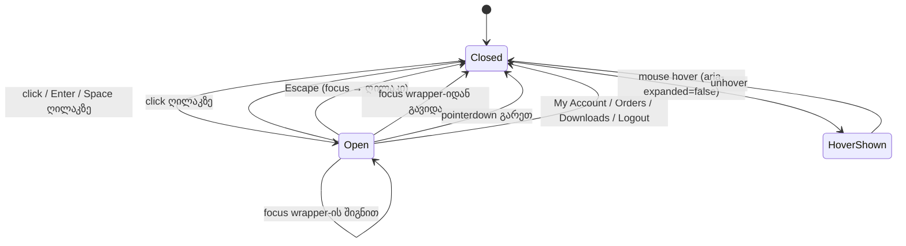
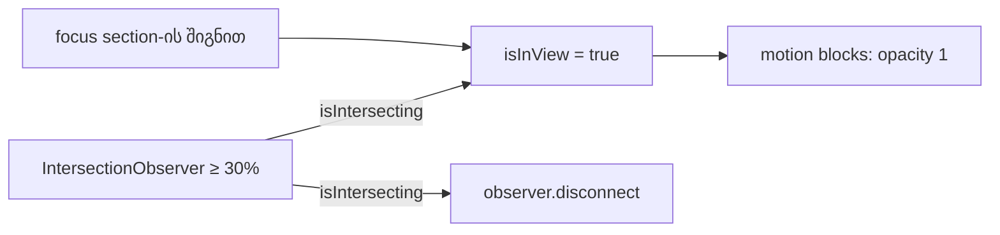

# დამალული focusable ელემენტები runtime-ში: mobile menu, user menu, StudioShowcase

**თარიღი:** 2026-10-27
**სტატუსი:** In Progress (იმპლემენტაცია დასრულდა; C-ის რაუნდი 204 PASS — `c-round-204.md`; გამოქვეყნება რაუნდ 205-თან ერთად, gate-204-ის ფიქსის შემდეგ)
**შეცვლილი პროექტი:** Store

## კონტექსტი

SABA-B-4-ის შემდეგ store-ში მოქმედებს წესი: Tab უნდა მიდიოდეს ყველა focusable ელემენტამდე და focus ring ჩანდეს. browser Tab probe-მა (B, რაუნდი 203→204) აჩვენა სამი Medium a11y ბაგი. სამივე ერთი კლასისაა: keyboard-ის მომხმარებელი ან უხილავ focusable-ზე ხვდება, ან ვერ აღწევს ელემენტამდე.

| Finding | რა გაიზომა | სად |
|---|---|---|
| **C-R202-04** | 375×812-ზე დახურული mobile menu ტოვებს 5 tab stop-ს (Collections, Studio, Free Samples, About, Sign In). ისინი 0 სიმაღლის box-შია, effective opacity 0-ით. | `Header.tsx`, mobile wrapper (`max-h-0 opacity-0 overflow-hidden`) |
| **C-R202-05** | `/`-ზე 3 წამის შემდეგ "Browse the Collection"-ის ორი stop opacity 0-ზეა: CTA link და role-ის არმქონე DIV. ასეა 1280-ზე და 375-ზე; 1440-ზე პირველ sample-ში 3-დან 1. | `StudioShowcase.tsx` |
| **B-R201-HEADER-USERMENU-KEYBOARD** | signed-in desktop user menu მხოლოდ hover-ით იხსნება. My Account, Orders, Downloads და Logout keyboard-ით მიუწვდომელია (WCAG 2.1.1). | `Header.tsx`, user menu |

## მიდგომა

### R105: mobile menu (C-R202-04)

- wrapper-ს ემატება `id="header-mobile-menu"`.
- დახურული მდგომარეობა: `max-h-0 opacity-0 invisible`. გახსნილი: `max-h-[80vh] opacity-100 visible`. დანარჩენი კლასები უცვლელია.
- "Toggle menu" ღილაკს ემატება `aria-expanded`, `aria-controls="header-mobile-menu"` და `type="button"`.
- `visibility: hidden` ბმულებს tab order-იდან და accessibility tree-დან იღებს. `transition-all`-ის დროს visibility დახურვისას transition-ის ბოლოს იცვლება, ამიტომ 300ms fade რჩება.

### R106: user menu, როგორც disclosure (B-R201-HEADER-USERMENU-KEYBOARD)

- ეს არის ღილაკი ბმულებით და არა `role="menu"`, ამიტომ arrow-key კონტრაქტი არ გვაქვს.
- state `isUserMenuOpen` თავიდან `false`-ია.
- ღილაკს აქვს `type="button"`, `aria-expanded` და `aria-controls="header-user-menu"`. click მენიუს toggle-ს უკეთებს; Enter და Space ბრაუზერიდან მოდის.
- panel-ს აქვს `id="header-user-menu"`. გახსნილზე ხილულია. დახურულზე ძველი კლასები და `group-hover:` reveal უცვლელად რჩება.
- **იხურება, როცა:**
  - focus wrapper-შია და მომხმარებელი Escape-ს აჭერს: event აღარ ვრცელდება და focus ღილაკს უბრუნდება;
  - focus wrapper-იდან გადის (`relatedTarget` გარეთაა ან `null`);
  - `pointerdown` ხდება wrapper-ის გარეთ: document listener აქტიურია მხოლოდ გახსნილ მდგომარეობაში;
  - მომხმარებელი აჭერს My Account-ს, Orders-ს ან Downloads-ს;
  - მომხმარებელი აჭერს Logout-ს: `signOut()` ერთხელ იძახება.
- wrapper-ის შიგნით focus-ის გადაადგილება (ღილაკი → ბმულები) მენიუს არ ხურავს.
- `Header.tsx`-ის ყველა `<button>`-ს მიეცა `type="button"`. Biome `useButtonType` გაფრთხილებები 6-დან 0-მდე ჩამოვიდა.

**ცნობიერი trade-off:** mouse hover ისევ აჩენს panel-ს, ხოლო `aria-expanded` `false` რჩება. Mouse-ის ქცევა არ შეცვლილა. `aria-expanded` ზუსტად აღწერს keyboard/click disclosure-ის მდგომარეობას.

### R107: StudioShowcase reveal (C-R202-05)

1. **ერთხელ reveal:** observer `isIntersecting`-ზე აყენებს `isInView = true`-ს და `disconnect()`-ს იძახებს. threshold ისევ 0.3-ია. scroll-ით გასვლა content-ს აღარ მალავს.
2. **focus-ზე reveal:** `<section>`-ის `onFocus` (React-ში bubble-ს აკეთებს) აყენებს `isInView = true`-ს. ეს არის keyboard-ის რეალური fix: section-ში focus შინაარსს აჩენს scroll-ის პოზიციის მიუხედავად.
3. **tabbable wrapper ამოღებულია:** CTA-ის გარშემო `motion.div whileHover/whileTap` წაიშალა. motion-dom-ის press gesture ასეთ target-ს `tabIndex = 0`-ს ანიჭებს (`node_modules/motion-dom/dist/es/gestures/press/index.mjs:76`), და სწორედ აქედან მოდიოდა role-ის არმქონე DIV stop. hover/press ეფექტი ახლა Link-ის Tailwind კლასებით კეთდება.

### უარყოფილი ალტერნატივები

| ალტერნატივა | რატომ უარვყავით |
|---|---|
| `inert` mobile menu-ზე | React 18-ს ტიპიზებული `inert` prop არ აქვს. დასჭირდებოდა type assertion ან string hack, რაც პროექტის წესებით აკრძალულია. |
| Conditional render (`isOpen && …`) | კლავს დახურვის ანიმაციას და არღვევს frozen ტესტებს N2/N5. |
| hover-ზე მიბმული state user menu-სთვის | hover-ით გახსნის შემდეგ click მენიუს pointer-ის ქვეშ დახურავდა. |
| hover-ის მოხსნა | ცვლის mouse-ის ქცევას, რაც არავის მოუთხოვია. |
| StudioShowcase-ის threshold-ის ცვლილება | keyboard-ის პრობლემის მიზეზი threshold არ არის. 0.3 ვიზუალური ცვლილების მინიმიზაციისთვის დარჩა; 375-ზე scroll reveal HEAD-ზეც მუშაობს. |

## არქიტექტურა

## შეცვლილი ფაილები

| ფაილი | დანიშნულება |
|---|---|
| `app/components/layout/Header.tsx` | R105 (mobile menu: `invisible`, id, `aria-expanded`/`aria-controls`) და R106 (user menu disclosure, `type="button"` ყველა ღილაკზე) |
| `app/components/home/StudioShowcase.tsx` | R107 (ერთხელ reveal, `onFocus` reveal, tabbable wrapper-ის ამოღება) |
| `app/lib/__tests__/store-hidden-focusables.test.tsx` | ახალი jsdom ტესტები HF1–HF9, HF6b და HF8b |
| `docs/implementation/2026/quarter-IV/161-hidden-focusables-runtime.md` | ეს დოკუმენტი |

## პრობლემები და გადაწყვეტები

**პრობლემა:** R107-ში ჩაწერილი `transition-[background-color,transform] hover:scale-105 active:scale-[0.98]` browser-ში hover-ის scale-ს არ ანიმირებს. 40ms-ზე `scale` უკვე 1.05-ია.
- **პირველი მიზეზი:** `app/styles/app.css:307`-ზე global unlayered წესი `a, button, … { transition: color, background-color, border-color, box-shadow, transform, opacity }` Tailwind-ის layered `transition-*` კლასს ყოველთვის ფარავს.
- **მეორე მიზეზი:** Tailwind v4-ის `scale-*` ცალკე `scale` CSS property-ს წერს და არა `transform`-ს, global სია კი `scale`-ს არ შეიცავს.
- **გადაწყვეტა (deviation R107-იდან, B-ს შეუძლია veto):** `hover:[transform:scale(1.05)] active:[transform:scale(0.98)]` (Tailwind arbitrary property, custom CSS-ის გარეშე).
- **გაზომვა:** hover-იდან 40ms-ზე `matrix(1.00884…)`, 340ms-ზე `matrix(1.05…)`, press-ზე `matrix(0.98…)`.
- **B-ის გადაწყვეტილება (რაუნდი 205, D-29z170):** DEVIATION 1 მიღებულია. C-მ დამოუკიდებლად დაადასტურა, რომ ruling-ის ფორმა global transition წესის გამო ხტება.
- **შენიშვნა:** `transition-[background-color,transform] duration-200` ruling-ის მიხედვით დარჩა, მაგრამ global წესის გამო ეფექტი არ აქვს. `app.css` ამ რაუნდში frozen-ია.

**პრობლემა:** user menu-ს Escape-ის handler-მა keydown-ის propagation არ უნდა შეაჩეროს, როცა მენიუ დახურულია.
- **გადაწყვეტა:** Escape მუშავდება მხოლოდ გახსნილ მდგომარეობაში. დახურულზე keydown ჩვეულებრივ ვრცელდება.

## ტესტირება

- **jsdom (`store-hidden-focusables.test.tsx`, HF1–HF9 + HF6b + HF8b):**
  - mobile toggle-ის `aria-expanded`/`aria-controls`;
  - user menu-ს toggle, Escape + refocus + stopPropagation, focusout შიგნით/გარეთ/`null`, pointerdown გარეთ/შიგნით, ბმულზე click და Logout (`signOut` ×1);
  - ყველა ღილაკის `type="button"`;
  - StudioShowcase: `tabindex` არ არის, CTA-ს ერთი stop, threshold 0.3, ერთხელ reveal (`disconnect`; HF8b — intersect-ის შემდეგ opacity 1 და გასვლისას აღარ იმალება) და focus-ზე reveal (`MotionGlobalConfig.skipAnimations`).
  - **HF6b:** user menu იხურება, როცა `isAuthenticated` false ხდება (token-ის ვადა, სხვა tab-ში logout), რომ ხელახალ login-ზე panel ღია არ დარჩეს (code-reviewer-ის Low). ტესტი ხსნის მენიუს, `isAuthenticated`-ს ჯერ `false`-ზე, მერე `true`-ზე ცვლის და ყოველ ჯერზე ახალი element-ით აკეთებს `rerender`-ს; ბოლოს ახალი "User menu" ღილაკის `aria-expanded` არის `false`. დაემატა რაუნდ 205-ში (GATE204-B1).
- **start copy-ზე** (HEAD-ის grants + ახალი ტესტი) 9-ვე row წითელია.
- **Mutants m1–m10** scratch copy-ზე: m1 (`invisible`-ის მოხსნა) jsdom-ში მწვანეა და მხოლოდ browser-ში ჩანს. დანარჩენი 9 თავის row-ს აწითლებს.
- **რაუნდი 205, HF6b:** start copy-ზე მწვანეა, რადგან რაუნდი 204-ის `Header.tsx`-ს effect უკვე აქვს. მისი red-proof არის **m11**: scratch `Header.tsx`-იდან `isAuthenticated` effect-ის წაშლა → HF6b წითელია (1 failed). HF1–HF9 და HF8b უცვლელია.
- **Browser (Playwright, :5173 + mock :5199):**
  - Tab probe 375/1280/1440-ზე, 5 გვერდზე;
  - signed-in user menu-ს probe 1280-ზე: Enter/Space, Tab-ის რიგი My Account → Orders → Downloads → Logout, Escape, hover. შედეგი ემთხვევა B-ის scratch-ის შედეგს.
- **B-ის probe-ის რიცხვები** (planning, HEAD → scratch):
  - `/`-ის stop-ები: 375-ზე 42 → 36, 1280-ზე 41 → 40, 1440-ზე 41 → 40;
  - `/store` 375-ზე: 18 → 13;
  - დამალული stop-ები: HEAD-ზე C-R202-04 (5) და C-R202-05 (2), scratch-ზე 0.

## TODO / შემდეგი ნაბიჯები

- **B-R203-LEADMAGNET-AUTO-OPEN-FOCUS (Medium) — რაუნდ 205-ში გაკეთდა, იხ. `162-lead-magnet-dialog-focus.md`. საწყისი აღწერა:**
  - `/`-ზე 40%-იანი scroll-ის შემდეგ, ჩატვირთვიდან 8 წამში, "FREE DOWNLOAD" popup ავტომატურად იხსნება.
  - `useScrollLock` body-ს აფიქსირებს, ამიტომ `scrollY` 0-ზე ბრუნდება.
  - popup-ს არ აქვს `role="dialog"`/`aria-modal`, Escape და საწყისი focus, ხოლო Tab გვერდზე რჩება.
  - Owner: `LeadMagnetPopup.tsx`. ეს keep-list-ის კონტენტია: ემატება მხოლოდ semantics და focus, ტექსტი არ იცვლება.
- **B-R203-USERMENU-HOVER-ESCAPE (Low, deferred):** hover-ით ნაჩვენებ panel-ს Escape-ით დახურვა არ აქვს (WCAG 1.4.13). ეს ხარვეზი ამ რაუნდამდეც არსებობდა.
- **B-R203-E2E-RESPONSIVE-CLOSED-ASSERT (Low, deferred):** `e2e/responsive.spec.ts:80` დახურულ 0 სიმაღლის container-ზე `toBeVisible()`-ს ამოწმებს. ეს assertion HEAD-ზეც ჩავარდნილია.
- **B-ისთვის:** global `a, button { transition }` წესი (`app.css:307`, `utilities.css:7`) ფარავს ყველა Tailwind `transition-*` კლასს ბმულებსა და ღილაკებზე, და მის სიაში `scale`/`translate` არ არის. ეს არის store-wide სიგნალი, ამ რაუნდის ownership-ის გარეთ.
- **code-reviewer-ის Low-ები (gate 204, B-ის რაუნდი 205-ის ruling — `deferred_low_polish`):**
  - **C-R204-02** (Suggestion 1): `relatedTarget === null`-ზე მენიუ მაშინვე იხურება; Safari/iOS tap-ზე რისკი. `Header.tsx` რაუნდ 205-ში frozen-ია.
  - **GATE204-S3** (Suggestion 3): CTA-ის `transition-[background-color,transform]` global წესის გამო არაფერს აკეთებს; `motion-reduce` ვარიანტი არ არის.
  - **GATE204-S4** (Suggestion 4): HF8b-ში რეალური `setTimeout(50)`. რაუნდ 205-ში არჩევითი იყო და არ შეცვლილა (HF8b უცვლელია).
  - **GATE204-S5** (Suggestion 5): focus-ით reveal-ის შემდეგ observer მხოლოდ შემდეგ intersection-ზე ითიშება.
  - Suggestion 2 (Logout/ბმულების `onClick`) root-ის commit message-ის შენიშვნაა და არა TODO.
