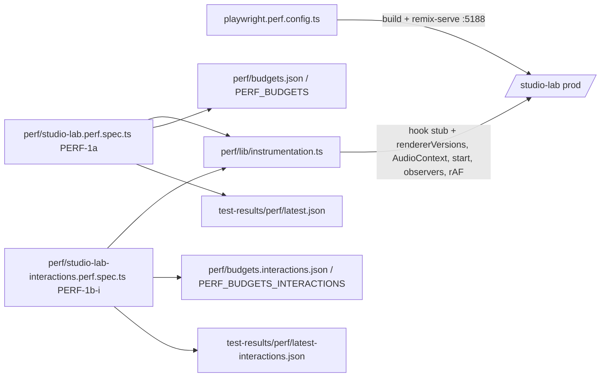

# Studio-ს interaction baseline-ები (PERF-1b-i): drag-ები, clip click, zoom, play/pause

**თარიღი:** 2026-10-27
**სტატუსი:** In Progress (C round 214 check pending)
**შეცვლილი პროექტი:** Store (მხოლოდ სატესტო ინფრასტრუქტურა და docs; `app/` არ შეცვლილა)

## კონტექსტი

SABA-B-5-ის მოთხოვნაა: "B checks the other continuous drags (fade handles, clip gain, range, trim) with the same harness and lists the ones that need the same treatment as PERF tasks". PERF-1a (doc 163) fader-ებს ზომავს. PERF-1b ორად გაიყო (D-29z206): PERF-1b-i (ეს რაუნდი) ზომავს interaction სცენარებს, PERF-1b-ii (round 216) კი export-ს, bytes-ს, DOM-სა და memory-ს. PERF-1a უკვე 525 s-ს იღებს 15 წუთიანი limit-იდან, ამიტომ ახალი სცენარები ცალკე spec-ში წავიდა.

## მიდგომა

- **ცალკე, თვითკმარი spec** (D-29z207, tech-lead): `perf/studio-lab-interactions.perf.spec.ts`, ერთი ტესტი `studio-lab perf harness PERF-1b-i`. PERF-1a-ის მცირე pure helper-ები (`snapshot`, `waitForQuiet`, `startTasks`, `setPlayback`/`isPlaying`, `blurActive`, move-to-paint-ის p95 და `buildReport`-ის median/determinism ლოგიკა) გადმოკოპირდა. `perf/lib/`-ში refactor ამ რაუნდში არ გაკეთდა (PERF-HARNESS-SHARED-LIB სიგნალი).
- **ცალკე budget-ები და შედეგები.** `perf/budgets.interactions.json` (144 სტრიქონი, ყველა id `interact.`-ით იწყება), იტვირთება არსებული `loadPerfBudgets`-ით; override: `PERF_BUDGETS_INTERACTIONS`. შედეგები: `test-results/perf/perf-1b-i-<ISO>.json` და `test-results/perf/latest-interactions.json`, `harness: 'PERF-1b-i'`. PERF-1a-ის `latest.json` ახალ spec-ს არ ეხება. ორი წესი იგივეა: "measured row without a budget row" და "row not measured N times".
- **Row design (D-29z174 ნიმუში).** ყველა ახალი მეტრიკა `record`-ია. `assert` მხოლოდ liveness და setup სტრიქონებია. interaction-ის ბიუჯეტების assert-ები იმ PERF ფიქსებთან ერთად მოვა, რომლებიც შესაბამის interaction-ს ფლობენ.
- **Pass-ები.** `cpuRates [1, 6]`, 3 pass თითო rate-ზე. თითო pass არის ერთი ახალი browser context, 1440×900 (`newContext({ viewport })`; `innerWidths` report-ში = 1440). Throttle ირთვება Add-ის შემდეგ, როგორც PERF-1a-ში. 30 clip-იანი ბლოკი და load სტრიქონები მხოლოდ 1×-ზეა. 2–7 ნაბიჯები ორივე rate-ზე იზომება, 6×-ის id-ს აქვს `.6x` სუფიქსი (ყველა მეტრიკაზე, wall-clock-ის ჩათვლით; 1×-ზე სუფიქსი არ არის).
- **Drag-ები.** `dragSteps = 60`, +120 px მარჯვნივ. drag ორ ნახევრად სრულდება (30 + 30 step): შუაში და ბოლოს, `mouse.up`-მდე, liveness-ისთვის იკითხება clip-ის მდგომარეობა. grab point `document.elementFromPoint`-ით მოწმდება: წერტილი და (range/move-ზე) +120 px წერტილიც უნდა ეკუთვნოდეს target-ს და viewport-ში იყოს. styling class-ის selector არ გამოიყენება (L12).

### Pass-ის თანმიმდევრობა

1. მხოლოდ 1×: `/studio-lab` → ready (`interact.load.ready-ms`), ბიბლიოთეკის Add; ველოდებით clip-ს, მის waveform-ს და "სიჩუმეს" (`interact.harness.hook-live`). fixed wait არ არის.
2. 6×-ზე throttle ირთვება.
3. clip click (`interact.click.*`, `interact.harness.click-live`).
4. zoom 1 clip-ით: 5 × `=` და 5 × `-`, თითო key თავისი ფანჯრით (`interact.zoom.1.*`, `interact.harness.zoom-live`).
5. ოთხი drag, stopped: range, fade-in, trim start, move; ყოველის შემდეგ reset.
6. Home (seek 0), შემდეგ Space → playing (`interact.play.start-*`, 1×: `interact.harness.audio-running`).
7. ოთხი drag, playing; ყოველის წინ Home (seek 0), რომ Follow-მა timeline არ გადაახვიოს და playhead clip-ის შიგნით დარჩეს.
8. Space → stopped (`interact.play.stop-*`).
9. მხოლოდ 1×: clip-ის header click, Ctrl+D × 29 (`interact.harness.clips-30`), zoom 30 clip-ით (`interact.zoom.30.*`), Space, Home, fade-in drag პირველ clip-ზე (`interact.drag.fade.30.playing.*`), Space.

ზუსტი სია JSON-ის `sequence` ველშია.

### Reset-ის მეთოდი

- **fade, trim, move:** Ctrl+Z (focus blur-ის შემდეგ), მაგრამ **მხოლოდ მაშინ, თუ Undo ღილაკის `title` drag-ის შემდეგ შეიცვალა**. ასე drag, რომელმაც history entry არ შექმნა, სხვა (მაგ. Add-ის) entry-ს ვერ გააუქმებს.
- **range:** Escape range-ს არ ასუფთავებს (probe-ით შემოწმდა). ამიტომ range body-ზე იმავე grab point-ზე უმოძრაო click კეთდება: `finishGesture` range-ს ასუფთავებს და playhead-ს იქ გადაიტანს (`ArrangementClip.tsx` ~l.730).
- **Reset-ის შემოწმება:** `data-clip-start`, `data-fade-in` და clip-ის width drag-მდელ მნიშვნელობებს უბრუნდება, `[data-range-start]` ელემენტი 0-ია, clip-ში range label აღარ ჩანს, Undo-ს `title` კი drag-მდელ entry-ზე დაბრუნდა. დარღვევა pass-ს აგდებს ("reset failed").

### Liveness-ის წესები

| სტრიქონი | წესი |
|---|---|
| `interact.harness.click-live` | Add-ის შემდეგ `Clip Gain — fader` enabled-ია (დამატებული clip არჩეულია); Stems ხაზის ცარიელ ადგილზე click მონიშვნას ხსნის, fader disabled ხდება (`StudioWorkspace.tsx` ~l.1727); clip header-ზე click-ის შემდეგ ისევ enabled-ია და ზუსტად 1 fader არსებობს |
| `interact.harness.zoom-live`, `interact.harness.zoom-30-live` | `Zoom (px/s)` slider-ის მნიშვნელობა ყოველ `=`-ზე იზრდება, ყოველ `-`-ზე კლებულობს და ბოლოს საწყისს უბრუნდება (678 → 851 → 678) |
| `interact.harness.drag-range-live` | clip-ის range label-ის ბოლო დრო შუაში და ბოლოს არსებობს და იზრდება |
| `interact.harness.drag-fade-live`, `interact.harness.drag-fade-30-live` | `data-fade-in` იზრდება დასაწყისიდან შუამდე და შუიდან ბოლომდე |
| `interact.harness.drag-trim-live`, `interact.harness.drag-move-live` | `data-clip-start` იცვლება დასაწყისიდან შუამდე და შუიდან ბოლომდე |
| `interact.harness.audio-running` | Play label = Pause, tracked context = `running` და Space-იდან "სიჩუმემდე" ≥ 1 `start()` (GATE206-S6-ის იგივე წესი) |
| `interact.harness.clips-30` | Ctrl+D-ის ყოველი დაჭერის შემდეგ clip-ების რაოდენობა = დაჭერა + 1; ბოლოს 30 და 30 განსხვავებული `data-clip-start` |

drag-ის liveness სტრიქონი 1 მხოლოდ მაშინაა, როცა stopped და playing ორივე ცოცხალია. 0 liveness ასევე failure-ს წერს.

### DEVIATION — needs B ruling: `interact.harness.drag-range-live` signal

task ითხოვდა: "`[data-range-end]` exists and changes during the drag". clip body-ის range gesture `allTracks`-ს არ აყენებს, `data-range-start`/`data-range-end` კი მხოლოდ all-tracks range-ის overlay-ზე იხატება (`ArrangementLane.tsx` l.1016–1026, `range?.allTracks`). probe-მა (dev server, 1440×900) აჩვენა: drag-ის შემდეგ clip-ში ჩანს `00:07.525 – 00:10.525 · 3.000 s`, "Zoom to the time selection (Z)" აქტიურია, `[data-range-start]` კი 0-ია. ამიტომ liveness-ის სიგნალია clip-ის range label-ის ბოლო დრო (text selector, L12-ით დაშვებული). თუ range all-tracks გახდება, clip-ის label ქრება და row ვარდება. reset-ის შემოწმება `[data-range-start]` = 0-ს კვლავ ამოწმებს, დამატებით კი label-ის გაქრობას.

### DEVIATION (მცირე): `interact.harness.click-live`

task ითხოვდა: "after the click, the `Clip Gain — fader` slider count is 1". fader ყოველთვის იხატება (მონიშვნის გარეშე disabled-ია, `ArrangementDetailPanel.tsx` ~l.705), ამიტომ count მონიშვნას ვერ ამტკიცებს. სიგნალია enabled → disabled (ცარიელი ხაზის click) → enabled (clip click); count = 1 დამატებით მოწმდება.

## არქიტექტურა

## მეტრიკები

| მეტრიკა | განმარტება |
|---|---|
| `commits-per-move` | move-ის ფანჯრის commit-ები ÷ ფანჯრის pointermove-ები. ფანჯარა იწყება in-page pointerdown-ის შემდეგ პირველ move-ზე და მთავრდება in-page pointerup-ზე (PERF-1a-ის `move-components-*`-ის ფანჯარა). PERF-1a-ის `commits-per-move`-ისგან განსხვავებით settle-ს არ შეიცავს |
| `move-components-per-move`, `move-components-max` | ფანჯრის rendered კომპონენტების ჯამი ÷ move-ები; ერთი commit-ის მაქსიმუმი. per-commit მედიანა არ გამოიყენება (probe-ით bimodal-ია) |
| `release-commits` | commit-ები pointerup-იდან "სიჩუმემდე" (მინ. 600 ms, შემდეგ 200 ms commit/`start()`-ის გარეშე, მაქს. 3 s) |
| `move-restarts`, `release-restarts` | `start()` გამოძახებები (non-offline) move-ის ფანჯარაში და pointerup-იდან "სიჩუმემდე"; detail აჯგუფებს task-ებად |
| `move-to-paint-p95` | PERF-1a-ის sampler, pointerup-მდე; wall-clock, ტრენდი (±30 %) |
| `interact.click.commits`, `.components` | click-იდან "სიჩუმემდე"; components = ჯამი, detail-ში per-commit ზომები |
| `interact.click.event-duration-max` | ყველაზე გრძელი Event Timing entry (≥ 16 ms) ფანჯარაში; თუ არ არის, ყველაზე გრძელი LoAF; არც ერთის შემთხვევაში 0. detail.source ასახელებს წყაროს. wall-clock |
| `commits-per-key`, `components-per-key`, `components-max` | 10 key-ის ფანჯრის ჯამი ÷ 10; ერთი commit-ის მაქსიმუმი. key-ის ფანჯარა: დაჭერიდან "სიჩუმემდე" (მინ. 300 ms) |
| `key-window-longest-ms` | ყველაზე გრძელი დრო key-ის დაჭერიდან (page-ის `performance.now()` დაჭერამდე) მისი ფანჯრის ბოლო commit-მდე; detail.longestLoafMs. wall-clock |
| `interact.play.start-*`, `interact.play.stop-*` | Space-იდან "სიჩუმემდე" (მინ. 1 s): commit-ები, კომპონენტების ჯამი, `start()`-ები |

**Determinism.** commit-ისა და კომპონენტის რაოდენობები (`interactionDeterminismMetrics`) სამ pass-ში ±10 %-ით ან ±2-ით (რომელიც მეტია) უნდა თანხვდეს, თორემ run ვარდება "nondeterministic count"-ით. A-ის ორ run-ში ყველა deterministic სტრიქონის ყველა sample ერთნაირი იყო, ამიტომ არცერთი სტრიქონი ამ სიმრავლიდან არ ამოვარდა. **ზღვარი (code-review M2):** ±2-იანი ტოლერანსი ratio სტრიქონებს (`commits-per-move` ≈ 1–2, `commits-per-key` = 1, მცირე restart-ები) პრაქტიკულად ვერ აგდებს. PERF-1a-საც იგივე სისუსტე აქვს. ეს PERF-HARNESS-SHARED-LIB-ისთვის რჩება. 1×/6×-ის cross-rate შემოწმება ამ spec-ში არ არის (task არ ითხოვდა). ცხრილში 1×/6× component რიცხვები მაინც ერთნაირია, `commits-per-move` კი fade-ზე 1 / 0.983-ია.

## შედეგები (A, round 214: ორი საბოლოო run, საბოლოო tree)

run 1: `durationMs` 313989 (5.2 min), run 2: 299362 (5.0 min); ორივე exit 0, `complete: true`, `failures: []`, `reactRenderer` 18.3.1. სრული ცხრილი (1× / 6× მედიანები, run 1 / run 2):

| row | 1× median (run 1 / run 2) | 6× median (run 1 / run 2) | samples run 1 (1×) |
|---|---|---|---|
| `interact.load.ready-ms` | 911 / 909 | — | [953, 911, 878] |
| `interact.harness.hook-live` | 2 / 2 | — | [2, 2, 2] |
| `interact.harness.audio-running` | 1 / 1 | — | [1, 1, 1] |
| `interact.harness.click-live` | 1 / 1 | 1 / 1 | [1, 1, 1] |
| `interact.click.commits` | 3 / 3 | 3 / 3 | [3, 3, 3] |
| `interact.click.components` | 102 / 102 | 102 / 102 | [102, 102, 102] |
| `interact.click.event-duration-max` | 16 / 24 | 88 / 88 | [24, 16, 16] |
| `interact.harness.zoom-live` | 1 / 1 | 1 / 1 | [1, 1, 1] |
| `interact.zoom.1.commits-per-key` | 1 / 1 | 1 / 1 | [1, 1, 1] |
| `interact.zoom.1.components-per-key` | 95 / 95 | 95 / 95 | [95, 95, 95] |
| `interact.zoom.1.components-max` | 95 / 95 | 95 / 95 | [95, 95, 95] |
| `interact.zoom.1.key-window-longest-ms` | 13.7 / 13.1 | 91.6 / 79.1 | [12.8, 13.7, 13.8] |
| `interact.harness.drag-range-live` | 1 / 1 | 1 / 1 | [1, 1, 1] |
| `interact.drag.range.stopped.commits-per-move` | 1.983 / 1.983 | 1.983 / 1.983 | [1.983, 1.983, 1.983] |
| `interact.drag.range.stopped.move-components-per-move` | 101.283 / 101.283 | 101.283 / 101.283 | [101.283, 101.283, 101.283] |
| `interact.drag.range.stopped.move-components-max` | 98 / 98 | 98 / 98 | [98, 98, 98] |
| `interact.drag.range.stopped.release-commits` | 1 / 1 | 1 / 1 | [1, 1, 1] |
| `interact.drag.range.stopped.move-to-paint-p95` | 5.3 / 4.8 | 39.5 / 37 | [4.8, 5.3, 5.6] |
| `interact.drag.range.playing.commits-per-move` | 1.983 / 1.983 | 1.983 / 1.983 | [1.983, 1.983, 1.983] |
| `interact.drag.range.playing.move-components-per-move` | 101.283 / 101.283 | 101.283 / 101.283 | [101.283, 101.283, 101.283] |
| `interact.drag.range.playing.move-components-max` | 98 / 98 | 98 / 98 | [98, 98, 98] |
| `interact.drag.range.playing.release-commits` | 1 / 1 | 1 / 1 | [1, 1, 1] |
| `interact.drag.range.playing.move-to-paint-p95` | 6.5 / 6.4 | 43.7 / 96.7 | [5.9, 6.5, 6.6] |
| `interact.drag.range.playing.move-restarts` | 0 / 0 | 0 / 0 | [0, 0, 0] |
| `interact.drag.range.playing.release-restarts` | 0 / 0 | 0 / 0 | [0, 0, 0] |
| `interact.harness.drag-fade-live` | 1 / 1 | 1 / 1 | [1, 1, 1] |
| `interact.drag.fade.stopped.commits-per-move` | 1 / 1 | 0.983 / 0.983 | [1, 1, 1] |
| `interact.drag.fade.stopped.move-components-per-move` | 96.367 / 96.367 | 96.367 / 96.367 | [96.367, 96.367, 96.367] |
| `interact.drag.fade.stopped.move-components-max` | 98 / 98 | 98 / 98 | [98, 98, 98] |
| `interact.drag.fade.stopped.release-commits` | 1 / 1 | 1 / 1 | [1, 1, 1] |
| `interact.drag.fade.stopped.move-to-paint-p95` | 4.5 / 4.5 | 36.1 / 32.8 | [3.9, 4.5, 4.8] |
| `interact.drag.fade.playing.commits-per-move` | 1 / 1 | 0.983 / 0.983 | [1, 1, 1] |
| `interact.drag.fade.playing.move-components-per-move` | 96.367 / 96.367 | 96.367 / 96.367 | [96.367, 96.367, 96.367] |
| `interact.drag.fade.playing.move-components-max` | 98 / 98 | 98 / 98 | [98, 98, 98] |
| `interact.drag.fade.playing.release-commits` | 1 / 1 | 1 / 1 | [1, 1, 1] |
| `interact.drag.fade.playing.move-to-paint-p95` | 5.9 / 6 | 40.8 / 81.8 | [5.5, 5.9, 7.3] |
| `interact.drag.fade.playing.move-restarts` | 0 / 0 | 0 / 0 | [0, 0, 0] |
| `interact.drag.fade.playing.release-restarts` | 1 / 1 | 1 / 1 | [1, 1, 1] |
| `interact.harness.drag-trim-live` | 1 / 1 | 1 / 1 | [1, 1, 1] |
| `interact.drag.trim.stopped.commits-per-move` | 1.967 / 1.967 | 1.967 / 1.967 | [1.967, 1.967, 1.967] |
| `interact.drag.trim.stopped.move-components-per-move` | 101.283 / 101.283 | 101.283 / 101.283 | [101.283, 101.283, 101.283] |
| `interact.drag.trim.stopped.move-components-max` | 98 / 98 | 98 / 98 | [98, 98, 98] |
| `interact.drag.trim.stopped.release-commits` | 1 / 1 | 1 / 1 | [1, 1, 1] |
| `interact.drag.trim.stopped.move-to-paint-p95` | 7.6 / 7 | 57.5 / 50.4 | [7.6, 7.2, 7.8] |
| `interact.drag.trim.playing.commits-per-move` | 1.967 / 1.967 | 1.967 / 1.967 | [1.967, 1.967, 1.967] |
| `interact.drag.trim.playing.move-components-per-move` | 101.283 / 101.283 | 101.283 / 101.283 | [101.283, 101.283, 101.283] |
| `interact.drag.trim.playing.move-components-max` | 98 / 98 | 98 / 98 | [98, 98, 98] |
| `interact.drag.trim.playing.release-commits` | 1 / 1 | 1 / 1 | [1, 1, 1] |
| `interact.drag.trim.playing.move-to-paint-p95` | 8.6 / 8.8 | 56.9 / 105.6 | [8.6, 8.5, 8.7] |
| `interact.drag.trim.playing.move-restarts` | 0 / 0 | 0 / 0 | [0, 0, 0] |
| `interact.drag.trim.playing.release-restarts` | 1 / 1 | 1 / 1 | [1, 1, 1] |
| `interact.harness.drag-move-live` | 1 / 1 | 1 / 1 | [1, 1, 1] |
| `interact.drag.move.stopped.commits-per-move` | 1.967 / 1.967 | 1.967 / 1.967 | [1.967, 1.967, 1.967] |
| `interact.drag.move.stopped.move-components-per-move` | 101.383 / 101.383 | 101.383 / 101.383 | [101.383, 101.383, 101.383] |
| `interact.drag.move.stopped.move-components-max` | 100 / 100 | 100 / 100 | [100, 100, 100] |
| `interact.drag.move.stopped.release-commits` | 1 / 1 | 1 / 1 | [1, 1, 1] |
| `interact.drag.move.stopped.move-to-paint-p95` | 6.4 / 6 | 44.1 / 39.5 | [5.7, 8.1, 6.4] |
| `interact.drag.move.playing.commits-per-move` | 1.967 / 1.967 | 1.967 / 1.967 | [1.967, 1.967, 1.967] |
| `interact.drag.move.playing.move-components-per-move` | 101.383 / 101.383 | 101.383 / 101.383 | [101.383, 101.383, 101.383] |
| `interact.drag.move.playing.move-components-max` | 100 / 100 | 100 / 100 | [100, 100, 100] |
| `interact.drag.move.playing.release-commits` | 1 / 1 | 1 / 1 | [1, 1, 1] |
| `interact.drag.move.playing.move-to-paint-p95` | 8.4 / 8.2 | 68.2 / 102.9 | [8.4, 8.1, 8.7] |
| `interact.drag.move.playing.move-restarts` | 0 / 0 | 0 / 0 | [0, 0, 0] |
| `interact.drag.move.playing.release-restarts` | 1 / 1 | 1 / 1 | [1, 1, 1] |
| `interact.play.start-commits` | 1 / 1 | 1 / 1 | [1, 1, 1] |
| `interact.play.start-components` | 87 / 87 | 87 / 87 | [87, 87, 87] |
| `interact.play.start-sources` | 1 / 1 | 1 / 1 | [1, 1, 1] |
| `interact.play.stop-commits` | 1 / 1 | 1 / 1 | [1, 1, 1] |
| `interact.play.stop-components` | 87 / 87 | 87 / 87 | [87, 87, 87] |
| `interact.harness.clips-30` | 30 / 30 | — | [30, 30, 30] |
| `interact.harness.zoom-30-live` | 1 / 1 | — | [1, 1, 1] |
| `interact.zoom.30.commits-per-key` | 1 / 1 | — | [1, 1, 1] |
| `interact.zoom.30.components-per-key` | 240 / 240 | — | [240, 240, 240] |
| `interact.zoom.30.components-max` | 240 / 240 | — | [240, 240, 240] |
| `interact.zoom.30.key-window-longest-ms` | 110.3 / 103.6 | — | [98.5, 110.3, 113.1] |
| `interact.harness.drag-fade-30-live` | 1 / 1 | — | [1, 1, 1] |
| `interact.drag.fade.30.playing.move-components-per-move` | 96.367 / 96.367 | — | [96.367, 96.367, 96.367] |
| `interact.drag.fade.30.playing.release-restarts` | 30 / 30 | — | [30, 30, 30] |

wall-clock სტრიქონები (`*.move-to-paint-p95`, `*.key-window-longest-ms`, `interact.click.event-duration-max`, `interact.load.ready-ms`) ტრენდია და run-ებს შორის იცვლება. მაგალითად `interact.drag.range.playing.move-to-paint-p95.6x` 43.7 / 96.7 ms-ია, ამიტომ assert-ად არ გამოდგება.

## PERF candidates

B-ისთვის წინადადებაა; B round 216-ის დაგეგმვისას გადაწყვეტს. ჩემით task არ გამიხსნია. რიცხვები production build-ის 1× მედიანებია (6×-ზე კომპონენტები იგივეა). restart-ები playing მდგომარეობაშია.

| სცენარი | კომპონენტი / move (key, click) | restarts / move | restarts release-ზე | ვერდიქტი | preview path |
|---|---|---|---|---|---|
| range body drag | 101.283 (`interact.drag.range.stopped.move-components-per-move`), 1.983 commit / move | 0 | 0 | **Same treatment as the faders** | `ArrangementClip.tsx:687` `setTimeRange({...})` → `ArrangementContext.tsx:1572` `setTimeRange` → `:739` `setRange` → `setRangeState`: ყოველ move-ზე ახალი range object და provider-ის re-render |
| fade-in handle drag | 96.367, 1 commit / move | 0 | 1 (1 clip), **30 (30 clip, `interact.drag.fade.30.playing.release-restarts`)** | **Same treatment as the faders + commit restart** | `ArrangementClip.tsx:503` `previewArrangement(next)` → `ArrangementContext.tsx:1588` `previewArrangement` → `updateHistory` (ყოველ move-ზე ახალი `present`); release-ზე commit → graph rebuild → ყველა clip-ის restart |
| trim start drag | 101.283, 1.967 commit / move | 0 | 1 (1 clip) | **Same treatment as the faders + commit restart** (30 clip-ზე არ გაზომილა; release-ის გზა fade-ის commit-ის იგივეა, ეს დასკვნაა) | `ArrangementClip.tsx:674` `previewArrangement(next)` → `ArrangementContext.tsx:1588` |
| clip move drag | 101.383, 1.967 commit / move | 0 | 1 (1 clip) | **Same treatment as the faders + commit restart** (30 clip-ზე არ გაზომილა; დასკვნა) | `ArrangementClip.tsx:634` `previewArrangement(next)` → `ArrangementContext.tsx:1588` |
| fade-in drag, 30 clips | 96.367 (`interact.drag.fade.30.playing.move-components-per-move`) | — | 30 | **Commit restart**: release-ზე 30-ვე clip restart-დება; კანდიდატი: მხოლოდ შეცვლილი clip-ის reschedule | იგივე, რაც fade-ზე |
| zoom key (`=` / `-`) | 95 / key (1 clip), **240 / key (30 clip)**, 1 commit / key; `interact.zoom.30.key-window-longest-ms` ≈ 98–113 ms 1×-ზე | — | — | **ok** key-ისთვის (დისკრეტული, 1 commit). კომპონენტები clip-ების რაოდენობასთან ერთად იზრდება; Ctrl+wheel zoom უწყვეტია და ცალკე გაზომვას იმსახურებს (ჰიპოთეზა, არ გაზომილა) | `StudioWorkspace.tsx:1228` `stepTimelineZoomBy` → `:1134` `applyTimelineView` |
| clip click | 102 (3 commit) | — | — | **ok** | `ArrangementClip.tsx:448` `selectClip` |
| play / pause | 87 თითო (1 commit); `start-sources` 1 (1 clip) | — | — | **ok** (30 clip-ით play არ გაზომილა) | `ArrangementContext.tsx:1269` `togglePlayback` |

ოთხივე drag-ზე move-ის დროს `start()` 0-ია. graph-ის rebuild მხოლოდ commit-ზე ხდება.

## Hygiene (PERF-1a)

- **GATE206-S3 (renderer version).** `instrumentation.ts`: devtools hook stub-ის `inject` renderer-ის `version`-ს იწერს, როცა ის string-ია (`in` + `typeof` type guard, `as`-ის გარეშე). წაკითხვა: `window.__czabaPerf.rendererVersions()`. ორივე spec failure-ს წერს, თუ renderer არ ჩაიდგა ან major ≠ 18. ორივე report-ს აქვს `reactRenderer` ველი. budget სტრიქონი არ დამატებულა.
- **GATE206-S6 (audio really runs).** `harness.audio-running` = 1 მხოლოდ მაშინ, როცა context `running`-ია (და Play label = Pause) **და** Space-იდან 5 s idle ფანჯრის ბოლომდე ≥ 1 `start()` ჩაიწერა. detail: `contextRunning`, `starts`. id, mode და budget (`== 1`) უცვლელია, `budgets.json`-ში მხოლოდ `note` შეიცვალა. ახალ spec-ს იგივე წესით აქვს `interact.harness.audio-running`.
- **GATE211-S4 (fixed wait).** `selectClipGainMembers`-ში `waitForTimeout(2000)` შეიცვალა state wait-ით: 2 audio clip და 2 `arrangement-clip-waveform` (ის მხოლოდ peaks-ის მზადყოფნის შემდეგ იხატება). Add-ის შემდეგ `waitForTimeout(2000)` (`harness.hook-live`-ის საზომი ფანჯარა) ruling-ის მიხედვით უცვლელია.

## შეცვლილი ფაილები

- `perf/studio-lab-interactions.perf.spec.ts`: ახალი. PERF-1b-i-ის სცენარები, liveness, report.
- `perf/budgets.interactions.json`: ახალი, 144 სტრიქონი (12 მხოლოდ 1×-ზე, 66 × 2 rate).
- `perf/studio-lab.perf.spec.ts`: მხოლოდ S3, S6 და S4.
- `perf/lib/instrumentation.ts`: მხოლოდ S3 (`rendererVersions`).
- `perf/budgets.json`: მხოლოდ `harness.audio-running`-ის `note`.
- `docs/implementation/2026/quarter-IV/163-studio-perf-harness.md`: l.67 (`harness.audio-running`) და ერთი წინადადება, რომელიც ამ doc-ზე მიუთითებს.
- `docs/implementation/2026/quarter-IV/167-waveform-outline-path.md`: post-PASS სტრიქონები (L28, D-29z205).
- `docs/implementation/2026/quarter-IV/168-perf-interactions-baseline.md`: ეს doc.

## პრობლემები და გადაწყვეტები

- **Problem:** `[data-range-*]` clip range-ზე არ იხატება. **Solution:** liveness clip-ის range label-ზე გადავიდა (იხ. DEVIATION).
- **Problem:** Escape clip range-ს არ ასუფთავებს. **Solution:** range body-ზე უმოძრაო click; ის playhead-საც გადაიტანს, ამიტომ play-ის და ყოველი playing drag-ის წინ Home (seek 0) კეთდება.
- **Problem:** Add-ის შემდეგ clip უკვე არჩეულია, Clip Gain fader კი ყოველთვის იხატება. **Solution:** მონიშვნა Stems ხაზის ცარიელ ადგილზე click-ით იხსნება; სიგნალი fader-ის enabled მდგომარეობაა.
- **Problem:** `[data-clip-start="0.000"]` locator trim/move drag-ის შუაში აღარ ემთხვევა clip-ს. **Solution:** clip იძებნება `data-clip-id`-ით, რომელიც Add-ის შემდეგ იკითხება; Undo id-ს ინარჩუნებს.
- **Problem:** Ctrl+Z უშედეგო drag-ის შემდეგ წინა history entry-ს (Add-ს) გააუქმებდა. **Solution:** Ctrl+Z მხოლოდ Undo ღილაკის `title`-ის ცვლილებისას; reset-ის შემდეგ `title` drag-მდელს უნდა დაემთხვეს.
- **Problem (code-review M1):** play-ის start ფანჯარა playhead-ის ბოლო click-ის ადგილზე იყო დამოკიდებული. **Solution:** Space-ის წინ Home.
- **Problem:** `biome.json` მხოლოდ `app/**`-ს მოიცავს, ამიტომ `npx biome check perf/` არაფერს ამოწმებს ("No files were processed"). **Solution:** როგორც round 206/208-ში: ასლი scratch-ში, includes `perf/**`-ზე გაფართოებული; `biome check` → 7 ფაილი, "No fixes applied", 0 diagnostic.

## ტესტირება

ყველა run რეალურ headless Chromium-ში (cloud runner), production build-ზე (`playwright.perf.config.ts`, :5188), საბოლოო tree-ზე, თანმიმდევრულად და build-ის პარალელურად გაშვების გარეშე.

- `npx playwright test --config playwright.perf.config.ts perf/studio-lab-interactions.perf.spec.ts` ორჯერ: exit 0 ორივეჯერ (5.4 min და 5.2 min build-ის ჩათვლით). `durationMs`: 313989 და 299362 (≤ 12 min, fallback არ დასჭირდა), `complete: true`, `failures: []`. ყოველი budget სტრიქონი 3-ჯერ გაიზომა. ყველა deterministic სტრიქონის sample ორივე run-ში ერთნაირია.
- PERF-1a ერთხელ (`perf/studio-lab.perf.spec.ts`): exit 0, `durationMs` 454474, `failures: []`, `reactRenderer` 18.3.1. 316 სტრიქონი, თითო 3-ჯერ გაზომილი; ყველა assert PASS. 167 deterministic მედიანა ზუსტად უდრის `a-round-212/perf-run-1.json`-ს (0 სხვაობა). `harness.audio-running` = 1 სამივე pass-ში, detail `contextRunning: true`, `starts: 1`.
- `latest.json` და `latest-interactions.json` ცალკე ფაილებია (`test-results/perf/`).
- `npm run typecheck`: exit 0. Biome: scratch substitute, 0 diagnostic.

**Red-proof (named mutants, `/tmp/r214-scratch/store` ასლზე; store-ის tree არ შეცვლილა).**
- **M1 (liveness):** ახალ spec-ში stopped fade-in drag-ის `mouse.down` გამოტოვებულია (`if (baseId !== 'interact.drag.fade.stopped') await page.mouse.down();`). run ვარდება (exit 1): `assert failed interact.harness.drag-fade-live: measured median 0 [0, 0, 0], budget == 1` (და `.6x`), ყოველ pass-ში `drag did not change its target`, ამასთან `interact.drag.fade.stopped.*` სტრიქონებზე `row not measured 3 times`. სხვა liveness სტრიქონები გადის.
- **M2 + M3 (ერთი scratch run, ორივე spec, `npm run test:perf`-ის ექვივალენტი):** scratch `instrumentation.ts`-ში წაშლილია `state.starts.push(...)` (M2), renderer-ის version კი ჩაიწერება როგორც `'17.0.2'` (M3). exit 1. PERF-1a report: `React renderer major is not 18: 17.0.2` (6 pass-ში), `assert failed harness.audio-running: measured median 0 [0, 0, 0], budget == 1` და `assert failed harness.restart-live: measured median 0 [0, 0, 0], budget >= 1` (restart-live-იც `start()`-ს ითვლის). PERF-1b-i report: `React renderer major is not 18: 17.0.2` (6 pass-ში), `play: audio not running (context running true, start() calls 0)` და `assert failed interact.harness.audio-running: measured median 0 [0, 0, 0], budget == 1`. ორივე report-ის `reactRenderer` = `17.0.2`.
- **M4 (budgets file):** `PERF_BUDGETS_INTERACTIONS` ასლი, სადაც `interact.harness.clips-30`-ის budget არის `== 31`. exit 1, ერთადერთი failure: `assert failed interact.harness.clips-30: measured median 30 [30, 30, 30], budget == 31`.

## TODO / შემდეგი ნაბიჯები

- **B (round 216-ის დაგეგმვა):** PERF candidates-ის ვერდიქტები. `interact.harness.drag-range-live` სიგნალის DEVIATION-ის დადასტურება ან შეცვლა.
- **PERF-HARNESS-SHARED-LIB:** ორი spec-ის საერთო helper-ების `perf/lib/`-ში გატანა ქცევის შეცვლის გარეშე. ratio სტრიქონების determinism-ის ტოლერანსი (code-review M2).
- **PERF-1b-ii (round 216):** export long tasks და peak memory, JS bytes per route, DOM per clip, backing-store MB, GATE206-S5.
- trim/move release restarts 30 clip-ით და Ctrl+wheel zoom ჯერ არ გაზომილა.
