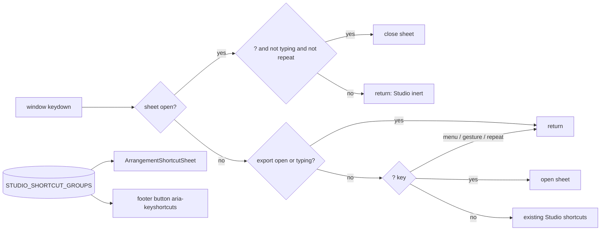

# Calm Studio — `?` shortcut sheet და მუდმივი shortcut ხაზის მოხსნა (SABA-B-8 CALM-1a)

**თარიღი:** 2026-10-28
**სტატუსი:** In Progress (stage 1 of 2; C round 227 PASS)
**შეცვლილი პროექტი:** Store

## კონტექსტი

Saba-მ (2026-10-28) Studio-ს ეკრანი გადატვირთულად მიიჩნია. ერთ-ერთი მიზეზი footer-ის ბოლოში
მუდმივი shortcut ხაზი იყო. რაუნდ 9-ში ის ერთ ხაზად დაიწყო, მაგრამ შემდეგ რაუნდებში 19 კლავიშამდე
გაიზარდა. Saba-ს გადაწყვეტილებით (decision 1) shortcut-ები გადადის modal sheet-ში: ის `?`-ით ან
footer-ის მშვიდი ღილაკით „Shortcuts ?“ იხსნება და Esc-ით იხურება. მუდმივი ხაზი ქრება.

CALM-1 ორ ეტაპად იყოფა (D-29z267):
- 1a (ეს რაუნდი): sheet, `?`, footer ღილაკი, ხაზის მოხსნა და lane-move hint-ის გადატანა კონტექსტურ სლოტში.
- 1b: ყველა ღილაკის tooltip-ში კლავიში და `aria-keyshortcuts`, იმავე წყაროდან.

## მიდგომა

- **ერთი წყარო:** `shortcuts.ts` ინახავს `STUDIO_SHORTCUT_GROUPS`-ს: 8 ჯგუფსა და 43 სტრიქონს,
  Live 12-ის ch. 42-ის მსგავსად დაჯგუფებულს. sheet ამ მონაცემებიდან იხატება, 1b-ში კი tooltip-ებიც
  აქედან აიღებენ კლავიშებს. ძებნა (`filterStudioShortcutGroups`) case-insensitive substring-ია
  action-ზე, ჯგუფის სათაურსა და კლავიშის ტექსტზე.
- **Sheet:** ჩარჩოდ გამოყენებულია არსებული `Modal` (`ui/Modal.tsx`, უცვლელი), ზომით `xl`. sheet-ს აქვს
  ძებნის ველი, ორსვეტიანი grid და `<kbd>` chip-ები. გახსნისას focus ძებნაზე გადადის, Tab/Shift+Tab
  sheet-ის შიგნით ტრიალებს, დახურვისას კი focus opener-ს უბრუნდება. თუ opener `body` იყო ან აღარ
  არსებობს, focus footer ღილაკზე გადადის. Export dialog-ის pattern ადგილობრივად არის გადმოტანილი;
  საერთო hook-ის მოთხოვნა checkpoint request-შია.
- **`?` კლავიში:** `handleKeyDown`-ში `?` შემოწმდება `key`-ით ან `Shift+Slash` `code`-ით, Ctrl/Alt/Meta-ს
  გარეშე. branch მოთავსებულია export/typing early return-ის შემდეგ, ამიტომ ტექსტურ ველებსა და
  Export-ში `?` ჩვეულებრივად იწერება ან იგნორირდება. გამორიცხულია `role="menu"`, აქტიური pointer
  gesture და `event.repeat`.
- **Sheet ღიაა → Studio ინერტულია:** ყველაზე ზედა early return ყველა სხვა branch-ს ბლოკავს (Space,
  Delete, Ctrl+Z, M, G, ისრები). ერთადერთი გამონაკლისია `?`, რომელიც ხურავს sheet-ს, თუ focus ტექსტურ
  ველში არ არის და კლავიში auto-repeat არ არის.
- **Footer:** მუდმივი ხაზის ნაცვლად ერთი კონტექსტური სტრიქონია. მარცხნივ ერთი სლოტია, რომლის
  პრიორიტეტია lane-move hint → selected-clip ხაზი → reserve. მარჯვნივ Shortcuts ღილაკია
  (`leading-4`, 16 px). footer 69 px-დან 49 px-მდე დაბალდა, timeline კი 20 px-ით გაიზარდა.

### Ableton-თან განსხვავებები (შეგნებული)
- Live 12-ში `?` Info View-ს ხსნის (2.2.2, 42.1). CZABA-ს Info View არ აქვს, ამიტომ `?` shortcut sheet-ს
  ხსნის (Saba decision 1).
- Mac-ის ცალკე სვეტის ნაცვლად ქვესათაურია: „Ctrl means ⌘ on Mac · Alt means ⌥ · Esc closes.“
  (D-29z271). Chromium-ში ⌘/⌥ რეალური glyph-ით იხატება (DejaVu Sans fallback), ამიტომ fallback ტექსტი
  არ დაგვჭირდა.
- PageUp/PageDown სტრიქონზე წერია „bigger step“ და არა dB მნიშვნელობა: ეს ბრაუზერის native range ქცევაა.
- ჯგუფის სათაურები `text-xs`-ია (12 px) და არა `text-label`-ის 11 px. მიზეზი C-A11Y-ის „ყველა ტექსტი
  ≥ 12 px“ მოთხოვნაა.

## არქიტექტურა

## შეცვლილი ფაილები

- `app/lib/arrangement/shortcuts.ts` (ახალი): shortcut-ების ერთი წყარო, `findStudioShortcut` და `filterStudioShortcutGroups`.
- `app/components/arrangement/ArrangementShortcutSheet.tsx` (ახალი): modal sheet, ძებნა, focus trap/restore.
- `app/components/arrangement/StudioWorkspace.tsx`: sheet-ის state/ref/render, `?` branch, sheet-open early return და footer-ის კონტექსტური სტრიქონი.
- `app/lib/arrangement/strings.ts`: `studioShortcutSheetStrings`.
- `app/lib/arrangement/__tests__/shortcuts.test.ts` (ახალი): SC1–SC3.
- `app/lib/arrangement/__tests__/shortcut-sheet-ui.test.tsx` (ახალი): SS1–SS10.
- `app/lib/arrangement/__tests__/workspace-strings-ui.test.tsx`: WSU1.
- `app/lib/arrangement/__tests__/track-group-collapse-ui.test.tsx`: UC12-ის პირველი assertion.

## პრობლემები და გადაწყვეტები

- **Problem:** Modal-ის Esc listener `document`-ზეა, workspace-ის კი `window`-ზე. Esc-ით დახურვის შემდეგ
  იმავე event-ს floating video-ს Escape branch-ი შეიძლება მისწვდენოდა.
  **Solution:** sheet ღიაობისას window capture-ში Escape-ს `preventDefault`-ს უკეთებს. floating-video
  branch `defaultPrevented`-ს ამოწმებს და ამ event-ს აღარ ამუშავებს.
- **Problem:** workspace-ის `keyup` Space-ზე `preventDefault`-ს აკეთებს, ამიტომ Space Close ღილაკს ვერ
  გაააქტიურებდა.
  **Solution:** sheet-ის content-ზე React `onKeyUp` Space-ის propagation-ს აჩერებს. Browser-ში Space
  Close-ზე sheet-ს ხურავს და playback არ იწყება.
- **Problem:** `?`-ზე თითის დაჭერისას auto-repeat ძებნის ველში „????“-ს წერდა.
  **Solution:** sheet ღიაობისას repeat `?` keydown-ს `preventDefault`-ით ბლოკავს (SS3).
- **Problem:** TH10 (studio-theme-obsidian) კრძალავს `font-semibold`-ს.
  **Solution:** სათაური `font-medium`-ია.
- **Problem (GATE226-B1):** footer-ის slot-ები ახალ row wrapper-ში გადავიდა და `basis-full` wrapper-ზე
  აღმოჩნდა. `track-layout.test.tsx`-ის შემთხვევა „reserves the selected-clip row with an aria-hidden
  placeholder and renders the real line as one truncated full-width row (C-R11-02, C-R15-02)“ კლასების
  ზუსტ სიას ამოწმებდა, ამიტომ root gate ჩავარდა. Browser-ში ქცევა სწორი იყო.
  **Solution:** class pin-ები ამოღებულია. იმავე შემთხვევაში სტრუქტურის assertion-ებია: placeholder-ის
  მშობელი row შეიცავს „Keyboard shortcuts (?)“ ღილაკს, და მონიშნული clip-ის ხაზი და placeholder
  მონიშვნისა და მოხსნის შემდეგ იმავე row-ში რჩება. Geometry browser-ში მოწმდება.
- **Problem (C-R226-02, C-R226-03):** `fit` სტრიქონი ამბობდა, რომ ruler-ზე ორმაგი დაწკაპუნება ყოველთვის
  მთელ პროექტს ატევს, თუმცა time selection-ისას ის selection-ზე აზუმავს. `waveform-zoom` სტრიქონი
  არარსებულ „1× button“-ს ასახელებდა, რეალური control კი `<select>`-ია.
  **Solution:** `fit`-ის keys: „Double-click the overview“ და „Double-click the ruler (no selection)“.
  `waveform-zoom`-ის key: „Waveform Zoom menu“. SC4 ამოწმებს ორივეს და იმას, რომ არცერთი key-ში
  სიტყვა „button“ არ წერია.

## ტესტირება

- Unit/UI: SC1–SC3 და SS1–SS10, ასევე განახლებული WSU1 და UC12. covering ნაკრები (25 ფაილი, 320 ტესტი)
  მწვანეა; repo-scan ტესტები (focus-ring, panel-radius, obsidian, cursor-map, colour suites) მწვანე დარჩა.
- Mutants: MU-a → SS5, MU-b → SS3, MU-c (open/close) → SS3, MU-d → SS2/SS10, MU-e → SS6, MU-f → SS8.
- Code review-ის შემდეგ დამატებული mutants:
  - MU-g: Esc-ის `preventDefault`-ის მოხსნა → SS2 წითელია;
  - MU-h: Space keyup stop-ის მოხსნა → SS5 წითელია;
  - MU-i: focus ყოველთვის fallback-ზე ბრუნდება → SS2 წითელია (opener = Snap ღილაკი).
- Browser (Chromium, 1440×900 და 1280×720):
  - footer 49 px, timeline scroller-ის `clientHeight` 516/406, კონტექსტური სტრიქონი 16 px;
  - footer ღილაკის contrast 6.68:1 (rest), 14.78:1 (hover);
  - ⌘/⌥ რეალური glyph-ითაა;
  - `fit` სტრიქონის chip არ იჭრება, sheet-ს ჰორიზონტალური overflow არ აქვს.

## TODO / შემდეგი ნაბიჯები

- CALM-1b: კლავიშები ყველა ღილაკის tooltip-სა და `aria-keyshortcuts`-ში, იმავე `STUDIO_SHORTCUT_GROUPS`-იდან.
- საერთო dialog focus hook (Export + shortcut sheet): checkpoint request `b-round-225-checkpoint-request.md`.
- CALM-2 (copy-ს გადატანა) და CALM-3 (Overview).
