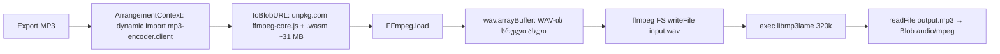
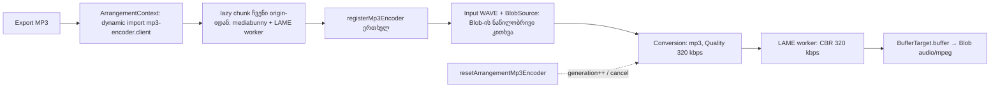

# Studio lab-ის MP3 export mediabunny + LAME-ით (PERF-16a)

**თარიღი:** 2026-10-28
**სტატუსი:** In Progress (stage 1 of 2; C round 218 PASS)
**შეცვლილი პროექტი:** Store (`/studio-lab`-ის MP3 encoder; legacy `/studio/:productId` უცვლელია)

## კონტექსტი

ადრე `/studio-lab`-ის პირველი MP3 export ffmpeg.wasm-ის core-ს (~31 MB) `unpkg.com`-დან ტვირთავდა, მთელ WAV-ს ერთ სრულ `ArrayBuffer`-ად აკოპირებდა და ffmpeg-ის ფაილურ სისტემაში წერდა. ეს მესამე მხარის host-ზე დამოკიდებულება, დიდი ჩამოტვირთვა და ზედმეტი მეხსიერებაა. Saba-ს მიერ დამტკიცებული OSS გეგმა (`docs/technical/performance/oss-adoption.md`, PERF-16) ffmpeg-ს `mediabunny` + `@mediabunny/mp3-encoder`-ით (LAME) ცვლის. PERF-16 ორ ეტაპად გაიყო (D-29z221): 16a — lab-ის encoder (ეს დოკუმენტი), 16b — legacy გზა და `@ffmpeg/*`-ის ამოღება.

## მიდგომა

- **Module API უცვლელია.** `app/lib/arrangement/mp3-encoder.client.ts` ინარჩუნებს სამ export-ს იგივე signature-ით: `ArrangementMp3Encoder`, `loadArrangementMp3Encoder()`, `resetArrangementMp3Encoder()`. `ARRANGEMENT_MP3_CORE_BASE_URL` წაიშალა: ის მხოლოდ ამ module-სა და მის ტესტში გამოიყენებოდა. `ArrangementContext.tsx` (dynamic import, 120 s timeout, reset abort-ზე და შეცდომაზე) არ შეცვლილა.
- **Load = რეგისტრაცია.** `loadArrangementMp3Encoder()` პირველ გამოძახებაზე ერთხელ, უპირობოდ იძახებს `registerMp3Encoder()`-ს და არასდროს module-ის შეფასებისას. README-ის `canEncodeAudio('mp3')` guard არ გამოვიყენეთ: ის ბრაუზერის native encoder-ს ანიჭებს უპირატესობას, ამიტომ ფაილი ბრაუზერის მიხედვით განსხვავდებოდა. CZABA-ს სჭირდება ერთი პროგნოზირებადი ფაილი: CBR 320 kbps LAME ყველგან (Ableton Live 12 manual §5.1.3.3-ის მსგავსად). ამას გარდა, `canEncodeAudio` WebCodecs-ს მოითხოვს და jsdom-ში არ მუშაობს.
- **Timeout-ისა და load-failed-ის შტოები რჩება, მაგრამ ვიწროვდება (§1.2).** load ახლა თითქმის მყისიერი რეგისტრაციაა. Context-ის 120 s timeout და `encoderLoadFailed` ახლა მხოლოდ ორ შემთხვევაში ჩაირთვება: dynamic-import-ის chunk ვერ ჩაიტვირთა ან `registerMp3Encoder` შეცდომას ისვრის. ეს განზრახ ჩაიწერა: ეს შტოები მომავალშიც არ უნდა წაიშალოს.
- **Encode.** თითო `encode()` ერთ `Conversion`-ს ქმნის. Input არის `WAVE` format `BlobSource`-ით იმავე Blob-ზე, output არის `Mp3OutputFormat` → `BufferTarget`, audio კი `codec: 'mp3'` და `new Quality({ bitrate: 320_000 })` (მოძველებული `bitrate` ველი არ გამოიყენება). Sample rate და არხები WAV-ისას რჩება (48 kHz stereo). `onProgress` `execute()`-მდე ყენდება, [0, 1]-ში იჭრება და non-finite მნიშვნელობებს უგულებელყოფს. `isValid === false`-ზე `execute()` არ იძახება და Error-ში discard-ის მიზეზი ჩანს. `input.dispose()` `finally`-ში ეშვება.
- **WAV-ის სრული ასლი აღარ იქმნება (§1.5-ის ფორმულირება).** encode-ის გზა არ იძახებს `wav.arrayBuffer()`, `bytes()`, `text()` ან `new Response(wav)`-ს. `BlobSource` Blob-ს ნაწილ-ნაწილ კითხულობს შეზღუდულ cache-ში (`mediabunny.d.ts` l.637–638, default 8 MiB). ეს არ ნიშნავს „ნულ კოპირებულ ბაიტს“: ნაწილები და LAME-ის PCM buffer-ები კვლავ კოპირდება, უბრალოდ WAV-ის ზომის ერთი `ArrayBuffer` აღარ იქმნება.
- **Reset, cancel და stale encoder.** `resetArrangementMp3Encoder()` generation-ს ზრდის და ყოველ მიმდინარე `Conversion`-ზე ერთხელ იძახებს `cancel()`-ს. მიმდინარე `encode()` reject-დება: `execute()`-ის დროს `ConversionCanceledError`-ით, ხოლო `Conversion.init`-მდე ან მის დროს მომხდარი reset-ისას ჩვეულებრივი `Error`-ით („MP3 encoder reset…“). Context ორივე შემთხვევაში ჯერ `signal.aborted`-ს ამოწმებს. cancel-ის შემდეგ `onProgress` აღარ გადაეცემა. Reset-მდე მიღებული encoder ობიექტი ახალ `encode()`-ს Error-ით უარყოფს და Conversion-ს არ ქმნის. Reset-ის შემდეგ შემდეგი load `registerMp3Encoder()`-ს თავიდან იძახებს. Upstream-ში ეს no-op-ია: `registered` flag `registerEncoder`-ის გამოძახებამდე ყენდება (`src/index.ts` l.256–263). ამიტომ ME2-ის „registers again“ მხოლოდ ჩვენს wrapper-ზე ვრცელდება; თუ რეალური რეგისტრაცია ჩავარდა, ხელახლა ცდა მას ვეღარ გამოასწორებს, და ამიტომაც ურჩევს `encoderLoadFailed` გვერდის გადატვირთვას. Reset-ის შემდეგ დასრულებული ძველი load ახალ generation-ს loaded-ად არ ნიშნავს. Worker-ის გასუფთავებას mediabunny აკეთებს: `close()` → `worker.terminate()` (`@mediabunny/mp3-encoder` `src/index.ts` l.155–156).
- **Copy (§1.7).** სამი სტრიქონი შეიცვალა: `mp3FormatNote`, `encoderLoading` და `encoderLoadFailed`. მათში CDN, 31 MB და ffmpeg აღარ ჩანს. `exportCancelledEncoder` უცვლელია. reset-ის შემდეგ chunk browser cache-იდან მოდის და რეგისტრაცია no-op-ია; რეალურად თავიდან იწყება LAME worker, რომელსაც `Mp3Encoder.init()` ყოველ Conversion-ზე ქმნის (`src/index.ts` l.48–50). ამიტომ სტრიქონი მომხმარებლისთვის კვლავ სწორია.

## არქიტექტურა

ადრე (ffmpeg.wasm):

ახლა (mediabunny + LAME):

**Bundle (production build, `npm run build`, round 218):**

| Chunk | Raw bytes | Gzip bytes |
|---|---|---|
| `build/client/assets/mp3-encoder.client-*.js` (mediabunny + LAME worker, ერთი chunk) | 687,512 | 227,410 (`gzip -9`; Vite-ის ანგარიშით 227.06 kB) |

- ჯამი 227,410 gzip bytes-ია, ბიუჯეტი კი ≤ 1 MiB (perf-plan l.42).
- `mediabunny`-ს ან LAME-ს სხვა client chunk არ შეიცავს. `studio-lab-*.js`-ში „mediabunny“ მხოლოდ `mp3FormatNote`-ის ტექსტშია.
- Remix-ის `manifest-*.js`-ში `/studio-lab` route-ის, root-ისა და entry-ის სტატიკურ `imports`-ში encoder-ის chunk არ არის. მასზე მხოლოდ `studio-lab-*.js`-ის dynamic `import("./mp3-encoder.client-…")` მიუთითებს. `build/client/.vite/manifest.json` ამ build-ში არ იქმნება, ამიტომ შემოწმება Remix-ის manifest-სა და chunk-ის ტექსტზე გაკეთდა.
- შედარებისთვის, gate 217-ზე ძველი wrapper chunk 1.45 kB (gzip 0.85 kB) იყო, ხოლო ~31 MB core CDN-დან იტვირთებოდა.

**ლიცენზია:** LAME LGPL-ია და MPL-2.0 ლიცენზიის `@mediabunny/mp3-encoder`-შია ჩაშენებული. `mediabunny` MPL-2.0-ია. LGPL/MPL-ის ვალდებულებების (third-party notices) აღრიცხვა OSS-LIC რაუნდის საქმეა, რომელიც ამის შემდეგ მოდის.

**ცნობილი upstream ინფორმაცია:** bundle worker-ისთვის `URL.createObjectURL`-ს იძახებს და მას არასდროს აუქმებს (revoke): encoder-ის თითო init-ზე რჩება ერთი პატარა blob URL. ეს ბაგი არ არის და FAIL-ად არ ითვლება.

## შეცვლილი ფაილები

- `app/lib/arrangement/mp3-encoder.client.ts` — encoder-ის სრული გადაწერა mediabunny + LAME-ზე (load/registration, encode, reset/cancel, stale encoder).
- `app/lib/arrangement/__tests__/mp3-encoder.test.ts` — ტესტების გადაწერა `mediabunny`-სა და `@mediabunny/mp3-encoder`-ის hoisted fake-ებით (ME1–ME9).
- `app/lib/arrangement/strings.ts` — `mp3FormatNote`, `encoderLoading`, `encoderLoadFailed`.
- `app/lib/arrangement/__tests__/strings.test.ts` — ამ სამი სტრიქონის მოსალოდნელი მნიშვნელობები.
- `docs/implementation/2026/quarter-IV/170-perf-16a-mp3-mediabunny.md` — ეს დოკუმენტი.

## პრობლემები და გადაწყვეტები

- **პრობლემა:** registration სინქრონულია, ამიტომ „reset load-ის დროს“ მდგომარეობას ფანჯარა არ აქვს. **გადაწყვეტა:** load ერთ microtask-ს ელოდება, generation-ს ამოწმებს და მხოლოდ ამის შემდეგ არეგისტრირებს. ეს ძირითადად სატესტო ფანჯარაა: context-ის reset ყოველთვის macrotask-იდან მოდის (abort click ან timer), ამიტომ ამ microtask-ში ვერ მოხვდება. ME3(a) ამოწმებს, რომ reset-ის შემდეგ ძველი load reject-დება და რეგისტრაცია არ ხდება.
- **პრობლემა:** `Conversion.init` ასინქრონულია. reset შეიძლება მოხდეს მაშინ, როცა გასაუქმებელი Conversion ჯერ არ არსებობს. **გადაწყვეტა:** init-ის შემდეგ generation ხელახლა მოწმდება. ვალიდური run in-flight სიაში `execute()`-მდე ემატება, ამიტომ reset მას ზუსტად ერთხელ აუქმებს.
- **პრობლემა:** mediabunny cancel-ის შემდეგ progress-ს თავად არ ბლოკავს. **გადაწყვეტა:** run-ის `isCancelled` flag-ს reset აყენებს, ხოლო forwarder მას ამოწმებს (ME3(b)).
- **პრობლემა:** dev server mediabunny-ს დამატებამდე ჩაირთო. **გადაწყვეტა:** პირველ MP3 export-ზე Vite-მა deps ხელახლა გააოპტიმიზა და გვერდი გადატვირთა (environment, არა ბაგი). განმეორებითი export ორივე viewport-ზე გავიდა.

## ტესტირება

- `app/lib/arrangement/__tests__/mp3-encoder.test.ts`:
  - **ME1:** import-ზე რეგისტრაცია არ ხდება, ერთდროული load-ები ერთ load-ს იზიარებს და რეგისტრაცია ზუსტად ერთხელ ხდება.
  - **ME2:** რეგისტრაციის შეცდომა in-flight load-ს ასუფთავებს.
  - **ME3(a)–(d):** reset load-ის დროს; reset encode-ის დროს (cancel ერთხელ, progress აღარ) და `Conversion.init`-ის დროს (execute და cancel არ ხდება); stale encoder; no-op reset.
  - **ME4:** Conversion-ის ზუსტი config, 320 kbps.
  - **ME5:** progress-ის clamp.
  - **ME6:** invalid Conversion.
  - **ME7:** `execute()`-ის ან `Conversion.init`-ის შეცდომა (dispose მაინც ეშვება) და null buffer.
  - **ME8:** ჩვენი კოდი WAV-ს თავად არ კითხულობს. ეს მხოლოდ ჩვენს module-ს ეხება: რეალური `BlobSource` default-ად stream reader-ით კითხულობს (`useStreamReader`, `mediabunny.d.ts` l.640–644).
  - **ME9:** import-ის საზღვარი (repo scan) და მისი დასახელებული mutant-ი.
- Mutant-ები scratch-ზე, თითოეული საკუთარ row-ზე ვარდება:
  - 128 kbps → ME4;
  - top-level რეგისტრაცია → ME1;
  - `wav.arrayBuffer()` → ME8;
  - static `import 'mediabunny'` → ME9;
  - stale-check-ის მოხსნა → ME3(c);
  - init-ის შემდეგ generation-ის შემოწმების მოხსნა → ME3(b) (`Conversion.init` row).
- Covering-ის 8 ფაილი (mp3-encoder, strings, export-mp3, export-progress-ui, export-cancel-ui, export-dialog-hold-enter, collection-load-status, video-import-status-ui): 129/129 გავიდა. ასევე გავიდა `npm run typecheck` და `npm run lint`.
- რეალური ბრაუზერი (Playwright Chromium, dev `:5173`, 1440×900 და 1280×720, round 218):
  - `czaba-studio-lab.mp3`, 4,055,208 bytes;
  - წინ ერთი Xing frame (56 kbps, ცალკე აღრიცხული);
  - 4,224 audio frame, ყველა MPEG-1 Layer III, 320 kbps, 48 kHz, joint stereo, header `FF FB E4 64`;
  - 4,224 × 1152 / 48000 = 101.376 s („MP3 created: 01:41.352“);
  - `decodeAudioData`: 101.376 s, 2 არხი, RMS −15.29 dBFS (WAV-ისაც −15.29);
  - export-ის შემდეგ მესამე მხარის მოთხოვნა 0-ია და `unpkg`/`ffmpeg` URL არ ჩანს;
  - 2 s-ის შემდეგ blob-URL worker 0-ია;
  - page error 0-ია.
- Production build: იხ. „არქიტექტურა“-ს bundle-ის ცხრილი.

## TODO / შემდეგი ნაბიჯები

- **OSS-LIC (round 219):** third-party notices (LAME LGPL, mediabunny MPL-2.0) და GPL/AGPL-ის ლიცენზიის ტესტი.
- **16b:**
  - legacy `convertWavToMp3` (`StudioContext.tsx` → `app/utils/ffmpeg.ts`) გადადის იმავე encoder-ზე. `app/utils/ffmpeg.ts` გადაიწერება delegation-ად და გამოყენებულ export-ებს შეინარჩუნებს (წაშლა Saba-ს სჭირდება).
  - განახლდება `export-progress-ui.test.tsx` l.21/54.
  - 16b-ის C PASS-ის შემდეგ B შეიტანს `{"remove": ["@ffmpeg/ffmpeg", "@ffmpeg/util"]}`-ს და root-ს სთხოვს ერთხაზიან grant-ს `vite.config.ts` l.27-ზე (`optimizeDeps.exclude`), იმავე commit-ში.
  - განახლდება `docs/technical/diagrams/studio-audio-pipeline.md` l.273/318/521/542.
- CSP: worker `blob:` URL-იდან იტვირთება. CSP-ის დამატებისას (`SECURITY_AUDIT.md`) საჭირო იქნება `worker-src blob:`, თორემ MP3 export ჩავარდება (OSS-LIC/16b-ის შენიშვნა).
- dev-only Vite re-optimise პირველ MP3 export-ზე: 16b-ის info შენიშვნაა, production-ზე არ ეხება.
