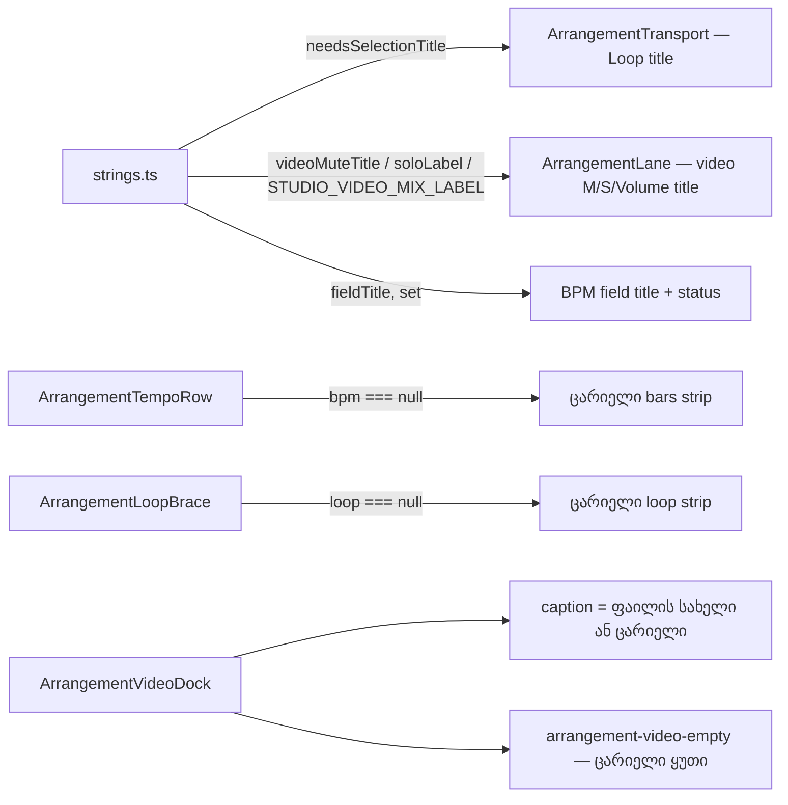

# Calm Studio — timeline canvas-ისა და dock-ის დამხმარე ტექსტის გადატანა მშვიდ ადგილებში (SABA-B-8 CALM-2a)

**თარიღი:** 2026-10-28
**სტატუსი:** In Progress (stage 1 of 2; C round 229 PASS)
**შეცვლილი პროექტი:** Store

## კონტექსტი

Saba-მ (2026-10-28) Studio-ს ეკრანი გადატვირთულად მიიჩნია. CALM-1-მა (doc 177) მუდმივი shortcut
ხაზი მოხსნა. Saba-ს decision 2-ის მიხედვით დამხმარე წინადადებები tooltip-ში, `title`-ში, `aria`-ში
ან ერთჯერად status-ში გადადის, ხოლო dock-ის „No video added yet“ მშვიდ, ცარიელ monitor-ად იქცევა.
გადატანილი ფაქტები ხელმისაწვდომი უნდა დარჩეს.

CALM-2 ორ ეტაპად იყოფა. ეს ეტაპი (2a) ეხება იმ ხუთ წინადადებას, რომლებიც timeline canvas-ზე და
video dock-შია:

- „Bars: set a BPM — grid only, audio is not stretched“ (BPM strip);
- „Loop: make a time selection and press Loop (Ctrl+L)“ (Loop strip);
- „Arrangement · Overview“ (dock-ის label row);
- „Video · sound from the video track (M/S/Volume)“ (dock caption);
- „No video added yet“ (ცარიელი monitor).

## მიდგომა

**გადატანის რუკა:**

| წინადადება | ახალი ადგილი |
|---|---|
| BPM strip-ის hint | strip ცარიელია; „audio is not stretched“ უკვე წერია BPM field-ის `title`-ში (`studioTempoStrings.fieldTitle`) და BPM-ის დაყენების status-ში (`studioTempoStrings.set`) |
| Loop strip-ის hint | strip ცარიელია; მიზეზი გადავიდა disabled Loop ღილაკის `title`-ში: `Loop: make a time selection first (Ctrl+L)` (`studioLoopStrings.needsSelectionTitle`) |
| „Arrangement · Overview“ | label წაიშალა; Overview-ს `aria-label` და `title` უცვლელად ამბობს, რომ ეს მთელი პროექტია |
| caption „Video · sound from…“ | caption აჩვენებს მხოლოდ playhead-ის ქვეშ მყოფი ვიდეოს ფაილის სახელს, სხვა შემთხვევაში ცარიელია; „ვიდეოს ხმა ვიდეო ტრეკზე იმართება“ გადავიდა ვიდეო ტრეკის M/S/Volume `title`-ებში |
| „No video added yet“ | overlay რჩება იმავე ზომისა და `bg-background` ფერის ცარიელ ყუთად (`data-testid="arrangement-video-empty"`), ტექსტის გარეშე |

**Loop ღილაკის `title`:** time selection არის → „Loop the time selection (Ctrl+L)“; selection არ არის,
loop არის → „Loop on / off (Ctrl+L)“; არც ერთი არ არის (ღილაკი disabled) → „Loop: make a time
selection first (Ctrl+L)“. ფორმულირება იმეორებს არსებულ „Zoom to selection: make a time selection
first (Z)“-ს — ერთი pattern „საჭიროა time selection“-ისთვის.

**წაშლილი strings:** `studioTempoStrings.emptyHint`, `studioLoopStrings.braceHint`,
`studioVideoDockStrings.overviewNote`, `captionFallback`, `captionSoundNote`, `empty` და
`TEMPO_EMPTY_HINT` export. მიზეზი — ერთი წყარო: consumer-ის გარეშე დარჩენილი string-ი strings-ის
ტესტებს მისცემდა საშუალებას, დაეპინათ ტექსტი, რომელსაც მომხმარებელი ვერ ხედავს.

**ერთი ფაქტი — ერთი ფორმულირება:** calm review-ში ეწერა „sound from the video“, მაგრამ პროდუქტი ამ
ფაქტს უკვე „Original video sound“-ს უწოდებს (`aria-label`-ები, `videoSoundLabel`). ამიტომ ახალი
`title`-ები იყენებს „Original video sound“-ს: Mute — `Mute — Original video sound`
(`studioLaneStrings.videoMuteTitle`), Solo — `studioLaneStrings.soloLabel('Original video sound')`,
Volume — `Original video sound` ყველა density-ში (ადრე მხოლოდ full-ზე ნაკლებ density-ში ჩანდა).
ორივე string ერთ `STUDIO_VIDEO_MIX_LABEL` constant-ს კითხულობს. აუდიო ტრეკების `title`-ები უცვლელია.

**რატომ არ არის sr-only ასლი ცარიელ monitor-ში:** ორ `<video>` ელემენტს თავისი `aria-label` აქვს,
ხოლო ვიდეო lane უკვე ამბობს „No video — use “Your own video” or drop a file here“. დამალული
დუბლიკატი ზედმეტი იქნებოდა.

**რატომ არ არის BPM placeholder „—“:** Saba-ს decision 2 მას არ ასახელებს, ხოლო field-ის საზღვარი
ცალკე finding-ია (DUX-B-3).

**Ableton Live 12-თან შედარება** (task §3): Overview-ზე label-ის არქონა manual-ის აღწერას ემთხვევა
(ch. 6.1). Loop-ისთვის time selection-ის მოთხოვნა არსებული შეგნებული განსხვავებაა (Live-ში
selection-ის გარეშე brace მთელ Arrangement-ს ფარავს, ch. 6.6). Dock-ში მუდმივი monitor არსებული
layout-ია; ცარიელი მუქი ყუთი მხოლოდ დასკვნით ჰგავს Live-ის შავ ეკრანს video gap-ში (ch. 28.2.2.1).

## არქიტექტურა

## შეცვლილი ფაილები

- `app/lib/arrangement/strings.ts` — ექვსი string წაიშალა; დაემატა `needsSelectionTitle`, `videoMuteTitle` და `STUDIO_VIDEO_MIX_LABEL`.
- `app/lib/arrangement/tempo.ts` — წაიშალა `TEMPO_EMPTY_HINT`.
- `app/components/arrangement/ArrangementTempoRow.tsx` — BPM-ის გარეშე bars strip არაფერს რენდერავს.
- `app/components/arrangement/ArrangementLoopBrace.tsx` — loop-ის გარეშე strip-ს child არ აქვს.
- `app/components/arrangement/ArrangementTransport.tsx` — Loop ღილაკის `title`-ის სამი მდგომარეობა.
- `app/components/arrangement/ArrangementVideoDock.tsx` — label წაიშალა (row-ს `min-h-4`), caption მხოლოდ ფაილის სახელია, ცარიელი monitor ტექსტის გარეშე.
- `app/components/arrangement/ArrangementLane.tsx` — ვიდეო ტრეკის Mute, Solo და Volume `title`-ები.
- `app/lib/arrangement/__tests__/strings.test.ts` — ST10, ST17, ST36, ST50 და ახალი ST-C2a.
- `app/lib/arrangement/__tests__/tempo.test.ts` — T10.
- `app/lib/arrangement/__tests__/tempo-ui.test.tsx` — U1, U8.
- `app/lib/arrangement/__tests__/tempo-window-ui.test.tsx` — BU7.
- `app/lib/arrangement/__tests__/navigation-strings-ui.test.tsx` — NS4 და ახალი NS6.
- `app/lib/arrangement/__tests__/video-dock-strings-ui.test.tsx` — VDS1.
- `app/lib/arrangement/__tests__/studio-theme-obsidian.test.tsx` — TH9.
- `app/lib/arrangement/__tests__/lane-strings-ui.test.tsx` — ახალი LSU8 და VDS4.

## პრობლემები და გადაწყვეტები

- **პრობლემა:** `tempo.test.ts` T10 vitest-ში მწვანე რჩებოდა `TEMPO_EMPTY_HINT`-ის წაშლის შემდეგაც (`undefined === undefined`), მხოლოდ `tsc` ვარდებოდა import-ზე. **გადაწყვეტა:** T10-დან import და identity line წაიშალა; vacuous pass მტკიცებულებად არ ჩაითვალა.
- **პრობლემა:** label-ის წაშლის შემდეგ dock-ის row ცარიელ caption-თან ერთად სიმაღლეს დაკარგავდა და Overview ზემოთ აიწეოდა. **გადაწყვეტა:** row-ს დაემატა `min-h-4`, რომ 16 px დარჩეს. jsdom layout-ს არ ითვლის, ამიტომ ეს მხოლოდ browser-ში მოწმდება (MU-6 → C-BBOX-229); class pin ტესტში არ დაემატა.

## ტესტირება

- **ST-C2a** — ახალი `needsSelectionTitle` და `videoMuteTitle` ზუსტი მნიშვნელობები და ექვსი წაშლილი key-ის არარსებობა.
- **U1** — bars strip ცარიელია და BPM field-ის `title` შეიცავს „audio is not stretched“-ს; **U8**, **BU7** — tempo-ს გასუფთავების შემდეგ strip ცარიელია.
- **NS4** — Loop strip loop-ის გარეშე ცარიელია; **NS6** — Loop ღილაკის `title`, `disabled` და `aria-keyshortcuts` სამივე მდგომარეობაში.
- **VDS1** — caption ცარიელია, label აღარ არის, „No video added yet“ აღარ ჩანს, `arrangement-video-empty` ცარიელია; **VDS4** — ვიდეოს import-ის შემდეგ caption ფაილის სახელს აჩვენებს და ცარიელი monitor ქრება.
- **LSU8** — ვიდეო ტრეკის Mute/Solo/Volume `title`-ები default და დაპატარავებულ (არა full) density-ში; აუდიო ტრეკისა უცვლელია.
- **TH9** — section label-ები ხუთია, „Arrangement“ აღარ არის.
- **Mutants:** MU-1 (Loop hint) → NS4 წითელი; MU-2 (Loop title fallback) → NS6 წითელი; MU-3 (video Mute `title`) და MU-4 (Volume `title` მხოლოდ არა-full density-ში) → LSU8 წითელი; MU-5 (caption „Video“) → VDS1 წითელი; MU-6 (`min-h-4`) — browser-only, C-BBOX-229.

## TODO / შემდეგი ნაბიჯები

- **CALM-2b:** Clip details-ის ცარიელი მდგომარეობა, library notice და მისი dismiss, first-run status და DUX-R-4(a) ცარიელი lane-ის hint.
- **CALM-3:** Overview-ს empty state და Ctrl+Alt+O.
