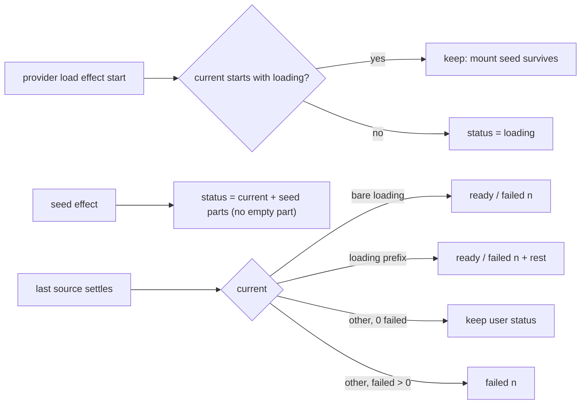

# SABA-B-11a FIX-2 — seed-ის status collection-ის ready ჩანაწერს გადაურჩება

**თარიღი:** 2026-10-29
**სტატუსი:** Completed (C round 237 PASS)
**შეცვლილი პროექტი:** Store

## კონტექსტი

SABA-B-11a-ის პირველმა ეტაპმა (round 234, doc 182) tempo seed დაამატა: პირველი music/stem clip
კატალოგის BPM-ით tempo-ს, musical `1/4` grid-ს და Snap-ს რთავს და status-ს წერს. ამ ერთ status
გზაში სამი საკითხი დარჩა:

| Id | Severity | პრობლემა |
|---|---|---|
| A-R234-REVIEW-M1 (+ შერწყმული B-R235-READY-CLOBBER) | Medium | provider-ის source-loading effect status-ს უბრალო string-ით წერდა ორჯერ: დასაწყისში `copy.loading`, ბოლო წყაროს დასრულებისას `copy.ready` / `copy.failed(n)`. შუაში დაწერილი ყველა status იკარგებოდა — სწრაფი Add-ის placement + seed და mount-ის seed. B-მ `ecaf0e4`-ზე ორი demo MP3-ის 4 s დაყოვნებით დეტერმინისტულად გაიმეორა. |
| GATE234-S2 | Low | collection-ში, სადაც music/stem BPM წყარო არ არის, seed-ის ძებნა არასდროს იხურებოდა: `findAssetTempoSeed` ყოველ clips/tracks ცვლილებაზე ორ Map-ს აშენებდა მთელი სესიის განმავლობაში. |
| GATE234-S3 | Low | `[status, ...parts].join(' ')` ცარიელ status-ზე წინა space-ს იძლეოდა. |

Mount-ზე clobber-ის მიზეზი effect-ების რიგია: React child effect-ს parent-ზე ადრე უშვებს, ამიტომ
`StudioWorkspace`-ის seed effect ჯერ status-ს წერდა, provider-ის `setStatus(copy.loading)` კი
მაშინვე მის შემდეგ ეცემოდა.

## მიდგომა

- **ფუნქციური `setStatus`.** context-ის წევრი ახლა `ArrangementStatusUpdate`-ს იღებს (string ან
  `(current) => string`). reducer (`status-announcement.ts`) ამ ფორმას უკვე იღებდა და არ შეცვლილა;
  string-ის ყველა არსებული გამომძახებელი უცვლელად მუშაობს.
- **სამი წესი (D-29z339), ორი სუფთა ფუნქცია `collection.ts`-ში:**
  - `loadingCollectionStatus(current, copy)` — status, რომელიც უკვე ამ collection-ის loading
    ტექსტით იწყება (mount-ის seed), რჩება; ყველაფერი სხვა loading ხდება, როგორც მანამდე. ასე
    LS3/LS3b-ის swap reset შენარჩუნებულია.
  - `settledCollectionStatus(current, copy, failed)` — ready ცვლის მხოლოდ loading ტექსტს: შიშველ
    loading-ს ან loading prefix-ს, რომელსაც seed-მა მიუმატა. მომხმარებლის მიერ loading-ის შემდეგ
    გამოწვეული status რჩება — თავად მოქმედება აჩვენებს, რომ Studio პასუხობს.
  - **failed(n) ყოველთვის იმარჯვებს.** ჩატვირთვის შეცდომა ერთადერთი ფაქტია, რომელსაც მომხმარებელი
    სხვაგან ერთი შეხედვით ვერ ხედავს. B-მ append-ის ვარიანტიც სცადა: 1280×720-ზე status ორ
    სტრიქონად (32 px) იშლება (`b-round-236/probe/statusbox-append-variant-*`). seed-ის ფაქტები
    status-ის გარეშეც ხელმისაწვდომია: BPM ველი, Snap ღილაკი და BPM-ის title („audio is not
    stretched“) — CALM-2-ის წესი „facts that move must stay reachable“.
- **seed effect** (`StudioWorkspace`) წერს `setStatus((current) => [current, ...parts]
  .filter(...).join(' '))`-ით: reducer-ის მიმდინარე ტექსტს კითხულობს და ცარიელ ნაწილს ფილტრავს
  (GATE234-S3).
- **ძებნის დახურვა (GATE234-S2).** `hasAssetTempoSource(sources)` (`tempo-seed.ts`)
  `useMemo`-თი ითვლება collection-ზე. `false`-ისას effect ბრუნდება Map-ების აშენებამდე.
  `tempoSeedOpenRef` სამუდამოდ არ იხურება: მომავალ collection-ს BPM წყაროებით seed ისევ უნდა
  შეეძლოს.
- **MU-SR ეკვივალენტურია.** render-ის დროინდელი `workspaceRef.current.status`-ის წაკითხვა
  (ფილტრით) ყველა მიღწევად რიგში იგივე შედეგს იძლევა, რადგან status-ის ჩანაწერი და clip-ის
  ცვლილება ერთ render-ში ხვდება. ფუნქციური ფორმა მაინც რჩება, რადგან reducer-ის მიმდინარე ტექსტს
  კონსტრუქციით კითხულობს (D-29z341).
- **საბას კითხვა `SABA-Q-READY-AFTER-ACTION` (L44):** თუ მომხმარებელი ყველა წყაროს ჩატვირთვამდე
  მოქმედებს, ready სტრიქონი („… Press ? for shortcuts.“) ამ სესიაში აღარ ჩანს. key-ებს
  `Shortcuts ?` ღილაკი და tooltip-ები ასწავლის (CALM-1). პასუხამდე ზემოთ აღწერილი default მოქმედებს.

### Reference

**Reference ვერ მოიძებნა.** ეს CZABA-ს საკუთარი status line-ის ორ ჩამწერს შორის კონტრაქტია.
Live 12-ის Status Bar-ში „collection loaded“ შეტყობინება, რომელიც მომხმარებლის მოქმედებას
ეჯიბრება, დოკუმენტირებული არ არის. ძებნა (B, WebSearch, 2026-10-28): „Ableton Live 12 manual
status bar messages bottom of screen“ — manual-ის სექცია არ დაბრუნდა, მხოლოდ 2004 წლის forum-ის
მოთხოვნა.

## არქიტექტურა

## შეცვლილი ფაილები

- `app/lib/arrangement/collection.ts` — `loadingCollectionStatus`, `settledCollectionStatus`.
- `app/lib/arrangement/tempo-seed.ts` — `hasAssetTempoSource`.
- `app/contexts/ArrangementContext.tsx` — `setStatus`-ის ტიპი, load effect-ის ორი ფუნქციური ჩანაწერი.
- `app/components/arrangement/StudioWorkspace.tsx` — `collectionHasTempoSource`, seed effect-ის
  guard, deps და ფუნქციური ჩანაწერი.
- `app/lib/arrangement/__tests__/tempo-seed-ui.test.tsx` — TU9–TU11.
- `app/lib/arrangement/__tests__/collection.test.ts` — CR1–CR4.
- `app/lib/arrangement/__tests__/tempo-seed.test.ts` — TS7.
- `app/lib/arrangement/__tests__/tempo-seed-search-ui.test.tsx` (ახალი) — TQ1, TQ2.
- `docs/implementation/2026/quarter-IV/182-saba-b-11a-tempo-seed.md` — პირველი problem bullet და
  ბოლო TODO bullet.
- `docs/implementation/2026/quarter-IV/183-saba-b-11a-bars-ruler.md` — `playFromRuler` bullet
  (C-R236-02).

## პრობლემები და გადაწყვეტები

- **პრობლემა:** ready ჩანაწერი სწრაფი Add-ის placement + seed status-ს ცვლიდა. **გადაწყვეტა:**
  `settledCollectionStatus` loading-ის გარდა სხვა status-ს 0 შეცდომისას ინარჩუნებს (TU9, CR3).
- **პრობლემა:** mount-ის seed-ს provider-ის loading ჩანაწერი ფარავდა (child effect parent-ზე ადრე).
  **გადაწყვეტა:** `loadingCollectionStatus` საკუთარ prefix-ს ინარჩუნებს, settle კი prefix-ს
  ready-ით ცვლის (TU10, CR2, CR4).
- **პრობლემა:** append-ით failed(n) status-ს 1280-ზე ორ სტრიქონად შლის. **გადაწყვეტა:** failed(n)
  ცვლის status-ს (CR1, CR3).
- **ცნობილი edge, ჩაწერილი და არა გამოსწორებული:** `loadingCollectionStatus` ინარჩუნებს ნებისმიერ
  status-ს, რომელიც იმავე origin-ის loading ტექსტით იწყება. იმავე origin-ის collection swap, რომელიც
  ძველი `Loading the demo collection… <seed>` ტექსტის დროს მოვა, მას არ გაასუფთავებს; შემდეგი
  settle prefix-ს მაინც ready-ით ან failed-ით ცვლის. `/studio-lab`-ში (ერთი collection) მიუღწეველია.

## ტესტირება

- `tempo-seed-ui.test.tsx`:
  - TU9 — დაყოვნებულ collection-ში `stem-90`-ის Add ჩატვირთვისას: status placement + seed +
    `Snap on — grid 1/4 (G)`; gate-ის გახსნის შემდეგ იგივე ტექსტი.
  - TU10 — საწყისი arrangement `stem-90`-ით: mount-ზე `Loading the demo collection… <seed> <Snap>`,
    შემდეგ `Demo collection ready. … <seed> <Snap>`.
  - TU11 — `setStatus('')`-ის შემდეგ seed: ზუსტად `<seed> <Snap>`, წინა space-ის გარეშე.
- `collection.test.ts` — CR1–CR4 (ორივე origin; prefix-ის swap; სხვა status 0/1 შეცდომით;
  სხვა origin-ის prefix reset).
- `tempo-seed.test.ts` — TS7 (`hasAssetTempoSource`: ცარიელი, SFX-ის BPM, BPM-ის გარეშე music,
  დიაპაზონს გარეთ, stem 90, music 128.004).
- `tempo-seed-search-ui.test.tsx` — TQ1 (BPM წყაროს გარეშე სამ clip ცვლილებაზე
  `findAssetTempoSeed` არ გამოიძახება), TQ2 (control: BPM stem-ით ეძახება seed-მდე, შემდეგ აღარ).
- `collection-load-status.test.tsx` — LS3/LS3b (swap reset), LS6 (rerender user status-ს
  ინარჩუნებს), LS7 (mount lock) უცვლელად მწვანეა.
- Mutant-ები (A, `a-round-237.md`): MU-RC → TU9, TU10 წითელი; MU-LD → TU10; MU-F → TU11;
  MU-S2 → TQ1; MU-SR → 0 წითელი (ეკვივალენტური, იხ. ზემოთ).
- რეალური ბრაუზერის მიღება C-ს ეკუთვნის (round 237, `/studio-lab`, 1440×900 და 1280×720).

## TODO / შემდეგი ნაბიჯები

- `SABA-Q-READY-AFTER-ACTION` — საბას პასუხი.
- იმავე origin-ის stale prefix edge — მხოლოდ რამდენიმე collection-იან route-ზე (purchased,
  SRW-21) გახდება მიღწევადი; მაშინ გადასამოწმებელია.
- SABA-B-11b — adaptive grid.
