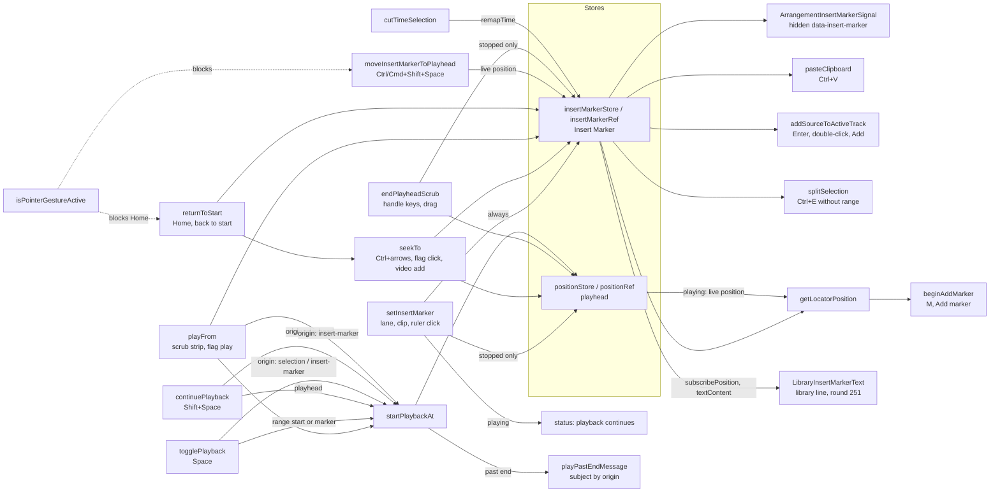
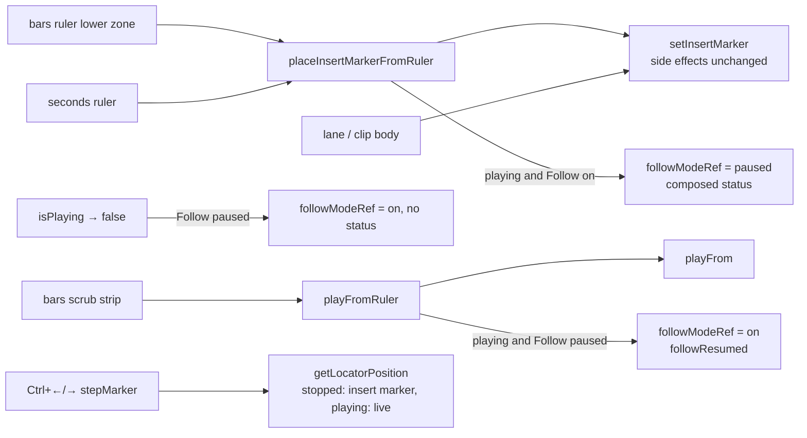

# SABA-B-10a stages 1–2b — ცალკე Insert Marker: Space მისგან უკრავს, Shift+Space stop point-იდან აგრძელებს, edit command-ები marker-ზე მოქმედებს

**თარიღი:** 2026-10-29
**სტატუსი:** Completed (C round 252 PASS)
**შეცვლილი პროექტი:** Store

## კონტექსტი

**SABA-B-10** (Saba, 2026-10-28): Studio-ში ერთი პოზიცია იყო (**D-15**, round 1: "single position
model"). Space ყოველთვის იქიდან იწყებდა, სადაც playback გაჩერდა, ხოლო timeline-ზე click
playback-ის დროს playback-ს გადაახტუნებდა. Ableton Live 12-ში ორი წერტილია: **Insert Marker**
(საიდანაც Space იწყებს) და playhead (სიმღერის მიმდინარე პოზიცია).

Saba-ს გადაწყვეტილება 1: **playback-ის დროს click მხოლოდ Insert Marker-ს გადაადგილებს; playback
გრძელდება.** ეს stage D-15-ს ცვლის და ამატებს Shift+Space-ს და Ctrl/Cmd+Shift+Space-ს. ხილული
მოციმციმე marker (SABA-B-10b) და Stop ღილაკი (SABA-B-9) ცალკე რაუნდებია.

**Stage 2a (round 250).** stage 1-ის შემდეგ marker და playhead Stop-ის შემდეგ განსხვავდება, მაგრამ
Paste, library add, Ctrl+E (range-ის გარეშე) და M ისევ playhead-ს კითხულობდა: Stop-ის შემდეგ
ჩასმული clip stop point-ზე ხვდებოდა და არა იქ, სადაც მომხმარებელმა დააწკაპუნა
(**C-EDIT-DIVERGE-249**). past-end status ყოველთვის "Playhead"-ს წერდა, მაშინაც კი, როცა Space
marker-იდან იწყებდა (**C-R249-INFO-PASTEND-WORDING**). იმავე კოდში დარჩა ორი Medium test gap
(**A-R249-REVIEW-IM3-CMD**, **A-R249-REVIEW-IM13-LEAK**: IM3 და IM13 marker-ს და playhead-ს ერთ
წერტილზე ამოწმებდა, ამიტომ assertion-ები ცარიელი იყო) და round 249-ის Medium regression
(**GATE249-S6 / B-R250-GESTURE-KEYS**): range drag-ის დროს Ctrl/Cmd+Shift+Space ან Home marker-ს
გადაადგილებდა და time selection-ს შლიდა.

**Stage 2a, round 251 fix-up.** C round 250-მა იპოვა **C-R250-01** (Medium, round 250-ის regression):
library-ის ხაზი Add-ის ზემოთ ისევ `Active track: SFX · playhead 00:04.491`-ს წერდა, მაშინ როცა Add
უკვე Insert Marker-ზე (`00:03.000`) სვამდა ხმას. ხაზი მომხმარებელს არასწორ წერტილს უჩვენებდა.
იმავე რაუნდის reviewer-მა აღნიშნა **A-R250-REVIEW-PASTE-SPLIT-PLAYING** (Medium, test strength):
IM15 და IM17 მხოლოდ გაჩერებულ მდგომარეობას ამოწმებდა, ამიტომ paste ან split, რომელიც playback-ის
დროს live position-ს კითხულობდა, მწვანე რჩებოდა. იაფად დაიხურა ორი Low ამავე ფაილში
(**A-R250-REVIEW-IM18-IM20-ASSERTS**): M-ის time selection-ის პრიორიტეტი და IM20-ის `preventDefault`.

**Stage 2b (round 252, ბოლო stage).** ნავიგაციის ოჯახი, რომელიც stage 2a-დან დარჩა:

- **C-R235-02 (Live 12 manual 6.2):** playback-ის დროს ruler-ზე click Follow-ს არ აჩერებდა, scrub
  strip-ზე click შეჩერებულ Follow-ს არ აბრუნებდა, და Stop-ის შემდეგ Follow შეჩერებული რჩებოდა.
- **B-R250-NAV-ORIGIN:** გაჩერებულ მდგომარეობაში Ctrl+←/→ stop point-იდან ითვლიდა და არა Insert
  Marker-იდან, თუმცა Space უკვე marker-იდან იწყებდა.
- **B-R250-PLAYHEAD-TITLES:** seconds ruler-ის, bars ruler-ის და range body-ის title ისევ
  `click = playhead`-ს წერდა.
- **B-R251-PASTEND-AT-END** (და deferred Low **B-R236-END-WORDING**, იგივე მიზეზი): ზუსტად end-ზე
  play-ის status `(00:16.000) is past the end of the project (00:16.000)`-ს წერდა.
- **A-R251-REVIEW-IM22-PLAYING** (Medium, test strength): IM22-ის playing assertion ცარიელი იყო, რადგან
  jsdom-ში `requestAnimationFrame` stub-ია და playhead store play-from მნიშვნელობაზე (3) რჩებოდა, რაც
  marker-საც უდრის.

## მიდგომა

### წესი (D-29z430)

- **ორი პოზიცია.** Insert Marker იწყება 0-ზე და განსაზღვრავს, საიდან იწყებს Space. playhead
  playback-ის დროს მოძრაობს და stop-ის შემდეგ stop point-ს აჩვენებს.
- **გაჩერებულ მდგომარეობაში ყოველი positioning action ორივეს ამოძრავებს:** lane click, clip-body
  click, ruler click (seconds ruler, bars lower zone), playhead handle-ის keys და drag, Home, ↤,
  marker jump, video add. **მხოლოდ Stop ყოფს მათ:** playhead stop point-ზე რჩება, marker — თავის
  ადგილზე.
- **Space:** stopped → time selection-ის დასაწყისიდან (თუ არსებობს), თორემ Insert Marker-იდან;
  playing → stop, marker უცვლელია.
- **Shift+Space:** stopped → playhead-იდან (stop point); playing → stop.
- **Ctrl/Cmd+Shift+Space:** marker გადადის playhead-ზე (playback-ის დროს live პოზიციაზე, 1 ms-მდე
  დამრგვალებით) და status ამას ამბობს.
- **playback-ის დროს click** (lane, clip body, seconds ruler, bars lower zone) მხოლოდ marker-ს
  ამოძრავებს; playback გრძელდება და status ამას ამბობს.
- **წერტილის დასმა time selection-ს ცვლის** (Live 6.9): `setInsertMarker`, `playFrom` (scrub strip,
  flag play), Ctrl/Cmd+Shift+Space, Home/↤ და stopped handle step ან drag.
- **D-27 რჩება, ახლა start point-ზე:** project end-ის იქით start უარს ამბობს `playPastEnd`-ით;
  ზუსტად end-ზე 0-იდან უკრავს; "ended here" გამონაკლისი Shift+Space-ის ბუნებრივ დასრულებას ფარავს.

### გზების გადაწყვეტილებები (D-29z431)

| გზა | გადაწყვეტილება | მიზეზი |
|---|---|---|
| `seekTo` (Ctrl+←/→, flag single click, video add) | marker-ს წერს და time selection-ს **ინარჩუნებს** | EN3 ამოწმებს, რომ time range track-ს ამატებს; ჩვენს marker-ს track არ აქვს. SABA-Q-10A-CTRL-ARROW-RANGE |
| Scrub strip / flag double-click / marker menu "play" → `playFrom` | marker-ს სვამს (selection იშლება) და target-იდან იწყებს. playback-ის დროს ახტება, როგორც HEAD-ზე | clear-ის გარეშე strip + stop-ის შემდეგ Space ძველ selection-ზე ხტებოდა |
| Flag "play" project end-ზე ან მის იქით | უარი `playPastEnd`-ით, როგორც strip | ერთი play-from წესი ყველა target-ისთვის |
| Home და ↤ → `returnToStart` | marker 0-ზე და `seekTo(0)`. playback-ის დროს playback 0-ზე ხტება (როგორც HEAD-ზე) | Saba-ს გადაწყვეტილება timeline click-ებს ეხება, არა transport command-ებს. SABA-Q-10A-HOME-PLAYING |
| playhead handle (←/→, drag) | playhead-ს ამოძრავებს (`onScrubEnd`); stopped — marker-საც | handle არის playhead |
| Cut Time | marker `remapTime`-ით გადაითვლება, playing თუ stopped | position-ის remap-თან თანმიმდევრულობა |
| Paste, Enter-add, Ctrl+E range-ის გარეშე, M stopped | stage 1-ში playhead-ს კითხულობდა; **stage 2a-ში Insert Marker** (ქვემოთ) | stage 2a |
| transport ღილაკის label | playback-ის დროს რჩება `Pause` | SABA-B-9 (B-R249-PAUSE-LABEL) |

### Stage 2a: რომელ პოზიციას კითხულობს თითო command (D-29z437)

| Command | Stopped | Playing | წყარო |
|---|---|---|---|
| Paste (Ctrl+V) | Insert Marker | Insert Marker | Live 6.9 (selection-based editing, background click = insert marker). სად ხვდება Paste — manual-ში წინადადება არ არის: **დასკვნა** |
| Library add (Enter, double-click, Add) | Insert Marker | Insert Marker | `transport-grid-review.md` §10a (დამტკიცებული 2026-10-28); ABL-R-6-ის "at the playhead" D-15-ის დროს დაიწერა — SABA-Q-10A-DEVIATIONS (e) |
| Ctrl+E time selection-ის გარეშე (ერთი ან რამდენიმე clip) | Insert Marker | Insert Marker | Live 6.12 |
| M | time selection-ის დასაწყისი, თორემ Insert Marker | time selection-ის დასაწყისი, თორემ live playback position | Live 6.4. playback-ის დროს quantize არ ხდება — SABA-Q-10A-DEVIATIONS (d) |
| Ctrl+E time selection-ით | selection-ის კიდეები (უცვლელი) | უცვლელი | Live 6.12 |
| Ctrl+←/→ | უცვლელი (playhead) | უცვლელი | stage 2b (B-R250-NAV-ORIGIN) |

M-ისთვის context-ში ახალი `getLocatorPosition()` არის: playback-ის დროს live position, თორემ
`insertMarkerRef`. Paste, add და split პირდაპირ `insertMarkerRef.current`-ს კითხულობს.

### Stage 2a: past-end refusal ასახელებს start point-ს (D-29z438)

`startPlaybackAt` იღებს `PlaybackStartOrigin`-ს (`'insert-marker' | 'selection' | 'playhead'`).
Space time selection-ის გარეშე, scrub strip და flag play → `Insert marker`; Space time selection-ით →
`Time selection start` (დღეს მხოლოდ API-ით მიიღწევა, IM19); Shift+Space → `Playhead`. origin
მხოლოდ status-ის ტექსტში გამოიყენება; `startPlaybackAt`-ის სხეულის რიგი უცვლელია.

### Stage 2a: keys pointer gesture-ის დროს (B-R250-GESTURE-KEYS)

Ctrl/Cmd+Shift+Space და Home `isPointerGestureActive()`-ის დროს არაფერს აკეთებს, როგორც სხვა
gesture-guarded transport key-ები (KeyO, zoom). ორივე branch-ში `preventDefault` რჩება, ამიტომ key
drag-ის დროს არც scroll-ს იწვევს და არც focused ღილაკს ააქტიურებს. `event.repeat`-ის შემოწმება
მხოლოდ Ctrl/Cmd+Shift+Space-ს აქვს; Home-ს ის არ ჰქონდა და არც ახლა აქვს (`returnToStart`
იდემპოტენტურია).

### Stage 2a, round 251: library-ის ხაზი ასახელებს Insert Marker-ს (D-29z445)

- **ტექსტი:** `Active track: <lane> · insert marker 00:03.000` — იგივე წერტილი, სადაც Add ხმას სვამს,
  გაჩერებულ მდგომარეობაში და playback-ის დროს. `insert marker` პატარა ასოებით, როგორც ძველი
  `· playhead` და sheet-ის row-ები; string key `studioLibraryPanelStrings.insertMarker`.
- **Direct write, React render-ის გარეშე.** `LibraryInsertMarkerText` (ყოფილი `LibraryPlayheadText`)
  კითხულობს `useArrangementInsertMarkerStore()`-ს; `useEffect` writer-ს ერთხელ იძახებს და
  `subscribePosition`-ით ყოველ marker-ის ცვლილებაზე `textContent`-ს წერს — იგივე pattern, რაც
  `ArrangementInsertMarkerSignal`-ს აქვს. playback-ის frame-ები ხაზს აღარ ეხება; R9-L1-ის budget
  (0 render) რჩება. testid: `arrangement-library-insert-marker`.
- **`findFreeStart`.** `addClip` დაკავებულ წერტილზე clip-ს შემდეგ თავისუფალ ადგილზე გადაიტანს. ხაზი
  ასახელებს marker-ს, ანუ სად **ცდილობს** Add ჩასმას; status ამბობს, სად აღმოჩნდა. ეს round 250-ის
  ქცევაა და შეცვლილი არ არის.
- **უარყოფილი: დროის ამოღება.** marker SABA-B-10b-მდე უხილავია, ამიტომ ეს ხაზი add point-ის ერთადერთი
  readout-ია.
- **უარყოფილი: playback-ის დროს playhead-ის ჩვენება.** Add playhead-ს არცერთ მდგომარეობაში არ
  კითხულობს (D-29z437).
- **Live 12 (BR 4.10, დადასტურებული):** browser-ში Enter ან double-click item-ს "whatever track is
  currently selected"-ზე ტვირთავს. **დასკვნა (არა დადასტურებული):** დროის პოზიცია manual-ში არ წერია;
  Insert Marker AV 6.9-დან გამოგვაქვს. browser-ის გვერდით position readout Live-ში არ მოიძებნა
  (BR 4.9/4.10) — ეს CZABA-ს დამატებაა.

### Stage 2-ის დაყოფა (D-29z436)

stage 2 ქცევის ოჯახების მიხედვით იყოფა: **2a** — command-ები, რომლებიც რაღაცას პოზიციაზე სვამს
ან ცვლის (ეს რაუნდი); **2b** — ნავიგაცია (Follow C-R235-02, Ctrl+←/→-ის origin, ruler-ის title-ები,
seconds ruler-ის როლი).

### Stage 2b: Follow ruler-ის click-ებზე (D-29z454, D-29z455)

Live 12 manual 6.2: *"Follow will pause if you make an edit or scroll the view horizontally in the
Arrangement or if you click on the beat-time ruler. Follow will start again once you stop or restart
playback, or click in the Arrangement or clip scrub area."*

- **Pause:** playback-ის დროს bars ruler-ის lower zone-ზე და seconds ruler-ზე click, როცა Follow `on`-ია
  → `paused`, status `Insert marker at <t> — playback continues, Follow paused. Stop, then Space plays
  from here.` seconds ruler-ის pause CZABA-ს წესია (დასკვნა, არა Live): ის იგივეს აკეთებს, რასაც bars
  lower zone (SABA-Q-TIME-RULER-ROLE (b)).
- **Resume:** playback-ის დროს scrub strip-ზე click, როცა Follow `paused`-ია → `on`, status
  `Follow is following the playback position again.`; `autoScrollLeftRef` ჯერ ახლდება, რომ შემდეგი
  follow scroll ხელით scroll-ად არ ჩაითვალოს. Stop → `on`, status-ის გარეშე.
- **უცვლელი:** `off` თავისით არასდროს ირთვება; lane, clip-body და range-body click Follow-ს არ ეხება
  ("Arrangement or clip scrub area" — ეს scrub area-ა, track არა: დასკვნა); გაჩერებულ მდგომარეობაში
  ruler click Follow-ს არ ცვლის; marker flag-ის play playback-ის დროს restart-ად არ ითვლება
  (SABA-Q-FOLLOW-EDIT-RESTART (b)).
- **სად ცხოვრობს:** `StudioWorkspace.tsx`-ში, რომელსაც `followModeRef` ეკუთვნის. ახალი
  `placeInsertMarkerFromRuler` ორივე ruler-ის `onSeek`-ია: ჯერ `setInsertMarker` უცვლელად (marker,
  stopped position, playing status, scrub ref — ყველა side effect რჩება, L49), შემდეგ pause და
  composed status. ორივე status write ერთ event handler-შია; React ერთ render-ს აკეთებს და
  `aria-live` region ერთ საბოლოო ტექსტს იღებს (FW1 MutationObserver-ით ამოწმებს).

### Stage 2b: Ctrl+←/→-ის origin (D-29z456)

`stepMarker` ახლა `getLocatorPosition()`-ს კითხულობს: გაჩერებულ მდგომარეობაში Insert Marker, playback-ის
დროს live position. "none" ტექსტი მდგომარეობით: stopped → `No more markers after/before the insert
marker`, playing → `… the playhead` (უცვლელი). Live 6.3/6.4 origin-ს არ ასახელებს; Insert Marker
6.3-იდან გამოგვაქვს (დასკვნა).

### Stage 2b: copy

- `rulerTitle`: `Click = insert marker · ↔ drag = scroll · ↕ drag = Zoom · double-click = Fit / Zoom
  to selection`; `rangeBodyTitle`: `drag = time selection · click = insert marker`.
- `playPastEnd`: როცა formatted position და end ტოლია → `<subject> (<t>) is at the end of the project —
  there is nothing to play here. Home returns to 0.`; შედარება ms-ის string-ზეა, ამიტომ 15.9999995 და
  16 end-ად იკითხება. caller-ები უცვლელია.

### უარყოფილი ალტერნატივები

- **`seekTo`-ს გადარქმევა.** frozen `ArrangementClip.tsx` prop-ს `seekTo` ჰქვია; Lane მას
  `setInsertMarker`-ს გადასცემს. გადარქმევა frozen ფაილს და მის ტესტებს შეეხებოდა.
- **status ყოველ Space-ზე** ("Playing from the insert marker …"). ყოველი Space ყველა სხვა status-ს
  გადაწერდა (L51); marker ხილული ხდება 10b-ში.
- **Home მხოლოდ marker-ზე** (playback-ის დროს). transport ღილაკი, რომელიც playback-ის დროს არაფერს
  აჩენს, 10b-მდე გაუგებარი იქნებოდა. ეს Saba-ს კითხვაა.
- **Stage 2a: ერთი ზოგადი subject "Start point".** მოკლეა, მაგრამ მომხმარებელს არ ეუბნება, რომელი
  წერტილი აღმოჩნდა end-ის იქით (marker, selection თუ playhead).
- **Stage 2a: M playback-ის დროს marker-ზე.** ABL-R-10-ს და Live 6.4-ის "in real time during
  playback"-ს არღვევს; M playback-ის დროს live position-ს ინარჩუნებს.
- **Stage 2a: Ctrl+←/→-ის origin-ის შეცვლა ახლავე.** `noneAfter`/`noneBefore`-ის copy-ს ოთხ ფაილში
  შეცვლას მოითხოვდა და ნავიგაციის ოჯახს ეკუთვნის — stage 2b.
- **Stage 2b: pause/resume context-ში.** `setInsertMarker` ruler-ის (pause) და lane-ის (ცვლილების
  გარეშე) click-ებს ერთად ემსახურება, ამიტომ წესი call site-ს ეკუთვნის.
- **Stage 2b: ruler click-ზე `pauseFollowForNavigation`.** მისი `followPaused` status
  `insertMarkerWhilePlaying`-ს გადაწერდა ან თვითონ გადაიწერებოდა (L51); ერთი composed ტექსტი ორივეს
  ამბობს.

### გაზომილი ფაქტი და დასკვნა

- **გაზომილი (B, Chromium 143, HEAD vs scratch):** HEAD-ზე ruler 2 s → Space → stop → Space
  stop point-იდან აგრძელებს (3.700); fix-ზე restart marker-იდან (2.200, 250 ms-ში). playback-ის
  დროს lane click HEAD-ზე playback-ს ახტუნებს (9 → 9.861); fix-ზე playback გრძელდება და marker
  6.000 ხდება.
- **დასკვნა (არა დადასტურებული):** Live-ში Stop marker-ს ადგილზე ტოვებს — ეს AV 6.3-ის ორი
  start point-იდან და KS 42.20-იდან გამოგვაქვს. Home-ის ქცევა playback-ის დროს Live-ში
  დაუდასტურებელია. playback-ის დროს click-ის ქცევა Live-ის manual-ში არ წერია; ეს Saba-ს
  გადაწყვეტილებაა.
- **გაზომილი, stage 2a (B, Chromium 143, HEAD `dcb7eb1` vs scratch, 1440×900 და 1280×720):** clip
  copy → SFX lane click 2 s → play/stop (3.483) → Ctrl+V: HEAD `sfx@3.483`, fix `sfx@2.000`.
  clip-body click 5 s → play/stop → Ctrl+E: HEAD split 6.491-ზე, fix 5.000-ზე (playback-ის დროსაც
  5.000, playback გრძელდება). ruler 2 → play/stop → M: HEAD `00:03.483`, fix `00:02.000`. Enter-add:
  HEAD `sfx@4.491`, fix `sfx@3.000`. range drag-ის დროს Ctrl+Shift+Space და Home: HEAD-ზე marker 0
  და selection იკარგება, fix-ზე marker `2.000` და selection რჩება.
- **დასკვნა, stage 2a:** Paste-ის ადგილი Live-ის manual-ში არ წერია (ch. 6 და ch. 42 მოძებნილია:
  "no reference found"); Insert Marker 6.9-ის selection-based editing-იდან გამოგვაქვს.
  browser-იდან add-ის Ableton-ის წყარო არ მოიძებნა.
- **გაზომილი, stage 2b (A, Chromium, `/studio-lab`, 1440×900 და 1280×720, pulse + 120 BPM, 97.7
  px/s):** lower-zone click playback-ის დროს → `paused`, `Follow ‖`, composed status, marker
  `1.250`, playhead 1.5 წამში ~147 px-ით წინ; seconds ruler → `paused`; strip click viewport-ის
  მარჯვენა კიდიდან ~100 px-ზე → `on`, `followResumed`, 3 წამი `on`, `scrollLeft` იცვლება; Stop → `on`;
  markers 2 და 6, ruler 1 → play ~3 წამი → stop (3.980) → Ctrl+→ → marker 2 მონიშნულია, marker და
  playhead 2.000. რიცხვები: `a-round-252.md`.
- **გაზომილი, stage 2b:** playback-ის დროს Ctrl+→ project end-ზე playback-ს აჩერებს (tick end-ზე
  ჩერდება), ამიტომ browser-ში `… after the playhead` end-ზე პრაქტიკულად მიუღწეველია; `… before the
  playhead` მიიღწევა, როცა 0-იდან play-ის შემდეგ Ctrl+← ორჯერ სწრაფად ეჭირება.

## არქიტექტურა

**Stage 2b (round 252):**

## შეცვლილი ფაილები

- `app/contexts/ArrangementContext.tsx` — მეორე position store (`insertMarkerStore`),
  `ArrangementInsertMarkerContext` და `useArrangementInsertMarkerStore()`; ახალი
  `writeInsertMarker`, `placeInsertMarker`, `startPlaybackAt` (ძველი `togglePlayback`-ის სხეული
  უცვლელად), `continuePlayback`, `setInsertMarker`, `returnToStart`, `moveInsertMarkerToPlayhead`;
  `seekTo`, `playFrom`, `endPlayheadScrub` და `cutTimeSelection` marker-საც წერს.
- `app/components/arrangement/StudioWorkspace.tsx` — დამალული `ArrangementInsertMarkerSignal`;
  lane click, ruler-ები → `setInsertMarker`; Space / Shift+Space / Ctrl/Cmd+Shift+Space branch-ები;
  Home → `returnToStart`; Ctrl/Cmd+Shift+Space key-up `preventDefault`.
- `app/components/arrangement/ArrangementRuler.tsx` — playhead handle-ის ←/→ → `onScrubEnd`.
- `app/components/arrangement/ArrangementLane.tsx` — clip-ს `seekTo` prop-ად `setInsertMarker`
  გადაეცემა.
- `app/components/arrangement/ArrangementTransport.tsx` — Back to start → `returnToStart`.
- `app/components/arrangement/ArrangementMarkerRow.tsx` — flag double-click და menu "play" →
  `playFrom(marker.time)` + flag-ის selection.
- `app/lib/arrangement/strings.ts` — `insertMarkerWhilePlaying`, `insertMarkerToPlayhead`.
- `app/lib/arrangement/__tests__/insert-marker-ui.test.tsx` — ახალი, IM1–IM14.
- `app/lib/arrangement/__tests__/bars-ruler-ui.test.tsx` — BR4b ახალ კონტრაქტზე.
- `app/lib/arrangement/__tests__/strings.test.ts` — ST11 და ST12-ის sample-ები ორი ახალი
  formatter-ისთვის.

**Stage 2a (round 250):**

- `app/contexts/ArrangementContext.tsx` — `PlaybackStartOrigin` type და `playPastEndMessage`-ის
  `origin` პარამეტრი; `startPlaybackAt`-ის origin; ახალი `getLocatorPosition()` context value-ზე;
  `pasteClipboard`, `addSourceToActiveTrack` და `splitSelection` (range-ის გარეშე) `insertMarkerRef`-ს
  კითხულობს; `splitPlayheadOutside` → `splitInsertMarkerOutside`.
- `app/components/arrangement/StudioWorkspace.tsx` — Ctrl/Cmd+Shift+Space და Home pointer
  gesture-ის დროს არაფერს აკეთებს.
- `app/components/arrangement/ArrangementMarkerRow.tsx` — `beginAddMarker` → `getLocatorPosition()`.
- `app/components/arrangement/ArrangementTransport.tsx` — Split-ის title `splitAtInsertMarkerTitle`.
- `app/lib/arrangement/strings.ts` — `playPastEnd({ subject, … })`, `startPoint*` სამი string, split-ის
  ახალი copy, marker-ის `addTitle`.
- `app/lib/arrangement/shortcuts.ts` — sheet-ის row-ები `split`, `marker`, `add-sound`.
- `app/lib/arrangement/__tests__/insert-marker-ui.test.tsx` — IM3 და IM13 გადაწერილი, IM11-ის origin,
  ახალი IM15–IM21.
- `app/lib/arrangement/__tests__/strings.test.ts` — ST6, ST10, ST11, ST12, ST28.
- `app/lib/arrangement/__tests__/ArrangementContext.test.ts` — D-27 row ("refuses Play beyond the
  end …") `'insert-marker'` subject-ით.
- `app/lib/arrangement/__tests__/bars-ruler-ui.test.tsx` — BR8, BR13 `'insert-marker'`.
- `app/lib/arrangement/__tests__/navigation-strings-ui.test.tsx` — NS1 (Split-ის title).
- `app/lib/arrangement/__tests__/marker-strings-ui.test.tsx` — MS1 (Add marker-ის title).

**Stage 2a, round 251 fix-up:**

- `app/components/arrangement/ArrangementLibraryPreview.tsx` — `LibraryPlayheadText` →
  `LibraryInsertMarkerText` (insert-marker store, direct write), testid
  `arrangement-library-insert-marker`, ხაზის ტექსტი `insertMarker` string-ით.
- `app/lib/arrangement/strings.ts` — `studioLibraryPanelStrings.insertMarker`.
- `app/lib/arrangement/__tests__/insert-marker-ui.test.tsx` — IM15 და IM17 playing branch-ით, IM20
  `preventDefault`-ით და Meta+Shift+Space-ით, ახალი IM22 და IM23.
- `app/lib/arrangement/__tests__/library-preview.test.tsx` — ახალი testid და ტექსტი.
- `app/lib/arrangement/__tests__/render-budget.test.tsx` — R9-L1 ახალ კონტრაქტზე,
  `InsertMarkerStoreProbe`, playback-frames row `LibraryInsertMarkerText`-ით.
- `app/lib/arrangement/__tests__/strings.test.ts` — ST49 (24 key).
- `app/lib/arrangement/__tests__/studio-theme-obsidian.test.tsx` — TH10-ის testid.

**Stage 2b (round 252):**

- `app/components/arrangement/StudioWorkspace.tsx` — `placeInsertMarkerFromRuler` (ორივე ruler-ის
  `onSeek`), `playFromRuler`-ის resume branch, Stop-ის resume effect-ში.
- `app/components/arrangement/ArrangementMarkerRow.tsx` — `stepMarker` → `getLocatorPosition()`,
  "none" ტექსტი `isPlaying`-ით.
- `app/lib/arrangement/strings.ts` — `insertMarkerWhilePlayingFollowPaused`, `noneAfterInsertMarker`,
  `noneBeforeInsertMarker`; შეცვლილი `rulerTitle`, `rangeBodyTitle`, `playPastEnd`.
- `app/lib/arrangement/__tests__/insert-marker-ui.test.tsx` — IM22 (playing branch), IM4 (composed
  status და `paused`), ახალი IM24.
- `app/lib/arrangement/__tests__/bars-ruler-ui.test.tsx` — ახალი FW1–FW7.
- `app/lib/arrangement/__tests__/strings.test.ts` — ST11, ST12-ის sample-ები, ST17, ST34 და marker-ის
  ზუსტი key-ები.
- `markers-ui.test.tsx` (MU6), `marker-edge-nav-ui.test.tsx` (EN4), `status-announcement-ui.test.tsx`
  (SK6, SK10) — "none" ტექსტი გაჩერებულ მდგომარეობაში insert marker-ს ასახელებს.
- `clip-strings-ui.test.tsx`, `navigation-strings-ui.test.tsx` (NS4), `track-layout.test.tsx` — ახალი
  title-ები.

## პრობლემები და გადაწყვეტები

- **ძველი selection strip click-ის შემდეგ.** Problem: prototype v3-ში `playFrom` selection-ს არ
  შლიდა, და strip click → Stop → Space ძველი selection-ის დასაწყისზე (5.2) ხტებოდა. Solution:
  `playFrom` marker-ს `placeInsertMarker`-ით სვამს, რომელიც selection-ს შლის.
- **EN3 და `seekTo`.** Problem: როცა `seekTo` selection-საც შლიდა, `marker-edge-nav-ui` EN3 წითლდებოდა
  (Ctrl+←/→ selection-ს track-ს ამატებს). Solution: `seekTo` marker-ს წერს, მაგრამ selection-ს
  ინარჩუნებს; EN3 უცვლელი და frozen რჩება (SABA-Q-10A-CTRL-ARROW-RANGE).
- **Ctrl+Shift+Space focused ღილაკზე.** Problem: browser ღილაკს Space-ის key-up-ზე ააქტიურებს, და
  Ctrl/Cmd modifier-ით key-up `preventDefault` არ იყო. Solution: key-up პირობა ფარავს
  Ctrl/Cmd+Shift+Space-ს (Alt-ის გარეშე); IM14.
- **Cut Time remap.** Problem: Cut Time position-ს გადაითვლიდა, marker კი ძველ დროზე დარჩებოდა.
  Solution: marker იგივე `remapTime`-ით გადაითვლება, playing თუ stopped; IM10.
- **Stage 2a: keys drag-ის დროს (B-R250-GESTURE-KEYS).** Problem: range drag-ის დროს
  Ctrl/Cmd+Shift+Space ან Home `placeInsertMarker`-ს იძახებდა, რომელიც time selection-ს შლის;
  pointerup-ის შემდეგ selection დაკარგული იყო. Solution: ორივე key `isPointerGestureActive()`-ის
  დროს ბრუნდება `preventDefault`-ის შემდეგ; IM20.
- **Stage 2a: IM3 და IM13 ცარიელი assertion-ები.** Problem: Cmd+Shift+Space და text field-ის keys
  მაშინ იგზავნებოდა, როცა marker და playhead ერთ წერტილზე იყო, ამიტომ test path-ის გარეშეც
  გადიოდა. Solution: ორივე test ჯერ წერტილებს აშორებს (play/stop); red-proof: A-MU-CTRL-ONLY → IM3,
  C-MU-LEAK-CS და C-MU-LEAK-SHIFT → IM13.
- **Stage 2a: helper-ის mutant სუსტია.** Problem: MU-PASTEND-ONE-SUBJECT (`playPastEndMessage`
  origin-ს უგულებელყოფს) მხოლოდ ST11-ს და D-27 row-ს აწითლებს, რადგან სხვა row-ები მოსალოდნელ
  ტექსტს იმავე helper-ით ითვლის. Solution: ST11 ზუსტ ტექსტებს ამოწმებს, ხოლო caller-ის mutant-ები
  (MU-STARTAT-PLAYHEAD-SUBJECT, MU-PLAYFROM-PLAYHEAD-SUBJECT, MU-SHIFT-AS-MARKER,
  MU-SELECTION-AS-MARKER) origin-ის გადაცემას ამოწმებს; RETRO-260-ის კანდიდატი.
- **Round 251: ხაზი ძველ წყაროს ასახელებდა (C-R250-01).** Problem: round 250-ის copy sweep მხოლოდ
  `strings.ts`-ს ეხებოდა, ხოლო `· playhead` inline JSX literal იყო `ArrangementLibraryPreview.tsx`-ში.
  Solution: ხაზი Insert Marker-ს კითხულობს და ასახელებს; L29 ახლა მოითხოვს ძველი სიტყვის grep-ს
  მთელ `app/**`-ზე (inline JSX, title, aria).
- **Round 251: IM15/IM17 მხოლოდ stopped.** Problem: C-ის C-MU-PASTE-SPLIT-LOCATOR
  (`isPlaying ? livePosition() : marker`) round 250-ში 0 row-ს აწითლებდა. Solution: ორივე row-ს
  playing branch დაემატა; MU-PASTE-SPLIT-LOCATOR → IM15 და IM17.
- **Round 252: IM22-ის ცარიელი playing assertion (L52).** Problem: jsdom-ში position store
  play-from მნიშვნელობაზე (3) რჩებოდა, რაც marker-საც უდრის, ამიტომ caption-ის assert playhead-ის
  წაკითხვას ვერ არჩევდა. Solution: row ჯერ `setPosition(getLivePosition())`-ს წერს და ამოწმებს, რომ
  store 3.5-ს გადაცდა; MU-IM22-REDPROOF (MU-CAPTION-POSITION + stopped assert-ების მოხსნა scratch-ზე)
  წითლდება playing assert-ზე (`'00:03.959'`), ხოლო იგივე HEAD row-ზე მწვანეა.
- **Round 252: IM4 ახალ კონტრაქტზე.** Problem: IM4 playback-ის დროს ruler click-ის HEAD status-ს
  ამოწმებდა; Follow `on` მდგომარეობაში ახლა composed ტექსტი იწერება. Solution: IM4 composed ტექსტს და
  `data-follow-mode="paused"`-ს ამოწმებს (assertion არ მოხსნილა).
- **Round 252: Stop status-ს არ წერს.** Problem: FW6-ის პირველი ვერსია stop-ის status-ს "stop without
  pause"-ის ტექსტთან ადარებდა, მაგრამ Stop status-ს საერთოდ არ წერს. Solution: FW6 ამოწმებს, რომ
  ორივე შემთხვევაში status და `statusSequence` უცვლელია; შედეგად Stop-ის შემდეგ ხაზზე წინა ტექსტი
  (`… Follow paused …`) რჩება, Follow ღილაკი კი `Follow`-ს აჩვენებს — B-ის გადასაწყვეტია.

## ტესტირება

- **Unit (jsdom):** `insert-marker-ui.test.tsx` IM1–IM14; `bars-ruler-ui.test.tsx` BR4b (ახალი
  კონტრაქტი: position ≈ 2, marker `6.000`, Stop + Play → 6); `strings.test.ts` ST11 (ორი ზუსტი
  ტექსტი) და ST12 (sample ყოველი formatter-ისთვის).
- **B-ის pre-check (round 248 → 249):** scratch-ზე სრული suite 3,123/3,123; covering set 122 ფაილი.
- **16 red-proof run** (`b-round-248/mutants`): FIX-CONTROL, MU-HEAD, MU-SPACE-FROM-POSITION,
  MU-NO-RANGE-START, MU-SHIFT-SAME-AS-SPACE, MU-CLICK-SEEKS-PLAYING, MU-NO-STATUS-PLAYING,
  MU-NO-RANGE-CLEAR, MU-CTRL-SHIFT-NOOP, MU-HOME-MARKER-ONLY, MU-SEEKTO-NO-MARKER,
  MU-SCRUBEND-NO-MARKER, MU-HANDLE-ONSEEK, MU-CUT-NO-REMAP, MU-KEYUP-OLD, MU-MARKER-PLAY-TOGGLE.
  თითოეული mutant მის დაფარვის row-ს აწითლებს (მაგ. MU-SHIFT-SAME-AS-SPACE → IM2,
  MU-CUT-NO-REMAP → IM10).
- **A (round 249):** typecheck, lint, Biome granted ფაილებზე, covering set, იგივე 16 run და
  Playwright probe-ები `/studio-lab`-ზე 1440×900 და 1280×720. რიცხვები: `a-round-249.md`.
- **Cmd+Shift+Space დაუდასტურებელია.** IM3 მას აგზავნის, მაგრამ იმ მომენტში marker და playhead
  ერთსა და იმავე წერტილზეა (1.000), ამიტომ assertion Cmd path-ის გარეშეც გადის: A-ს mutant
  A-MU-CTRL-ONLY (მხოლოდ `ctrlKey`) IM3-ს მწვანედ ტოვებს. ტესტის გამკაცრება B-ს გადაწყვეტილებაა;
  Mac-ზე ხელით შემოწმება Tech Lead-ის სიაშია (TLM-R249-MAC-CMD-SHIFT-SPACE). **Stage 2a-ში
  დახურულია:** IM3 ახლა წერტილებს აშორებს და A-MU-CTRL-ONLY მას აწითლებს.
- **Stage 2a, unit (jsdom):** IM3 და IM13 (გადაწერილი), IM11 (`'insert-marker'`), IM15 (paste
  marker-ზე), IM16 (add, stopped და playing), IM17 (split, ერთი და რამდენიმე clip, outside refusal),
  IM18 (M stopped marker-ზე, playing live position-ზე), IM19 (სამი origin-ის ტექსტი), IM20 (keys
  gesture-ის დროს), IM21 (stopped handle step selection-ს შლის, GATE249-S1); BR8 და BR13; ST11
  (სამივე subject-ის ზუსტი ტექსტი); D-27 row `ArrangementContext.test.ts`-ში.
- **Stage 2a, B-ის pre-check (round 249 → 250):** scratch-ზე სრული suite 3,130/3,130; covering set
  123 ფაილი; 18 red-proof run (17 script-ით + MU-HEAD) `b-round-249/mutants`-ში.
- **Stage 2a, A (round 250):** typecheck, lint, Biome granted ფაილებზე, covering set, იგივე 18 run და
  Playwright probe `/studio-lab`-ზე 1440×900 და 1280×720. რიცხვები: `a-round-250.md`.
- **Round 251 fix-up, unit (jsdom):** IM15 (paste playback-ის დროსაც 2-ზე), IM17 (split playback-ის
  დროს `00:05.000`-ზე, playback გრძელდება), IM20 (სამი keyDown default-ს აჩერებს, Meta+Shift+Space
  ჩათვლით), IM22 (ხაზი `· insert marker 00:03.000`-ს წერს stop-ის შემდეგ და playback-ის დროს, ruler
  click-ზე `00:06.000`; jsdom-ში `requestAnimationFrame` stub-ია, ამიტომ playing branch-ში playhead
  store play start-ზე, 3-ზე რჩება და ამ branch-ს playhead-ის წაკითხვის გარჩევა არ შეუძლია — playback-ის
  frame-ების red-proof R9-L1-ია, A-R251-REVIEW-IM22-PLAYING), IM23 (M time selection-ის დასაწყისს ირჩევს, stopped და playing), R9-L1 (60
  position frame-ზე ტექსტი უცვლელია, marker-ის ორი ცვლილება იწერება, 0 render), ST49 (24 key), TH10
  (`font-mono tabular-nums`).
- **Round 251, B-ის pre-check:** scratch-ზე სრული suite 3,132/3,132; covering set 123 ფაილი; 10
  red-proof run `b-round-250/mutants`-ში (MU-CAPTION-POSITION → IM22 და R9-L1, MU-CAPTION-REACT-STATE →
  R9-L1, MU-CAPTION-STATIC → IM22 და R9-L1, MU-PASTE-SPLIT-LOCATOR → IM15 და IM17, MU-M-NO-RANGE → IM23,
  ორი gesture mutant → IM20).
- **Round 251, A:** typecheck, lint, Biome granted ფაილებზე, covering set, იგივე 10 run და Playwright
  probe `/studio-lab`-ზე 1440×900 და 1280×720. რიცხვები: `a-round-251.md`.
- **Round 252, unit (jsdom):** FW1 (lower zone → `paused`, ერთი composed announcement, marker `6.000`,
  playback გრძელდება), FW2 (seconds ruler), FW3 (strip resume), FW4 (`off` რჩება), FW5 (stopped —
  ცვლილება არ არის), FW6 (Stop → `on`, status უცვლელი), FW7 (lane click Follow-ს არ ეხება), IM24
  (stopped Ctrl+→ marker-იდან, "none" ტექსტი მდგომარეობით), IM22, IM4, ST11 (at-end ტექსტი და
  `insertMarkerWhilePlayingFollowPaused`).
- **Round 252, A-ის mutant-ები** (`a-round-252/mutants`): MU-IM22-REDPROOF → IM22; MU-FW-NO-PAUSE → FW1,
  FW2, FW6, IM4; MU-FW-NO-SETMARKER → FW1, FW2, FW4, FW5 და BR/IM row-ები; MU-FW-SECONDS-RAW → FW2, IM4;
  MU-FW-NO-RESUME → FW3; MU-FW-NO-AUTOSCROLL-RESET → FW3 (resume-ის შემდეგ scroll event Follow-ს აღარ აჩერებს, code-reviewer-ის Medium); MU-FW-RESUME-ANY → FW4; MU-FW-PAUSE-STOPPED → FW5; MU-FW-NO-STOP-RESUME → FW6;
  MU-NAV-LIVE-ORIGIN → IM24; MU-NONE-PLAYHEAD-STOPPED → IM24; MU-NONE-INSERT-PLAYING → IM24;
  MU-PASTEND-ALWAYS-PAST → ST11; FIX-CONTROL მწვანე.
- **Round 252, A:** typecheck, lint, Biome შეცვლილ ფაილებზე, covering set (130 ფაილი) და Playwright
  probe `/studio-lab`-ზე 1440×900 და 1280×720. რიცხვები: `a-round-252.md`.

## TODO / შემდეგი ნაბიჯები

- **SABA-B-10a stage 2b დასრულდა round 252-ში** (ქვემოთ დარჩენილი ჩანაწერი ისტორიულია): C-R235-02 (Follow, Live 6.2), Ctrl+←/→-ის origin
  გაჩერებულ მდგომარეობაში `noneAfter`/`noneBefore`-ის copy-ით (B-R250-NAV-ORIGIN), ruler-ისა და
  range-ის title-ები, რომლებიც ჯერ "click = playhead"-ს წერს (B-R250-PLAYHEAD-TITLES), და seconds
  ruler-ის როლი (SABA-Q-TIME-RULER-ROLE), და B-R251-PASTEND-AT-END (ზუსტად end-ზე play-ის ტექსტი
  "(00:16.000) is past the end … (00:16.000)"). ამ stage-ზე doc-ის სტატუსი `Completed` ხდება.
- **REGRESSION-ROUND-2026-10-30:** შემდეგი დაგეგმვისას, C-CAPTION-251-ის ჩათვლით.
- **SABA-B-10b:** ხილული მოციმციმე marker (`motion-safe:`), contrast და shortcut sheet-ის row-ები
  Shift+Space-ისა და Ctrl+Shift+Space-ისთვის, და sheet-ის `marker` row-ის copy
  (A-R250-REVIEW-SHEET-MARKER-COPY).
- **SABA-B-9:** Stop ღილაკი, მისი double-click და label "Pause" → "Stop" (B-R249-PAUSE-LABEL).
- **Saba-ს კითხვები:** SABA-Q-10A-HOME-PLAYING, SABA-Q-10A-CTRL-ARROW-RANGE,
  SABA-Q-10A-DEVIATIONS (stage 2a-ში დაემატა (d) — M playback-ის დროს quantize არ ხდება, და (e) —
  library add marker-ზე და არა playhead-ზე, ABL-R-6-ისგან განსხვავებით).
- **ABL-R-10-ის დარჩენილი ნაწილი** (M playback-ის დროს selection-ს არ ითვალისწინებს და name field-ს
  არ ხსნის) REVIEW-RECOMMENDATIONS-ში რჩება.
- **GATE249-ARCH-TRANSPORT-POSITIONS:** architecture checkpoint 10a/10b-ის საზღვარზე
  (ARCH-CHECKPOINT-TRANSPORT-POSITIONS).
- **INFO-B249-STALE-MARKER-STATUS:** Home status-ს არ წერს, ამიტომ წინა marker status რჩება;
  10b-ის ხილული marker მდგომარეობას აჩენს.
- **Round 252-ის შემდეგ:** SABA-B-10b (ხილული marker, sheet-ის row-ები Shift+Space-ისა და
  Ctrl/Cmd+Shift+Space-ისთვის, `marker` copy), შემდეგ SABA-B-9 და SABA-B-11c.
- **SABA-Q-FOLLOW-EDIT-RESTART:** (a) Follow edit-ზე არ ჩერდება, (b) marker flag-ის play restart-ად არ
  ითვლება, (c) Follow-ს key არ აქვს — `awaiting_user`.
- **ARCH-CHECKPOINT-TRANSPORT-POSITIONS:** 10a/10b-ის საზღვარზე root-ის მოთხოვნა (B, შემდეგი დაგეგმვა).
- **Stop-ის შემდეგ status:** ხაზზე წინა `… Follow paused …` ტექსტი რჩება, სანამ სხვა status არ
  ჩაიწერება (FW6); B-ის გადასაწყვეტი.
