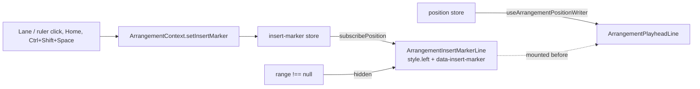

# SABA-B-10b — ხილული, მოციმციმე Insert Marker და transport-ის ხაზები shortcut sheet-ში

**თარიღი:** 2026-10-29
**სტატუსი:** Completed (C round 254 PASS)
**შეცვლილი პროექტი:** Store

## კონტექსტი

SABA-B-10a-მ (doc 191) Studio-ს ცალკე **Insert Marker** მისცა: Space მისგან უკრავს, Shift+Space
stop point-იდან აგრძელებს, Ctrl/Cmd+Shift+Space marker-ს playhead-თან გადაიტანს. მაგრამ marker
ეკრანზე არ ჩანდა. DOM-ში იყო მხოლოდ დამალული, ტესტებისთვის განკუთვნილი
`ArrangementInsertMarkerSignal` (`hidden`, 0×0). ამიტომ playback-ის დროს timeline-ზე click-ს
(Saba-ს გადაწყვეტილება 1: playback გრძელდება, მხოლოდ marker გადადის) ეკრანზე სხვა შედეგი არ
ჰქონდა, გარდა status line-ისა (INFO-B249-STALE-MARKER-STATUS).

Ableton Live 12 Reference Manual 6.3: "The flashing blue insert marker on a track determines where
playback starts." 6.9: "Clicking into the Arrangement background selects a point in time,
represented by a flashing insert marker."

shortcut sheet-ში (`?`) Shift+Space-ისა და Ctrl/Cmd+Shift+Space-ის ხაზები არ იყო (GATE249-S7),
`Play / Stop` და `Back to start` კი marker-ის მოდელს არ ასახელებდა. `marker` (M) ხაზი მხოლოდ
insert marker-ს ასახელებდა, მაშინ როცა `addTitle` სამ შემთხვევას ჩამოთვლის
(A-R250-REVIEW-SHEET-MARKER-COPY).

## მიდგომა

- **ხაზი playhead-ის მსგავსად იხატება.** `ArrangementInsertMarkerLine`: 1 px სიგანის
  ვერტიკალური ხაზი (`w-px bg-foreground`, ღია ink), `pointer-events-none`, `aria-hidden`, z-10.
  ის იმავე container-შია და იმავე `top-0 bottom-0`-ით, როგორც playhead. render მხოლოდ საწყის
  `left`-სა და `data-insert-marker`-ს წერს. ყოველ შემდეგ ცვლილებას insert-marker store-ის
  `subscribePosition` წერს პირდაპირ DOM-ში, React render-ის გარეშე. subscription
  `useIsomorphicLayoutEffect`-შია, ისევე როგორც playhead-ის writer, ამიტომ zoom-ის შემდეგ ახალი
  მასშტაბი paint-მდე მოქმედებს. `ArrangementContext.tsx` არ შეცვლილა.
- **ფერი: ink და არა brass.** reduced motion-ში brass marker და brass playhead მხოლოდ 1 px სიგანით
  განსხვავდებოდა. ink სხვა ფერის როლია. ხაზი playhead-ზე **ადრე** mount-დება, ამიტომ, სადაც
  ერთმანეთს ემთხვევა, brass playhead მის ზემოთ იხატება.
- **ციმციმი მხოლოდ `motion-safe:`-ით.** `--animate-insert-marker-blink` (`@theme`-ში) და
  `@keyframes insert-marker-blink` (`@theme`-ის გარეთ, `/* Keyframes */`-ის ქვეშ): 1.2 s,
  `step-end`, opacity 1 ↔ 0.25. ეს წამში დაახლოებით 0.83 flash-ია (1.67 opacity-ის ცვლილება),
  WCAG 2.3.1-ის ზღვარზე (3 flash/s) ნაკლები. `prefers-reduced-motion: reduce`-ისას ხაზი სტატიკურია, opacity 1.
- **დამალულია, სანამ time selection არსებობს** (`hidden={range !== null}`). Space ამ დროს
  selection-ის დასაწყისიდან უკრავს, ამიტომ ძველ marker-ზე ხილული ხაზი არასწორ საწყის წერტილს
  აჩვენებდა. `data-insert-marker` ამ დროსაც ახლდება.
- **Sheet:** transport ჯგუფის თანმიმდევრობა: `play-stop`, `continue-playback` (ახალი),
  `insert-marker-to-playhead` (ახალი), `back-to-start`, `play-from-point`, `loop`. ახალი ტექსტი
  მხოლოდ `shortcuts.ts`-შია. ღილაკების title-ები `keys[0]`-იდან იგება, ამიტომ `Play (Space)`,
  `Pause (Space)` და `Back to start (Home)` არ შეცვლილა. არც ერთ control-ს ახალი
  `aria-keyshortcuts` არ მიუღია.
- **უარყოფილი ალტერნატივები:** brass ხაზი (ზემოთ ნახსენები მიზეზით); ცალკე
  `useArrangementInsertMarkerWriter` hook context-ში (ის frozen `ArrangementContext.tsx`-ის
  ცვლილებას მოითხოვდა და არქიტექტურის საკითხად რჩება); marker-ის მხოლოდ status-ში ჩვენება
  (INFO-B249-STALE-MARKER-STATUS-ის ბაგის კლასი).
- **Saba-ს კითხვა** (SABA-Q-10B-MARKER-LOOK, `awaiting_user`): ink და არა ლურჯი; მთელი სიმაღლე და
  არა ერთი track; ხილულია playback-ის დროსაც; დამალულია time selection-ისას.

## არქიტექტურა

## შეცვლილი ფაილები

- `app/components/arrangement/StudioWorkspace.tsx`: `ArrangementInsertMarkerSignal` →
  `ArrangementInsertMarkerLine` (ხილული ხაზი) და მისი mount playhead-ის წინ.
- `app/styles/app.css`: ერთი `--animate-insert-marker-blink` token `@theme`-ში და ერთი
  `@keyframes insert-marker-blink` ბლოკი `@theme`-ის გარეთ.
- `app/lib/arrangement/shortcuts.ts`: transport-ის ორი ახალი ხაზი, `play-stop`-ის,
  `back-to-start`-ისა და `marker`-ის ახალი ტექსტი.
- `app/lib/arrangement/__tests__/shortcuts.test.ts`: SC1 (row order) და SC5 (ორი ახალი aria string; `ariaKeyShortcuts`-იანი ხაზების რაოდენობა 9 → 11).
- `app/lib/arrangement/__tests__/shortcut-sheet-ui.test.tsx`: SS-T1 და SS-T2.
- `app/lib/arrangement/__tests__/insert-marker-ui.test.tsx`: IMV1–IMV5.
- `app/lib/arrangement/__tests__/render-budget.test.tsx`: RB-IM და `{ timeout: 15_000 }` options-ის
  ფორმა Play → Pause → Play ტესტზე.
- `docs/implementation/2026/quarter-IV/192-saba-b-10b-visible-insert-marker.md`: ეს დოკუმენტი.

## პრობლემები და გადაწყვეტები

- **პრობლემა:** `@keyframes` `@theme`-ის შიგნით `store-theme-tokens.test.ts`-ის ST2–ST4-ს წითლად
  აქცევს (parser `@theme`-ში `{`-ს არ იღებს). **გადაწყვეტა:** keyframes `@theme`-ის გარეთაა,
  `/* Keyframes */` კომენტარის ქვეშ.
- **პრობლემა:** render-time `style.left`-ი mutation-ს მალავდა. ruler click-ი, Home და zoom
  context-ს ცვლის, parent ხელახლა render-დება და React სწორ `left`-ს ისევ წერს. ამიტომ
  subscription-ის ჩანაწერის წაშლა (MU-LEFT-FROZEN) და `pxPerSecond`-ის deps-იდან ამოღება
  (MU-NO-PPS-DEP) პირველ ვერსიაში მწვანე რჩებოდა. **გადაწყვეტა:** IMV1, IMV2 და IMV5 insert-marker
  store-ში პირდაპირ წერს, context-ის ცვლილების გარეშე, და ამოწმებს, რომ ხაზი მხოლოდ subscription-ით
  გადაადგილდა. ახლა ორივე mutant წითელია.
- **პრობლემა:** B-ის ამოცანა (D-29z471, round 253-ის A STOP-ის მიხედვით) ამბობდა, რომ render-budget-ის
  Play → Pause → Play ტესტს საკუთარი timeout არ ჰქონდა. HEAD-ზე მას უკვე ჰქონდა positional
  `15000` (vitest 4 ამ overload-ს იღებს). **გადაწყვეტა:** იგივე 15 s ჩაიწერა `{ timeout: 15_000 }`
  options-ის ფორმით (მეორე არგუმენტად). assertion-ები არ შეცვლილა: `git diff -w`-ში მხოლოდ
  RB-IM-ის დამატება და ხელმოწერის ხაზია. A-მ ეს B-ს გადასცა (L29).

## ტესტირება

- **Unit / UI:** SC1, SC5, SS-T1, SS-T2, IMV1–IMV5, RB-IM. IMV1 ამოწმებს, რომ ხაზი DOM-ში
  playhead-ზე ადრეა (z-order). IMV3 ამოწმებს, რომ `data-insert-marker` დამალულ ხაზზეც ახლდება.
  Mutant-ები (MU-SHEET-NO-ROWS, MU-ARIA-NO-META, MU-COPY-OLD, MU-HIDDEN-SIGNAL, MU-LEFT-FROZEN,
  MU-NO-HIDE, MU-NO-PPS-DEP, MU-REMOUNT, MU-ZORDER) თავის ხაზზე წითელია, FIX-CONTROL კი მწვანე.
- **Browser (Playwright, `/studio-lab`, 1440×900 და 1280×720, `no-preference` და `reduce`):**
  - ერთი ხაზი, 1 px, `rgb(236, 230, 218)`, playhead-ის სიმაღლე (408 / 392 px);
  - `animation-name`: `insert-marker-blink` (`no-preference`) და `none` (`reduce`);
  - opacity 6 sample-ზე 1, შემდეგ 6 sample-ზე 0.25 (1.2 s ციკლი);
  - click ხაზში გადის lane-მდე;
  - stop-ის შემდეგ ორივე ხაზი ჩანს და ერთმანეთს 145 px აშორებს;
  - შემდეგი Space 00:02.06x-დან იწყება;
  - Home: ერთი mutation, `0.000`;
  - selection-ისას ხაზი `hidden`-ია, empty-lane click-ის შემდეგ ისევ ჩანს;
  - zoom-ისა და scroll-ისას ruler-ის `0:02`-ს მიჰყვება.
- **Contrast** (ink, ხაზის ქვეშ მდებარე გაუმჭვირვალე ფონთან):
  - ruler / marker strip: 14.78:1;
  - video dropzone: 15.62:1;
  - SFX lane (+5 % brass): ≈14.7:1;
  - არამონიშნული clip-ის body (`bg-elevated`): 13.94:1;
  - მონიშნული clip-ის brass title bar: 1.88:1 (INFO-B254-INK-ON-BRASS, ჩაწერილია და row არ არის).

## TODO / შემდეგი ნაბიჯები

- **SABA-B-9:** Stop ღილაკი double-click-ით ("double-click Stop" marker-ს დასაწყისში აბრუნებს, Live
  6.3). `back-to-start`-ის ტექსტში ეს მხოლოდ მაშინ დაემატება.
- **SABA-Q-10B-MARKER-LOOK:** Saba-ს პასუხი ფერზე, სიმაღლეზე და ხილვადობაზე.
- **C-R253-01** (deferred Low) დამოკიდებულია ARCH-CHECKPOINT-TRANSPORT-POSITIONS-ზე (exported pure
  resolver).
