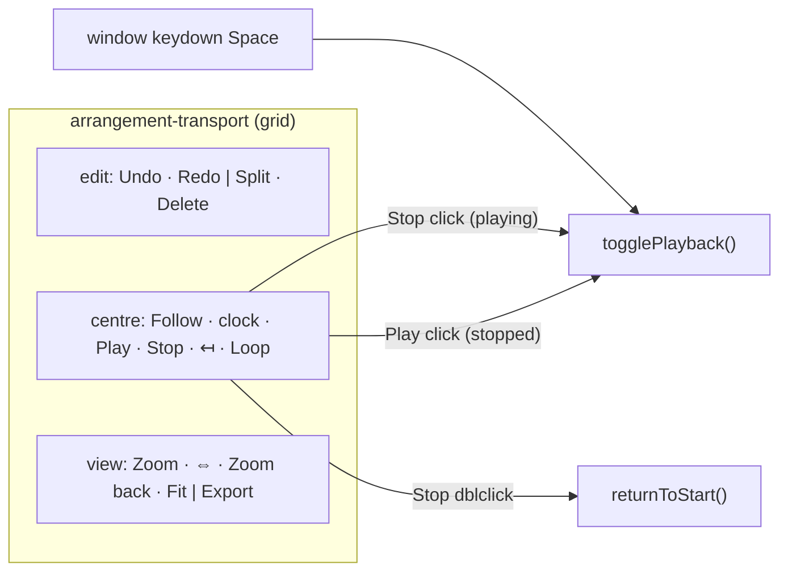

# SABA-B-9 ეტაპი 1 — ცენტრალური transport ჯგუფი, Stop ღილაკი და Play-ის მუდმივი სახელი

**თარიღი:** 2026-10-29
**სტატუსი:** In Progress (stage 1 of 2; C round 256 PASS)
**შეცვლილი პროექტი:** Store

## კონტექსტი

Studio-ს toolbar-ში transport მარცხენა კიდეზე იყო. Play x 12-ზე იდგა, ცალკე Stop ღილაკი
არ არსებობდა და Play დაკვრისას "Pause"-ად იქცეოდა. ამიტომ playback-ის შესაჩერებელი ერთადერთი
ღილაკი თავის სახელს ცვლიდა (B-R249-PAUSE-LABEL). Saba-ს გადაწყვეტილება 4 (SABA-B-9) ითხოვს
ცენტრალურ ჯგუფს: Follow · საათი · Play · Stop · Back to start · Loop. ის ასევე ითხოვს
master volume-ის გადატანას workspace-ის ქვედა მარჯვენა კუთხეში.

Ableton Live 12 Reference Manual, 6.3 "Transport and Playback": "You can click the Play button
to start playback; to stop playback, click the Stop button." იგივე სექცია: "To return the insert
marker to the starting play position, you can double-click the Stop button or press the Home key."
"Live Concepts > The Control Bar" სექციების თანმიმდევრობას ასახელებს (Follow and Arrangement
Position → Transport Controls → …), მაგრამ გეომეტრიაზე არაფერს ამბობს.

სამუშაო ორ ეტაპად გაიყო (D-29z482). ეს დოკუმენტი **ეტაპი 1**-ია: toolbar, Stop და Play.
master-ის გადატანა (ეტაპი 2) header-ის 35 px-სა და მის ქვემოთ ყველა y-ს ცვლის, ამიტომ ცალკე
რაუნდში კეთდება.

## მიდგომა

- **სამი ჯგუფი, DOM-ის ფიქსირებული რიგით.** `arrangement-transport-edit` (Undo, Redo, Split,
  Delete), `arrangement-transport-centre` (Follow, პოზიციის საათი `/ end`-ით, Play, Stop,
  Back to start, Loop) და `arrangement-transport-view` (Zoom label/slider/readout, Zoom to
  selection, Zoom back, Fit, Export). DOM-ის რიგი ყველა სიგანეზე edit → centre → view-ია.
  CSS `order` ან breakpoint-ზე DOM-ის გადაწყობა არ გამოიყენება: Tab-ის რიგი DOM-ს მიჰყვება და
  resize-ზე remount არ ხდება.
- **Grid-ი ორი რეჟიმით.** `min-[1408px]:`-დან ერთი მწკრივია `grid-cols-[1fr_auto_1fr]`-ით,
  ცენტრალური ჯგუფი გეომეტრიულად ცენტრშია. ამაზე ვიწრო ეკრანზე `grid-template-areas`
  ('centre centre' / 'edit view') იყენებს ორ მწკრივს: პირველში მხოლოდ transport-ია ცენტრში,
  მეორეში edit მარცხნივ და view მარჯვნივ. Breakpoint გაზომვით არის არჩეული. Chromium-ში
  ერთი მწკრივის ბუნებრივი სიგანეა 2 × 432.2 + 487 + 2 × 12 + 24 = **1,399.4 px**.
  `min-[1400px]` მხოლოდ 0.6 px-ის მარაგს ტოვებდა, ამიტომ არჩეულია 1,408 (≈ 8.6 px მარაგი).
- **Play მუდმივია.** `aria-label` ყოველთვის `Play`-ია, `title` — `Play (Space)`,
  `aria-keyshortcuts` — `Space`, glyph კი ყოველთვის lucide `Play`. გაჩერებულ მდგომარეობაში
  click იწყებს დაკვრას `togglePlayback()`-ით (time selection-ის დასაწყისიდან ან insert
  marker-იდან, 10a). დაკვრისას click არაფერს აკეთებს: არც stop, არც restart, არც status და
  არც history. `data-playing="true|false"` ტესტებისა და C-სთვისაა, class selector არ არის.
- **დაკვრის მდგომარეობა.** გაჩერებული Play არის `bg-foreground`, დაკვრისას კი `bg-brand`
  (brass). glyph ორივეში `text-background`-ია. ფორმა (32 px წრე) და პოზიცია არ იცვლება.
  `bg-foreground/20` ("on" fill) არ ავირჩიეთ: ის glyph-ის კონტრასტს 3:1-ზე ქვემოთ დაწევდა და
  მყარ stopped fill-ზე სუსტად გამოიყურებოდა.
- **Stop.** lucide `Square` (`size-3`, `aria-hidden`), toolbar-ის კვადრატული 32 px ფორმა.
  ტექსტი არ აქვს, ამიტომ ეკრანზე მუდმივ ტექსტს არ ამატებს. ერთი click აჩერებს მხოლოდ
  დაკვრისას. გაჩერებულ მდგომარეობაში ერთი click არაფერს ცვლის. `onDoubleClick` →
  `returnToStart()` (marker 0, playhead 0, history-ის გარეშე). Stop არასდროს არის `disabled`.
  დაკვრისას მოვლენების რიგია `click` (stop), `click` (no-op), `dblclick` (0-ზე დაბრუნება),
  ამიტომ საბოლოო მდგომარეობა გაჩერებულია 0-ზე.
- **კლავიატურა.** Play-სა და Stop-ზე `preventRepeatedEnterKeyDown` დამატებით Enter-ის
  auto-repeat-ს ბლოკავს. Space-ს workspace-ის window handler ამუშავებს keydown-ზე და
  `repeat`-ს უგულებელყოფს, keyup-ის `preventDefault` კი native click-ს აჩერებს. კომპონენტს
  საკუთარი Space handler არ სჭირდება.
- **Strings და sheet.** `studioPlaybackStrings`-დან `pauseLabel`/`pauseTitle` წაიშალა და
  დაემატა `stopLabel: 'Stop'` და `stopTitle` (`'Stop (Space)'`, shortcut-ის წყაროდან).
  `back-to-start` ხაზის keys გახდა `['Home', 'Double-click Stop']`. ეს Live-ზე უკეთესია:
  Live-ში ეს ჟესტი მხოლოდ manual-შია ნახსენები.

**განხილული ალტერნატივები:** ერთი მწკრივი 1280-ზე მოითხოვდა დაახლოებით 96 px ტექსტის მოხსნას
(Undo/Redo label-ები ან Zoom-ის სიტყვა და readout tooltip-ში). CALM-ის წესი "transport-ის
ტექსტური ღილაკები რჩება" ამას კრძალავს, ამიტომ ეს Saba-ს კითხვაა (SABA-Q-9-TRANSPORT (c)).

## არქიტექტურა



```
≥ 1408 px:  [ edit ············ ][ centre ][ ············ view ]   49 px
< 1408 px:  [ ············ centre ············ ]                     87 px
            [ edit ·························· view ]
```

## შეცვლილი ფაილები

- `app/components/arrangement/ArrangementTransport.tsx` — სამი ჯგუფი, Stop, Play-ის კონტრაქტი, `data-testid`-ები
- `app/lib/arrangement/strings.ts` — `stopLabel`/`stopTitle`, `pauseLabel`/`pauseTitle` წაიშალა
- `app/lib/arrangement/shortcuts.ts` — `back-to-start`: `['Home', 'Double-click Stop']`
- `app/lib/arrangement/__tests__/transport-centre-ui.test.tsx` — ახალი, TC1–TC9
- ტესტების კოლიზიები C1–C9: `transport-surface-ui`, `render-budget`, `master-ui`,
  `bars-ruler-ui`, `strings`, `grid-snap-ui`, `mode-toggle-colour-ui`, `navigation-strings-ui`,
  `shortcut-sheet-ui`

## პრობლემები და გადაწყვეტები

- **პრობლემა:** ტესტების ნაწილი toolbar-ს `flex-wrap` class-ით ან Play-ის `parentElement`-ით
  პოულობდა. ახლა Play ცენტრალურ ჯგუფშია და ეს ძებნა მხოლოდ ერთ ჯგუფს ხედავდა.
  **გადაწყვეტა:** ძებნა გადავიდა `data-testid="arrangement-transport"`-ზე (TS, GS14, DXT2, NS).
  ყველა არსებული assertion შენარჩუნებულია, ხოლო ინდექსები ახალ DOM-ის რიგზეა გადაწყობილი.
- **პრობლემა:** `bars-ruler-ui`-ის helper-ი Pause-ის სახელით კითხულობდა დაკვრის მდგომარეობას.
  key-ის წაშლის შემდეგ `name: undefined` ყველა ღილაკს ემთხვეოდა.
  **გადაწყვეტა:** helper-ი Play-ის `data-playing`-ს კითხულობს.
- **პრობლემა:** Chromium-ი computed ფერებს `oklab()`-ით აბრუნებს, ამიტომ პირველი კონტრასტის
  გაზომვა არასწორი იყო. **გადაწყვეტა:** ფერი canvas-ით გადაიყვანება sRGB-ში და alpha
  toolbar-ის ფონზე კომპოზიტდება.
- **პრობლემა:** 1,351–1,407 px შუალედში toolbar ახლა ორ მწკრივიანია (87 px), HEAD-ში კი 1,351
  px-მდე ერთი მწკრივი იყო (49 px). **გადაწყვეტა:** ეს ცენტრის გადაწყვეტილებისა და CALM-ის
  წესის შედეგია (D-29z483) და SABA-Q-9-TRANSPORT (c)-შია. 1440-სა და 1280-ზე სიმაღლეები HEAD-ს
  ემთხვევა.

## ტესტირება

- `transport-centre-ui.test.tsx`: TC1 (ჯგუფები და DOM-ის რიგი), TC2 (Play მხოლოდ გაჩერებისას
  იწყებს და დაკვრისას no-op-ია), TC3 (Stop აჩერებს, marker რჩება), TC4 (Stop გაჩერებისას
  no-op-ია), TC5 (double-click გაჩერებულზე და დაკვრისას → 0, restart-ის გარეშე), TC6
  (სახელები, title-ები, Pause არ არსებობს), TC7 (Space ფოკუსირებულ Play/Stop-ზე, repeat),
  TC8 (Enter და held Enter), TC9 (ფოკუსი Stop-ზე რჩება, Undo → Redo handoff).
- `render-budget`-სა და `master-ui`-ში Stop-ის click-ებს გარშემო დაემატა Play-ის `data-playing`-ის შემოწმება (click-მდე `true`, შემდეგ `false`). ეს ანაცვლებს HEAD-ის ფარულ შემოწმებას, რომელსაც `name: 'Pause'` ასრულებდა. მუტანტი, რომელშიც Stop არაფერს აკეთებს, ექვს ტესტს აწითლებს.
- მუტანტები M1–M5 გაწითლდა: M1 → TC2, M2 → TC5, M3 → TC4/TC5/TC9, M4 → TC6, M5 → TC1.
- `transport-surface-ui`-ის TS1, TS2 და TS6 მოიცავს 13 ღილაკს, Play-ის ორ მდგომარეობას და
  Stop-ის glyph-ს.
- Chromium (`/studio-lab`): 1440 → 49 px, 1 მწკრივი; 1280 → 87 px, 2 მწკრივი; 1366/1400/1407 → 87;
  1408 → 49. ცენტრის გადახრა 0 px-ია, overflow და გადაფარვა არ არის, საათი ერთ ხაზზეა.
  კონტრასტი: Play-ის glyph გაჩერებისას 15.62:1, დაკვრისას 8.32:1 (hover 7.24:1), Stop-ის
  glyph 13.24:1.

## TODO / შემდეგი ნაბიჯები

- SABA-B-9 ეტაპი 2: master volume workspace-ის ქვედა მარჯვენა კუთხეში.
- SABA-Q-9-TRANSPORT: (a) Play დაკვრისას, (b) Stop-ის ერთი click გაჩერებისას, (c) 1280-ის
  განლაგება და 1,351–1,407 px-ის ფანჯარა, (d) Play-ის დაკვრის მდგომარეობის ფერი. პასუხამდე
  მოქმედებს არჩეული ნაგულისხმევი მნიშვნელობები.
